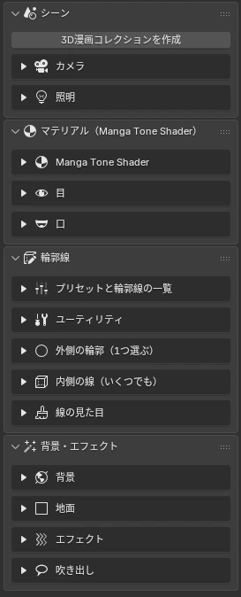

# <i class="bi bi-download"></i> Installation

<figure class="ms-shot" markdown>

<figcaption>The "3D Manga Studios" tab in the Sidebar</figcaption>
</figure>

<ol class="ms-steps" markdown>
<li markdown>
**Install the add-on zip**

Go to Edit › Preferences › Add-ons › ⌄ (top right) › "Install from Disk" and choose `00_3D_Manga_Studios_1.2.0.beta.zip`. Don't unzip it.
</li>
<li markdown>
**Enable it**

Check "3D Manga Studios" in the list. It isn't activated yet, so the Sidebar panels don't appear at this point.
</li>
<li markdown>
**Activate your license**

Request a license in the add-on's settings, paste the key you receive by email, and click "Activate". See [License Activation](license.md) for details.
</li>
<li markdown>
**Register the assets**

Put the bundled "3D Manga Studios Assets EN" (the Japanese version is JP) anywhere you like, and add it under Preferences › File Paths › Asset Libraries. Register each of the three folders inside, "Manga Tone Shader", "Manga Tone Flat" and "Manga Tone Shaded", as an asset library with the same name. The screentone, eye, mouth, background, effect and speech balloon assets are loaded from here.
</li>
<li markdown>
**Set the render engine to EEVEE**

The shaders and effects are made for EEVEE.
</li>
<li markdown>
**Open the Sidebar**

Press ++n++ in the 3D Viewport, open the "3D Manga Studios" tab, and click "Create 3D Manga Collection".
</li>
</ol>

