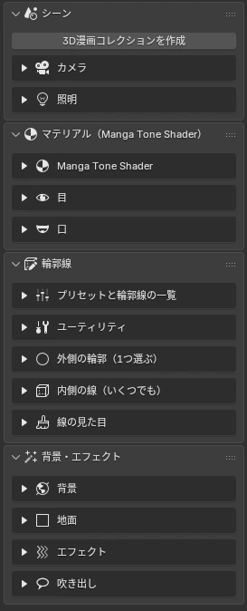

# <i class="bi bi-download"></i> インストール

<figure class="ms-shot" markdown>

<figcaption>サイドバーの「3D Manga Studios」タブ</figcaption>
</figure>

<ol class="ms-steps" markdown>
<li markdown>
**アドオンの zip を入れる**

`00_3D_Manga_Studios_1.2.0.beta.zip` を、編集 › プリファレンス › アドオン › 右上の ⌄ › 「ディスクからインストール」で選びます。zip は展開しません。
</li>
<li markdown>
**有効にする**

一覧の「3D Manga Studios」にチェックを入れます。この時点ではまだ未認証なので、サイドバーのパネルは表示されません。
</li>
<li markdown>
**ライセンスを認証する**

アドオンの設定欄でライセンスを申請し、メールで届いたキーを入れて「認証する」を押します。詳しくは [ライセンス認証](license.md) をご覧ください。
</li>
<li markdown>
**アセットを登録する**

同梱の「3D Manga Studios Assets JP」（英語版は EN）を任意の場所に置き、プリファレンス › ファイルパス › アセットライブラリに追加します。中の「Manga Tone Shader」「Manga Tone Flat」「Manga Tone Shaded」の3つのフォルダを、それぞれ同じ名前でアセットライブラリに登録します。トーン素材・目・口・背景・エフェクト・吹き出しのアセットがここから読み込まれます。
</li>
<li markdown>
**レンダーエンジンを EEVEE に**

シェーダーとエフェクトは EEVEE 用に作っています。
</li>
<li markdown>
**サイドバーを開く**

3D ビューで ++n++ を押し、「3D Manga Studios」タブから「3D漫画コレクションを作成」を押します。
</li>
</ol>

