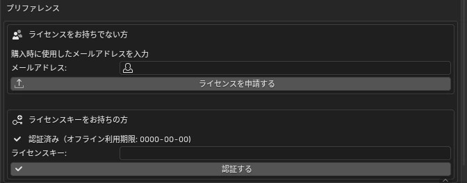

# <i class="bi bi-key-fill"></i> License Activation NEW {data-toc-label="License Activation"}

3D Manga Studios works once you activate it with a license key. Until then, its Sidebar panels and menus don't appear. Getting from request to activation takes four steps.

1<b>Install</b>Install and enable the add-on. At this point it is "Not activated".

2<b>Request a license</b>Enter the email address you used to purchase in the settings and send the request. Subject: [3D Manga Studios] License request received

3<b>Get the key by email</b>Once the administrator approves your request, the key is sent to you (usually within a few hours). Subject: [3D Manga Studios] Your license key has been issued

4<b>Enter the key and activate</b>Paste the key and click "Activate". The panels appear.

## <i class="bi bi-arrow-left-right"></i> How It Works

Flow
<svg viewBox="0 0 680 300" role="img" aria-label="Request and activation flow between Blender, the license server and the administrator" style="min-width:600px;width:100%;height:auto;font-family:var(--md-text-font)">
<defs><marker id="ar" viewBox="0 0 10 10" refX="9" refY="5" markerWidth="8" markerHeight="8" orient="auto"><path d="M0 0 L10 5 L0 10 Z" fill="currentColor"/></marker></defs>
<g fill="currentColor" font-size="13">
<text x="90" y="24" text-anchor="middle" font-weight="700" font-size="14">User (Blender)</text><text x="340" y="24" text-anchor="middle" font-weight="700" font-size="14">License server</text><text x="590" y="24" text-anchor="middle" font-weight="700" font-size="14">Administrator</text>
<g stroke="currentColor" stroke-dasharray="4 5" opacity=".5"><line x1="90" y1="36" x2="90" y2="290"/><line x1="340" y1="36" x2="340" y2="290"/><line x1="590" y1="36" x2="590" y2="290"/></g>
<g stroke="currentColor" stroke-width="2" fill="none" marker-end="url(#ar)">
<line x1="92" y1="62" x2="336" y2="62"/><line x1="338" y1="92" x2="94" y2="92"/><line x1="342" y1="122" x2="586" y2="122"/><line x1="588" y1="154" x2="344" y2="154"/><line x1="338" y1="186" x2="94" y2="186"/><line x1="92" y1="222" x2="336" y2="222"/><line x1="338" y1="256" x2="94" y2="256"/></g>
<text x="214" y="54" text-anchor="middle">① Request (email address)</text><text x="214" y="86" text-anchor="middle">Confirmation email</text><text x="464" y="114" text-anchor="middle">Request notice</text><text x="464" y="146" text-anchor="middle">② Approve</text><text x="214" y="178" text-anchor="middle">License key email</text><text x="214" y="214" text-anchor="middle">③ Enter key, click "Activate"</text><text x="214" y="250" text-anchor="middle">Activated</text>
<text x="90" y="284" text-anchor="middle" font-weight="700" fill="var(--ms-guide-ink)">Panels enabled</text>
</g></svg>

## <i class="bi bi-gear-fill"></i> In the Add-on Settings

<figure class="ms-shot" markdown>

<figcaption>Edit › Preferences › Add-ons › 3D Manga Studios</figcaption>
</figure>

1. **Open the settings** — In Edit › Preferences › Add-ons, expand "3D Manga Studios".
2. **Send a request** — Under "Don't have a license?", enter your email address and click "Request License". Check the address in the confirmation dialog and click OK.
3. **Activate** — Paste the key you received (16 characters, `XXXX-XXXX-XXXX-XXXX`) into "License Key" and click "Activate". When it shows "Activated (offline use until: YYYY-MM-DD)", you're done.

- If a request from the same email address is already waiting for approval, no new request is made; it is treated as "Already received".
- If a valid license has already been issued to that address, you can't request another. Use the key in the email you already have.
- If your request isn't approved, we'll tell you why in an email with the subject "[3D Manga Studios] About your license request".

## <i class="bi bi-shield-check"></i> After Activation

One time only

Your activation is saved on your PC and turns on automatically at startup from then on. You don't need an internet connection every time.

30<small> days</small>

After a set time since the last check (30 days by default), the add-on re-checks in the background without interrupting your work.

Offline period

Even if you are offline at the re-check, you can keep using it until the "offline use until" date shown. After that date, activate again while online.

2<small> PCs</small>

By default, one key can activate 2 PCs. Re-activating on the same PC doesn't count. The same key keeps working after you update the add-on.

## <i class="bi bi-exclamation-triangle-fill"></i> Error Messages and Fixes

| Message | Cause | Fix |
|---|---|---|
| The license key is invalid. | Typo in the key, or the key doesn't exist | Copy the key from the email again. Also check for extra spaces before or after it. |
| This license key is for a different add-on. | You entered a key for another add-on | Enter your key for 3D Manga Studios. |
| The activation limit has been reached. | You've activated the maximum number of PCs | Contact the administrator and ask them to free up or add an activation. |
| The license has expired. | A time-limited license has expired | Contact the administrator. |
| The license has been revoked. | The administrator revoked the license | Contact the administrator. |
| This version is no longer supported. Please download the latest version. | Distribution of an old version has ended | Download the latest version and reinstall. |
| Cannot connect to the license server. | No internet connection, server down, or a firewall | Check your internet connection and try again. You can keep using the add-on until the offline use date. |
| The request failed because the add-on's key has been updated… | The key built into the add-on is outdated | Download the latest version and reinstall. |
| This add-on is not accepting license requests right now. | Requests are paused | Contact the administrator. |

!!! shout "Caution"
    If the license is found to be revoked, expired, for a different add-on, over the PC limit, or for a discontinued version, the activation saved on your PC is deleted and the panels no longer appear.
