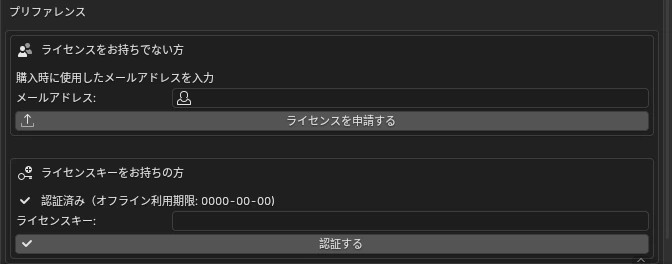

# <i class="bi bi-key-fill"></i> ライセンス認証 NEW {data-toc-label="ライセンス認証"}

3D Manga Studios は、ライセンスキーで認証すると使えるようになります。未認証のあいだは、サイドバーのパネルやメニューは表示されません。申請から認証までは次の4ステップです。

1<b>インストール</b>アドオンを入れて有効にします。この時点では「未認証」です。

2<b>ライセンスを申請</b>設定欄に購入時のメールアドレスを入れて申請します。 件名：【3D Manga Studios】ライセンス申請を受け付けました

3<b>キーがメールで届く</b>管理者が申請を承認すると、キーが届きます（通常数時間以内）。 件名：【3D Manga Studios】ライセンスキーの発行のお知らせ

4<b>キーを入れて認証</b>キーを貼り付けて「認証する」を押すと、パネルが表示されます。

## <i class="bi bi-arrow-left-right"></i> やりとりの流れ

流れ
<svg viewBox="0 0 680 300" role="img" aria-label="Blender、ライセンスサーバー、管理者のあいだの申請と認証の流れ" style="min-width:600px;width:100%;height:auto;font-family:var(--md-text-font)">
<defs><marker id="ar" viewBox="0 0 10 10" refX="9" refY="5" markerWidth="8" markerHeight="8" orient="auto"><path d="M0 0 L10 5 L0 10 Z" fill="currentColor"/></marker></defs>
<g fill="currentColor" font-size="13">
<text x="90" y="24" text-anchor="middle" font-weight="700" font-size="14">ユーザー（Blender）</text><text x="340" y="24" text-anchor="middle" font-weight="700" font-size="14">ライセンスサーバー</text><text x="590" y="24" text-anchor="middle" font-weight="700" font-size="14">管理者</text>
<g stroke="currentColor" stroke-dasharray="4 5" opacity=".5"><line x1="90" y1="36" x2="90" y2="290"/><line x1="340" y1="36" x2="340" y2="290"/><line x1="590" y1="36" x2="590" y2="290"/></g>
<g stroke="currentColor" stroke-width="2" fill="none" marker-end="url(#ar)">
<line x1="92" y1="62" x2="336" y2="62"/><line x1="338" y1="92" x2="94" y2="92"/><line x1="342" y1="122" x2="586" y2="122"/><line x1="588" y1="154" x2="344" y2="154"/><line x1="338" y1="186" x2="94" y2="186"/><line x1="92" y1="222" x2="336" y2="222"/><line x1="338" y1="256" x2="94" y2="256"/></g>
<text x="214" y="54" text-anchor="middle">① 申請（メールアドレス）</text><text x="214" y="86" text-anchor="middle">受付メール</text><text x="464" y="114" text-anchor="middle">申請の通知</text><text x="464" y="146" text-anchor="middle">② 承認</text><text x="214" y="178" text-anchor="middle">ライセンスキーのメール</text><text x="214" y="214" text-anchor="middle">③ キーを入れて「認証する」</text><text x="214" y="250" text-anchor="middle">認証OK</text>
<text x="90" y="284" text-anchor="middle" font-weight="700" fill="var(--ms-guide-ink)">パネルが有効に</text>
</g></svg>

## <i class="bi bi-gear-fill"></i> 設定欄での操作

<figure class="ms-shot" markdown>

<figcaption>編集 › プリファレンス › アドオン › 3D Manga Studios</figcaption>
</figure>

1. **設定欄を開く** — 編集 › プリファレンス › アドオン で「3D Manga Studios」を展開します。
2. **申請する** — 「ライセンスをお持ちでない方」にメールアドレスを入れ、「ライセンスを申請する」。確認ダイアログで宛先を確かめて OK します。
3. **認証する** — 届いたキー（`XXXX-XXXX-XXXX-XXXX` の 16 桁）を「ライセンスキー」に貼り付けて「認証する」。「認証済み（オフライン利用期限: YYYY-MM-DD）」と出れば完了です。

- 同じメールアドレスで承認待ちの申請がある場合は、新しく申請されず「受付済み」として扱われます。
- そのアドレスで有効なライセンスがすでに発行されている場合は申請できません。お手元のメールにあるキーをお使いください。
- 承認されなかった場合は、件名「【3D Manga Studios】ライセンス申請について」のメールで理由をお知らせします。

## <i class="bi bi-shield-check"></i> 認証したあと

毎回は不要

認証情報は PC に保存され、次からは起動時に自動で有効になります。ネット接続は毎回いりません。

30<small>日ごと</small>

前回の認証から一定期間（既定 30 日）たつと、操作を止めずに裏で再確認します。

オフライン期限

再確認のときにオフラインでも、表示の「オフライン利用期限」までは使えます。過ぎた場合は、オンラインで認証し直してください。

2<small>台まで</small>

1つのキーで認証できる PC は既定で 2 台です。同じ PC での再認証は数えません。アドオンを更新しても同じキーで使えます。

## <i class="bi bi-exclamation-triangle-fill"></i> エラーメッセージと対処

| 表示されるメッセージ | 原因 | 対処 |
|---|---|---|
| ライセンスキーが無効です。 | キーの入力ミス、存在しないキー | メールからキーをコピーし直してください。前後に空白が入っていないかもご確認ください。 |
| このライセンスキーは別のアドオン用です。 | ほかのアドオンのキーを入れた | 3D Manga Studios 用のキーを入力してください。 |
| アクティベーション上限に達しています。 | 認証した PC の台数が上限 | 管理者にご連絡のうえ、認証台数の解除または追加をご依頼ください。 |
| ライセンスの有効期限が切れています。 | 期限付きライセンスの期限切れ | 管理者にご連絡ください。 |
| ライセンスが失効しています。 | 管理者がライセンスを失効させた | 管理者にご連絡ください。 |
| このバージョンは提供を終了しました。最新版をダウンロードしてください。 | 古いバージョンの配布を終了 | 最新版をダウンロードして、インストールし直してください。 |
| 認証サーバーに接続できません。 | ネット未接続、サーバー停止、ファイアウォール | インターネットの接続を確かめて、もう一度お試しください。オフライン利用期限内であれば、そのままお使いいただけます。 |
| 申請できませんでした。アドオンのキーが更新されたため… | アドオンに入っているキーが古い | 最新版をダウンロードして、インストールし直してください。 |
| このアドオンは現在ライセンスの申請を受け付けていません。 | 申請の受付を停止中 | 管理者にお問い合わせください。 |

!!! shout "注意"
    失効・期限切れ・別アドオンのキー・台数超過・配布終了と判定されると、PC に保存された認証情報は削除され、パネルは表示されなくなります。
