# <i class="bi bi-stars"></i> Backgrounds & Effects: Finishing the Panel NEW {data-toc-label="Backgrounds & Effects: Finishing the Panel"}

Backgrounds you don't have to draw, ground that catches shadows, effect lines, manga symbols, game-style VFX, ink and brush, sky and clouds, and speech balloons. Pick them from thumbnails, and their values appear right there with lock and keyframe buttons.

## <i class="bi bi-image-fill"></i> Background · Manga Toon Backgrounds (MTB)

Every background is added as a World. It isn't an object, so it doesn't cast shadows or get in the way of selection or outlines. **It shows the background color only to the camera and is black as lighting**, so changing the background doesn't change the shading on your characters.

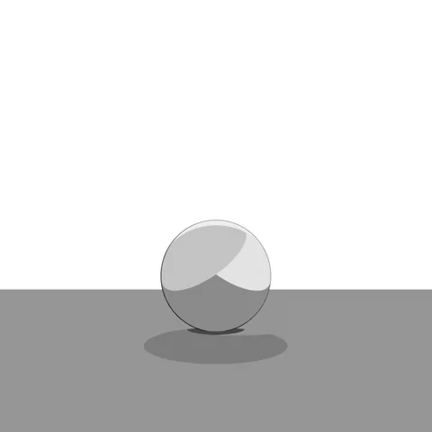White

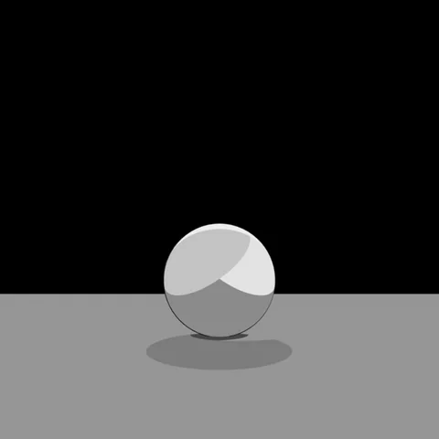Solid Black

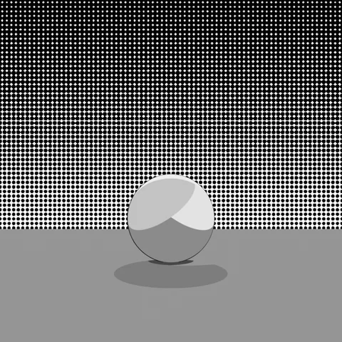Screentone

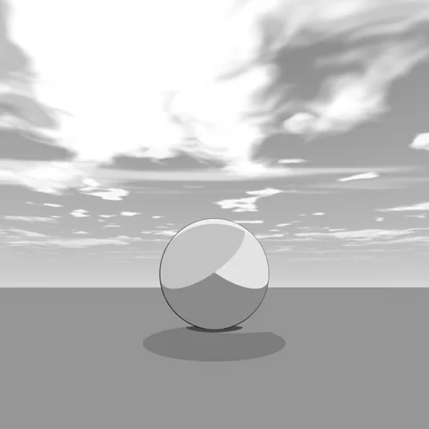Sky (Morning)

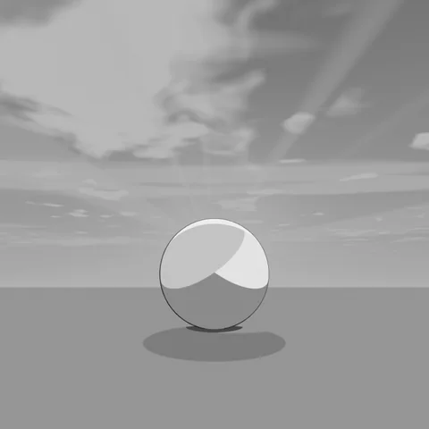Sky (Evening)

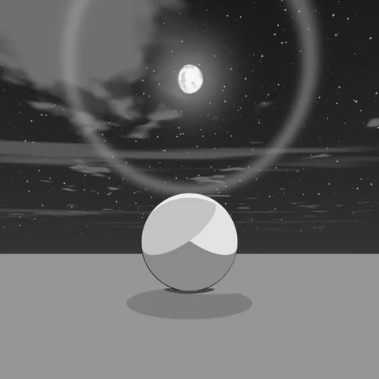Sky (Night)

Same sphere, ground and camera; only the background changes. The ground and the shading of the sphere stay the same.

<figure class="ms-shot" markdown>
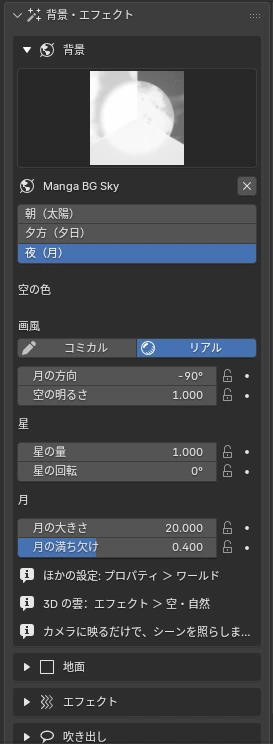
<figcaption>Backgrounds & Effects › Background</figcaption>
</figure>

For the screentone pattern, choose from 10 types such as halftone dots and crosshatch (kakeami), and add a vertical, horizontal or radial gradient. You can also switch it by dragging and dropping a screentone asset material onto the "Tone Material" field.

See [Material Reference › Manga Toon Backgrounds](../spec/mtb.md) for how the sky values change the look.

## <i class="bi bi-grid-3x3"></i> Ground · Manga Toon Ground (MTG) NEW {data-toc-label="Ground · Manga Toon Ground (MTG)"}

<figure class="ms-shot" markdown>
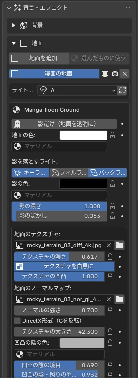
<figcaption>Backgrounds & Effects › Ground</figcaption>
</figure>

Lay ground under your characters and draw the light's shadows as **flat manga shadows**. "Add Ground" adds a large ground plane (200 m per side), and "Use on Selected" lets you use the same material on your own floor mesh. There is one ground material per scene.

- **Shadows from**: turn key, fill and back on and off with buttons. Where shadows overlap, they get darker
- **Shadow color, density, blur**: you can also put a tone material in the shadow color. Blur affects only the ground shadows
- **Shadows Only (Transparent Ground)**: hides the ground and multiplies only the shadows over the background
- **Texture / bumps**: tiles an image as seen from above. A normal map adds shading and shine to the bumps
- **Ground AO**: darkens areas near objects and where they touch the ground. Make it crisp for manga contact shadows
- **Fade Edges**: fades the ground out in a circle or along its edges so it blends into the background

!!! bubble "Shadows come from the light group"
    Shadows are drawn from the three lights of a light group. Each group gets three "ground shadow lights" that light only the ground. If the shadows drift after you move the lights, press ↻ (Reconnect Shadow Lights).

Detailed settings appear under "Manga Toon Ground" in the Material tab of the Properties Editor. See [Material Reference › Manga Toon Ground](../spec/mtg.md) for how each value changes the look.

## <i class="bi bi-lightning-charge-fill"></i> Effects · Manga Toon Effects (MTFX)

Filter by type and add effects from the thumbnails. Screen-space effects (focus lines, etc.) follow the camera and fill the frame; effects placed in space (explosions, etc.) go to the 3D cursor. Timing is set by the "Effect Progress" slider from 0 to 1. Keyframe it to animate the effect.

<figure class="ms-shot" markdown>
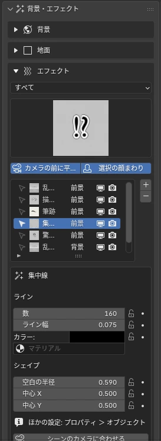
<figcaption>Backgrounds & Effects › Effects</figcaption>
</figure>

!!! bubble "Draw with Path"
    For brush strokes, "Draw with Path" creates a Bézier curve; move its points to make any brush path you like. You can also use "Draw Freehand" to draw directly with the mouse.

- See [Material Reference › Manga Toon Effects](../spec/mtfx.md) for how the effects are built (screen lines, manga line art, game-style VFX, ink and brush) and their main settings
- In the foreground and background effect lists, you can select, move, show/hide and delete effects. Selecting a row in a list also selects that object
- **Colors** of lines, edges, glows and so on are gathered in the Sidebar settings
- After changing cameras, use "Follow Scene Camera" to reattach screen-space effects and speech balloons to the current scene camera
- "In Front of Camera" places an effect as a flat plane in front of the camera, parallel to the screen
- Flat effects can be set to always face the camera

## <i class="bi bi-cloud-fill"></i> Sky · Clouds NEW {data-toc-label="Sky · Clouds"}

The sky World and the 3D clouds have an **Art Style slider**. At 0 you get black-and-white manga (screentones and cloud outlines); at 1, a colored anime look. Time of day and sun direction, moon phases, stars, sun rays, sun halos and even lens flares are included.

- Cloud presets cover the ten basic cloud types, plus a small cloud
- **Every cloud can switch between Mesh (comical) and Volume (realistic), one cloud at a time**, so you can mix mesh clouds in front with volume clouds far away
- "Mesh" and "Volume" next to "All Clouds" below the cloud list set every cloud in the scene at once
- "Cloud from Mesh" makes a cloud in any shape you like
- For realistic (volume) clouds, "Prepare for Realistic Clouds" sets up the sun and EEVEE settings automatically
- "Add Cloud Sun" adds a white sun that lights only the realistic clouds (character shading doesn't change)

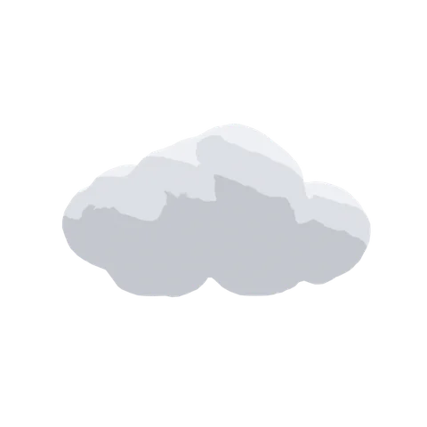Cumulus

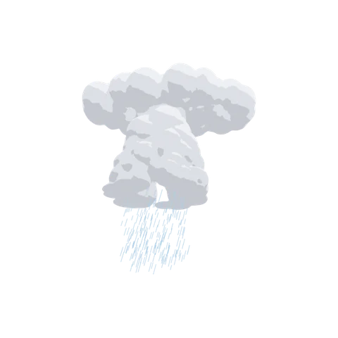Cumulonimbus

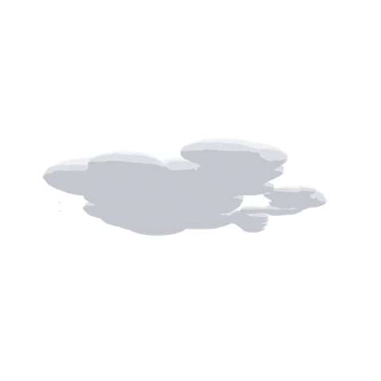Stratocumulus

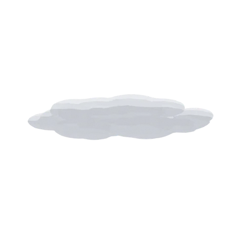Stratus

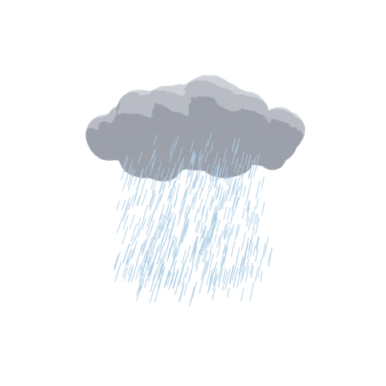Nimbostratus

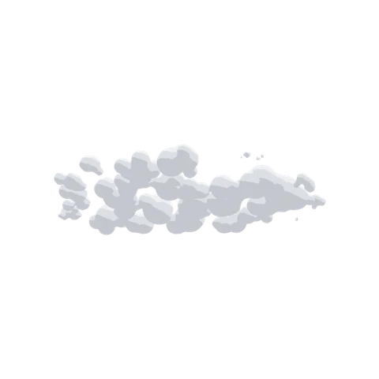Altocumulus

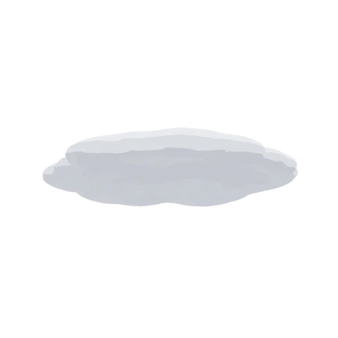Altostratus

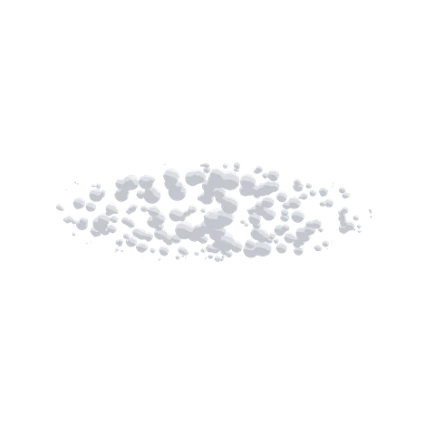Cirrocumulus

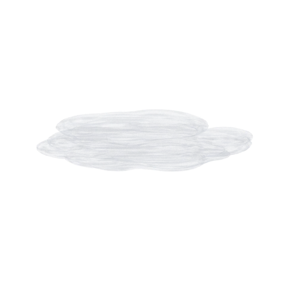Cirrostratus

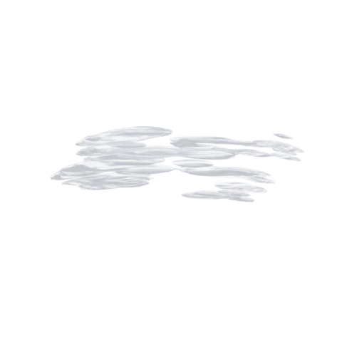Cirrus

Small Cloud

Each cloud preset placed as is and shot on its own, looking up slightly (transparent background; the tile color is only for legibility).

#### Mesh · Volume

Cumulus · Mesh

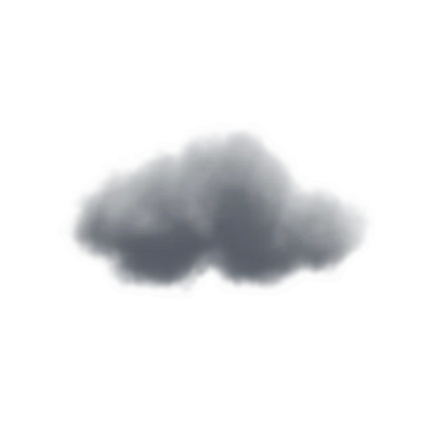Cumulus · Volume

Cumulonimbus · Mesh

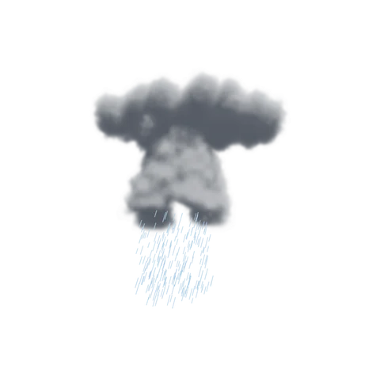Cumulonimbus · Volume

The same cloud switched with "Mesh / Volume" at the top of the selected cloud's settings. The volume shots use the sun added by "Prepare for Realistic Clouds".

<figure class="ms-shot" markdown>
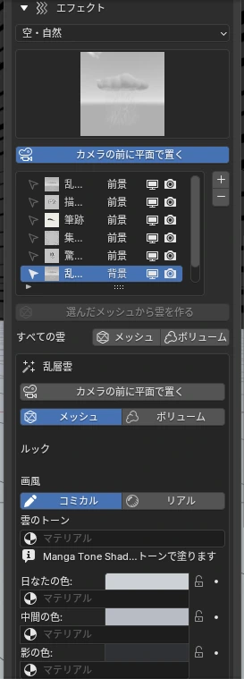
<figcaption>Backgrounds & Effects › Effects (cloud selected)</figcaption>
</figure>

| Where | Item | What it does |
|---|---|---|
| Below the list | All Clouds › Mesh / Volume | Sets every cloud in the scene at once |
| Top of the selected cloud's settings | Mesh / Volume | Switches only that cloud |

When you switch a cloud to Volume and the scene has no sun, a "Cloud Sun" is added automatically.

## <i class="bi bi-chat-fill"></i> Speech Balloons · Manga Toon Speech Bubbles NEW {data-toc-label="Speech Balloons · Manga Toon Speech Bubbles"}

<figure class="ms-shot" markdown>
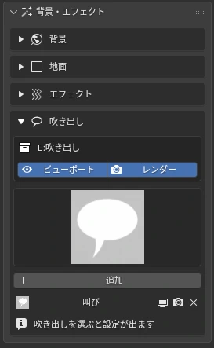
<figcaption>Backgrounds & Effects › Speech Balloons</figcaption>
</figure>

Speech

Shout

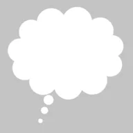Thought

Narration

- Line styles: Solid Line, Dashed Line (whispers), Wavy Line (fear, weak voices)
- Tail: tip position, width, bend and jagged edges (voices over the phone). Use "Tail Path" for a free shape
- Position and size are relative to the screen, so they stay the same on screen even if you change the focal length
- "Flip Balloon" flips it left/right and up/down
- Balloons are just the "shape"; the dialogue text is meant to be added in a design app

See [Material Reference › Manga Toon Speech Bubbles](../spec/mtsb.md) for the balloon's layer structure and settings.

## <i class="bi bi-fonts"></i> SFX Text · Warp · Kerning NEW {#sfx-text data-toc-label="SFX Text · Warp · Kerning"}

No Warp

Arc

Arc Lower

Arc Upper

Arch

Bulge

Shell Lower

Shell Upper

Flag

Wave

Fish

Rise

Fisheye

Inflate

Squeeze

Twist

Warp styles. The same icons appear in the Sidebar dropdown.

The "Sound Effect Text" effect is added as a **Blender text object**. You can type any text and bend it like Illustrator's warp. The black and white edges and line width work the same as in the other manga line art.

- **Text & font**: body text, text size, letter/word/line spacing, italics (shear) and alignment. Choose the font with the button on its own row; use "Similar Fonts" to search, add to favorites, or step to the next font
- **Warp**: pick from 16 styles. "Bend" sets how strongly it curves (negative values reverse it), and "Horizontal Distortion" / "Vertical Distortion" add a perspective-like look. The smaller "Smoothness" is, the finer the curve
- **Kerning**: select the text, press Tab to enter Edit Mode, place the cursor, and use ++alt+left++ / ++alt+right++ to tighten or loosen one letter at a time
- **Orientation**: rotate it like any other object
- **Link to Camera**: parents the text to the camera so it stays in the same place on screen when the camera moves. You can still move the text freely after linking, and "Unlink from Camera" undoes it
- Drawn sound effects made in earlier versions show a "Convert to Text Object (Kerning / Warp)" button. It replaces them while keeping the text, font, position and keyframes

