# <i class="bi bi-stars"></i> 背景・エフェクト：コマを仕上げる NEW {data-toc-label="背景・エフェクト：コマを仕上げる"}

描き込まない背景、影を落とす地面、効果線、漫符、ゲーム風の VFX、墨と筆、空と雲、吹き出し。サムネイルから選んで置き、数値はロックとキーフレームのボタン付きでその場に出ます。

## <i class="bi bi-image-fill"></i> 背景 Background · Manga Toon Backgrounds (MTB)

背景はすべてワールドとして入ります。物体ではないので、影を落としたり、選択や輪郭線の邪魔になったりしません。**カメラに映るときだけ背景の色、照明としては黒**なので、背景を変えてもキャラクターの陰影は変わりません。

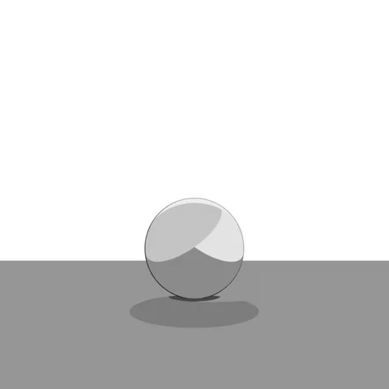白

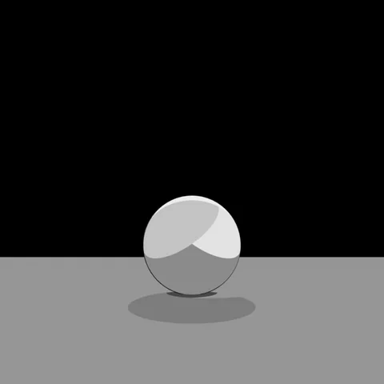ベタ

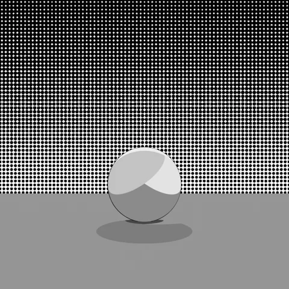トーン模様

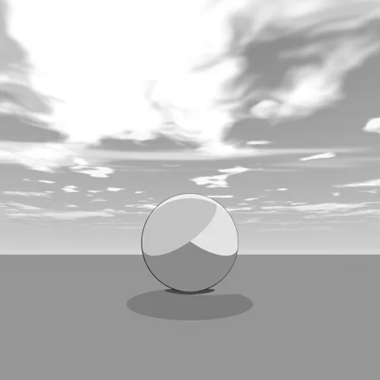空（朝）

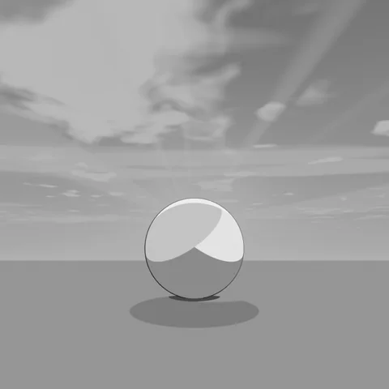空（夕方）

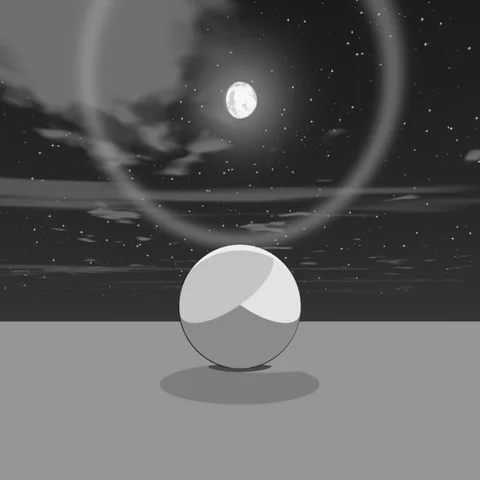空（夜）

同じ球・地面・カメラのまま、背景だけを切り替えて撮っています。地面と球の陰影は変わりません。

<figure class="ms-shot" markdown>
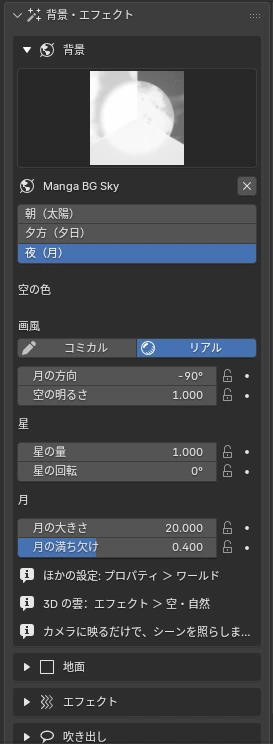
<figcaption>背景・エフェクト › 背景</figcaption>
</figure>

トーン模様はアミトーン・カケアミなど 10 種から選び、上下・左右・放射状のグラデを付けられます。トーン素材のマテリアルを「トーンのマテリアル」欄へドラッグ＆ドロップしても切り替わります。

空の数値を変えたときの見た目は [マテリアル仕様 › Manga Toon Backgrounds](../spec/mtb.md) にあります。

## <i class="bi bi-grid-3x3"></i> 地面 Ground · Manga Toon Ground (MTG) NEW {data-toc-label="地面 Ground · Manga Toon Ground (MTG)"}

<figure class="ms-shot" markdown>
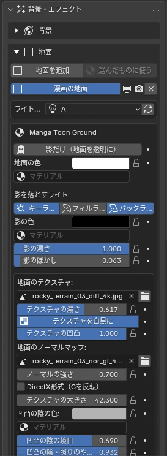
<figcaption>背景・エフェクト › 地面</figcaption>
</figure>

キャラクターの下に地面を敷き、ライトの影を**漫画の平らな影**で描きます。「地面を追加」で大きな地面（一辺 200 m）が入り、「選んだものに使う」で自分の床のメッシュにも同じマテリアルを使えます。地面のマテリアルはシーンに1つです。

- **影を落とすライト**：キー・フィル・バックをボタンでオン・オフ。重なった所ほど濃い影に
- **影の色・濃さ・ぼかし**：影の色にはトーンのマテリアルも入れられる。ぼかしは地面の影だけに効く
- **影だけ（地面を透明に）**：地面を消して、影だけを背景に掛け合わせる
- **テクスチャ・凹凸**：画像を上から見て並べて貼る。ノーマルマップで凹凸の陰と照り
- **接地の陰（AO）**：物の近くや接地しているところを暗く。くっきりさで漫画の接地影に
- **端を消す**：円形／辺に沿って地面を消し、背景になじませる

!!! bubble "影はライトグループから"
    影はライトグループの3灯から描きます。グループごとに「地面の影用ライト」が3つ付き、地面だけを照らします。ライトを動かしたあとに影がずれたら、↻（影用ライトをつなぎ直す）を押してください。

細かな設定はプロパティエディターのマテリアルタブ「Manga Toon Ground」に出ます。数値を変えたときの見た目は [マテリアル仕様 › Manga Toon Ground](../spec/mtg.md) にあります。

## <i class="bi bi-lightning-charge-fill"></i> エフェクト Effects · Manga Toon Effects (MTFX)

種類で絞り込んで、サムネイルから追加します。画面に対して置くもの（集中線など）はカメラに追従して画面いっぱいに、空間に置くもの（爆発など）は 3D カーソルの位置に入ります。時間は「進み具合」スライダー 0〜1 で決まり、キーフレームを打てばアニメーションになります。

<figure class="ms-shot" markdown>
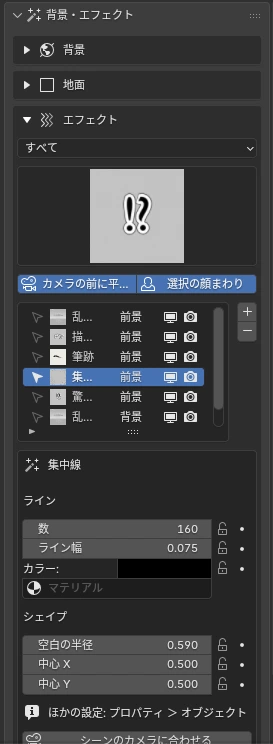
<figcaption>背景・エフェクト › エフェクト</figcaption>
</figure>

!!! bubble "パスで描く"
    筆跡は「パスで描く」でベジェカーブを作り、点を動かして自由な筆の軌跡にできます。「手描きで描く」でマウスから直接引くこともできます。

- 作りの違い（画面に描く線・漫画の線画・ゲーム風 VFX・墨と筆）と主な項目は [マテリアル仕様 › Manga Toon Effects](../spec/mtfx.md) にあります
- エフェクトは前景・背景の一覧で、選択・入れ替え・表示の切り替え・削除ができます。一覧の行を選ぶと、そのオブジェクトも選択されます
- 線・フチ・光などの**色**は、サイドバーの設定にまとめて出ます
- 画面に対して置くエフェクトと吹き出しは、カメラを替えたあと「シーンのカメラに合わせる」で今のシーンのカメラに付け直せます
- 「カメラの前に平面で置く」で、画面と平行に手前へ置けます
- 平面的なエフェクトは、常にカメラの方を向く設定を選べます

## <i class="bi bi-cloud-fill"></i> 空と雲 Sky · Clouds NEW {data-toc-label="空と雲 Sky · Clouds"}

空のワールドと 3D の雲には**画風スライダー**があります。0 で白黒の漫画（トーン・雲の輪郭線）、1 で色の付いたアニメ調。時刻・太陽の向き、月の満ち欠け、星、薄明光線、日暈、レンズフレアまで入っています。

- 雲は十種雲形＋小さな雲のプリセット
- どの雲も**メッシュ（コミカル）とボリューム（リアル）を雲ごとに切り替えられる**。手前はメッシュ、奥はボリュームのように混ぜられる
- 雲の一覧の下の「すべての雲」の「メッシュ」「ボリューム」で、シーンの雲をまとめてそろえられる
- 「メッシュから雲」で好きな形の雲を作れる
- リアルな雲（ボリューム）は「リアルな雲の準備」で太陽と EEVEE の設定を自動で整える
- 「雲用の太陽を追加」で、リアルな雲だけを照らす白い太陽を足せる（キャラクターの陰影は変わらない）

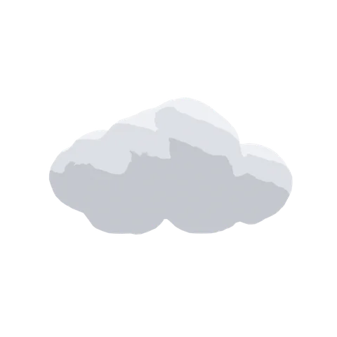積雲

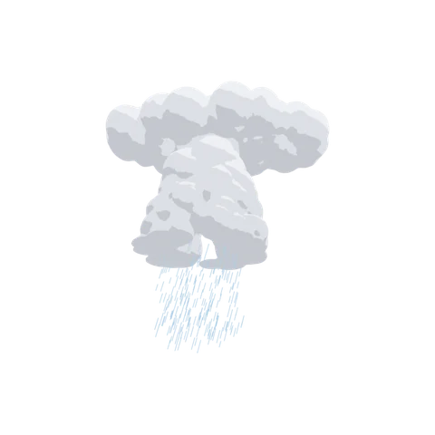入道雲

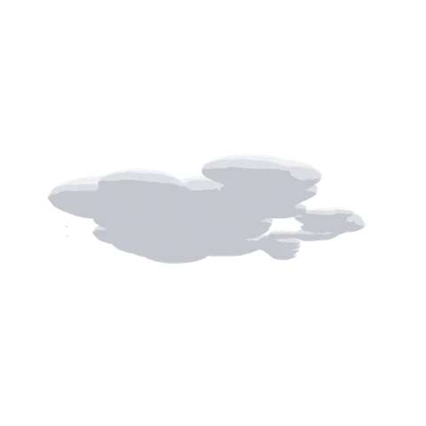層積雲

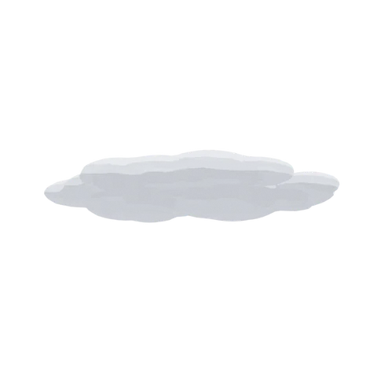層雲

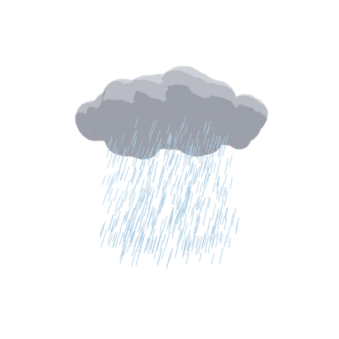乱層雲

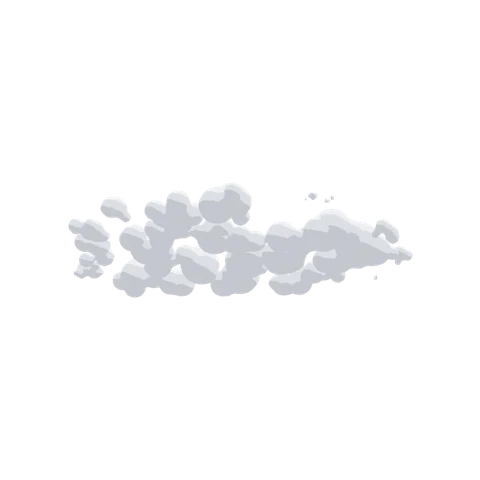高積雲（ひつじ雲）

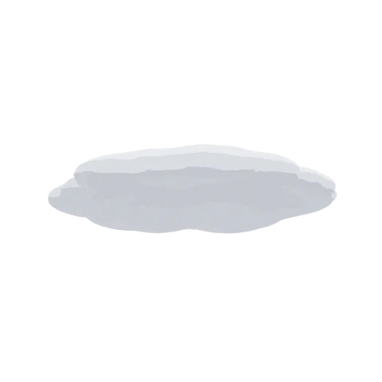高層雲

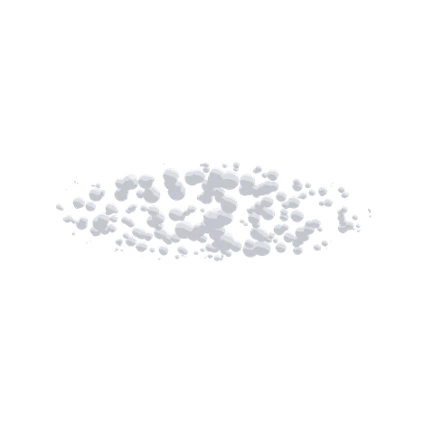巻積雲（うろこ雲）

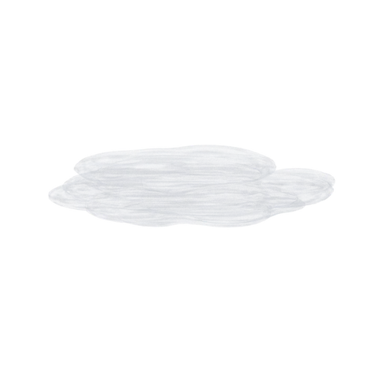巻層雲

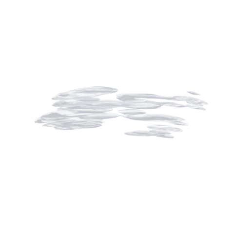巻雲（すじ雲）

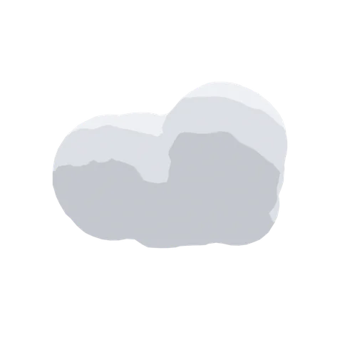小さな雲

各プリセットの雲をそのまま置き、少し下から見上げて雲だけを撮っています（背景は透明。タイルの地の色は見やすさのため）。

#### メッシュとボリューム Mesh · Volume

積雲・メッシュ

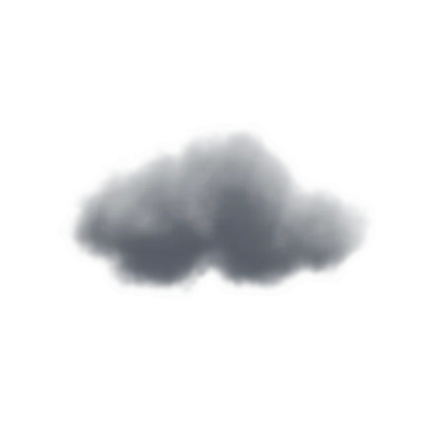積雲・ボリューム

入道雲・メッシュ

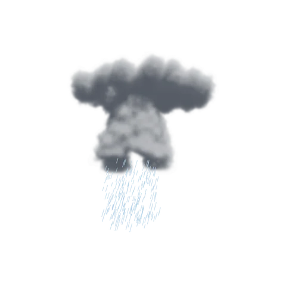入道雲・ボリューム

同じ雲を、選んだ雲の設定のいちばん上にある「メッシュ／ボリューム」で切り替えて撮っています。ボリュームは「リアルな雲の準備」で太陽を足した状態です。

<figure class="ms-shot" markdown>
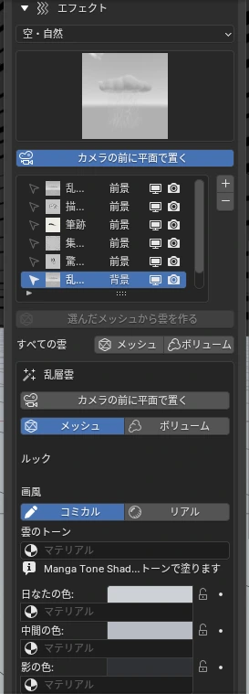
<figcaption>背景・エフェクト › エフェクト（雲を選んだとき）</figcaption>
</figure>

| 場所 | 項目 | 内容 |
|---|---|---|
| 一覧の下 | すべての雲 › メッシュ／ボリューム | シーンの雲をまとめてそろえる |
| 選んだ雲の設定のいちばん上 | メッシュ／ボリューム | その雲だけを切り替える |

ボリュームに切り替えたとき、シーンに太陽が無ければ「雲用の太陽」が自動で入ります。

## <i class="bi bi-chat-fill"></i> 吹き出し Speech Balloons · Manga Toon Speech Bubbles NEW {data-toc-label="吹き出し Speech Balloons · Manga Toon Speech Bubbles"}

<figure class="ms-shot" markdown>
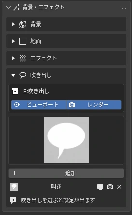
<figcaption>背景・エフェクト › 吹き出し</figcaption>
</figure>

通常

叫び

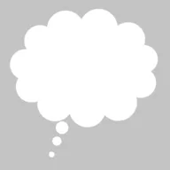思考

ナレーション

- 線は実線・点線（ささやき）・震え線（恐怖・弱い声）
- しっぽは先の位置・太さ・曲がり・ギザギザ（電話の声）。「しっぽのパス」で自由な形に
- 位置と大きさは画面基準。焦点距離を変えても画面上で同じ
- 「吹き出しを反転」で左右・上下を入れ替えられる
- セリフの文字はデザインアプリで入れる前提の「形」です

吹き出しの層の作りと項目は [マテリアル仕様 › Manga Toon Speech Bubbles](../spec/mtsb.md) にあります。

## <i class="bi bi-fonts"></i> 描き文字 SFX Text · Warp · Kerning NEW {#sfx-text data-toc-label="描き文字 SFX Text · Warp · Kerning"}

なし

円弧

下弦

上弦

アーチ

でこぼこ

貝殻（下向き）

貝殻（上向き）

旗

波形

魚形

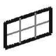上昇

魚眼レンズ

膨張

絞り込み

旋回

ワープのスタイル。サイドバーのプルダウンにも同じアイコンが出ます。

エフェクトの「描き文字」は **Blender のテキストオブジェクト**として入ります。文字は自由に打て、イラストレーターのワープのように曲げられます。白黒のフチや線の太さは、ほかの漫画の線画と同じです。

- **文字・フォント**：本文、文字の大きさ、字間・語間・行間、斜体（シアー）、揃え。フォントは独立した行のボタンから選び、「似たフォント」で探す・お気に入りに入れる・次のフォントへ送る
- **ワープ**：16 種のスタイルから選び、「カーブ」で曲がりの強さ（マイナスで逆向き）、「水平方向のゆがみ」「垂直方向のゆがみ」でパース風に。「なめらかさ」は小さいほど細かく曲がる
- **カーニング**：文字を選んで Tab で編集モードに入り、カーソルを置いて ++alt+left++ / ++alt+right++ で1文字ずつ詰める・広げる
- **向き**：ふつうのオブジェクトと同じように回転できます
- **カメラに紐づける**：カメラの子にして、カメラを動かしても画面の同じ位置に残す。紐づけたあとも文字は自由に動かせ、「カメラから外す」で元に戻る
- 前のバージョンで作った描き文字には「テキストオブジェクトに変換（カーニング・ワープ）」ボタンが出ます。文字・フォント・位置・キーフレームを引き継いで置き換えます

