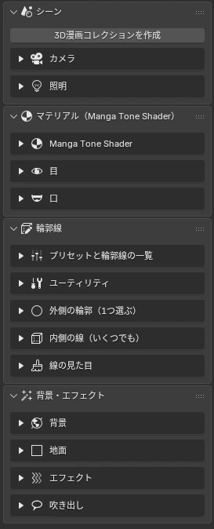

# <i class="bi bi-signpost-split-fill"></i> Feature Guide

The "3D Manga Studios" tab in the Sidebar (++n++ in the 3D Viewport) has four panels, in the order you work. Go through them from top to bottom and you'll have a finished panel.

<a href="scene.html">1<b>Scene</b>Collections, Camera, Distortion Fix, Lights, Light Linking</a>
<a href="material.html">2<b>Material</b>Manga Tone Shader, Painterly and Transparency, Eyes, Mouth</a>
<a href="outline.html">3<b>Outlines</b>Pick by role, Presets, Line Look, Outline List</a>
<a href="bgfx.html">4<b>Backgrounds & Effects</b>Background, Ground, Effects, Sky and Clouds, Speech Balloons, Sound Effect Text</a>

## <i class="bi bi-layout-sidebar"></i> Panels

<figure class="ms-shot" markdown>

<figcaption>The "3D Manga Studios" tab in the Sidebar</figcaption>
</figure>

- **Scene**
    - 3D Manga Collection
    - Camera (Lens Details, Resolution, Guides, Distortion Fix)
    - Lights (Light Linking)
- **Material (Manga Tone Shader)**
    - Basic Settings (feature toggles, Painterly, Transparency)
    - Eyes
    - Mouth
- **Outlines**
    - ① Outer Line ② Inner Lines ③ Line Look
    - Presets and Outline List
- **Backgrounds & Effects**
    - Background
    - Ground
    - Effects (Sound Effect Text)
    - Sky and Clouds
    - Speech Balloons

!!! bubble "Tip"
    The add-on assumes one panel per .blend file: one camera, and one background per scene.

