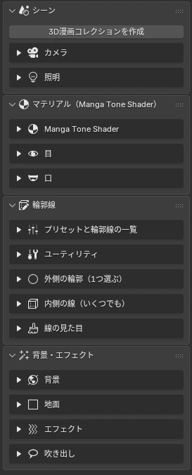

# <i class="bi bi-signpost-split-fill"></i> 機能ガイド

サイドバー（3D ビューで ++n++）の「3D Manga Studios」タブには、作業の順に4つのパネルが並んでいます。上から順に進めると1コマが仕上がります。

<a href="scene.html">1<b>シーン</b>コレクション、カメラ、歪み補正、ライト、ライトリンキング</a>
<a href="material.html">2<b>マテリアル</b>Manga Tone Shader、絵画風・透過、目、口</a>
<a href="outline.html">3<b>輪郭線</b>役割で選ぶ、プリセット、線の見た目、輪郭線の一覧</a>
<a href="bgfx.html">4<b>背景・エフェクト</b>背景、地面、エフェクト、空と雲、吹き出し、描き文字</a>

## <i class="bi bi-layout-sidebar"></i> パネルの構成 Panels

<figure class="ms-shot" markdown>

<figcaption>サイドバーの「3D Manga Studios」タブ</figcaption>
</figure>

- **シーン**
    - 3D漫画コレクション
    - カメラ（レンズ詳細・解像度・ガイド・歪み補正）
    - ライト（ライトリンキング）
- **マテリアル（Manga Tone Shader）**
    - 基本（機能のチェック・絵画風・透過）
    - 目
    - 口
- **輪郭線**
    - ① 外側の輪郭 ② 内側の線 ③ 線の見た目
    - プリセットと輪郭線の一覧
- **背景・エフェクト**
    - 背景
    - 地面
    - エフェクト（描き文字）
    - 空と雲
    - 吹き出し

!!! bubble "ポイント"
    1つの .blend ファイルで1コマを作る前提です。カメラは1台、背景はシーンに1つです。

