# <i class="bi bi-palette-fill"></i> Materials: Tones and Shadows, Eyes and Mouth

"Apply Manga Tone Shader" puts a manga shader on the selected objects. From the Sidebar you can adjust halftone and crosshatch (kakeami) screentones, crisp shadows, and even the patterns inside the shadows. Eyes and mouths have their own shaders and are drawn on top of the face.

## <i class="bi bi-noise-reduction"></i> Apply Manga Tone Shader

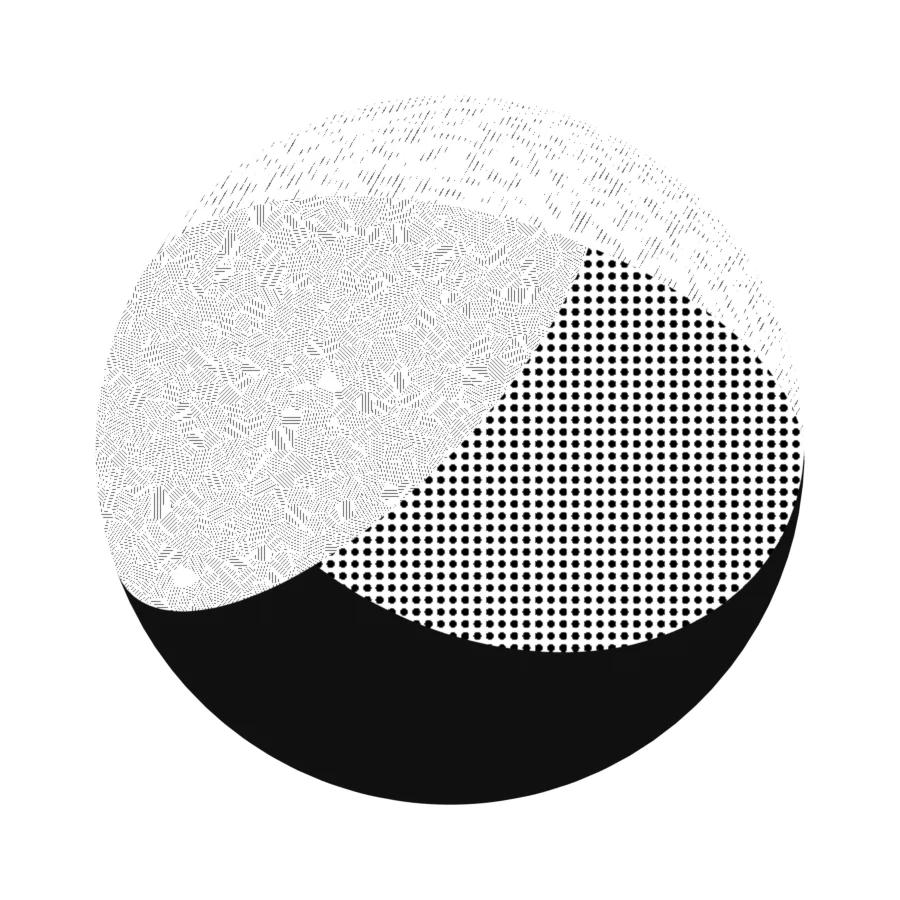

You assign a tone pattern and color to each of the three lights: key, fill and back. You can swap screentone assets by dragging and dropping them from the Asset Browser.

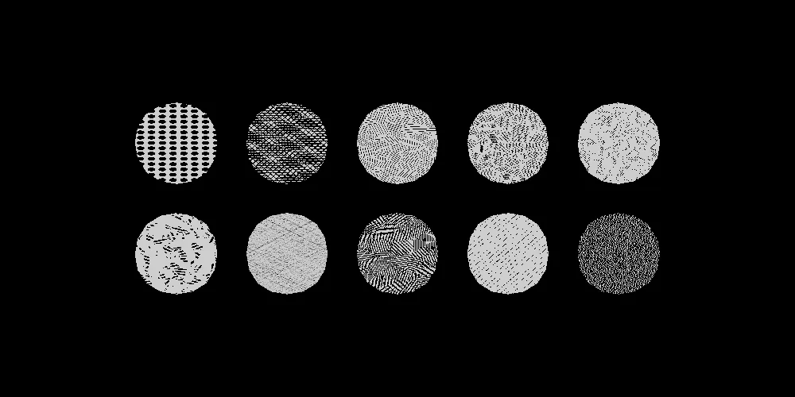

The bundled screentone assets (Manga Tone Flat / Shaded). See [Manga Tone Flat](../spec/flat.md) and [Manga Tone Shaded](../spec/shaded.md) for the full list.

<figure class="ms-shot" markdown>
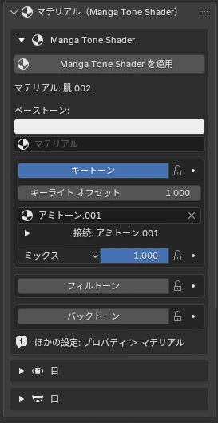
<figcaption>Sidebar › Material</figcaption>
</figure>

| Section | Items | Effect |
|---|---|---|
| Base Color | Base / Key / Fill / Back Tone | The base color, and the tone on the surfaces lit by each of the three lights |
| Normals | Normal Map, Brush Strokes | Surface bumps, and a brush-stroke wobble along the light/shadow boundary |
| Shadow | Shadow, Sub Outline, AO | Cast shadows, lines along shadow edges, darkness in crevices |
| Highlights | Gloss, Anisotropy, Rim Light | Angel rings on hair, metal streaks, backlit rims |
| Other Features | Matte, Watercolor, Color (Variation & Paper), Transparency | Paper texture and color unevenness, PNG cutouts |

See [Material Reference › Manga Tone Shader](../spec/mts.md) for how each value changes the look.

### Key / Fill / Back Tone

Key, fill and back each have their own box, with items listed top to bottom in the order you work on them.

| Step | Item | What it does |
|:-:|---|---|
| 1 | Tone on/off | Whether to use this level. When off, the items below are hidden |
| 2 | Light offset | Shifts the light/shadow boundary to widen or narrow the surfaces of this level |
| 3 | Color | The base color of this level |
| 4 | Tone material | The screentone asset material. You can also drag and drop it from the Asset Browser |
| 5 | Blend mode / opacity | How the tone is layered (Normal, Multiply, Screen, Overlay, Add, Subtract, Darken, Lighten) and its strength. Opacity can be keyframed |

!!! bubble "Tone gradients"
    Tones used for the material color can have a gradient too. Seen from the front of the object, the strength changes from bottom to top.

## <i class="bi bi-brush-fill"></i> Painterly Look · Normal Map · Transparency NEW {data-toc-label="Painterly Look · Normal Map · Transparency"}

Painterly
**Paint in patches of color**

Splits surfaces into brush-like patches and adds variation to color and brightness. Presets: Standard, Oil, Thick Paint and Watercolor. Watercolor bleeds at the boundaries and pools paint at the edges.

Normal
**Normal maps / painting brush strokes**

Normal maps affect shadows, gloss, anisotropy and rim light (DirectX format is flipped). You can also create a blank image and hand-paint brush strokes with the normal palette.

Transparency
**PNG cutouts + alpha outlines**

Cut out leaf or hair-tip cards with the PNG alpha, either sharp or soft. To add an outline that follows the cut-out shape, use "Alpha Shape" in the Outlines panel.

### Painterly Presets

These are the values set when you choose a preset. Oil and Thick Paint also turn on Manga Tone Shader's "Color (Variation & Paper)", and Watercolor turns on Manga Tone Shader's "Watercolor" (bleeding and pooled edges). Items marked — are left unchanged.

| | Item | Standard | Oil | Thick Paint | Watercolor |
|---|---|---|---|---|---|
| **Brush Strokes** | Strength <code>Strength</code> | 1 | 1 | 0.6 | 1 |
|  | Stroke size <code>Stroke Size</code> | 4.3 | 3 | 3 | 2.5 |
|  | Softness <code>Softness</code> | 0 | 0 | 0 | 0.7 |
|  | Distortion <code>Distortion</code> | 0.15 | 0.35 | 0.1 | 0.45 |
|  | Distortion scale <code>Distortion Scale</code> | 3.5 | 3.5 | 3.5 | 3.5 |
|  | Fine distortion <code>Detail Distortion</code> | 0.08 | 0.12 | 0.03 | 0.05 |
|  | Fine distortion scale <code>Detail Scale</code> | 25.7 | 25.7 | 25.7 | 25.7 |
|  | Grain <code>Grain</code> | 0.075 | 0.1 | 0.02 | 0.02 |
|  | Grain scale <code>Grain Scale</code> | 82.1 | 82.1 | 82.1 | 82.1 |
|  | Texture displacement <code>Texture Displacement</code> | 0 | 0.25 | 0.05 | 0.4 |
| **Brush Marks** | Brush dabs <code>Brush Dabs</code> | 0 | 0 | 1 | 0 |
|  | Dab size <code>Dab Size</code> | — | — | 2 | — |
|  | Stroke length <code>Stroke Length</code> | — | — | 2.5 | — |
|  | Bristle streaks <code>Streaks</code> | — | — | 0.35 | — |
|  | Streak scale <code>Streak Scale</code> | — | — | 15 | — |
|  | Edge break <code>Edge Break</code> | — | — | 0.7 | — |
| **Also changed** **(Manga Tone Shader)** | Color (Variation & Paper) <code>Paint Finish</code> | — | On | On | — |
|  | Color variation <code>Color Variation</code> | — | 0.06 | 0.06 | — |
|  | Value variation <code>Value Variation</code> | — | 0.22 | 0.22 | — |
|  | Paper <code>Paper</code> | — | 0.1 | 0.1 | — |
|  | Watercolor <code>Watercolor</code> | Off | Off | Off | On |

## <i class="bi bi-eye-fill"></i> Parallax Eye · Manga Toon Eye NEW {data-toc-label="Parallax Eye · Manga Toon Eye"}

<figure class="ms-shot" markdown>
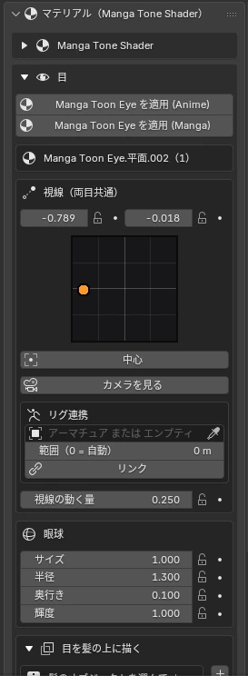
<figcaption>Material › Eye</figcaption>
</figure>
<figure class="ms-shot" markdown>
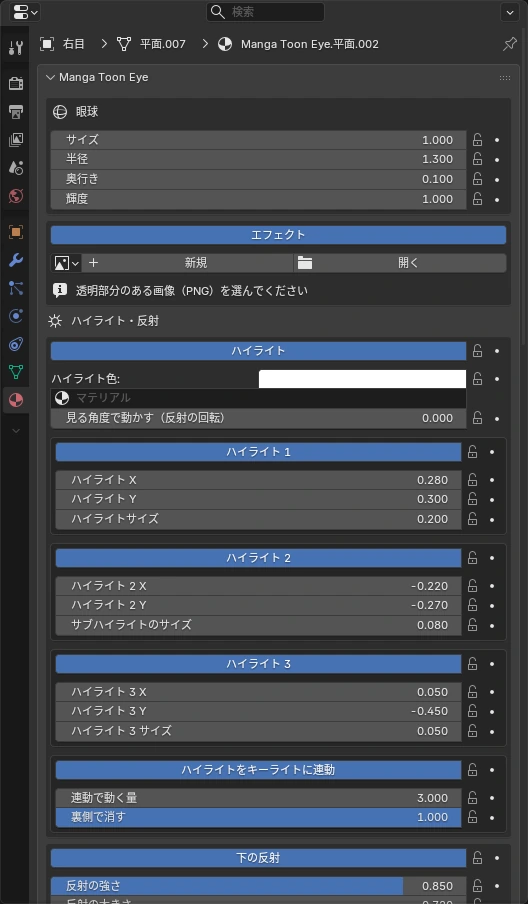
<figcaption>Properties › Material › Manga Toon Eye</figcaption>
</figure>

A **parallax eye**: the iris appears set back inside the curved surface of the eyeball. Each eye is a separate object and follows a look target through drivers (no Python auto-run needed).

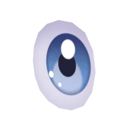Anime

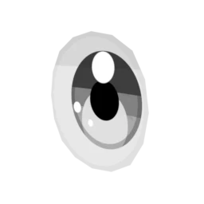Manga (black and white, ink lines)

- **Draw Over Hair**: makes only the hair (and its outlines) in front of the eyes, as seen from the camera, see-through
- **Look target / Look at Camera**: moves the gaze with a target attached to the head bone
- **Eye pad**: a control pad you drag to move the gaze. Also works with the rig link
- Adjust the iris, pupil, eyelid shadow and highlights in the Material tab of the Properties Editor

**Making expressions**

There is no dedicated expression switch. Combine the three settings below instead. All of them can be keyframed, so you can switch them per panel or per shot.

- **Pupil Shape**: choose circle, polygon, star or heart ([Pupil Shape](../spec/mte.md#mte-pupil-pupil-shape))
- **Eye Effect**: overlays a PNG such as hearts or sparkles on the eye ([Eye Effect](../spec/mte.md#mte-eye-effect-image))
- **Eye Display**: switches between Eye / Eye + Effect / Sclera + Effect / Hide Eye. It sets constant (no interpolation) keyframes, so it switches instantly ([Eye Display](../spec/mte.md#mte-eye-effect-display))

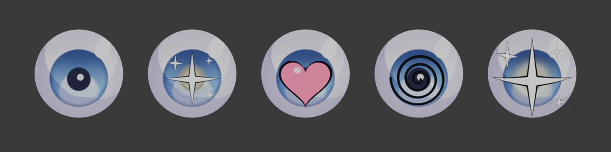

### Link to Rig · Eyes

<figure class="ms-rig-demo" markdown>
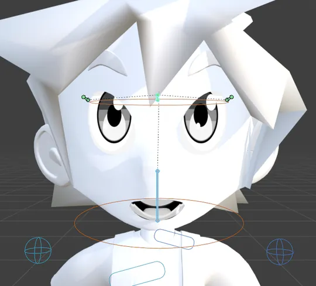
<figcaption>Linked to the look controller bone and moved left and right. It works with bones of any rig, such as Rigify or Auto-Rig Pro</figcaption>
</figure>
<figure class="ms-shot" markdown>
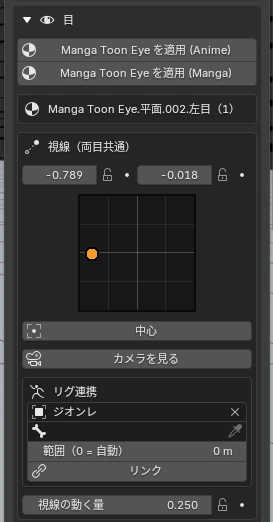
<figcaption>Material › Parallax Eye › Look (Both Eyes)</figcaption>
</figure>

Drive the look (and the overlay position) with a controller bone of your rig, or with an empty. When the bone or empty moves up, down, left or right inside a square, the eyes move with it.

- For a rig that has a bone per eye (eye.L / eye.R, as in Rigify), **each eye is also linked automatically** when you click Link, so one eye can move alone (it adds to the shared look)
- "Overlay Position" (the image drawn over the eye) has the same kind of rig link
- While a look target is used, the target moves the eyes (the pad is off)

| Item | What it does |
|---|---|
| Rig (Armature or empty) | The armature that has the controller bone, or an empty to use as the controller |
| Bone | For an armature, the bone that moves the look |
| Range (0 = auto) | How far the bone / empty travels from the center to the edge. 0 = half the bone length (or the empty size) |
| Link | Starts the link. While linked, the pad is hidden and only the rig moves the eyes. × unlinks and brings the pad back |
| Calibrate (Center Here) | For an empty, makes its current position the center of the look |
| Align Controllers to Eyes | Moves the linked bones (Rigify eyes / eye.L / eye.R, etc.) to just in front of the eye planes |

See [Material Reference › Manga Toon Eye](../spec/mte.md) for how each value changes the look.

## <i class="bi bi-emoji-smile-fill"></i> Manga Mouth · Manga Toon Mouth NEW {data-toc-label="Manga Mouth · Manga Toon Mouth"}

<figure class="ms-shot" markdown>
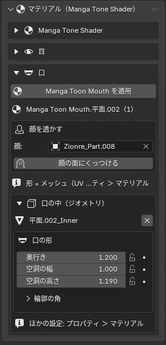
<figcaption>Material › Mouth</figcaption>
</figure>

An anime mouth: a flat card stuck to the face surface becomes the shape of the mouth itself. The inside of the mouth shows a throat, tongue and teeth with depth.

**Shaping the mouth**

There are no shape presets. **The shape of the mouth card (mesh) is the shape of the mouth.**

- Select the mouth object, enter Edit Mode and move the vertices to shape it (the mouth appears inside the UV square)
- To open or close the mouth, deform the mouth card itself (Edit Mode, shape keys, an armature, etc.). The teeth and tongue follow bones with "Rig Link" below
- Adjust the mouth cavity (depth, width, height) and the corners of the outline in "Mouth Shape" in the Sidebar

| Item | What it does |
|---|---|
| Shape | The mouth card mesh itself. Move its vertices in Edit Mode |
| Inside | Add or remove it with geometry. Depth, width and height of the cavity |
| Teeth | Teeth Style (Solid, Square, Round, Jagged); height, width, position and rotation (forward/back, left/right, front) for the upper and lower teeth |
| Placement | Stick it to the face surface, show through the face with a mask |
| Rig Link | Move the teeth and tongue with bones (see "Rig Link · Mouth Inside" below) |

### Rig Link · Mouth Inside

<figure class="ms-rig-demo" markdown>

<figcaption>The upper teeth, lower teeth and tongue linked to bones, with the jaw bone opening and closing. It works with bones of any rig, such as Rigify or Auto-Rig Pro. The mouth card opens with a shape key driven by the jaw bone</figcaption>
</figure>
<figure class="ms-shot" markdown>
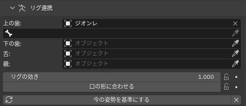
<figcaption>Properties › Material › Manga Toon Mouth › Rig Link</figcaption>
</figure>

Link the **teeth and tongue** inside the mouth to bones of your rig (or to objects) so they follow the jaw and tongue bones.

The bones pass on their motion relative to the pose you had when you clicked "Set Current Pose as Rest". After linking, click it once with the mouth closed in a neutral pose.

| Item | What it does |
|---|---|
| Upper Teeth / Lower Teeth / Tongue | The object that moves each part. When you pick an armature, choose the bone in the field below |
| Parent | What the motion is measured from (the head, etc.). Empty = automatic (a bone such as head in the same armature → the parent of the empty → the parent of the mouth) |
| Rig Strength | How much of the bone motion is passed on (1 = the same amount) |
| Follow Mouth Shape | The teeth and tongue also move when the mouth card changes shape (opening, closing, etc.). Off = they stay where they are in the rest shape |
| Set Current Pose as Rest | Takes the current pose and mouth shape as the rest position of the teeth and tongue |
| × | Stops the rig link |

See [Material Reference › Manga Toon Mouth](../spec/mtm.md) for how each value changes the look.
