# <i class="bi bi-palette-fill"></i> マテリアル：トーンと影、目と口

「Manga Tone Shader を適用」で、選んだオブジェクトに漫画用のシェーダーが入ります。網点やカケアミのトーン、くっきりした影、影の中の模様までをサイドバーから調整できます。目と口は専用のシェーダーで、顔の上に描き足します。

## <i class="bi bi-noise-reduction"></i> Manga Tone Shader Apply Manga Tone Shader

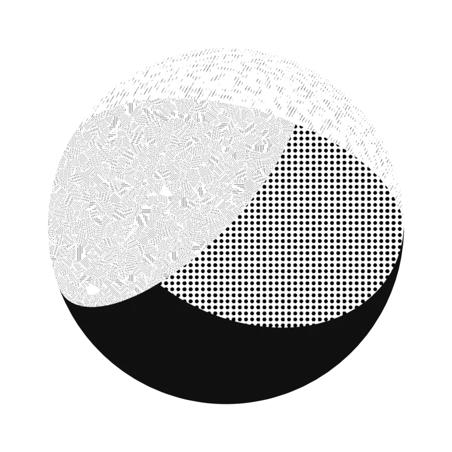

キー・フィル・バックの3灯それぞれに、トーンの模様と色を割り当てる作りです。トーン素材はアセットブラウザからドラッグ＆ドロップで入れ替えられます。

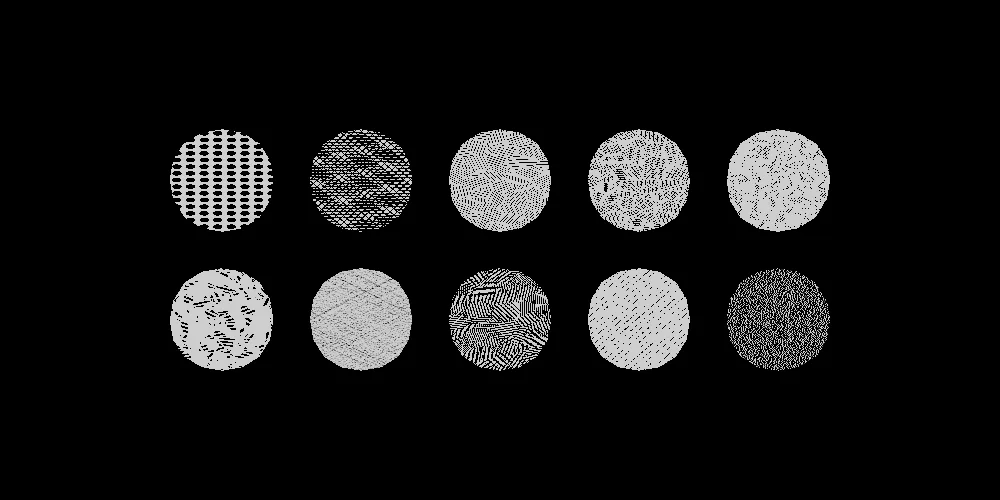

同梱のスクリーントーン素材（Manga Tone Flat / Shaded）。全種類の一覧は [Manga Tone Flat](../spec/flat.md) と [Manga Tone Shaded](../spec/shaded.md) にあります。

<figure class="ms-shot" markdown>
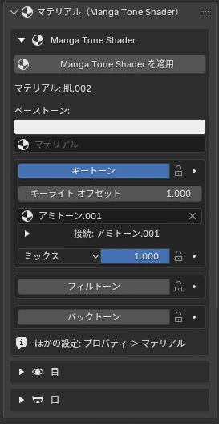
<figcaption>サイドバー › マテリアル</figcaption>
</figure>

| 見出し | 項目 | 効果 |
|---|---|---|
| 基本色 | Base / Key / Fill / Back Tone | 地の色と、3灯それぞれの面のトーン |
| 法線 | ノーマルマップ、筆のタッチ | 凹凸と、明暗の境目を筆跡のように揺らす |
| 影 | シャドウ、サブ輪郭、AO | 落ち影、影の縁の線、くぼみの暗がり |
| ハイライト | 光沢、異方性、リムライト | 髪の天使の輪、金属のすじ、逆光のふち |
| その他 | マット、水彩、色（色ゆらぎ・紙）、透過 | 紙の質感や色ムラ、PNG の切り抜き |

数値を変えたときの見た目は [マテリアル仕様 › Manga Tone Shader](../spec/mts.md) にまとめています。

### キー・フィル・バックのトーン Key / Fill / Back Tone

キー・フィル・バックはそれぞれ枠で分かれていて、上から作業する順に並んでいます。

| 順 | 項目 | 内容 |
|:-:|---|---|
| 1 | トーンのオン・オフ | その段を使うかどうか。オフにすると下の項目は隠れる |
| 2 | ライトのオフセット | 明暗の境目をずらし、その段の面を広げる・狭める |
| 3 | 色 | その段の地の色 |
| 4 | トーンのマテリアル | トーン素材のマテリアル。アセットブラウザからドラッグ＆ドロップでも入る |
| 5 | 描画モード・不透明度 | トーンの重ね方（通常・乗算・スクリーン・オーバーレイ・加算・減算・比較（暗）・比較（明））と濃さ。不透明度はキーフレームを打てる |

!!! bubble "トーンのグラデーション"
    マテリアルの色に使うトーンにもグラデを付けられます。オブジェクトを正面から見て、下から上に濃さが変わります。

## <i class="bi bi-brush-fill"></i> 絵画風・ノーマル・透過 Painterly Look · Normal Map · Transparency NEW {data-toc-label="絵画風・ノーマル・透過 Painterly Look · Normal Map · Transparency"}

絵画風
**絵の具の面で塗る**

面を筆の塗りのように分割して、色と明るさにムラを付けます。プリセットは標準・油彩・厚塗り・水彩。水彩では境目がにじみ、縁に絵の具がたまります。

ノーマル
**ノーマルマップ / 筆タッチを描く**

ノーマルマップは影・光沢・異方性・リムすべてに効きます（DirectX 形式は反転）。無地の画像を作り、ノーマルパレットで筆タッチを手描きすることもできます。

透過
**PNG で切り抜き ＋ アルファの縁取り**

葉や髪先の板ポリを、PNG のアルファでくっきり／ソフトに切り抜き。切り抜いた形に沿った輪郭線は、輪郭線パネルの「アルファ（透過の形）」で付けます。

### 絵画風のプリセット Painterly Presets

プリセットを選んだときに入る値です。油彩・厚塗りは Manga Tone Shader の「色（色ゆらぎ・紙）」も一緒にオンにし、水彩は Manga Tone Shader の「水彩」（にじみ・縁のたまり）をオンにします。— の項目は変わりません。

| | 項目 | 標準 | 油彩 | 厚塗り | 水彩 |
|---|---|---|---|---|---|
| **筆のタッチ** | 強さ <code>Strength</code> | 1 | 1 | 0.6 | 1 |
|  | タッチの細かさ <code>Stroke Size</code> | 4.3 | 3 | 3 | 2.5 |
|  | やわらかさ <code>Softness</code> | 0 | 0 | 0 | 0.7 |
|  | ゆがみ <code>Distortion</code> | 0.15 | 0.35 | 0.1 | 0.45 |
|  | ゆがみの細かさ <code>Distortion Scale</code> | 3.5 | 3.5 | 3.5 | 3.5 |
|  | 細かいゆがみ <code>Detail Distortion</code> | 0.08 | 0.12 | 0.03 | 0.05 |
|  | 細かいゆがみのスケール <code>Detail Scale</code> | 25.7 | 25.7 | 25.7 | 25.7 |
|  | 粒子 <code>Grain</code> | 0.075 | 0.1 | 0.02 | 0.02 |
|  | ざらつきの細かさ <code>Grain Scale</code> | 82.1 | 82.1 | 82.1 | 82.1 |
|  | テクスチャのずれ <code>Texture Displacement</code> | 0 | 0.25 | 0.05 | 0.4 |
| **筆跡** | 筆の置き跡 <code>Brush Dabs</code> | 0 | 0 | 1 | 0 |
|  | 置き跡の細かさ <code>Dab Size</code> | — | — | 2 | — |
|  | 線の長さ <code>Stroke Length</code> | — | — | 2.5 | — |
|  | 毛筋 <code>Streaks</code> | — | — | 0.35 | — |
|  | 毛筋の細かさ <code>Streak Scale</code> | — | — | 15 | — |
|  | 明暗の境目の崩し <code>Edge Break</code> | — | — | 0.7 | — |
| **一緒に変わる項目** **（Manga Tone Shader）** | 色（色ゆらぎ・紙） <code>Paint Finish</code> | — | オン | オン | — |
|  | 色ゆらぎ <code>Color Variation</code> | — | 0.06 | 0.06 | — |
|  | 明るさのゆらぎ <code>Value Variation</code> | — | 0.22 | 0.22 | — |
|  | 紙 <code>Paper</code> | — | 0.1 | 0.1 | — |
|  | 水彩 <code>Watercolor</code> | オフ | オフ | オフ | オン |

## <i class="bi bi-eye-fill"></i> 目 Parallax Eye · Manga Toon Eye NEW {data-toc-label="目 Parallax Eye · Manga Toon Eye"}

<figure class="ms-shot" markdown>
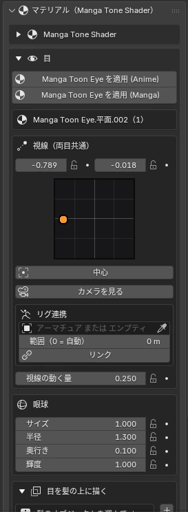
<figcaption>マテリアル › 目</figcaption>
</figure>
<figure class="ms-shot" markdown>
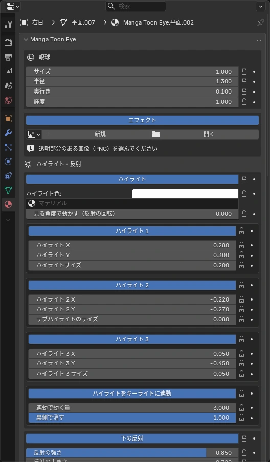
<figcaption>プロパティ › マテリアル › Manga Toon Eye</figcaption>
</figure>

眼球の球面に沿って虹彩が奥に見える**視差のある目**です。左右別々のオブジェクトで、視線ターゲットにドライバーで追従します（Python の自動実行は不要）。

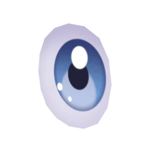アニメ

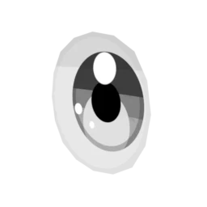漫画（白黒・インク線）

- **目を髪の上に描く**：カメラから見て目の前にある髪（とその輪郭線）だけを透かします
- **視線ターゲット / カメラを見る**：頭のボーンに付いたターゲットで視線を動かす
- **目のパッド**：ドラッグで視線を動かせる操作パッド。リグ連携にも対応
- 虹彩・瞳孔・まぶたの影・ハイライトは、プロパティエディターのマテリアルタブで調整

**表情の作り方**

専用の切り替えボタンはなく、次の3つを組み合わせて表情を作ります。どれもキーフレームを打てるので、コマやカットごとに切り替えられます。

- **瞳孔の形**：丸・多角形・星・ハートから選びます（[瞳孔の形](../spec/mte.md#mte-pupil-pupil-shape)）
- **エフェクト**：ハートやキラキラなどの PNG を目の上に重ねます（[エフェクト](../spec/mte.md#mte-eye-effect-image)）
- **目の表示**：目／目＋エフェクト／白目＋エフェクト／隠すを切り替えます。補間なしのキーフレームが入り、パッと切り替わります（[目の表示](../spec/mte.md#mte-eye-effect-display)）

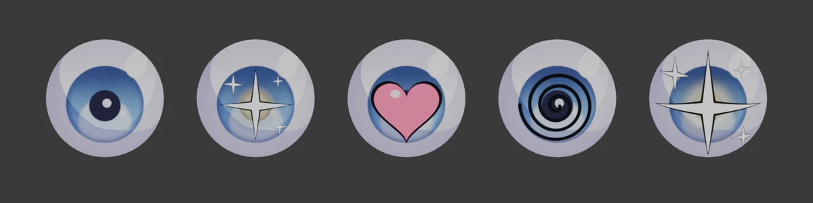

### リグ連携（目） Link to Rig · Eyes

<figure class="ms-rig-demo" markdown>
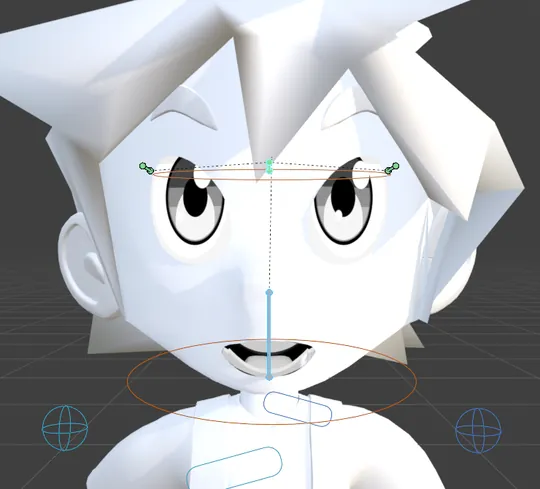
<figcaption>視線のコントローラーのボーンにつないで、左右に動かしたところ。Rigify・Auto-Rig Pro など、どのリグのボーンにもつなげます</figcaption>
</figure>
<figure class="ms-shot" markdown>
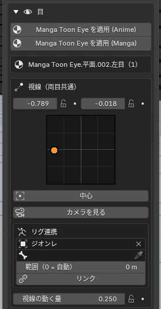
<figcaption>マテリアル › 目 › 視線（両目共通）</figcaption>
</figure>

視線（と、エフェクトの位置）を、リグのコントローラーのボーンか、エンプティで動かせます。ボーン／エンプティが四角の中を上下左右に動くと、目もその分動きます。

- Rigify のように左右の目のボーン（eye.L / eye.R）があるリグは、リンクしたときに**片目ずつも自動でつながり**、片目だけを動かせます（両目共通の視線に足される）
- 「エフェクトの位置」（目の上に重ねる画像）にも、同じ形のリグ連携があります
- 視線ターゲットを使っているときは、ターゲットで動きます（パッドは無効）

| 項目 | 内容 |
|---|---|
| リグ（アーマチュア または エンプティ） | コントローラーのボーンを持つアーマチュア、またはコントローラーにするエンプティ |
| ボーン | アーマチュアのときに、視線を動かすボーンを選ぶ |
| 範囲（0 = 自動） | ボーン／エンプティが中心から端まで動く距離。0 = ボーンの長さ（エンプティの大きさ）の半分 |
| リンク | 連携を始める。連携中はパッドが消え、リグだけで動く。× で解除するとパッドに戻る |
| キャリブレーション（今の位置を中心に） | エンプティのとき、今の位置を視線の中心にする |
| コントローラーを目の位置に合わせる | 連携したボーン（Rigify の eyes / eye.L / eye.R など）を目の板のすぐ前に移す |

数値を変えたときの見た目は [マテリアル仕様 › Manga Toon Eye](../spec/mte.md) にあります。

## <i class="bi bi-emoji-smile-fill"></i> 口 Manga Mouth · Manga Toon Mouth NEW {data-toc-label="口 Manga Mouth · Manga Toon Mouth"}

<figure class="ms-shot" markdown>
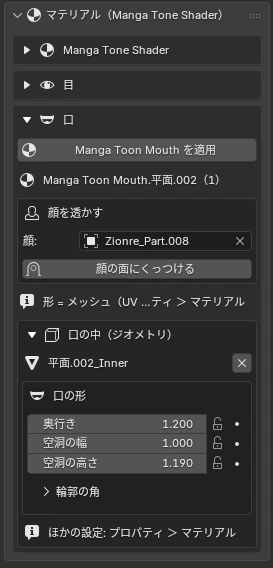
<figcaption>マテリアル › 口</figcaption>
</figure>

顔の面にくっつく板ポリが、そのまま口の形になるアニメ口です。口の中は、奥行きのある喉・舌・歯として見せます。

**口の形の作り方**

形のプリセットはなく、**口の板（メッシュ）の形がそのまま口の形**になります。

- 口のオブジェクトを選んで編集モードに入り、頂点を動かして形を作ります（UV の四角の中が口になります）
- 開け閉めは、口の板そのものを変形させて作ります（編集モード・シェイプキー・アーマチュアなど）。歯と舌は下の「リグ連携」でボーンについてきます
- 口の中の空洞（奥行き・幅・高さ）と、輪郭の角はサイドバーの「口の形」で調整します

| 項目 | 内容 |
|---|---|
| 形 | 口の板のメッシュそのもの。編集モードで頂点を動かす |
| 口の中 | ジオメトリで足す／外す。空洞の奥行き・幅・高さ |
| 歯 | 歯のスタイル（一枚板・四角・丸・ギザ）、上下それぞれの高さ・幅・位置・回転（前後・左右・正面） |
| 配置 | 顔の面にくっつける、顔をマスクで透かす |
| リグ連携 | 歯と舌をボーンで動かす（下の「リグ連携（口の中）」） |

### リグ連携（口の中） Rig Link · Mouth Inside

<figure class="ms-rig-demo" markdown>

<figcaption>上の歯・下の歯・舌をボーンにつないで、あごのボーンを開け閉めしたところ。Rigify・Auto-Rig Pro など、どのリグのボーンにもつなげます。口の板の開閉は、あごのボーンにドライバーでつないだシェイプキーで動かしています</figcaption>
</figure>
<figure class="ms-shot" markdown>
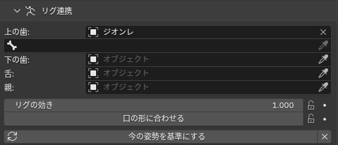
<figcaption>プロパティ › マテリアル › Manga Toon Mouth › リグ連携</figcaption>
</figure>

口の中の**歯と舌**をリグのボーン（またはオブジェクト）につなぎ、あごや舌のボーンの動きについてこさせます。

ボーンの動きは「今の姿勢を基準にする」を押したときのポーズからの差で伝わります。リグに付けたら、口を閉じた普通の姿勢で一度押してください。

| 項目 | 内容 |
|---|---|
| 上の歯 ／ 下の歯 ／ 舌 | それぞれを動かすオブジェクト。アーマチュアを選ぶと、下の欄でボーンを選べる |
| 親 | 動きを測る元（頭など）。空なら自動（同じアーマチュアの head などのボーン → エンプティの親 → 口の親） |
| リグの効き | ボーンの動きをどれだけ伝えるか（1 = 同じだけ） |
| 口の形に合わせる | 口の板の形が変わる（開く・閉じるなど）と、歯と舌も一緒に動く。オフ = 基準の形の位置のまま |
| 今の姿勢を基準にする | 今のポーズと今の口の形を、歯と舌の基準の位置にする |
| × | リグとの連携をやめる |

数値を変えたときの見た目は [マテリアル仕様 › Manga Toon Mouth](../spec/mtm.md) にあります。
