# <i class="bi bi-vector-pen"></i> Outlines: Choose Lines by Their Role NEW {data-toc-label="Outlines: Choose Lines by Their Role"}

You choose lines by **where they go**, not by how they are drawn (the method). One outer line only, as many inner lines as you like. Conflicting combinations can't be selected, so you never end up with doubled lines.

## <i class="bi bi-ui-checks"></i> Outer Silhouette · Inner Lines · Line Look

<figure class="ms-shot" markdown>
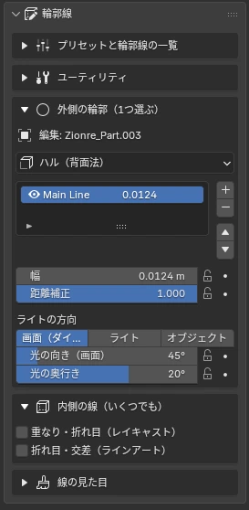
<figcaption>Sidebar › Outlines</figcaption>
</figure>

<button type="button" data-ver="45" aria-pressed="false">Blender 4.5</button><button type="button" data-ver="52" aria-pressed="true">Blender 5.1 or later</button>

① Outer Line <small>choose one</small>

<label><input type="radio" name="outer" value="none"> None</label>
<label><input type="radio" name="outer" value="hull" checked> Hull</label>
<label data-rc><input type="radio" name="outer" value="ray"> Raycast</label>
<label><input type="radio" name="outer" value="la"> Line Art</label>
<label><input type="radio" name="outer" value="alpha"> Alpha Shape</label>

② Inner Lines <small>any number</small>

<label><input type="checkbox" name="inner" value="ao" checked> Contact / Valley (AO)</label>
<label data-rc><input type="checkbox" name="inner" value="ray"> Overlap / Crease (Raycast)</label>
<label><input type="checkbox" name="inner" value="la"> Crease / Intersection (Line Art)</label>

Raycast needs Blender 5.1 or later. On 4.5, use AO instead.

③ Line Look

WeightWobble / BoilTextureColor

Setup: Hull + AO

An interactive mock-up. Switch the version and unavailable methods turn gray.

| Method | What it draws | 4.5 | 5.1+ |
|---|---|:-:|:-:|
| Hull | An inverted outer shell. Line layers can be stacked | ○ | ○ |
| AO Lines | Recessed spots: contact, intersections and valley folds | ○ | ○ |
| Line Art | Grease Pencil. Per collection | ○ | ○ |
| Raycast | Silhouette, overlaps and creases, each with its own width | — | ○ |
| Alpha | Follows the shape cut out by a PNG | ○ | ○ |

!!! shout "Fix Automatically"
    The current setup is shown on one line at the bottom of the panel. If there is a doubled outline, an overlap with an old-style outline, no camera and so on, a warning and a "Fix Automatically" button appear.

## <i class="bi bi-collection-fill"></i> Line Presets

Switch the whole line look at once, like picking a different pen. "Manga Standard" and "Heavy Manga" also set up the outer and inner lines. You can save your own settings with an icon.

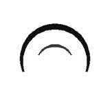Manga Standard <small>Hull + AO</small>

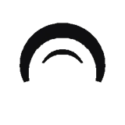Heavy Manga <small>Hull + Raycast</small>

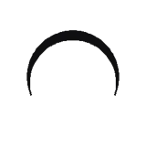G-Pen <small>Strong thick-thin contrast</small>

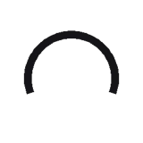Marker <small>Even width, uneven density</small>

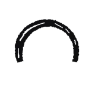Oil Brush <small>Dry brush, color trace</small>

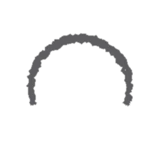Rough Pencil <small>Wobble, boil</small>

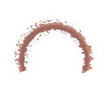Paint <small>Color trace, brush marks</small>

On 4.5, inner lines in presets that use Raycast are automatically replaced with AO.

#### Presets on a Sphere

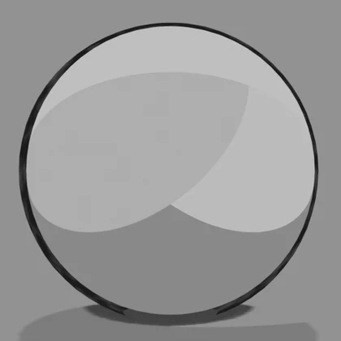Manga Standard

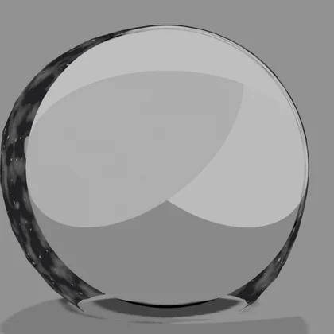Heavy Manga

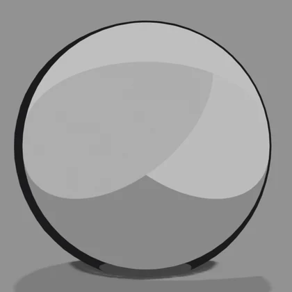G-Pen

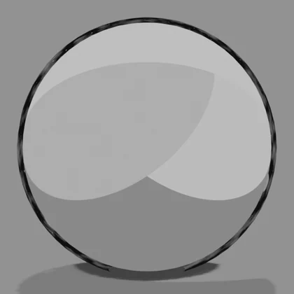Marker

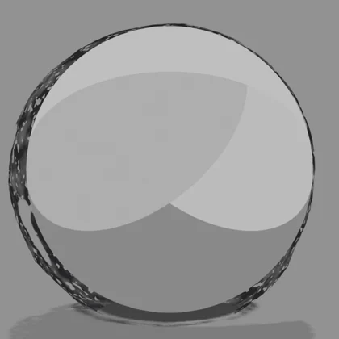Oil Brush

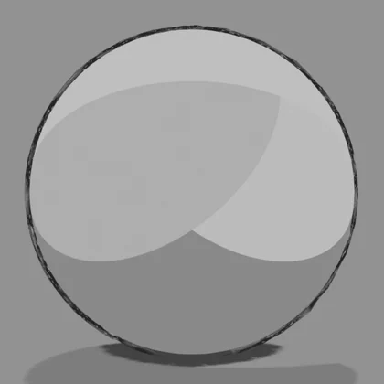Rough Pencil

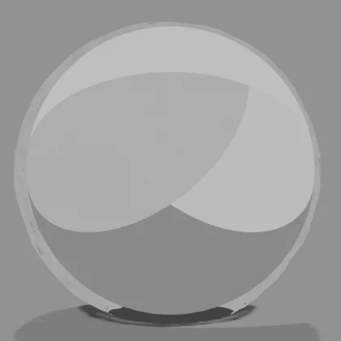Paint

Each preset applied to the same sphere and rendered as is (Blender 5.1; only the outline settings differ).

### Preset Values

These are the values set when you choose a preset. All presets share black lines and a dark gray distance color. "Manga Standard" and "Heavy Manga" also switch which line types are used (Hull, Raycast or Line Art for the outer and inner lines). The other presets keep the line types as they are and only change the look, such as width and wobble. "Paint" also turns on Sync Base Color.

| | Item | Manga Standard | Heavy Manga | G-Pen | Marker | Oil Brush | Rough Pencil | Paint |
|---|---|---|---|---|---|---|---|---|
| **Setup** | Line types used | Outer: Hull | Outer: Hull, inner: Raycast | Unchanged | Unchanged | Unchanged | Unchanged | Unchanged |
| **Weight** | Thickness (m) | 0.04 | 0.07 | 0.04 | 0.045 | 0.055 | 0.03 | 0.055 |
|  | Distance Compensation | 1 | 1 | 1 | 1 | 0.8 | 1 | 0.8 |
|  | Light-Based Width | 0.55 | 1 | 0.8 | 0.15 | 0.9 | 0.3 | 0.6 |
|  | Shadow Side Scale | 1.8 | 3 | 2.2 | 1.3 | 2.6 | 1.5 | 2 |
|  | Light Side Scale | 0.5 | 0.15 | 0.35 | 0.8 | 0.25 | 0.6 | 0.5 |
|  | Taper | 0.8 | 0.9 | 0.8 | 0.2 | 0.9 | 0.5 | 0.9 |
|  | Thin with Distance | 0.25 | 0.35 | 0.3 | 0.1 | 0.3 | 0.2 | 0.2 |
|  | Depth Fade | 0.2 | 0.25 | 0.2 | 0.1 | 0.3 | 0.3 | 0 |
| **Wobble** | Width Wobble | 0.08 | 0.2 | 0.1 | 0.05 | 0.45 | 0.3 | 0.55 |
|  | Position Wobble | 0 | 0.1 | 0 | 0.05 | 0.2 | 0.5 | 0.35 |
|  | Wobble Scale | 8 | 6 | 8 | 8 | 5 | 12 | 4 |
|  | Overshoot | 0 | 0 | 0 | 0.02 | 0.04 | 0.08 | 0.04 |
|  | Boil Interval (frames) | 0 | 0 | 0 | 0 | 0 | 2 | 0 |
| **Texture** | Dry Brush | 0 | 0.15 | 0 | 0.1 | 0.45 | 0.35 | 0.2 |
|  | Dry Brush Scale | 25 | 22 | 25 | 30 | 18 | 40 | 30 |
|  | Gaps | 0 | 0.05 | 0 | 0.05 | 0.15 | 0.2 | 0 |
|  | Gap Scale | 2.5 | 2.5 | 2.5 | 2.5 | 2.5 | 3 | 2.5 |
|  | Density Variation | 0.12 | 0.3 | 0 | 0.35 | 0.3 | 0.4 | 0.3 |
|  | Overlap Opacity | 1 | 1 | 1 | 0.8 | 0.9 | 0.6 | 0.9 |
|  | Brush Edge | 0 | 0 | 0 | 0 | 0 | 0 | 0.6 |
|  | Brush Scale | — | — | — | — | — | — | 6 |
| **Color** | Color Trace | 0 | 0 | 0 | 0 | 0 | 0 | 1 |
|  | Trace Darkness | 0.55 | 0.35 | 0.55 | 0.6 | 0.5 | 0.45 | 0.18 |
|  | Trace Saturation | 1.3 | 1.3 | 1.3 | 1.3 | 1.3 | 1.3 | 1.15 |

## <i class="bi bi-sliders"></i> Line Look

| Group | Items | Look |
|---|---|---|
| Weight | Thinner on the light side and thicker on the shadow side, taper, thinner and fainter with distance | Solid-looking main lines, aerial perspective in the distance |
| Wobble / Boil | Width wobble, position wobble, boil interval (frames) | Hand-drawn unsteadiness. In animation, lines wobble as if redrawn every given number of frames |
| Texture | Dry brush, gaps, density variation, overlap opacity | Dry-brush strokes, overlapping marker strokes |
| Color | Color trace (darkness, saturation), Sync Base Color, Pure Black Line | Takes the line color from the base color, e.g. brown on skin, a darker hair color on hair. "Sync Base Color" reads the material color automatically |

Set everything to 0 and you get the same lines as the standard Hull. Values can be keyframed (except Boil Interval). "Copy Line Settings" copies the setup and look of the active object to all selected objects. You can also select another object and use "Paste Line Settings".

- **Line layers**: Hull lines can be stacked with "Add Line Layer" (a thick outer line plus a thin inner line, etc.). Layers can be moved up and down or removed
- **Line Art line colors**: when the outer line or inner lines use Line Art, ③ Line Look shows a **Line Color** for each Line Art line under "Line Art (collection)", where you can change it

## <i class="bi bi-list-check"></i> Preset &amp; Outline List

<figure class="ms-shot" markdown>
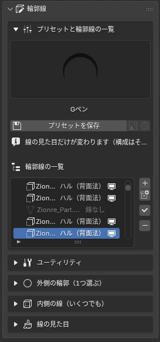
<figcaption>Outlines › Preset &amp; Outline List</figcaption>
</figure>

- **+ / Collection**: adds lines to the selected meshes, or to a whole collection (using the current preset)
- **✓ Apply**: applies the current preset's look to the row selected in the list
- **−**: removes the lines of the selected row
- **👁 / 🖥**: turns only the line effect on and off, without deleting the settings

