# <i class="bi bi-vector-pen"></i> 輪郭線：線の役割で選ぶ NEW {data-toc-label="輪郭線：線の役割で選ぶ"}

線の描き方（方式）ではなく、**どこに引く線か**で選びます。外側の輪郭は1つだけ、内側の線はいくつでも。矛盾する組み合わせは選べないので、線が二重になる心配がありません。

## <i class="bi bi-ui-checks"></i> 役割で選ぶ Outer Silhouette · Inner Lines · Line Look

<figure class="ms-shot" markdown>
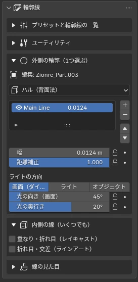
<figcaption>サイドバー › 輪郭線</figcaption>
</figure>

<button type="button" data-ver="45" aria-pressed="false">Blender 4.5</button><button type="button" data-ver="52" aria-pressed="true">Blender 5.1 以上</button>

① 外側の輪郭 <small>1つだけ</small>

<label><input type="radio" name="outer" value="none"> なし</label>
<label><input type="radio" name="outer" value="hull" checked> ハル</label>
<label data-rc><input type="radio" name="outer" value="ray"> レイキャスト</label>
<label><input type="radio" name="outer" value="la"> ラインアート</label>
<label><input type="radio" name="outer" value="alpha"> アルファ（透過の形）</label>

② 内側の線 <small>いくつでも</small>

<label><input type="checkbox" name="inner" value="ao" checked> 接触・谷折り（AO）</label>
<label data-rc><input type="checkbox" name="inner" value="ray"> 重なり・折れ目（レイキャスト）</label>
<label><input type="checkbox" name="inner" value="la"> 折れ目・交差（ラインアート）</label>

レイキャストは Blender 5.1 以上で使えます。4.5 では AO をお使いください。

③ 線の見た目

強弱揺れ・ボイル質感色

構成: ハル ＋ AO

操作できる模式図です。バージョンを切り替えると、使えない方式が灰色になります。

| 方式 | 内容 | 4.5 | 5.1+ |
|---|---|:-:|:-:|
| ハル | 反転した外殻。線レイヤーを重ねられる | ○ | ○ |
| AO ライン | 接触・交差・谷折りの奥まった所 | ○ | ○ |
| ラインアート | グリースペンシル。コレクション単位 | ○ | ○ |
| レイキャスト | シルエット・重なり・折れ目を別の太さで | — | ○ |
| アルファ | PNG で切り抜いた形に沿う | ○ | ○ |

!!! shout "自動で直す"
    パネルの下に今の構成が1行で出ます。輪郭の二重、古いアウトラインとの重複、カメラなしなどがあると警告と「自動で直す」ボタンが出ます。

## <i class="bi bi-collection-fill"></i> プリセット Line Presets

ペンの種類を選ぶ感覚で、線の見た目をまとめて切り替えます。「マンガ標準」「重厚マンガ」は外側・内側の構成も一緒に入ります。自分の設定はアイコン付きで保存できます。

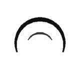マンガ標準 <small>ハル＋AO</small>

重厚マンガ <small>ハル＋レイキャスト</small>

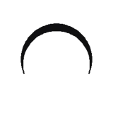Gペン <small>強弱がはっきり</small>

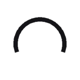油性ペン <small>均一・濃淡ムラ</small>

筆（油彩） <small>かすれ・色トレス</small>

鉛筆ラフ <small>揺れ・ボイル</small>

絵の具 <small>色トレス・筆跡</small>

4.5 では、レイキャストを含むプリセットの内側の線は自動で AO に置き換わります。

#### 球に適用したときの線 Presets on a Sphere

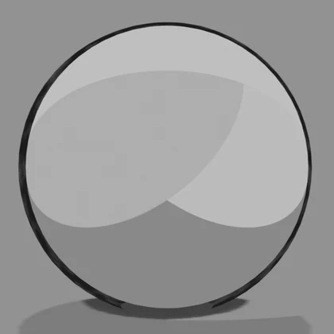マンガ標準

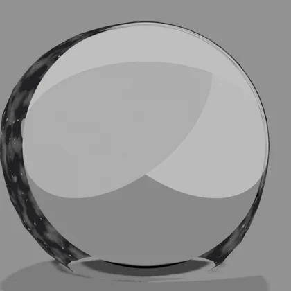重厚マンガ

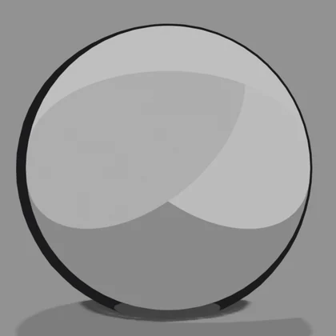Gペン

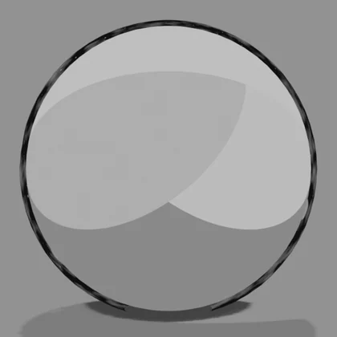油性ペン

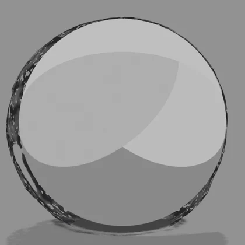筆（油彩）

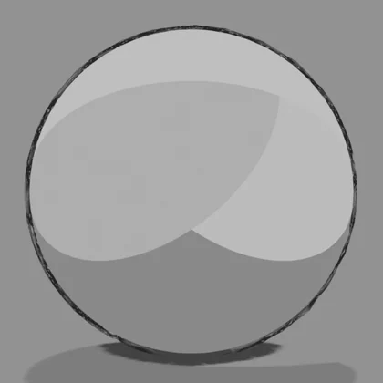鉛筆ラフ

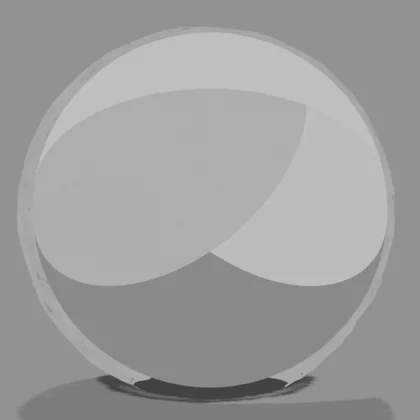絵の具

同じ球に各プリセットを適用し、そのまま撮った比較です（Blender 5.1、輪郭線の設定以外は同じ）。

### プリセットの値 Preset Values

プリセットを選んだときに入る値です。線の色は黒、遠景の色は濃いグレーで共通です。「マンガ標準」「重厚マンガ」は、使う線の種類（外側・内側にハル・レイキャスト・ラインアートのどれを使うか）も切り替えます。ほかのプリセットは線の種類はそのままで、太さや揺れなどの見た目だけを変えます。「絵の具」は下地色を取得もオンになります。

| | 項目 | マンガ標準 | 重厚マンガ | Gペン | 油性ペン | 筆（油彩） | 鉛筆ラフ | 絵の具 |
|---|---|---|---|---|---|---|---|---|
| **構成** | 使う線の種類 | 外側をハルに | 外側をハル、内側をレイキャストに | 変えない | 変えない | 変えない | 変えない | 変えない |
| **強弱** | 太さ（m） | 0.04 | 0.07 | 0.04 | 0.045 | 0.055 | 0.03 | 0.055 |
|  | 距離補正 | 1 | 1 | 1 | 1 | 0.8 | 1 | 0.8 |
|  | 光源で太さを変える | 0.55 | 1 | 0.8 | 0.15 | 0.9 | 0.3 | 0.6 |
|  | 影側の太さ | 1.8 | 3 | 2.2 | 1.3 | 2.6 | 1.5 | 2 |
|  | 光側の太さ | 0.5 | 0.15 | 0.35 | 0.8 | 0.25 | 0.6 | 0.5 |
|  | 入り抜き | 0.8 | 0.9 | 0.8 | 0.2 | 0.9 | 0.5 | 0.9 |
|  | 奥ほど細く | 0.25 | 0.35 | 0.3 | 0.1 | 0.3 | 0.2 | 0.2 |
|  | 奥ほど薄く | 0.2 | 0.25 | 0.2 | 0.1 | 0.3 | 0.3 | 0 |
| **揺れ** | 太さのゆらぎ | 0.08 | 0.2 | 0.1 | 0.05 | 0.45 | 0.3 | 0.55 |
|  | 位置のゆらぎ | 0 | 0.1 | 0 | 0.05 | 0.2 | 0.5 | 0.35 |
|  | ゆらぎのスケール | 8 | 6 | 8 | 8 | 5 | 12 | 4 |
|  | 突き抜け | 0 | 0 | 0 | 0.02 | 0.04 | 0.08 | 0.04 |
|  | ボイル間隔（フレーム） | 0 | 0 | 0 | 0 | 0 | 2 | 0 |
| **質感** | かすれ | 0 | 0.15 | 0 | 0.1 | 0.45 | 0.35 | 0.2 |
|  | かすれの細かさ | 25 | 22 | 25 | 30 | 18 | 40 | 30 |
|  | 途切れ | 0 | 0.05 | 0 | 0.05 | 0.15 | 0.2 | 0 |
|  | 途切れのスケール | 2.5 | 2.5 | 2.5 | 2.5 | 2.5 | 3 | 2.5 |
|  | 濃淡ムラ | 0.12 | 0.3 | 0 | 0.35 | 0.3 | 0.4 | 0.3 |
|  | 重なりの濃さ | 1 | 1 | 1 | 0.8 | 0.9 | 0.6 | 0.9 |
|  | 筆跡の縁 | 0 | 0 | 0 | 0 | 0 | 0 | 0.6 |
|  | 筆跡のスケール | — | — | — | — | — | — | 6 |
| **色** | 色トレス | 0 | 0 | 0 | 0 | 0 | 0 | 1 |
|  | トレスの暗さ | 0.55 | 0.35 | 0.55 | 0.6 | 0.5 | 0.45 | 0.18 |
|  | トレスの彩度 | 1.3 | 1.3 | 1.3 | 1.3 | 1.3 | 1.3 | 1.15 |

## <i class="bi bi-sliders"></i> 線の見た目 Line Look

| グループ | 項目 | 見た目 |
|---|---|---|
| 強弱 | 光源側を細く・影側を太く、入り抜き、奥ほど細く・薄く | 立体感のある主線、遠景の空気遠近 |
| 揺れ・ボイル | 太さの揺らぎ、位置の揺れ、ボイル間隔（コマ） | 手で引いたブレ。アニメ時は指定コマごとに描き直したように揺れる |
| 質感 | かすれ、途切れ、濃淡ムラ、重なりの濃さ | ドライブラシ、マーカーの重なり |
| 色 | 色トレス（暗さ・彩度）、下地色を取得、線を真っ黒に | 肌は茶、髪は濃い髪色など、下地から線色を取る。「下地色を取得」でマテリアルの色を自動で読み込む |

すべて 0 にすると、標準のハルと同じ線に戻ります。値はキーフレームを打てます（ボイル間隔を除く）。「線設定をコピー」で、アクティブなオブジェクトの構成と見た目を選択中の全オブジェクトへ写せます。別のオブジェクトを選んでから「線設定を貼り付け」で写すこともできます。

- **線レイヤー**：ハルの線は「線レイヤーを追加」で重ねられます（太い外線＋細い内線など）。レイヤーは上下に移動・削除できます
- **ラインアートの線の色**：外側の輪郭・内側の線にラインアートを使っているときは、③ 線の見た目の「ラインアート（コレクション）」に**線の色**がラインアートの線ごとに並び、そこで色を変えられます

## <i class="bi bi-list-check"></i> プリセットと輪郭線の一覧 Preset &amp; Outline List

<figure class="ms-shot" markdown>
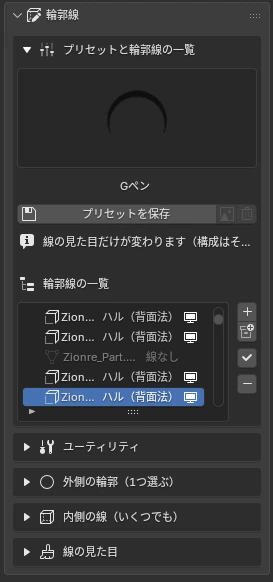
<figcaption>輪郭線 › プリセットと輪郭線の一覧</figcaption>
</figure>

- **＋ / コレクション**：選択中のメッシュ、またはコレクション丸ごとに線を付ける（今のプリセットで）
- **✓ 適用**：一覧で選んだ行に、今のプリセットの見た目を適用
- **−**：選んだ行の線を外す
- **👁 / 🖥**：設定を消さずに線の効果だけオン・オフ

