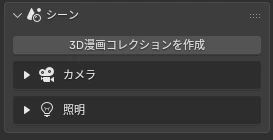
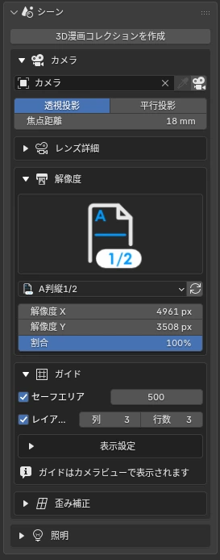
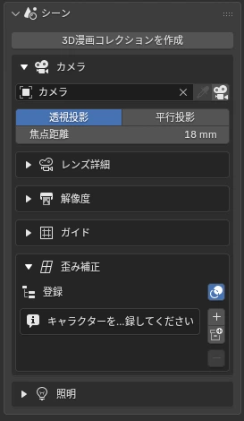
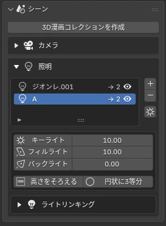
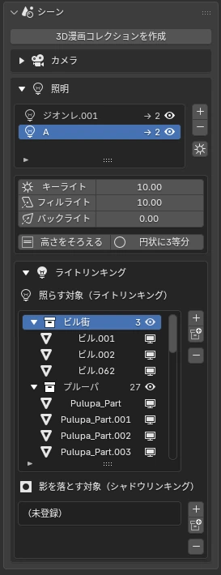

# <i class="bi bi-camera-reels-fill"></i> Scene: Setting the Stage for a Panel

The first button to press is "Create 3D Manga Collection". It sets up where the foreground, characters, background, camera and speech balloons go, and every button after that sorts new items into this structure automatically.

## <i class="bi bi-archive-fill"></i> Create 3D Manga Collection

<figure class="ms-shot" markdown>

<figcaption>Sidebar › Scene</figcaption>
</figure>

Outliner

- 3D Manga Collection
    - A: Stage
        - 0: Foreground Effects — impact bursts, sparks, etc.
        - 1: Characters / Objects
        - 2: Background Effects — focus lines, magic circles, etc.
    - B: Lighting — three lights
    - C: Background / World
    - D: Camera
    - E: Speech Balloons — toggle their visibility all at once

You can keep your existing Outliner contents, or delete them and start over. When you add an effect, it goes to its default place (foreground or background), and you can move it to the other list later.

!!! bubble "Tip"
    Put your characters in "1: Characters / Objects". Light Linking and the outline list can then handle them per collection, which makes things easier.

## <i class="bi bi-camera-fill"></i> Camera · Lens Details · Resolution · Guides

Set up the camera from the paper size and the panel shape. The presets cover full A-size and B-size pages, plus panels that split the page vertically or horizontally into 1/2 to 1/6. The resolution and guides are set in one go, and the panel division lines appear in the camera frame.

A-size (full page)

B-size (full page)

A-size vertical 1/3

A-size horizontal 1/4

<figure class="ms-shot" markdown>

<figcaption>Scene › Camera</figcaption>
</figure>

| Subpanel | What it does |
|---|---|
| Camera | Set as the scene camera, switch to camera view, reload the preset |
| Lens Details | Focal length (strength of perspective), clip range, etc. |
| Resolution | Resolution matched to the paper size and panel ratio |
| Guides | Safe areas, layout guides, column and row division lines with their color and width |

### Resolution Presets

Resolutions are the size when printed at 600 dpi. "Vertical" splits the page top to bottom into wide panels; "horizontal" splits it side to side into tall panels. Every preset has a 500 px safe area (about 21 mm on paper).

| Preset | Resolution (px) | Size on paper (mm) |
|---|---|---|
| **A-size** (full page, A4) | 4,961 × 7,016 | 210 × 297 |
| A-size vertical 1/2 | 4,961 × 3,508 | 210 × 149 |
| A-size vertical 1/3 | 4,961 × 2,339 | 210 × 99 |
| A-size vertical 1/4 | 4,961 × 1,754 | 210 × 74 |
| A-size vertical 1/5 | 4,961 × 1,403 | 210 × 59 |
| A-size horizontal 1/2 | 2,480 × 7,016 | 105 × 297 |
| A-size horizontal 1/3 | 1,654 × 7,016 | 70 × 297 |
| A-size horizontal 1/4 | 1,240 × 7,016 | 52 × 297 |
| A-size horizontal 1/5 | 992 × 7,016 | 42 × 297 |
| A-size horizontal 1/6 | 827 × 7,016 | 35 × 297 |

| Preset | Resolution (px) | Size on paper (mm) |
|---|---|---|
| **B-size** (full page, B4) | 6,071 × 8,598 | 257 × 364 |
| B-size vertical 1/2 | 6,071 × 4,299 | 257 × 182 |
| B-size vertical 1/3 | 6,071 × 2,866 | 257 × 121 |
| B-size vertical 1/4 | 6,071 × 2,150 | 257 × 91 |
| B-size vertical 1/5 | 6,071 × 1,720 | 257 × 73 |
| B-size horizontal 1/2 | 3,035 × 8,598 | 128 × 364 |
| B-size horizontal 1/3 | 2,023 × 8,598 | 86 × 364 |
| B-size horizontal 1/4 | 1,518 × 8,598 | 64 × 364 |
| B-size horizontal 1/5 | 1,214 × 8,598 | 51 × 364 |
| B-size horizontal 1/6 | 1,012 × 8,598 | 43 × 364 |

## <i class="bi bi-aspect-ratio-fill"></i> Distortion Fix NEW {data-toc-label="Distortion Fix"}

Fixes faces that get stretched near the edge of the frame when you shoot close up with a wide-angle lens. The camera stays as it is; **only the face looks as if it was shot with a different lens**.

<figure class="ms-shot" markdown>

<figcaption>Scene › Camera › Distortion Fix</figcaption>
</figure>

- **Face Lens**: even with an 18mm camera, the face looks like it was shot at 85mm
- **Pull Toward Camera**: moves the face toward the camera so it looks bigger
- **Full-Effect Radius / Falloff Width**: blends the fix naturally from the neck down
- The center of the fix is parented to the head bone automatically, so it follows when you move the character

Register with "Register by Collection" or "+ Register Selected". Once every mesh in a collection is registered, they are automatically grouped into a single per-collection fix. Use 👁 in the list to turn the effect on and off, and "Highlight Registered" to highlight the targets in the viewport.

Try it

<b>camera 18mm</b><b id="dfFaceLab" class="g">face 18mm</b><label><input id="dfShow" type="checkbox"> Show the fix area in color</label>

<label>Face Lens <input id="dfLens" type="range" min="18" max="120" value="18"><output id="dfLensOut">18mm</output></label>
<button type="button" id="dfReset" class="ms-df3d__btn"><i class="bi bi-arrow-counterclockwise"></i> Reset Position</button>

A 3D scene of the sample character (Zionre) shot with an 18mm camera. Drag the character (or the red arrow) left and right: the closer to the edge of the frame, the more the face stretches sideways. Raise "Face Lens" and only the face goes back to a telephoto-like shape, while everything from the neck down blends in and keeps the original perspective.

## <i class="bi bi-lightbulb-fill"></i> Lights

<figure class="ms-shot" markdown>

<figcaption>Scene › Lights</figcaption>
</figure>

Each light group comes with a set of three lights. The shader reads the **color channels** of the light separately, so you can assign red, green and blue to different tone levels.

<i style="background:var(--ms-key)"></i><b>Key Light</b>: the brightest surfaces. The main light that sets the shape of the shadows

<i style="background:var(--ms-fill)"></i><b>Fill Light</b>: the midtones inside the shadows. The second tone level

<i style="background:var(--ms-back)"></i><b>Back Light</b>: a rim that lifts the outline. White highlights from backlighting

Use "Align Heights" and "Space Evenly in a Circle" to tidy up the layout. You can keep several groups in the list, so you can give each character its own lights.

Try it

<b>Manga Tone Shader</b><button type="button" data-m="1" class="on">Tone</button><button type="button" data-m="0">RGB</button>

<button type="button" id="ltAlign" class="ms-df3d__btn"><i class="bi bi-distribute-vertical"></i> Align Heights</button>
<button type="button" id="ltEven" class="ms-df3d__btn"><i class="bi bi-circle"></i> Space Evenly in a Circle</button>
<button type="button" id="ltReset" class="ms-df3d__btn"><i class="bi bi-arrow-counterclockwise"></i> Reset Lights</button>
<button type="button" id="ltCam" class="ms-df3d__btn"><i class="bi bi-camera-video"></i> Reset Camera</button>

Drag a light ball to move it along the dotted blue circle. Hold Shift and drag up or down to change its height. Drag on empty space to orbit the camera, and use the wheel to zoom in and out. Click an axis circle at the top right to view from that direction. Switch to "RGB" to see the color channels the shader reads (red = key, green = fill, blue = back). In "Tone", those channels become white, halftone-dot midtones and white backlight highlights.

## <i class="bi bi-link-45deg"></i> Light Linking NEW {data-toc-label="Light Linking"}

Manage the "Lit Objects" and "Shadow Casters" of the selected light group, each in its own list. This lets you keep character A's lights from hitting character B or the background.

<figure class="ms-shot" markdown>

<figcaption>Lights › Light Linking</figcaption>
</figure>

- **+**: adds the collection selected in the Outliner, or the selected objects if there is none
- **Collection button**: pick a collection from a list and add it
- **−**: removes the row selected in the list
- Things without faces, such as empties and armatures, can't be added

!!! shout "If everything turns black"
    If the character isn't in the light group's "Lit Objects", Manga Tone Shader renders it solid black.

