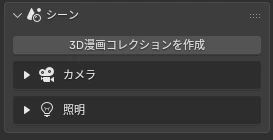
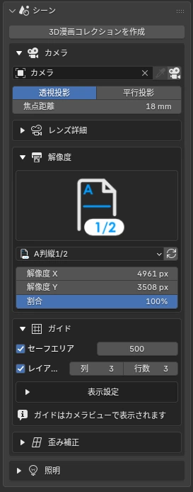
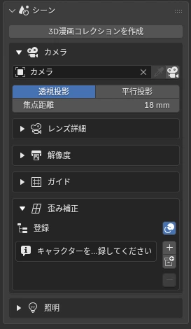
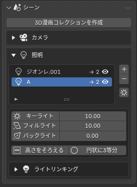
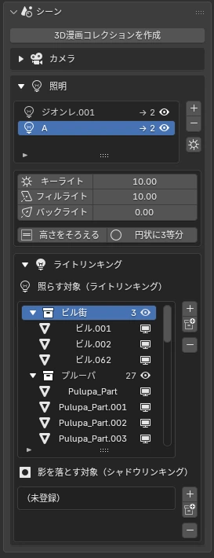

# <i class="bi bi-camera-reels-fill"></i> シーン：コマの舞台をつくる

最初に押すのは「3D漫画コレクションを作成」です。前景・キャラクター・背景・カメラ・吹き出しの置き場所が決まり、以降のボタンはこの構成に合わせて自動で振り分けます。

## <i class="bi bi-archive-fill"></i> 3D漫画コレクション Create 3D Manga Collection

<figure class="ms-shot" markdown>

<figcaption>サイドバー › シーン</figcaption>
</figure>

アウトライナー

- 3D漫画コレクション
    - A: ステージ
        - 0: 前景エフェクト — ウニフラ・火花など
        - 1: キャラクター / オブジェクト
        - 2: 背景エフェクト — 集中線・魔法陣など
    - B: ライティング — 3灯のライト
    - C: 背景 / ワールド
    - D: カメラ
    - E: 吹き出し — まとめて表示を切替

既存のアウトライナーを残すか、消して作り直すかを選べます。エフェクトは追加するときに既定の置き場所（前景か背景）へ入り、あとから一覧で入れ替えられます。

!!! bubble "ポイント"
    キャラクターは「1: キャラクター / オブジェクト」に入れておくと、ライトリンキングや輪郭線の一覧がコレクション単位で扱えて楽です。

## <i class="bi bi-camera-fill"></i> カメラ Camera · Lens Details · Resolution · Guides

紙のサイズとコマの形からカメラを決めます。プリセットは A判・B判の全面と、縦・横に 1/2〜1/6 で割ったコマ。解像度とガイドがまとめて設定され、カメラ枠にコマ割りの線が出ます。

A判（全面）

B判（全面）

A判 縦 1/3

A判 横 1/4

<figure class="ms-shot" markdown>

<figcaption>シーン › カメラ</figcaption>
</figure>

| サブパネル | できること |
|---|---|
| カメラ | シーンのカメラに設定、カメラビューへ切替、プリセットの読み直し |
| レンズ詳細 | 焦点距離（パースの強さ）、クリップ範囲など |
| 解像度 | 紙サイズとコマの比率に合わせた解像度 |
| ガイド | セーフエリア、レイアウトガイド、列・行の分割線と色・太さ |

### 解像度のプリセット Resolution Presets

解像度は 600 dpi で印刷したときの大きさです。「縦」は紙を縦に割った横長のコマ、「横」は横に割った縦長のコマです。どのプリセットもセーフエリアは 500 px（紙の上で約 21 mm）です。

| プリセット | 解像度（px） | 紙の上の大きさ（mm） |
|---|---|---|
| **A判**（全面・A4） | 4,961 × 7,016 | 210 × 297 |
| A判 縦 1/2 | 4,961 × 3,508 | 210 × 149 |
| A判 縦 1/3 | 4,961 × 2,339 | 210 × 99 |
| A判 縦 1/4 | 4,961 × 1,754 | 210 × 74 |
| A判 縦 1/5 | 4,961 × 1,403 | 210 × 59 |
| A判 横 1/2 | 2,480 × 7,016 | 105 × 297 |
| A判 横 1/3 | 1,654 × 7,016 | 70 × 297 |
| A判 横 1/4 | 1,240 × 7,016 | 52 × 297 |
| A判 横 1/5 | 992 × 7,016 | 42 × 297 |
| A判 横 1/6 | 827 × 7,016 | 35 × 297 |

| プリセット | 解像度（px） | 紙の上の大きさ（mm） |
|---|---|---|
| **B判**（全面・B4） | 6,071 × 8,598 | 257 × 364 |
| B判 縦 1/2 | 6,071 × 4,299 | 257 × 182 |
| B判 縦 1/3 | 6,071 × 2,866 | 257 × 121 |
| B判 縦 1/4 | 6,071 × 2,150 | 257 × 91 |
| B判 縦 1/5 | 6,071 × 1,720 | 257 × 73 |
| B判 横 1/2 | 3,035 × 8,598 | 128 × 364 |
| B判 横 1/3 | 2,023 × 8,598 | 86 × 364 |
| B判 横 1/4 | 1,518 × 8,598 | 64 × 364 |
| B判 横 1/5 | 1,214 × 8,598 | 51 × 364 |
| B判 横 1/6 | 1,012 × 8,598 | 43 × 364 |

## <i class="bi bi-aspect-ratio-fill"></i> 歪み補正 Distortion Fix NEW {data-toc-label="歪み補正 Distortion Fix"}

広角で寄ったとき、画面の端で顔が引き伸ばされる問題を直します。カメラはそのままで、**顔だけ別のレンズで撮ったように**見せる仕組みです。

<figure class="ms-shot" markdown>

<figcaption>シーン › カメラ › 歪み補正</figcaption>
</figure>

- **顔だけのレンズ**：18mm のカメラでも、顔は 85mm 相当に
- **カメラへ寄せる**：顔をカメラ側へ平行移動して大きく見せる
- **全部効く範囲 / なじませる幅**：首から下へ自然につなぐ
- 補正の中心は頭のボーンに自動で親子付け。動かしても追従します

登録は「コレクションで登録」または「＋ 選択で登録」。コレクションのメッシュが全部登録されると、自動でコレクション単位の補正にまとまります。一覧の 👁 で効果のオン・オフ、「登録を色で表示」で対象をビューポートでハイライトできます。

試してみる

<b>camera 18mm</b><b id="dfFaceLab" class="g">face 18mm</b><label><input id="dfShow" type="checkbox"> 補正の範囲を色で表示</label>

<label>顔だけのレンズ <input id="dfLens" type="range" min="18" max="120" value="18"><output id="dfLensOut">18mm</output></label>
<button type="button" id="dfReset" class="ms-df3d__btn"><i class="bi bi-arrow-counterclockwise"></i> 位置をリセット</button>

サンプルシーンのキャラクター（ジオンレ）を 18mm のカメラで撮った 3D シーンです。キャラ（または赤い矢印）をドラッグして左右に動かすと、画面の端ほど顔が横に伸びます。「顔だけのレンズ」を上げると、顔だけが望遠で撮ったような形に戻り、首から下はなじませて元のパースのままです。

## <i class="bi bi-lightbulb-fill"></i> ライト：RGB の3灯 Lights

<figure class="ms-shot" markdown>

<figcaption>シーン › ライト</figcaption>
</figure>

ライトは1つのグループに3灯がセットで入ります。シェーダーはライトの**色の成分**を読み分けるので、赤・緑・青をそれぞれ別のトーンの段に割り当てられます。

<i style="background:var(--ms-key)"></i><b>キーライト</b>：いちばん明るい面。影の形を決める主光源

<i style="background:var(--ms-fill)"></i><b>フィルライト</b>：影の中の中間調。トーンの2段目

<i style="background:var(--ms-back)"></i><b>バックライト</b>：輪郭を浮かせるリム。逆光の白抜き

「高さをそろえる」「円状に3等分」で配置を整えられます。グループは一覧で複数持てるので、キャラクターごとに別のライトも組めます。

試してみる

<b>Manga Tone Shader</b><button type="button" data-m="1" class="on">トーン</button><button type="button" data-m="0">RGB</button>

<button type="button" id="ltAlign" class="ms-df3d__btn"><i class="bi bi-distribute-vertical"></i> 高さをそろえる</button>
<button type="button" id="ltEven" class="ms-df3d__btn"><i class="bi bi-circle"></i> 円状に3等分</button>
<button type="button" id="ltReset" class="ms-df3d__btn"><i class="bi bi-arrow-counterclockwise"></i> ライトをリセット</button>
<button type="button" id="ltCam" class="ms-df3d__btn"><i class="bi bi-camera-video"></i> カメラをリセット</button>

ライトの玉をドラッグすると、青い点線の円に沿って動きます。Shift を押しながら上下にドラッグすると高さが変わります。何もない所をドラッグするとカメラが回り、ホイールで寄り引きできます。右上の軸の丸をクリックすると、その向きから見られます。「RGB」に切り替えると、シェーダーが読み分けている色の成分（赤＝キー、緑＝フィル、青＝バック）がそのまま見えます。「トーン」では、その成分が白・網点の中間調・逆光の白抜きに置き換わります。

## <i class="bi bi-link-45deg"></i> ライトリンキング Light Linking NEW {data-toc-label="ライトリンキング Light Linking"}

選んだライトグループが「照らす対象」と「影を落とす対象」を、それぞれ一覧で管理します。キャラクターAのライトがキャラクターBや背景に当たらないように分けられます。

<figure class="ms-shot" markdown>

<figcaption>ライト › ライトリンキング</figcaption>
</figure>

- **＋**：アウトライナーで選んだコレクション、無ければ選択中のオブジェクトを追加
- **コレクションのボタン**：コレクションを一覧から選んで追加
- **−**：一覧で選んでいる行を外す
- エンプティやアーマチュアなど、面のないものは対象外です

!!! shout "真っ黒になるときは"
    キャラクターがライトグループの「照らす対象」に入っていないと、Manga Tone Shader は真っ黒になります。

