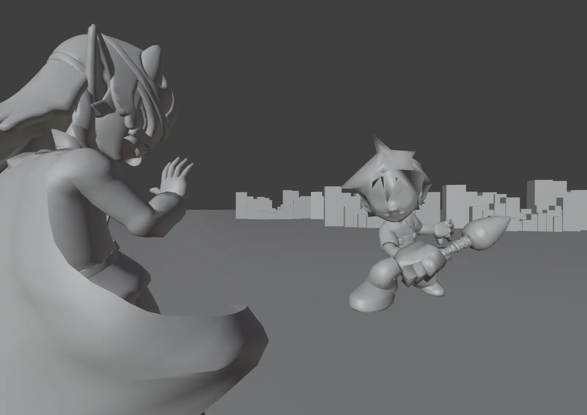
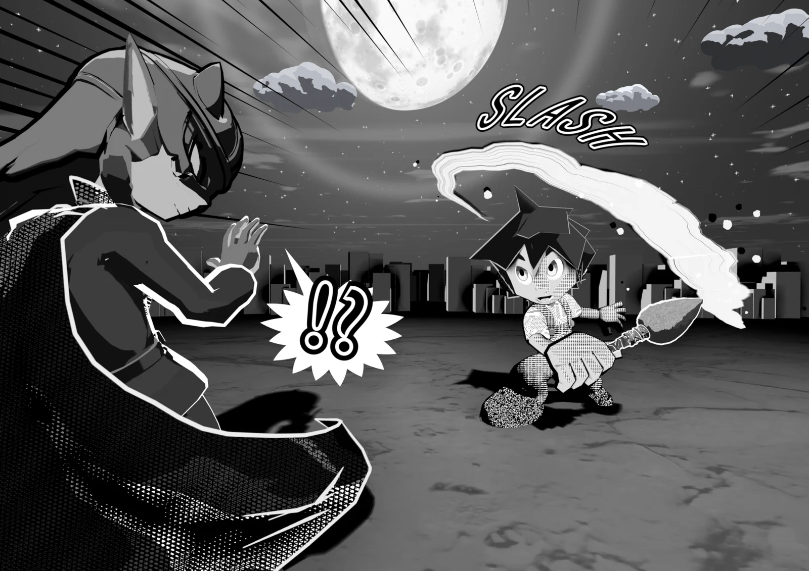

<h1>Finish <em>manga panels</em> right inside Blender.</h1>

3D Manga Studios is a Blender add-on that makes 3D scenes look like black-and-white manga pages. Screentones, outlines, camera panel layout, lights, eyes and mouths, backgrounds, effect lines and speech balloons are all covered by four panels in the Sidebar.

Blender 4.5 LTS or later5.2 LTS recommendedEEVEE onlyJapanese / English UI

[Installation](getting-started/install.md){ .md-button .md-button--primary } [Feature Guide](guide/index.md){ .md-button }

<figure markdown style="margin:0">

BeforeAfter
<input type="range" min="0" max="100" value="50" aria-label="Slider to compare before and after">

<figcaption>Drag the slider left and right to compare. Left: Solid shading. Right: the render finished with 3D Manga Studios (sample scene).</figcaption>
</figure>

## <i class="bi bi-info-circle-fill"></i> Overview

3D Manga Studios is a Blender add-on that turns a 3D scene into black-and-white artwork that looks like a real manga panel. Applying screentones, drawing outlines, placing lights and adding backgrounds and effect lines are all done with buttons and values in the Sidebar, without building node trees by hand. Because pose and framing stay in 3D, you can reshoot the same character from another angle for the next panel in seconds.

## <i class="bi bi-stars"></i> Features

<i class="bi bi-circle-half ms-feat-ic" aria-hidden="true"></i><b>Materials</b>
**Tones and shadows in one click**

Manga Tone Shader reads the key, fill and back lights separately and turns them into halftone dots or crosshatch tones. Gloss, rim light, painterly and watercolor looks are included. → [Materials](guide/material.md)

<i class="bi bi-vector-pen ms-feat-ic" aria-hidden="true"></i><b>Outlines</b>
**Pick lines by role**

Choose the outer silhouette and inner lines by role, and switch the whole line look with presets such as G-Pen or Pencil Rough. → [Outlines](guide/outline.md)

<i class="bi bi-camera-fill ms-feat-ic" aria-hidden="true"></i><b>Scene</b>
**Page size and panel layout**

Set the resolution and guides from A-size or B-size pages and their splits. Includes Distortion Fix for faces stretched by wide lenses. → [Scene](guide/scene.md)

<i class="bi bi-lightbulb-fill ms-feat-ic" aria-hidden="true"></i><b>Lights</b>
**Three lights and Light Linking**

Place three lights per character and let Light Linking decide what each one lights, automatically. → [Scene › Lights](guide/scene.md)

<i class="bi bi-emoji-smile-fill ms-feat-ic" aria-hidden="true"></i><b>Eyes & Mouth</b>
**Eyes and a mouth you can animate**

Parallax eyes and an anime mouth that moves without shape keys. Change expressions with eye effects and pupil shapes. → [Materials › Eyes & Mouth](guide/material.md)

<i class="bi bi-stars ms-feat-ic" aria-hidden="true"></i><b>Backgrounds & Effects</b>
**Finish the panel**

Pick sky and background Worlds, a ground that catches shadows, focus lines and manga symbols, ink brush strokes, SFX lettering and speech balloons from thumbnails. → [Backgrounds & Effects](guide/bgfx.md)

## <i class="bi bi-grid-3x2-gap-fill"></i> One Panel in 4 Steps

<figure class="ms-shot" markdown>

<figcaption>Finished sample scene</figcaption>
</figure>

<a href="guide/scene.html">1<b>Scene</b>Create the collections, set the camera size and panel layout, and place the three lights.</a>
<a href="guide/material.html">2<b>Material</b>Add screentones and shadows with Manga Tone Shader, then add eyes and a mouth.</a>
<a href="guide/outline.html">3<b>Outlines</b>Pick outer and inner lines by role, and choose the pen type with a preset.</a>
<a href="guide/bgfx.html">4<b>Backgrounds & Effects</b>Finish with a background World, effect lines, manga symbols and speech balloons.</a>

## <i class="bi bi-pc-display"></i> Requirements

| Item | Details |
|---|---|
| Blender | 4.5 LTS or later (5.2 LTS recommended) |
| Render engine | EEVEE only (Cycles is not supported) |
| UI language | Japanese and English (follows Blender's language setting) |
| License activation | Needs an internet connection the first time (works offline for a period after activation) |

See [Getting Started › Requirements](getting-started/index.md) for details.

## <i class="bi bi-file-earmark-text-fill"></i> License

| Item | License |
|---|---|
| Add-on (Python scripts) | MIT License / GNU GPL v3 |
| Bundled assets (materials, nodes, images) | The included terms (License_JP / License_EN) |

The full text and the terms for using the assets in your work are on [Terms & License](license.md).

## <i class="bi bi-chat-square-text-fill"></i> Notes

| Item | Details |
|---|---|
| Developer | Adacchi-MultiCreator |
| Latest version | v1.2.0 beta (see the [Changelog](changelog.md)) |
| News | [X (@3d_manga19094)](https://x.com/3d_manga19094) |
| Bug reports | [GitHub Issues](https://github.com/Adacchi-MultiCreator/3D-Manga-Studios-Issues) |
| Older versions | The v1.0 documentation is available from the version switcher in the header |

## <i class="bi bi-book-fill"></i> How to Use These Docs

| What you want to know | Page |
|---|---|
| Installation and requirements | [Installation](getting-started/install.md) |
| Requesting and activating a license key | [License Activation](getting-started/license.md) |
| How to use each Sidebar panel | [Feature Guide](guide/index.md) |
| What's inside the materials, and how values change the look | [Material Specs](spec/index.md) |
| The bundled screentone assets | [Manga Tone Flat](spec/flat.md) / [Manga Tone Shaded](spec/shaded.md) |
| What English UI terms are in Japanese | [Translation Dictionary](translation.md) |
| When something doesn't work | [FAQ](faq.md) |
| What's changed | [Changelog](changelog.md) |
| What you may do, and the terms | [Terms of Use & License](license.md) |
