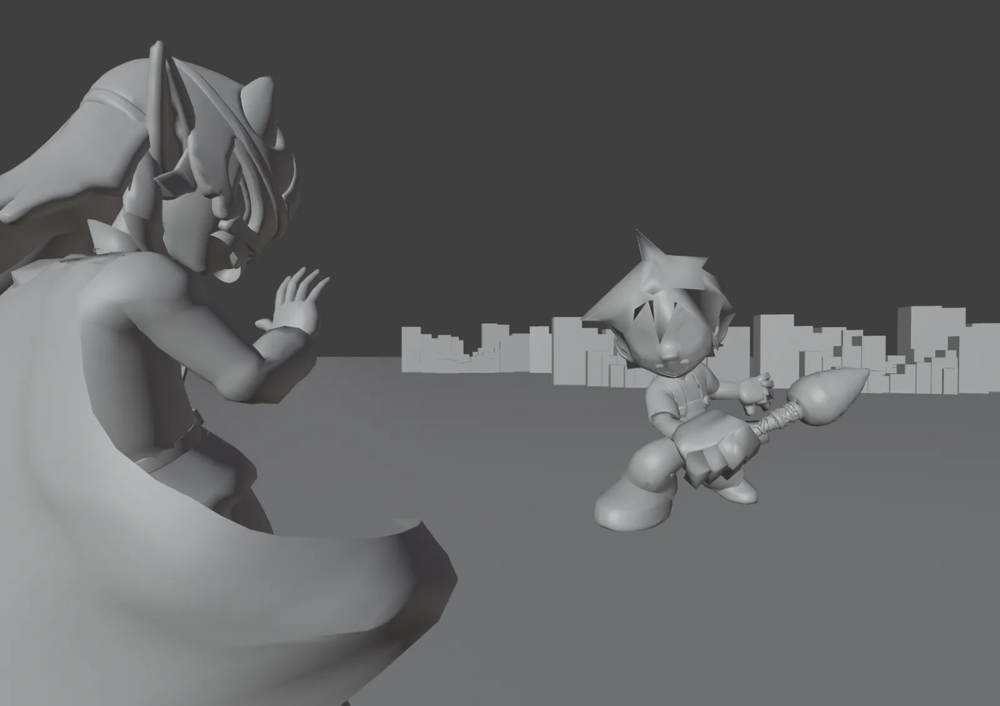
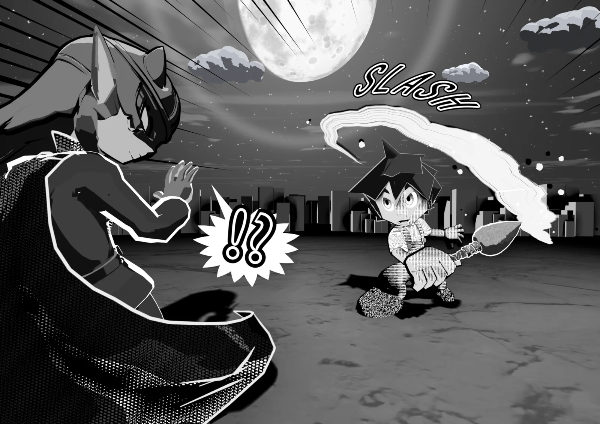

<h1>Blenderで、<em>漫画のコマ</em>を そのまま仕上げる。</h1>

3D Manga Studios は、3D シーンを白黒原稿の見た目にするための Blender アドオンです。トーン、輪郭線、カメラのコマ割り、ライト、目と口、背景、効果線、吹き出しまで、サイドバーの4つのパネルで一通りそろいます。

Blender 4.5 LTS 以上推奨 5.2 LTSEEVEE 専用日本語 / English UI

[インストール手順](getting-started/install.md){ .md-button .md-button--primary } [機能ガイドを見る](guide/index.md){ .md-button }

<figure markdown style="margin:0">

適用前適用後
<input type="range" min="0" max="100" value="50" aria-label="適用前と適用後を比べるスライダー">

<figcaption>スライダーを左右に動かして比べられます。左はソリッド表示、右は 3D Manga Studios で仕上げたレンダリングです（サンプルシーン）。</figcaption>
</figure>

## <i class="bi bi-info-circle-fill"></i> 概要 Overview

3D Manga Studios は、Blender で作った 3D シーンを、本物の漫画のコマのような白黒原稿に仕上げるためのアドオンです。トーンを貼る、輪郭線を引く、ライトを置く、背景や効果線を描き足す、といった作業を、手でノードを組むことなくサイドバーのボタンと数値で行えます。ポーズや構図は 3D で何度でも撮り直せるので、同じキャラクターを別の角度から描くコマも素早く作れます。

## <i class="bi bi-stars"></i> 特徴 Features

<i class="bi bi-circle-half ms-feat-ic" aria-hidden="true"></i><b>マテリアル</b>
**トーンと影をワンクリックで**

Manga Tone Shader が、キー・フィル・バックの3灯を読み分けて網点やカケアミのトーンに置き換えます。光沢・リムライト・絵画風・水彩にも対応。→ [マテリアル](guide/material.md)

<i class="bi bi-vector-pen ms-feat-ic" aria-hidden="true"></i><b>輪郭線</b>
**線を役割で選ぶ**

外側の輪郭と内側の線を役割で選び、Gペン・鉛筆ラフなどのプリセットで線の見た目をまとめて切り替えます。→ [輪郭線](guide/outline.md)

<i class="bi bi-camera-fill ms-feat-ic" aria-hidden="true"></i><b>シーン</b>
**紙のサイズとコマ割り**

A判・B判と縦横の割りから解像度とガイドを決めます。広角で歪んだ顔を直す歪み補正付き。→ [シーン](guide/scene.md)

<i class="bi bi-lightbulb-fill ms-feat-ic" aria-hidden="true"></i><b>ライト</b>
**3灯とライトリンキング**

キャラクターごとに3灯を置き、照らす相手をライトリンキングで自動で分けます。→ [シーン › ライト](guide/scene.md)

<i class="bi bi-emoji-smile-fill ms-feat-ic" aria-hidden="true"></i><b>目・口</b>
**動かせる目と口**

視差のある目と、シェイプキーなしで動くアニメ口。表情はエフェクトや瞳孔の形で切り替えます。→ [マテリアル › 目・口](guide/material.md)

<i class="bi bi-stars ms-feat-ic" aria-hidden="true"></i><b>背景・エフェクト</b>
**コマを仕上げる**

空と背景のワールド、影を受ける地面、集中線や漫符、墨の筆跡、描き文字、吹き出しをサムネイルから置けます。→ [背景・エフェクト](guide/bgfx.md)

## <i class="bi bi-grid-3x2-gap-fill"></i> 4ステップで1コマ

<figure class="ms-shot" markdown>

<figcaption>サンプルシーンの仕上がり</figcaption>
</figure>

<a href="guide/scene.html">1<b>シーン</b>コレクションを作り、カメラのサイズとコマ割り、3灯のライトを置く。</a>
<a href="guide/material.html">2<b>マテリアル</b>Manga Tone Shader でトーンと影を付け、目と口を足す。</a>
<a href="guide/outline.html">3<b>輪郭線</b>外側・内側の線を役割で選び、ペンの種類をプリセットで決める。</a>
<a href="guide/bgfx.html">4<b>背景・エフェクト</b>背景ワールド、効果線や漫符、吹き出しを置いて仕上げる。</a>

## <i class="bi bi-pc-display"></i> 動作環境 Requirements

| 項目 | 内容 |
|---|---|
| Blender | 4.5 LTS 以上（推奨 5.2 LTS） |
| レンダーエンジン | EEVEE 専用（Cycles は非対応） |
| 表示言語 | 日本語・英語（Blender の言語設定に従う） |
| ライセンス認証 | 初回にインターネット接続が必要（認証後はオフラインでも利用できる期間あり） |

くわしくは [はじめに › 動作環境](getting-started/index.md) を参照してください。

## <i class="bi bi-file-earmark-text-fill"></i> ライセンス License

| 対象 | ライセンス |
|---|---|
| アドオン本体（Python スクリプト） | MIT License / GNU GPL v3 |
| 付属アセット（マテリアル・ノード・画像など） | 同梱の利用条件（License_JP / License_EN） |

全文と、アセットを作品に使うときの条件は [利用規約・ライセンス](license.md) にあります。

## <i class="bi bi-chat-square-text-fill"></i> 補足 Notes

| 項目 | 内容 |
|---|---|
| 開発者 | あだっち（Adacchi-MultiCreator） |
| 最新版 | v1.2.0 beta（変更点は [更新履歴](changelog.md)） |
| お知らせ | [X（@3d_manga19094）](https://x.com/3d_manga19094) |
| 不具合の報告 | [GitHub Issues](https://github.com/Adacchi-MultiCreator/3D-Manga-Studios-Issues) |
| 旧バージョン | v1.0 のドキュメントは、ヘッダーの版の切り替えから見られます |

## <i class="bi bi-book-fill"></i> このドキュメントの読み方

| 知りたいこと | ページ |
|---|---|
| 入れ方・動作環境 | [インストール](getting-started/install.md) |
| ライセンスキーの申請と認証 | [ライセンス認証](getting-started/license.md) |
| サイドバーの各パネルの使い方 | [機能ガイド](guide/index.md) |
| マテリアルの中身と、数値で変わる見た目 | [マテリアル仕様](spec/index.md) |
| 付属のスクリーントーン素材 | [Manga Tone Flat](spec/flat.md) ／ [Manga Tone Shaded](spec/shaded.md) |
| 英語の画面の言葉が日本語で何か | [翻訳辞書](translation.md) |
| うまく動かないとき | [よくある質問](faq.md) |
| 変更点 | [更新履歴](changelog.md) |
| 使ってよい範囲・規約 | [利用規約・ライセンス](license.md) |
