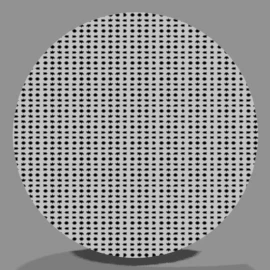
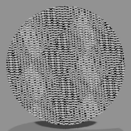
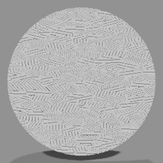
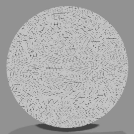
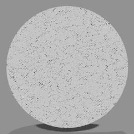
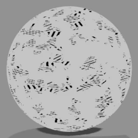
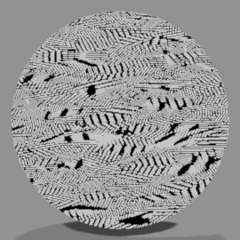
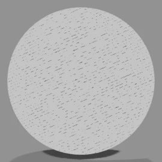
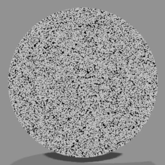
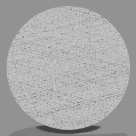

# <i class="bi bi-grid-3x3-gap-fill"></i> Manga Tone Flat NEW {data-toc-label="Manga Tone Flat"}

These are the **flat tones (10 types)** among the bundled screentone assets. Drop one into a color field of the Manga Tone Shader and that area gets the pattern.

Manga Tone Flat
The pattern fills the whole area as is, whatever the lights do. Whichever layer you put it in (Key, Fill, Back or Base), that layer's area is filled with the pattern. These are also the tones you can use for the background (World).

For tones whose density changes with how the light hits, see [Manga Tone Shaded](shaded.md).

## <i class="bi bi-grid-fill"></i> Tones

<b>Screentone Dots</b>The most basic halftone dots. For shadows and clothing patterns

<b>Screentone 4-Layer Crosshatch</b>Crosshatch with lines in four directions. For dark shadows and a distinctive texture

<b>Screentone Crosshatch A</b>A simple crosshatch of combined diagonal lines

<b>Screentone Crosshatch B</b>A denser crosshatch than A

<b>Screentone Crosshatch C</b>The densest of the three. For dark shadows

<b>Screentone Faded Crosshatch</b>A crosshatch with a dry, faded texture. For an analog look

<b>Screentone Pencil Layered Crosshatch</b>A hand-drawn feel, like layered pencil strokes

<b>Screentone Parallel Lines</b>Straight parallel lines. For backgrounds and a sense of speed

<b>Screentone Sand</b>Fine grains like sand. For rough textures and light shadows

<b>Screentone Grain</b>An irregular, noisy mesh. For rough textures

The images show a sphere with the tone material applied as is.

## <i class="bi bi-hdd-stack-fill"></i> Asset Libraries

<ol class="ms-steps" markdown>
<li markdown>
**Place the folder**

Put the bundled "3D Manga Studios Assets EN" folder (the Japanese version is JP) anywhere you like. It contains the "Manga Tone Flat" and "Manga Tone Shaded" folders.
</li>
<li markdown>
**Add it as an asset library**

In Edit › Preferences › File Paths › Asset Libraries, click "+" and register each folder under the same name (it is handy to register both). This is the same as in the [installation](../getting-started/install.md) steps.
</li>
<li markdown>
**Open it in the Asset Browser**

Split an area, set its editor type to "Asset Browser", and choose "Manga Tone Flat" or "Manga Tone Shaded" in the library field.
</li>
</ol>

## <i class="bi bi-hand-index-fill"></i> Drag &amp; Drop

<ol class="ms-steps" markdown>
<li markdown>
**Open the layer you want to tone**

Select the object and, in Sidebar › Material › Manga Tone Shader, open the layer you want to fill with a tone (Base, Key, Fill or Back).
</li>
<li markdown>
**Drag and drop**

Drop a tone from the Asset Browser onto that layer's "Tone Material" field. You can also pick one from the right side of the field. Remove it to go back to the original color.
</li>
<li markdown>
**Adjust the pattern**

You can change the size, angle and so on of the tone with the inputs of the tone node ("Tone: ...") added in the Shader Editor. The values are carried over from the asset material's settings. Halftone dots are automatically kept round to match the render's aspect ratio.
</li>
</ol>

For a comparison of how tones look in the base tone, see [Manga Tone Shader › Base Tone](mts.md#mts-base-base-tone).

!!! shout "Using materials other than the bundled tones"
    You can drop in materials other than the bundled tones, but the Manga Tone Shader effects may not work correctly. If Blender freezes or the material shows up pink or purple, switch back to a bundled tone.

## <i class="bi bi-sliders2"></i> Inputs

| Tone | Inputs (default) |
|---|---|
| Screentone Dots | Radius (0.5), Scale (5), Aspect Ratio (2), Angle (0), Randomness (0), Offset (0), Invert |
| Screentone 4-Layer Crosshatch | Scale (50), Width (0.1), Main Angle (0), Angle A–D (55, 100, 145, 190), Invert |
| Screentone Crosshatch A | Hatch Scale (5), Hatch Width (1), Hatch Angle (45), Pattern Scale (5), Pattern Width (2), Invert |
| Screentone Crosshatch B | Pattern Scale (5), Hatch Scale (80), Hatch Angle (30), Invert |
| Screentone Crosshatch C | Scale (5), Invert |
| Screentone Faded Crosshatch | Hatch Scale (5), Hatch Width (0.5), Hatch Angle (45), Pattern Scale (5), Pattern Width (5), Fade Amount (0.5), Fade Density (5), Invert |
| Screentone Pencil Layered Crosshatch | Hatch Scale (5), Hatch Width (0.5), Hatch Angle (45), Pattern Scale (50), Pattern Width (0.1), Offset (0.5), Invert |
| Screentone Parallel Lines | Scale (5), Density (5), Fade Amount (0.5), Invert |
| Screentone Sand | Noise Brightness (0), Noise Contrast (2), Noise Scale (5), Invert |
| Screentone Grain | Size (5), Pattern (0.5), Pattern Brightness (0), Pattern Contrast (0), Cross Pattern, Invert |

- **Invert**: Swaps black and white (gives you a white pattern)
- **Aspect Ratio**: So that the dots look round, this is set automatically to the render's aspect ratio when the tone goes into the Manga Tone Shader
