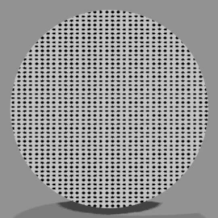
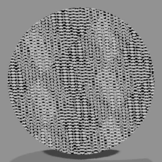
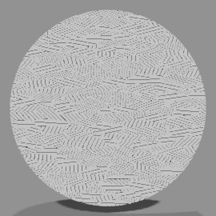
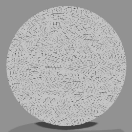
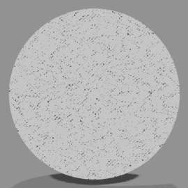
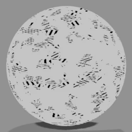
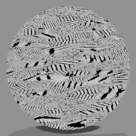
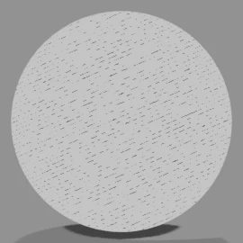
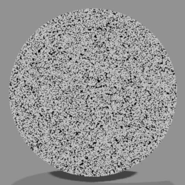
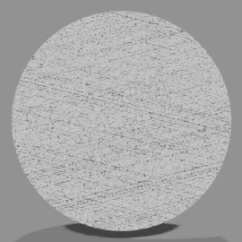

# <i class="bi bi-grid-3x3-gap-fill"></i> Manga Tone Flat NEW {data-toc-label="Manga Tone Flat"}

付属のスクリーントーン素材のうち、**平らなトーン（10種）**です。Manga Tone Shader の色の欄にドロップすると、その面が模様になります。

Manga Tone Flat
ライトに関係なく、模様がそのまま一面に入ります。キー・フィル・バック・ベースのどの段に入れても、段の面がその模様で塗られます。背景（ワールド）のトーンに使えるのもこちらです。

ライトの当たり方で模様の濃さが変わるトーンは [Manga Tone Shaded](shaded.md) です。

## <i class="bi bi-grid-fill"></i> 一覧 Tones

<b>アミトーン</b>いちばん基本の網点。 影や服の柄に

<b>4カケアミトーン</b>4方向の線を重ねたカケアミ。 濃い影や独特の質感に

<b>カケアミトーンA</b>斜線を組み合わせたシンプルなカケアミ

<b>カケアミトーンB</b>A より線の密度が高いカケアミ

<b>カケアミトーンC</b>3種でいちばん密度が高い。 暗い影に

<b>かすれカケアミトーン</b>かすれた質感のカケアミ。 アナログ風に

<b>鉛筆風重ねカケアミトーン</b>鉛筆で描き重ねたような手描き感

<b>万線トーン</b>平行な直線。 背景やスピード感に

<b>砂目トーン</b>砂のような細かい粒。 ざらついた質感や淡い影に

<b>ノイズトーン</b>不規則なノイズ状の網。 荒れた質感に

画像は、球にトーンのマテリアルをそのまま付けた場合の見た目です。

## <i class="bi bi-hdd-stack-fill"></i> アセットブラウザに登録する Asset Libraries

<ol class="ms-steps" markdown>
<li markdown>
**フォルダを置く**

同梱の「3D Manga Studios Assets JP」（英語版は EN）を任意の場所に置きます。中に「Manga Tone Flat」「Manga Tone Shaded」のフォルダがあります。
</li>
<li markdown>
**アセットライブラリに追加する**

編集 › プリファレンス › ファイルパス › アセットライブラリの「＋」から、フォルダを同じ名前で登録します（2つとも登録しておくと便利です）（[インストール](../getting-started/install.md)の手順と同じです）。
</li>
<li markdown>
**アセットブラウザで開く**

エリアを分割してエディタの種類を「アセットブラウザ」にし、ライブラリの欄で「Manga Tone Flat」または「Manga Tone Shaded」を選びます。
</li>
</ol>

## <i class="bi bi-hand-index-fill"></i> Manga Tone Shader での使い方 Drag &amp; Drop

<ol class="ms-steps" markdown>
<li markdown>
**トーンを入れる段を開く**

オブジェクトを選び、サイドバー › マテリアル › Manga Tone Shader で、トーンにしたい段（ベース・キー・フィル・バック）を開きます。
</li>
<li markdown>
**ドラッグ＆ドロップする**

アセットブラウザのトーンを、その段の「トーンのマテリアル」の欄にドロップします。欄の右から選ぶこともできます。外すと元の色に戻ります。
</li>
<li markdown>
**模様を調整する**

入れたトーンの大きさ・角度などは、シェーダーエディターに追加されたトーンのノード（「Tone: 〜」）の入力で変えられます。値はアセットのマテリアルの設定を引き継ぎます。網点はレンダーの縦横比に合わせて自動で丸く保たれます。
</li>
</ol>

ベーストーンに入れたときの見た目の比較は [Manga Tone Shader › ベーストーン](mts.md#mts-base-base-tone) にあります。

!!! shout "専用のトーン以外を入れるとき"
    付属のトーン以外のマテリアルも入れられますが、Manga Tone Shader の効果が正しくかからないことがあります。Blender が固まったり、マテリアルがピンク・紫で表示されたりする場合は、付属のトーンに戻してください。

## <i class="bi bi-sliders2"></i> 調整できる項目 Inputs

| トーン | 項目（既定値） |
|---|---|
| アミトーン | Radius（0.5）、Scale（5）、縦横比（2）、Angle（0）、Randomness（0）、Offset（0）、Invert |
| 4カケアミトーン | Scale（50）、Width（0.1）、メイン角度（0）、角度 A〜D（55・100・145・190）、Invert |
| カケアミトーンA | 斜線のスケール（5）、斜線の幅（1）、斜線の角度（45）、パターンのスケール（5）、パターンの幅（2）、Invert |
| カケアミトーンB | パターンスケール（5）、斜線のスケール（80）、斜線の角度（30）、Invert |
| カケアミトーンC | Scale（5）、Invert |
| かすれカケアミトーン | 斜線のスケール（5）、斜線の幅（0.5）、斜線の角度（45）、パターンのスケール（5）、パターンの幅（5）、かすれ具合（0.5）、カスレの密度（5）、Invert |
| 鉛筆風重ねカケアミトーン | 斜線のスケール（5）、斜線の幅（0.5）、斜線の角度（45）、パターンのスケール（50）、パターンの幅（0.1）、Offset（0.5）、Invert |
| 万線トーン | Scale（5）、Density（5）、かすれ具合（0.5）、Invert |
| 砂目トーン | ノイズの明度（0）、ノイズのコントラスト（2）、ノイズのスケール（5）、Invert |
| ノイズトーン | Size（5）、Pattern（0.5）、パターンの明度（0）、パターンのコントラスト（0）、クロスパターン化、Invert |

- **Invert**：白黒を反転します（白い模様にする）
- **縦横比**：網点が丸く見えるよう、Manga Tone Shader に入れるとレンダーの縦横比に合わせて自動で設定されます
