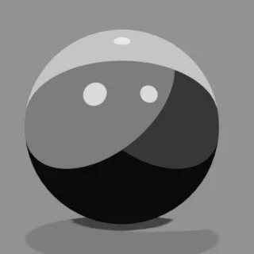
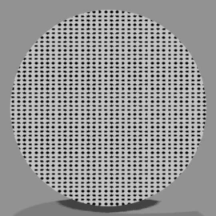
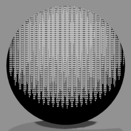
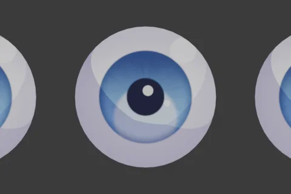
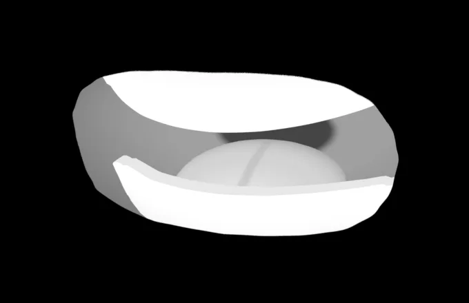
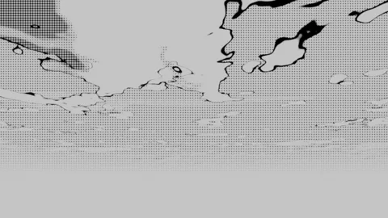
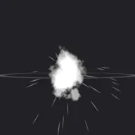
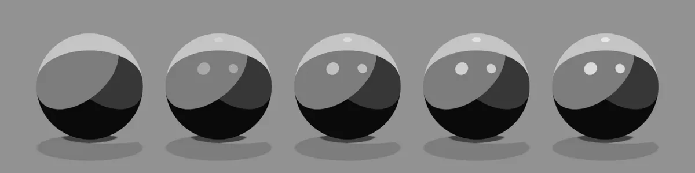

# <i class="bi bi-diagram-3-fill"></i> Material Specs NEW {data-toc-label="Material Specs"}

Every 3D Manga Studios material goes into a material in the same simple form: one Node Group plus an output. This section shows what happens inside each one, and how it looks when you change the values shown in the Sidebar and properties, using images actually rendered in Blender.

<a class="ms-tile" href="mts.html"><b>MTS · Manga Tone Shader</b>Screentone, shadows, gloss and more: the shading of the whole object</a>
<a class="ms-tile" href="flat.html"><b>Manga Tone Flat</b>Flat screentones you drop into a color field (10 types)</a>
<a class="ms-tile" href="shaded.html"><b>Manga Tone Shaded</b>Shaded tones whose density changes with the lights (9 types)</a>
<a class="ms-tile" href="mte.html"><b>MTE · Manga Toon Eye</b>Eyes with depth (iris, pupil, highlights)</a>
<a class="ms-tile" href="mtm.html"><b>MTM · Manga Toon Mouth</b>The mouth plane and the geometry inside the mouth</a>
<a class="ms-tile" href="mtb.html"><b>MTB · Manga Toon Backgrounds</b>The "Sky" background World (art style, time of day, clouds)</a>
<a class="ms-tile" href="mtg.html"><b>MTG · Manga Toon Ground</b>Shadows cast on the ground, texture, AO and edge fade</a>
<a class="ms-tile" href="mtfx.html"><b>MTFX · Manga Toon Effects</b>Foreground and background effects such as focus lines and sparks</a>
<a class="ms-tile" href="mtsb.html"><b>MTSB · Manga Toon Speech Bubbles</b>Speech balloons (normal, shout, thought, narration)</a>

## <i class="bi bi-tags-fill"></i> Asset names

Each asset in the add-on has the name and abbreviation below. The abbreviations (MTS, MTG and so on) are also used at the start of node and material names.

| Abbr. | Full name | Contents | Spec page |
|---|---|---|---|
| **MTS** | Manga Tone Shader | Screentone, shadows, gloss and more: the shading of the whole object | [View spec](./mts.md) |
| — | Manga Tone Flat | Flat screentones you drop into a color field | [View list](./flat.md) |
| — | Manga Tone Shaded | Shaded tones whose density changes with the lights | [View list](./shaded.md) |
| **MTE** | Manga Toon Eye | Eyes with depth (iris, pupil, highlights) | [View spec](./mte.md) |
| **MTM** | Manga Toon Mouth | The mouth plane and the geometry inside the mouth | [View spec](./mtm.md) |
| **MTB** | Manga Toon Backgrounds | The "Sky" background World (art style, time of day, clouds) | [View spec](./mtb.md) |
| **MTG** | Manga Toon Ground | Shadows cast on the ground, texture, AO and edge fade | [View spec](./mtg.md) |
| **MTFX** | Manga Toon Effects | Foreground and background effects such as focus lines and sparks | [View spec](./mtfx.md) |
| **MTSB (tentative)** | Manga Toon Speech Bubbles | Speech balloons | [View spec](./mtsb.md) |

## <i class="bi bi-eyeglasses"></i> How to read the comparison images

<strong>Example: Gloss Opacity</strong><code>Gloss › Opacity</code>

The five spheres show <b>the value changing from left to right</b>. Each value is written under the image. The yellow cell is the default value for that setting. Everything except the setting being changed stays at its default.

00.250.50.751

Comparison image setup: EEVEE, the add-on's three lights (key = red / fill = green / back = blue), orthographic camera.

## <i class="bi bi-intersect"></i> Blend mode labels

| Label | Meaning |
|---|---|
| Over | Laid on top (normal mix) |
| Multiply | Darkens the color below |
| Add | Adds brightness to the color below |
| Screen | Lightens as it layers |
| Mask | Makes everything outside the shape transparent |
| Switch | Switches based on a value such as the art style |
| Adjust | Adjusts the color of the whole image |
| Fixed | Not used for lighting (seen by the camera only) |
