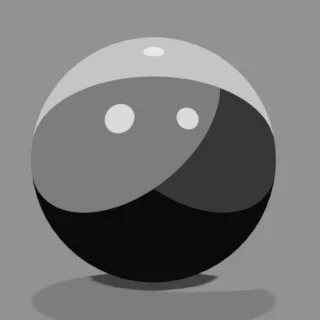
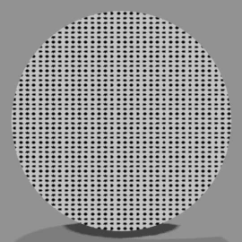
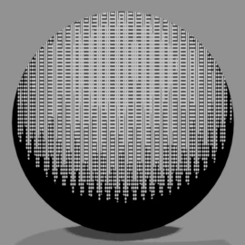
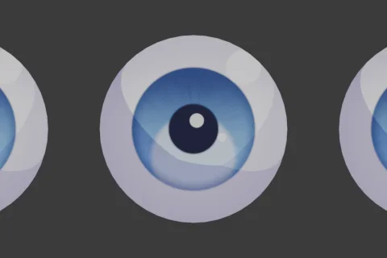
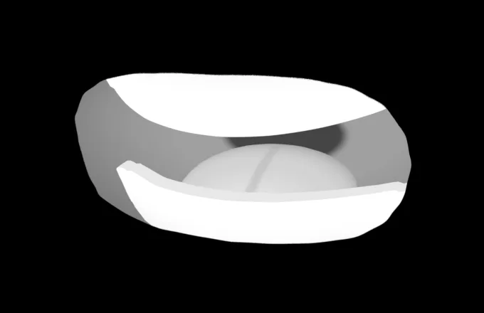
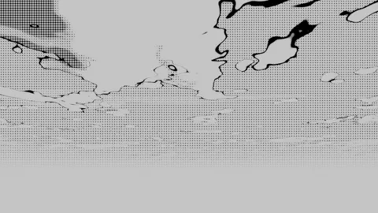
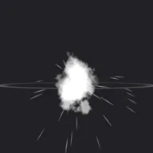
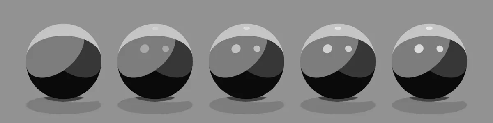

# <i class="bi bi-diagram-3-fill"></i> マテリアル仕様 NEW {data-toc-label="マテリアル仕様"}

3D Manga Studios のマテリアルは、どれも「ノードグループ1つ＋出力」というシンプルな形でマテリアルに入ります。ここでは、それぞれの中身の流れと、サイドバーやプロパティに出る数値を変えたときの見た目を、実際に Blender でレンダーした画像で並べています。

<a class="ms-tile" href="mts.html"><b>MTS · Manga Tone Shader</b>トーン・影・光沢など、オブジェクト全体の塗り</a>
<a class="ms-tile" href="flat.html"><b>Manga Tone Flat</b>色の欄に入れる平らなスクリーントーン（10種）</a>
<a class="ms-tile" href="shaded.html"><b>Manga Tone Shaded</b>ライトで濃さが変わる陰影付きのトーン（9種）</a>
<a class="ms-tile" href="mte.html"><b>MTE · Manga Toon Eye</b>奥行きのある目（虹彩・瞳孔・ハイライト）</a>
<a class="ms-tile" href="mtm.html"><b>MTM · Manga Toon Mouth</b>口の板ポリと、口の中のジオメトリ</a>
<a class="ms-tile" href="mtb.html"><b>MTB · Manga Toon Backgrounds</b>背景ワールド「空」（画風・時間帯・雲）</a>
<a class="ms-tile" href="mtg.html"><b>MTG · Manga Toon Ground</b>地面に落ちる影・テクスチャ・AO・端の消し方</a>
<a class="ms-tile" href="mtfx.html"><b>MTFX · Manga Toon Effects</b>集中線・火花などの前景・背景エフェクト</a>
<a class="ms-tile" href="mtsb.html"><b>MTSB · Manga Toon Speech Bubbles</b>吹き出し（通常・叫び・思考・ナレーション）</a>

## <i class="bi bi-tags-fill"></i> アセットの名前と略称 Asset names

アドオンのアセットは、それぞれ次の名前と略称で呼びます。ノード名やマテリアル名の先頭にも、この略称（MTS・MTG など）が使われています。

| 略称 | 正式名 | 中身 | 仕様ページ |
|---|---|---|---|
| **MTS** | Manga Tone Shader | トーン・影・光沢など、オブジェクト全体の塗り | [仕様を見る](./mts.md) |
| — | Manga Tone Flat | 色の欄に入れる平らなスクリーントーン | [一覧を見る](./flat.md) |
| — | Manga Tone Shaded | ライトで濃さが変わる陰影付きのトーン | [一覧を見る](./shaded.md) |
| **MTE** | Manga Toon Eye | 奥行きのある目（虹彩・瞳孔・ハイライト） | [仕様を見る](./mte.md) |
| **MTM** | Manga Toon Mouth | 口の板ポリと、口の中のジオメトリ | [仕様を見る](./mtm.md) |
| **MTB** | Manga Toon Backgrounds | 背景ワールド「空」（画風・時間帯・雲） | [仕様を見る](./mtb.md) |
| **MTG** | Manga Toon Ground | 地面に落ちる影・テクスチャ・AO・端の消し方 | [仕様を見る](./mtg.md) |
| **MTFX** | Manga Toon Effects | 集中線・火花などの前景・背景エフェクト | [仕様を見る](./mtfx.md) |
| **MTSB（案）** | Manga Toon Speech Bubbles | 吹き出し | [仕様を見る](./mtsb.md) |

## <i class="bi bi-eyeglasses"></i> 比較画像の見方

<strong>例：光沢の不透明度</strong><code>Gloss › Opacity</code>

5つの球は、<b>左から右へ値を変えたもの</b>です。画像の下に、それぞれの値を書いています。黄色い欄がその項目の既定値です。変えている項目以外はすべて既定値のままです。

00.250.50.751

比較画像の条件：EEVEE、ライトはアドオンの3灯（キー＝赤／フィル＝緑／バック＝青）、正投影カメラ。

## <i class="bi bi-intersect"></i> 合成（重ね方）の呼び方

| 札 | 意味 |
|---|---|
| 透過 | 上に重ねる（通常のミックス） |
| 乗算 | 下の色を暗くする |
| 加算 | 下の色に明るさを足す |
| スクリーン | 明るく重ねる |
| マスク | 形の外を透明にする |
| 切替 | 画風などの値で切り替える |
| 加工 | 全体の色を調整する |
| 固定 | 照明には使わない（カメラにだけ映す） |
