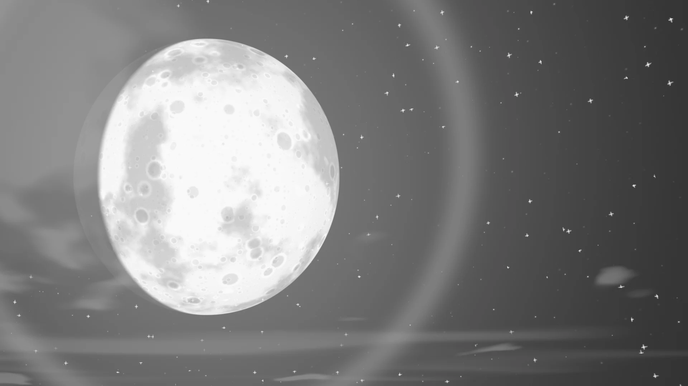
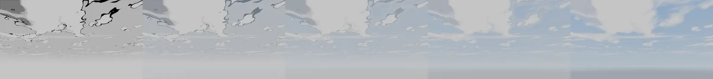
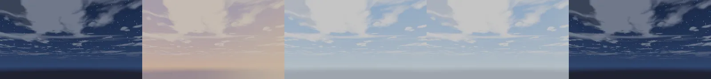
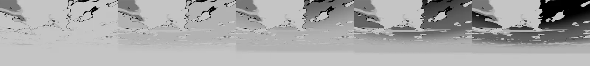

# <i class="bi bi-cloud-sun-fill"></i> Manga Toon Backgrounds (Sky) NEW {data-toc-label="Manga Toon Backgrounds (Sky)"}

<figure class="ms-page-hero"></figure>

MTB · World › Manga BG Sky › MTS BG Sky

Every background is added as a <strong>World</strong>. The World shader is set up as "background color only when seen by the camera, black as lighting", so changing the background does not change the character's shading. This page lists the main values of the "Sky" background preset.

## <i class="bi bi-layers-fill"></i> Layer stack

On top of the sky color, layers are stacked from the farthest to the nearest.

## <i class="bi bi-diagram-2-fill"></i> Node tree

Drivers (automatic)

Camera right, up, back and zoom<i>For the lens flare</i>

Drivers (automatic)

Aspect ratio<i>From the render resolution</i>

MTS BG Sky

Sky, clouds, stars, moon, light effects<i>Art Style 0 = manga (black and white, screentone, lines)</i><i>Art Style 1 = anime (color, soft shading)</i>

Light Path

Camera ray: background color<i>Everything else: black</i>

World Output

Surface

!!! note ""
    Effects (focus lines, explosions and so on) and speech balloons are built with Geometry Nodes, and their values appear on the object's Modifier. For how each type looks, see the "Effects" list in the guide.

## <i class="bi bi-sliders2"></i> Inputs

Each row of 5 spheres (eye, mouth, sky) shows **the value changing from left to right**. The values are written under each image. The yellow cell is the setting's default; all other settings stay at their defaults.

??? info "MTS BG Sky settings"

    | Panel | Setting | English Name | Default |
    |---|---|---|---|
    | Sky | [Art Style](#mtb-sky-art-style) | `Art Style` | 1 |
    | Sky | [Time of Day](#mtb-sky-time-of-day) | `Time of Day` | 0.45 |
    | Clouds | [Big Clouds](#mtb-clouds-big-clouds) | `Big Clouds` | 0.5 |
    | Manga Style | [Sky Tone](#mtb-manga-style-sky-tone) | `Sky Tone` | 0.3 |

### Sky

<strong>Art Style</strong><code>Art Style</code>Default 1Compared 0 → 1

0 = manga (black and white, screentone, cloud outlines), 1 = anime (color, soft shading). Images use sky saturation 1.

00.250.50.751

<strong>Time of Day</strong><code>Time of Day</code>Default 0.45Compared 0.05 → 0.85

Night → dawn → day → evening → night. The sun color also changes with the time of day.

0.050.250.450.70.85

### Clouds

<strong>Big Clouds</strong><code>Big Clouds</code>Default 0.5Compared 0 → 1

The amount of big clouds.

00.250.50.751

### Manga Style

<strong>Sky Tone</strong><code>Sky Tone</code>Default 0.3Compared 0 → 1

With Art Style 0, how dark the screentone on the sky is.

00.250.50.751

