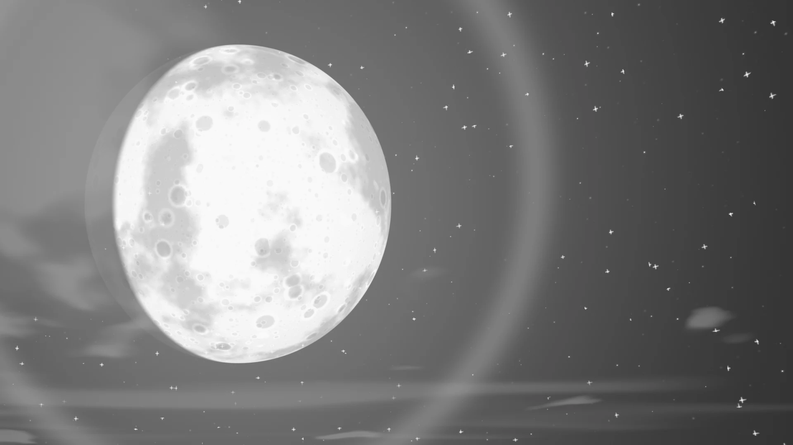

# <i class="bi bi-cloud-sun-fill"></i> Manga Toon Backgrounds（空） NEW {data-toc-label="Manga Toon Backgrounds（空）"}

<figure class="ms-page-hero"></figure>

MTB · World › Manga BG Sky › MTS BG Sky

背景はすべて<strong>ワールド</strong>として入ります。ワールドのシェーダーは「カメラに映るときだけ背景の色、照明としては黒」になっているので、背景を変えてもキャラクターの陰影は変わりません。ここでは背景プリセット「空」の主な数値を並べています。

## <i class="bi bi-layers-fill"></i> 概要図 Layer stack

空の色の上に、遠いものから順に重ねます。

## <i class="bi bi-diagram-2-fill"></i> 構成 Node tree

ドライバー（自動）

カメラの右・上・後ろ・ズーム<i>レンズフレア用</i>

ドライバー（自動）

縦横比<i>レンダー解像度から</i>

MTS BG Sky

空・雲・星・月・光の効果<i>画風 0 = 漫画（白黒・トーン・線）</i><i>画風 1 = アニメ（色・やわらかい陰影）</i>

ライトパス

カメラレイなら背景色<i>それ以外は黒</i>

ワールド出力

サーフェス

!!! note ""
    エフェクト（集中線・爆発など）と吹き出しはジオメトリノードで作られ、値はオブジェクトのモディファイアに出ます。種類ごとの見た目はガイドの「エフェクト」一覧をご覧ください。

## <i class="bi bi-sliders2"></i> パネルと数値 Inputs

5つの球（目・口・空）は、**左から右へ値を変えたもの**です。画像の下に値を書いています。黄色い欄がその項目の既定値で、ほかの項目は既定値のままです。

??? info "MTS BG Sky の項目一覧"

    | パネル | 項目 | 英語名 | 既定値 |
    |---|---|---|---|
    | 空 | [画風](#mtb-sky-art-style) | `Art Style` | 1 |
    | 空 | [時間帯](#mtb-sky-time-of-day) | `Time of Day` | 0.45 |
    | 雲 | [大きな雲](#mtb-clouds-big-clouds) | `Big Clouds` | 0.5 |
    | 漫画調の設定 | [空のトーン](#mtb-manga-style-sky-tone) | `Sky Tone` | 0.3 |

### 空 Sky

<strong>画風</strong><code>Art Style</code>既定 1比較 0 → 1

0 = 漫画（白黒・トーン・雲の輪郭線）、1 = アニメ（色・やわらかい陰影）。画像は空の彩度 1 の場合。

00.250.50.751

<strong>時間帯</strong><code>Time of Day</code>既定 0.45比較 0.05 → 0.85

夜 → 朝焼け → 昼 → 夕方 → 夜。太陽の色も時間帯で変わります。

0.050.250.450.70.85

### 雲 Clouds

<strong>大きな雲</strong><code>Big Clouds</code>既定 0.5比較 0 → 1

大きな雲の量。

00.250.50.751

### 漫画調の設定 Manga Style

<strong>空のトーン</strong><code>Sky Tone</code>既定 0.3比較 0 → 1

画風 0 のとき、空に貼るトーンの濃さ。

00.250.50.751

