# <i class="bi bi-eye-fill"></i> Manga Toon Eye NEW {data-toc-label="Manga Toon Eye"}

<figure class="ms-page-hero">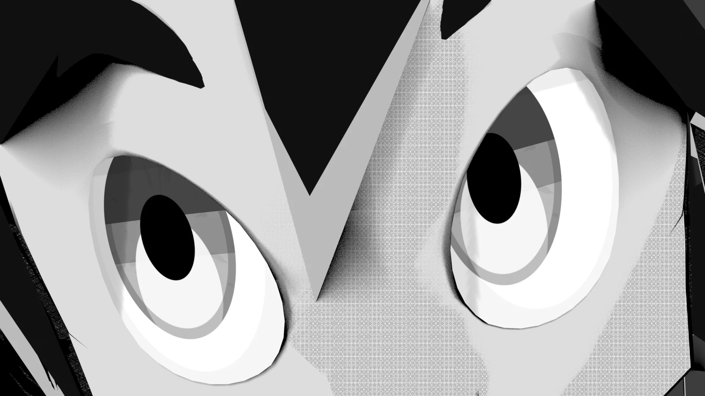</figure>

MTE · Material › Manga Toon Eye [material name] › MTS Parallax Eye

A <strong>parallax</strong> eye that makes the iris look like it sits inside the curved eyeball. The material shows only one outer group; inside it, the steps run in the order "position → look → effect → composite". The look settings are listed in the Properties Editor, Material tab, under "Manga Toon Eye".

## <i class="bi bi-layers-fill"></i> Layer stack

Layers are drawn on the curved eyeball, from the bottom layer up.

## <i class="bi bi-diagram-2-fill"></i> Node tree

Drivers (automatic)

Eye position, gaze X / Y<i>From the look target</i><i>Left/right, rotation</i>

Manga Toon Eye [material name]

MTS Parallax Eye<i>Position → look → effect → composite</i><i>The image (iris texture) is inside too</i>

Screen Tone

Screentone for the manga style

Material Output

Surface

!!! note ""
    There are two styles: "Anime" and "Manga" (black and white, ink lines). The group has a version number; older groups are rebuilt automatically and keep their values.

## <i class="bi bi-sliders2"></i> Inputs

Each row of 5 spheres (eye, mouth, sky) shows **the value changing from left to right**. The values are written under each image. The yellow cell is the setting's default; all other settings stay at their defaults.

??? info "MTS Parallax Eye settings"

    | Panel | Setting | English Name | Default |
    |---|---|---|---|
    | Eyeball | [Eye Scale](#mte-eyeball-eye-scale) | `Eye Scale` | 1 |
    | Eyeball | [Brightness](#mte-eyeball-brightness) | `Brightness` | 1 |
    | Eye Effect | [Effect Image](#mte-eye-effect-image) | — | None |
    | Eye Effect | [Effect Placement](#mte-eye-effect-placement) | `Follow Iris` | Follow Iris |
    | Eye Effect | [Eye Display](#mte-eye-effect-display) | `Eye Display` | Eye + Effect |
    | Eye Effect | [Effect Size](#mte-eye-effect-size) | `Effect Size` | 1 |
    | Eye Effect | [Effect Brightness](#mte-eye-effect-brightness) | `Effect Brightness` | 1 |
    | Eye Effect | [Effect X](#mte-eye-effect-x) / [Y](#mte-eye-effect-y) | `Effect Position` | 0 / 0 |
    | Iris Color | [Iris Size](#mte-iris-color-iris-size) | `Iris Size` | 0.52 |
    | Pupil | [Pupil Size](#mte-pupil-pupil-size) | `Pupil Size` | 0.42 |
    | Pupil | [Pupil Shape](#mte-pupil-pupil-shape) | `Pupil Shape` | 0 |
    | Highlights | [Highlight Size](#mte-highlights-highlight-size) | `Highlight Size` | 0.2 |
    | Highlights | [Highlight X](#mte-highlights-highlight-x) | `Highlight X` | 0.28 |
    | Lid Shadow | [Lid Shadow Height](#mte-lid-shadow-lid-shadow-height) | `Lid Shadow Height` | 0.5 |
    | Iris Texture | [Texture Mix](#mte-iris-texture-mix) | `Texture Mix` | 1 |
    | Iris Texture | [Texture Multiply](#mte-iris-texture-multiply) | `Texture Multiply` | 0 |
    | Iris Texture | [Texture Scale](#mte-iris-texture-scale) | `Texture Scale` | 1 |
    | Iris Texture | [Texture Rotation](#mte-iris-texture-rotation) | `Texture Rotation` | 0° |
    | Iris Rim / Pattern | [Limbal Ring](#mte-iris-rim-pattern-limbal-ring) | `Limbal Ring` | 0.7 |
    | Iris Rim / Pattern | [Pattern Amount](#mte-iris-rim-pattern-pattern-amount) | `Pattern Amount` | 0.35 |
    | Iris Rim / Pattern | [Pattern Scale](#mte-iris-rim-pattern-pattern-scale) | `Pattern Scale` | 1 |
    | Iris Outline | [Ink Width](#mte-iris-outline-ink-width) | `Ink Width` | 0.08 |
    | Lower Glow | [Glow Amount](#mte-lower-glow-glow-amount) | `Glow Amount` | 0.5 |
    | Lower Glow | [Glow Offset](#mte-lower-glow-glow-offset) | `Glow Offset` | 0.45 |
    | Light Shading | [Shadow Threshold](#mte-light-shading-shadow-threshold) | `Shadow Threshold` | 1 |
    | Sclera | [Sclera Shade](#mte-sclera-sclera-shade) | `Sclera Shade` | 0.35 |

### Eyeball

<strong>Eye Scale</strong><code>Eye Scale</code>Default 1Compared 0.6 → 1.4

Scales the iris and pupil together.
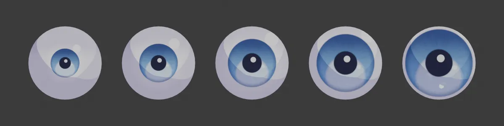
0.60.811.21.4

<strong>Brightness</strong><code>Brightness</code>Default 1Compared 0.4 → 2.5

The brightness of the whole eye.
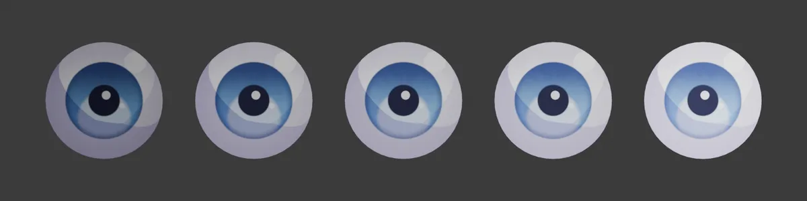
0.40.711.52.5

### Eye Effect

Lays an image with transparency (PNG) on the very top layer of the eye. You can draw manga "eye expressions" such as hearts, sparkles or swirls straight into the eye. Pick an image under Properties Editor › Material › the eye's "Eye Effect", and the settings below appear.

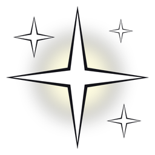Sparkle

Heart

Swirl

The PNGs used for the comparisons (512 × 512, transparent background). All are original images you are free to use.

<strong>Effect Image</strong><code>Image</code>PNG (with transparency)

The image to lay on top. The eye below shows through the transparent parts. The rightmost image uses the "Whole Eye" placement, so the effect spreads beyond the iris.
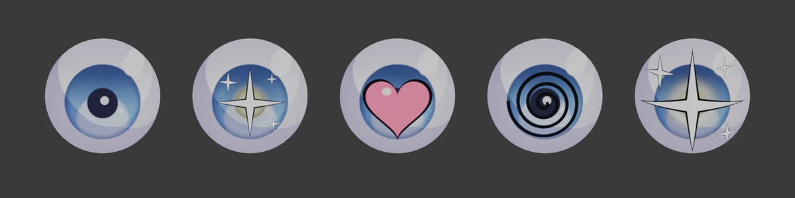
NoneSparkleHeartSwirlSparkle (Whole Eye)

<strong>Effect Placement</strong><code>Follow Iris</code>Default Follow Iris

<b>Follow Iris</b>: the image center sticks to the iris center and moves with the gaze. Its size is also set to match the iris. <b>Whole Eye</b>: the image covers the whole eye plane and does not move when the gaze moves. <b>Mirror Left Eye</b>: when on, the image on the left eye is flipped horizontally so both eyes are symmetrical.

<strong>Eye Display</strong><code>Eye Display</code>Default Eye + Effect

Use "Eye Display" in the Sidebar to choose what is drawn in the eye. "Sclera + Effect" hides the iris and highlights and draws only the effect on the sclera. "Hide Eye" draws nothing. With Auto Keying on, a keyframe with no interpolation (constant) is inserted.
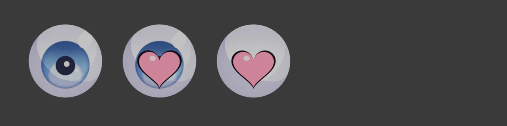
EyeEye + EffectSclera + EffectHide Eye 

<strong>Effect Size</strong><code>Effect Size</code>Default 1Compared 0.4 → 1.6

The size of the effect. With Follow Iris, 1 is about the same size as the iris.
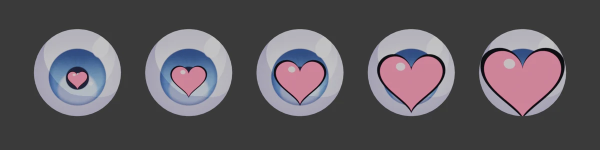
0.40.711.31.6

<strong>Effect Brightness</strong><code>Effect Brightness</code>Default 1Compared 0.25 → 2

The brightness of the effect. Lower values make it darker and recede; higher values make it bright and stand out.
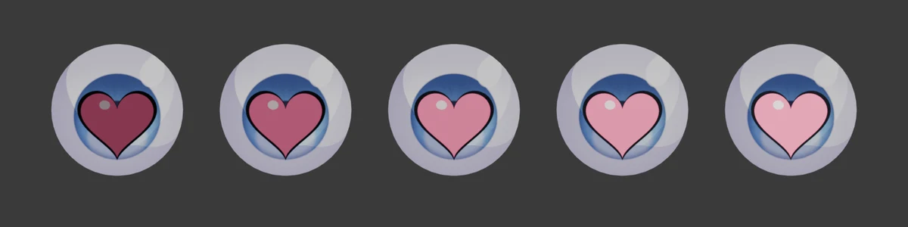
0.250.511.52

<strong>Effect X</strong><code>Effect Position X</code>Default 0Compared -0.3 → 0.3

Shifts the effect left or right.
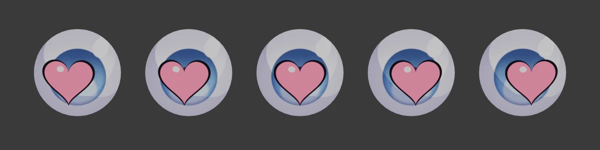
-0.3-0.1500.150.3

<strong>Effect Y</strong><code>Effect Position Y</code>Default 0Compared -0.3 → 0.3

Shifts the effect up or down. You can also move it with the control pad in the panel (drag the dot), or with a bone (Effect Bone).
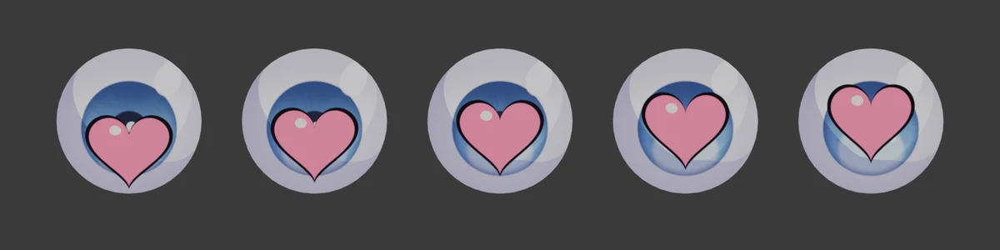
-0.3-0.1500.150.3

### Iris Color

<strong>Iris Size</strong><code>Iris Size</code>Default 0.52Compared 0.3 → 0.8

The size of the iris.
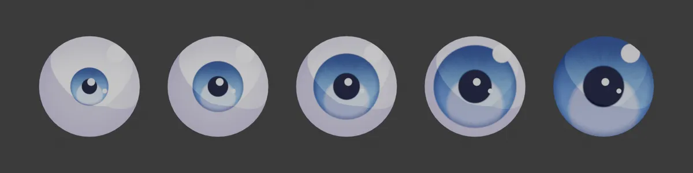
0.30.40.520.650.8

### Pupil

<strong>Pupil Size</strong><code>Pupil Size</code>Default 0.42Compared 0.1 → 0.8

The size of the pupil.
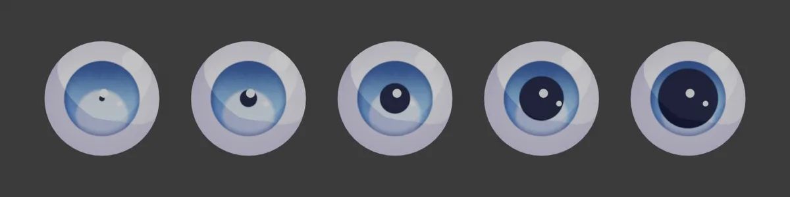
0.10.250.420.60.8

<strong>Pupil Shape</strong><code>Pupil Shape</code>Default 0Compared 0 → 3

0 = circle, 1 = polygon, 2 = star, 3 = heart.
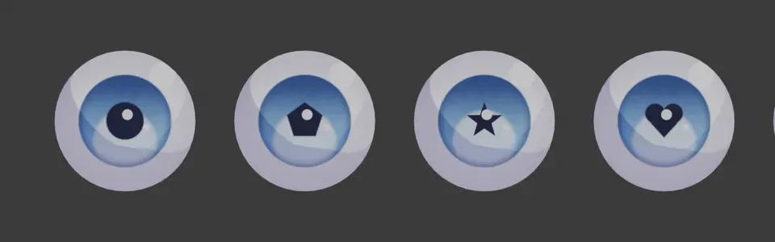
0123

### Highlights

<strong>Highlight Size</strong><code>Highlight Size</code>Default 0.2Compared 0.05 → 0.45

The size of the largest highlight (Highlight 1).
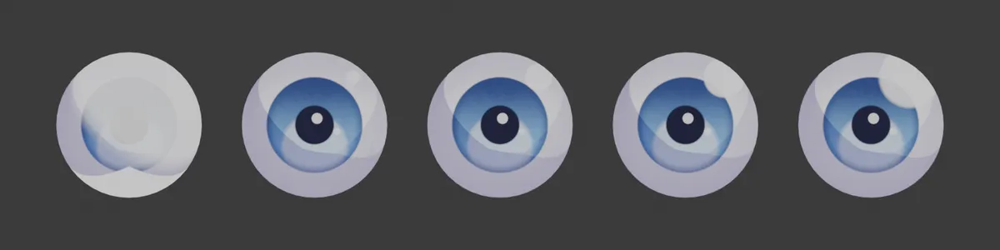
0.050.120.20.30.45

<strong>Highlight X</strong><code>Highlight X</code>Default 0.28Compared -0.6 → 0.6

The left/right position of Highlight 1.
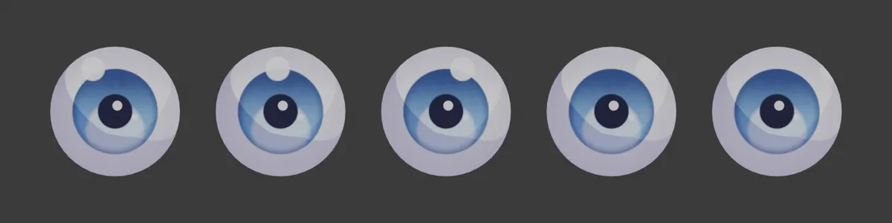
-0.6-0.300.30.6

### Lid Shadow

<strong>Lid Shadow Height</strong><code>Lid Shadow Height</code>Default 0.5Compared -1 → 1

How far the upper eyelid's shadow comes down. The more negative the value, the lower the shadow reaches, darkening the sclera and iris. Positive values pull the shadow up, and at 1 it is almost gone (with strength 1 and a deep purple shadow color).
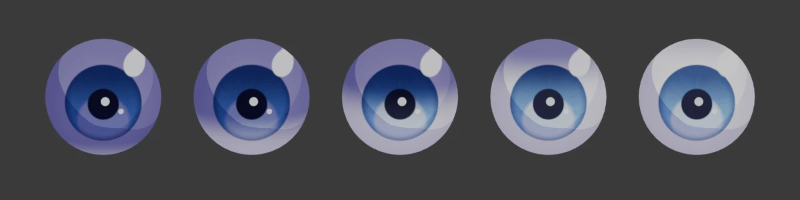
-1-0.500.51

### Iris Texture

Puts an image on the iris. When you pick an image, it fills the iris, with the image center at the iris center. The pupil, highlights and reflection are drawn on top of the texture. If the slot does not appear on an older eye, run the setup again to enable it.

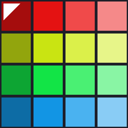Image used for the comparisons

<strong>Texture Mix</strong><code>Texture Mix</code>Default 1Compared 0 → 1

How much the texture covers the iris color. 0 gives the original iris color; 1 gives the texture's color.
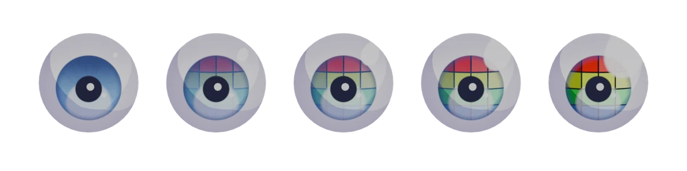
00.250.50.751

<strong>Texture Multiply</strong><code>Texture Multiply</code>Default 0Compared 0 → 1

The higher the value, the more the texture is multiplied with the iris color. Use it when you want to keep the iris color and use only the light and dark of the pattern.
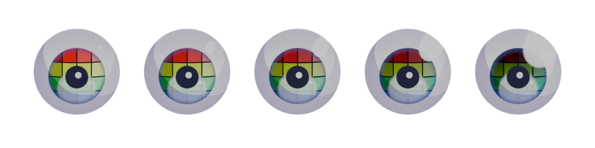
00.250.50.751

<strong>Texture Scale</strong><code>Texture Scale</code>Default 1Compared 0.5 → 2

The size of the texture. At 1 it fills the iris. Below 1, the area outside the image shows the original iris color; above 1, the center of the image is enlarged.
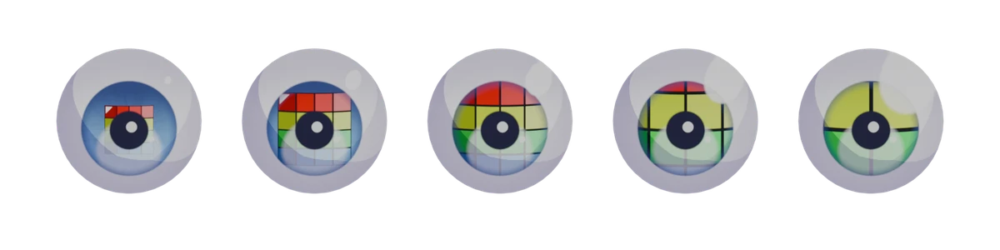
0.50.7511.52

<strong>Texture Rotation</strong><code>Texture Rotation</code>Default 0°Compared 0° → 180°

Rotates the texture around the iris center (shown with the colored-tile image; the position of the red row at the top shows the direction). Turn on "Texture Mirror Left" to flip the texture horizontally on the left eye.
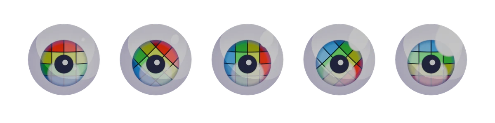
0°45°90°135°180°

### Iris Rim / Pattern

<strong>Limbal Ring</strong><code>Limbal Ring</code>Default 0.7Compared 0 → 1

A ring that darkens the edge of the iris.
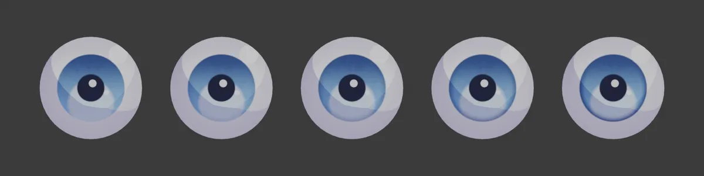
00.250.50.751

<strong>Pattern Amount</strong><code>Pattern Amount</code>Default 0.35Compared 0 → 1

The strength of the radial pattern in the iris.
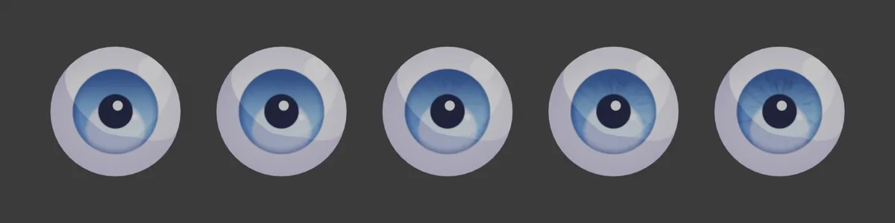
00.250.50.751

<strong>Pattern Scale</strong><code>Pattern Scale</code>Default 1Compared 0.3 → 8

How fine the pattern is (with Pattern Amount 0.8).
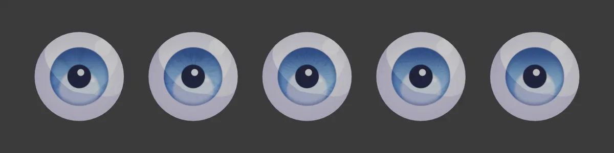
0.31248

### Iris Outline

<strong>Ink Width</strong><code>Ink Width</code>Default 0.08Compared 0 → 0.3

The ink line around the iris (when turned on).
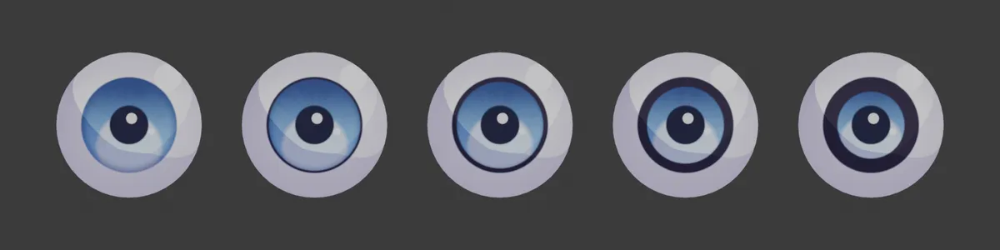
00.050.10.20.3

### Lower Glow

<strong>Glow Amount</strong><code>Glow Amount</code>Default 0.5Compared 0 → 1

The bright reflection in the lower part of the iris.
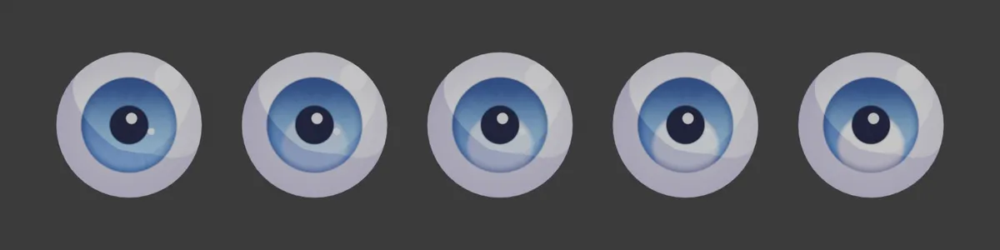
00.250.50.751

<strong>Glow Offset</strong><code>Glow Offset</code>Default 0.45Compared -1 → 1

The position of the reflection. Negative values move it up.
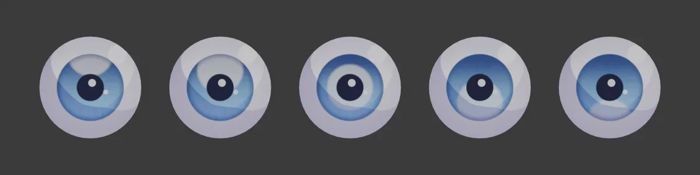
-1-0.500.451

### Light Shading

<strong>Shadow Threshold</strong><code>Shadow Threshold</code>Default 1Compared 0 → 4

How much shadow the RGB lights cast on the eye. Raising it spreads the shadow and darkens the eye.
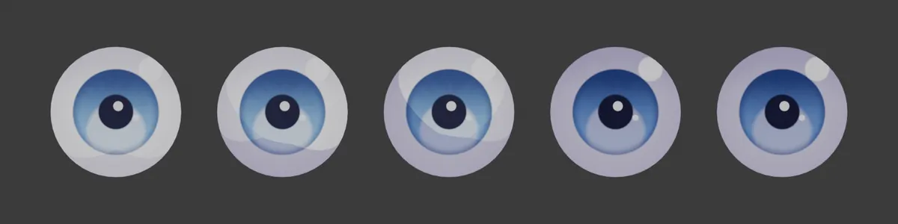
00.5124

### Sclera

<strong>Sclera Shade</strong><code>Sclera Shade</code>Default 0.35Compared 0 → 1

The shading around the edge of the sclera.
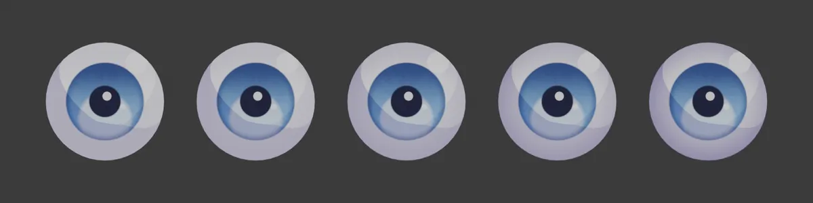
00.250.50.751

