# <i class="bi bi-eye-fill"></i> Manga Toon Eye NEW {data-toc-label="Manga Toon Eye"}

<figure class="ms-page-hero">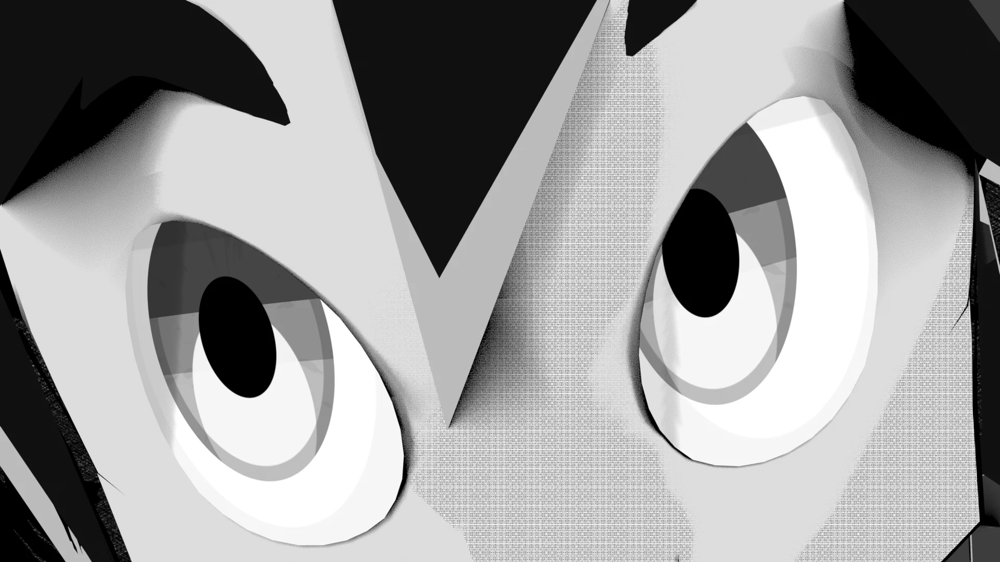</figure>

MTE · Material › Manga Toon Eye [マテリアル名] › MTS Parallax Eye

眼球の球面の内側に虹彩があるように見せる<strong>視差（パララックス）</strong>の目です。マテリアルには外側のグループ1つだけが見え、中で「位置 → 見た目 → エフェクト → 合成」の順に処理します。見た目の項目はプロパティエディターのマテリアルタブ「Manga Toon Eye」に並びます。

## <i class="bi bi-layers-fill"></i> 概要図 Layer stack

眼球の球面に、下の層から順に描いていきます。

## <i class="bi bi-diagram-2-fill"></i> 構成 Node tree

ドライバー（自動）

目の位置・視線 X / Y<i>視線ターゲットから</i><i>左右・回転</i>

Manga Toon Eye [マテリアル名]

MTS Parallax Eye<i>位置 → 見た目 → エフェクト → 合成</i><i>画像（虹彩テクスチャ）もこの中</i>

Screen Tone

漫画調のときのトーン

マテリアル出力

サーフェス

!!! note ""
    スタイルは「アニメ」「漫画（白黒・インク線）」の2種類。グループにはバージョンがあり、古いものは値を保ったまま自動で作り直されます。

## <i class="bi bi-sliders2"></i> パネルと数値 Inputs

5つの球（目・口・空）は、**左から右へ値を変えたもの**です。画像の下に値を書いています。黄色い欄がその項目の既定値で、ほかの項目は既定値のままです。

??? info "MTS Parallax Eye の項目一覧"

    | パネル | 項目 | 英語名 | 既定値 |
    |---|---|---|---|
    | 眼球 | [目の大きさ](#mte-eyeball-eye-scale) | `Eye Scale` | 1 |
    | 眼球 | [明るさ](#mte-eyeball-brightness) | `Brightness` | 1 |
    | エフェクト | [エフェクトの画像](#mte-eye-effect-image) | — | なし |
    | エフェクト | [貼り方](#mte-eye-effect-placement) | `Follow Iris` | 黒目に追従 |
    | エフェクト | [目の表示](#mte-eye-effect-display) | `Eye Display` | 目＋エフェクト |
    | エフェクト | [大きさ](#mte-eye-effect-size) | `Effect Size` | 1 |
    | エフェクト | [明るさ](#mte-eye-effect-brightness) | `Effect Brightness` | 1 |
    | エフェクト | [位置 X](#mte-eye-effect-x) / [Y](#mte-eye-effect-y) | `Effect Position` | 0 / 0 |
    | 黒目の色 | [黒目サイズ](#mte-iris-color-iris-size) | `Iris Size` | 0.52 |
    | 瞳孔 | [瞳孔サイズ](#mte-pupil-pupil-size) | `Pupil Size` | 0.42 |
    | 瞳孔 | [瞳孔の形](#mte-pupil-pupil-shape) | `Pupil Shape` | 0 |
    | ハイライト | [ハイライトサイズ](#mte-highlights-highlight-size) | `Highlight Size` | 0.2 |
    | ハイライト | [ハイライト X](#mte-highlights-highlight-x) | `Highlight X` | 0.28 |
    | まぶたの影 | [まぶたの影の高さ](#mte-lid-shadow-lid-shadow-height) | `Lid Shadow Height` | 0.5 |
    | 黒目のテクスチャ | [テクスチャの濃さ](#mte-iris-texture-mix) | `Texture Mix` | 1 |
    | 黒目のテクスチャ | [乗算（模様だけ使う）](#mte-iris-texture-multiply) | `Texture Multiply` | 0 |
    | 黒目のテクスチャ | [テクスチャの大きさ](#mte-iris-texture-scale) | `Texture Scale` | 1 |
    | 黒目のテクスチャ | [テクスチャの回転](#mte-iris-texture-rotation) | `Texture Rotation` | 0° |
    | 黒目の縁・模様 | [黒目の外周リング](#mte-iris-rim-pattern-limbal-ring) | `Limbal Ring` | 0.7 |
    | 黒目の縁・模様 | [模様の濃さ](#mte-iris-rim-pattern-pattern-amount) | `Pattern Amount` | 0.35 |
    | 黒目の縁・模様 | [模様の細かさ](#mte-iris-rim-pattern-pattern-scale) | `Pattern Scale` | 1 |
    | 黒目の輪郭線 | [輪郭線の太さ](#mte-iris-outline-ink-width) | `Ink Width` | 0.08 |
    | 下の反射 | [反射の強さ](#mte-lower-glow-glow-amount) | `Glow Amount` | 0.5 |
    | 下の反射 | [反射の位置（下へ）](#mte-lower-glow-glow-offset) | `Glow Offset` | 0.45 |
    | ライトの陰影 | [影のしきい値](#mte-light-shading-shadow-threshold) | `Shadow Threshold` | 1 |
    | 白目 | [陰りの濃さ](#mte-sclera-sclera-shade) | `Sclera Shade` | 0.35 |

### 眼球 Eyeball

<strong>目の大きさ</strong><code>Eye Scale</code>既定 1比較 0.6 → 1.4

虹彩・瞳孔をまとめて拡大縮小します。
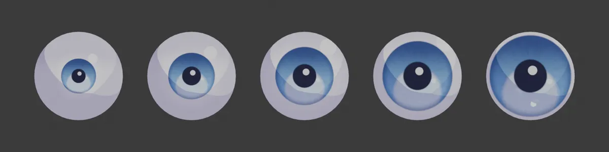
0.60.811.21.4

<strong>明るさ</strong><code>Brightness</code>既定 1比較 0.4 → 2.5

目全体の明るさ。
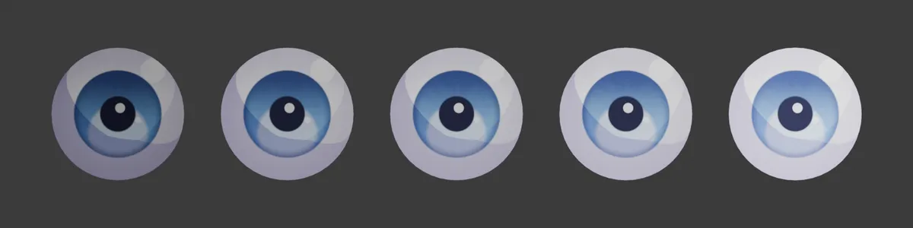
0.40.711.52.5

### エフェクト Eye Effect

目の一番上の層に、透明部分のある画像（PNG）を重ねます。ハートやキラキラ、ぐるぐるなど、漫画の「目の表情」をそのまま描き込めます。プロパティエディター › マテリアル › 目の「エフェクト」で画像を選ぶと、下の項目が出ます。

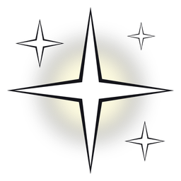キラキラ

ハート

ぐるぐる

比較に使った PNG（512 × 512・背景は透明）。どれも自由に使えるオリジナル画像です。

<strong>エフェクトの画像</strong><code>Image</code>PNG（透明部分あり）

重ねる画像。透明な部分は下の目がそのまま見えます。右端は貼り方を「目全体」にした場合で、黒目の外まで広がります。
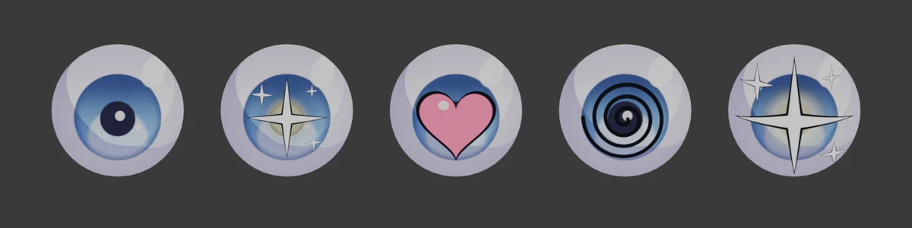
なしキラキラハートぐるぐるキラキラ（目全体）

<strong>貼り方</strong><code>Follow Iris</code>既定 黒目に追従

<b>黒目に追従</b>：画像の中心が黒目の中心に付き、視線と一緒に動きます。大きさも黒目に合わせて決まります。 <b>目全体</b>：目の板全体に貼り、視線を動かしても画像は動きません。 <b>左目は反転</b>：オンにすると左目の画像を左右反転し、左右対称にします。

<strong>目の表示</strong><code>Eye Display</code>既定 目＋エフェクト

サイドバーの「目の表示」で、目に何を描くかを切り替えます。「白目＋エフェクト」は黒目とハイライトを消し、白目の上にエフェクトだけを描きます。「隠す」は目を描きません。自動キー挿入がオンなら、補間なしのキーフレームが入ります。
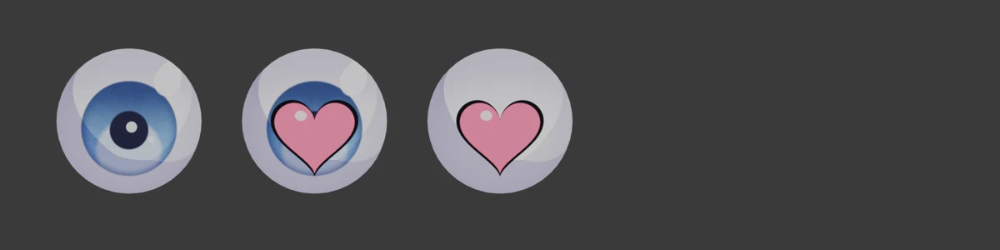
目目＋エフェクト白目＋エフェクト隠す　

<strong>大きさ</strong><code>Effect Size</code>既定 1比較 0.4 → 1.6

エフェクトの大きさ。黒目に追従のときは、1 で黒目とほぼ同じ大きさです。
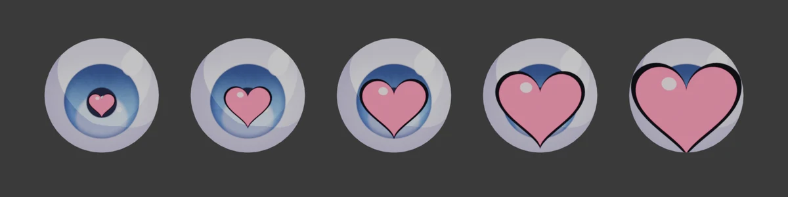
0.40.711.31.6

<strong>明るさ</strong><code>Effect Brightness</code>既定 1比較 0.25 → 2

エフェクトの明るさ。下げると暗く沈み、上げると明るく浮きます。
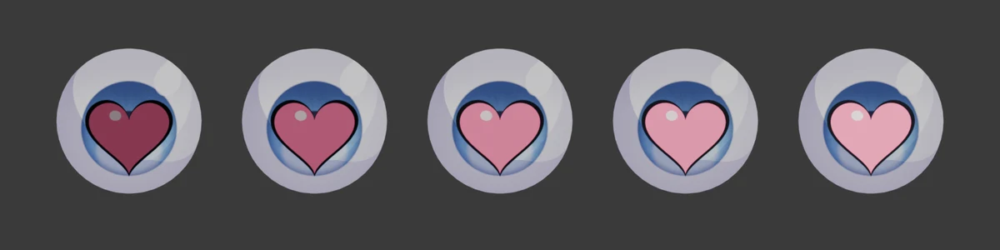
0.250.511.52

<strong>位置 X</strong><code>Effect Position X</code>既定 0比較 -0.3 → 0.3

エフェクトを左右にずらします。
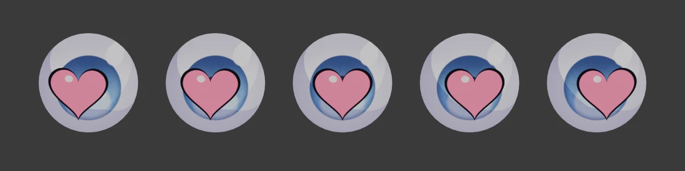
-0.3-0.1500.150.3

<strong>位置 Y</strong><code>Effect Position Y</code>既定 0比較 -0.3 → 0.3

エフェクトを上下にずらします。位置はパネルの操作パッド（点をドラッグ）でも動かせ、ボーンで動かすこともできます（エフェクトのボーン）。
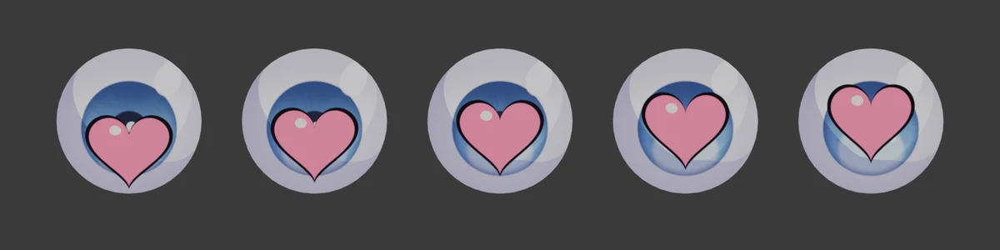
-0.3-0.1500.150.3

### 黒目の色 Iris Color

<strong>黒目サイズ</strong><code>Iris Size</code>既定 0.52比較 0.3 → 0.8

虹彩の大きさ。
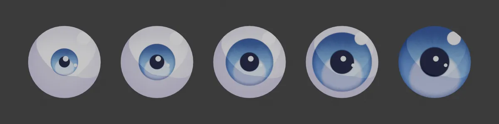
0.30.40.520.650.8

### 瞳孔 Pupil

<strong>瞳孔サイズ</strong><code>Pupil Size</code>既定 0.42比較 0.1 → 0.8

瞳孔の大きさ。
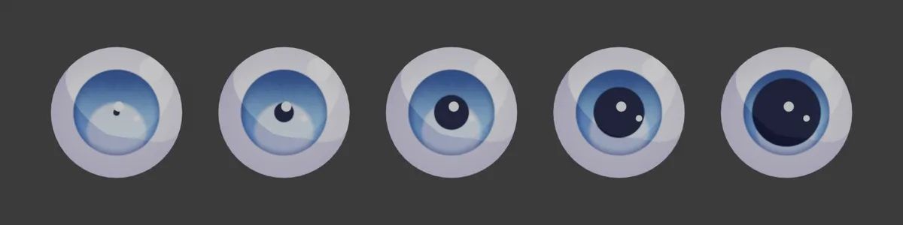
0.10.250.420.60.8

<strong>瞳孔の形</strong><code>Pupil Shape</code>既定 0比較 0 → 3

0 = 円、1 = 多角形、2 = 星、3 = ハート。
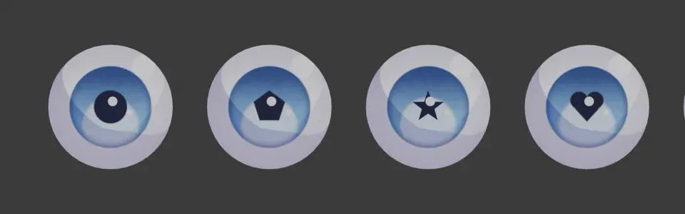
0123

### ハイライト Highlights

<strong>ハイライトサイズ</strong><code>Highlight Size</code>既定 0.2比較 0.05 → 0.45

いちばん大きいハイライト（ハイライト 1）の大きさ。
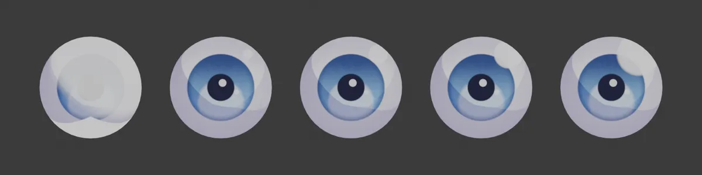
0.050.120.20.30.45

<strong>ハイライト X</strong><code>Highlight X</code>既定 0.28比較 -0.6 → 0.6

ハイライト 1 の左右の位置。
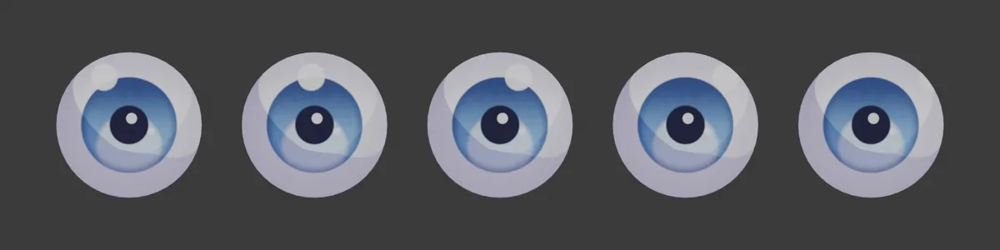
-0.6-0.300.30.6

### まぶたの影 Lid Shadow

<strong>まぶたの影の高さ</strong><code>Lid Shadow Height</code>既定 0.5比較 -1 → 1

上まぶたの影が下りてくる位置。マイナスほど影が下まで下り、白目と黒目が暗くなります。プラスでは影が上に引いて、1 でほぼ消えます（濃さ 1、影の色が濃い紫の場合）。
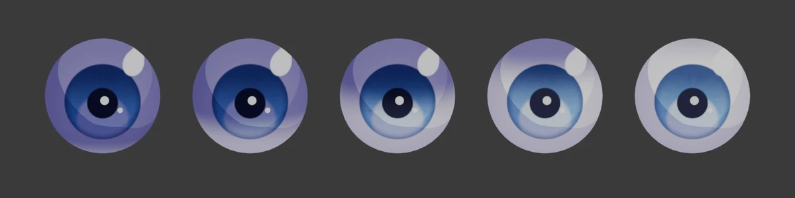
-1-0.500.51

### 黒目のテクスチャ Iris Texture

黒目に画像を貼ります。画像を選ぶと黒目いっぱいに貼られ、画像の中心が黒目の中心になります。瞳孔・ハイライト・反射はテクスチャの上に描かれます。古い目で欄が出ないときは、もう一度セットアップすると使えるようになります。

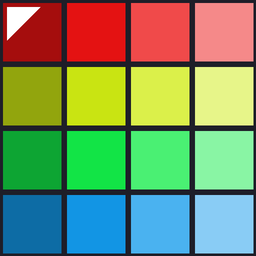比較に使った画像

<strong>テクスチャの濃さ</strong><code>Texture Mix</code>既定 1比較 0 → 1

テクスチャを黒目の色にどれだけ重ねるか。0 で元の黒目の色、1 でテクスチャの色になります。
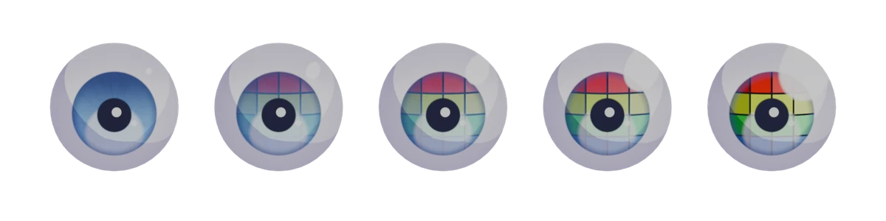
00.250.50.751

<strong>乗算（模様だけ使う）</strong><code>Texture Multiply</code>既定 0比較 0 → 1

上げるほど、テクスチャを黒目の色に掛け合わせます。黒目の色を残したまま、模様の明暗だけを使いたいときに。
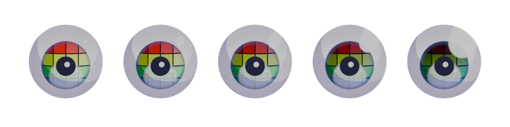
00.250.50.751

<strong>テクスチャの大きさ</strong><code>Texture Scale</code>既定 1比較 0.5 → 2

テクスチャの大きさ。1 で黒目いっぱい。1 より小さいと画像の外側の部分は元の黒目の色になり、大きいと中央部分を拡大します。
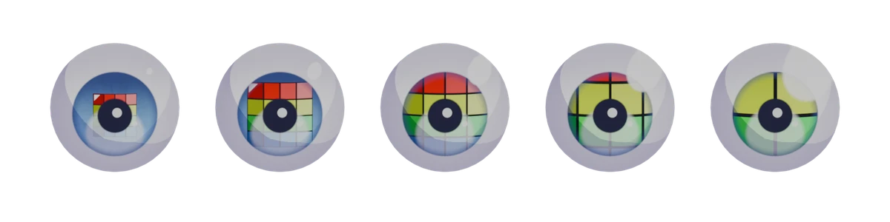
0.50.7511.52

<strong>テクスチャの回転</strong><code>Texture Rotation</code>既定 0°比較 0° → 180°

テクスチャを黒目の中心で回します（色の違うタイルを並べた画像の場合。上の赤い列の位置で向きがわかります）。「テクスチャを左目で反転」をオンにすると、左目は左右反転して貼られます。
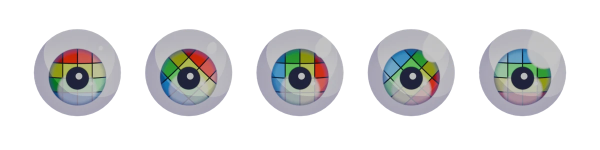
0°45°90°135°180°

### 黒目の縁・模様 Iris Rim / Pattern

<strong>黒目の外周リング</strong><code>Limbal Ring</code>既定 0.7比較 0 → 1

虹彩のふちを濃くするリング。
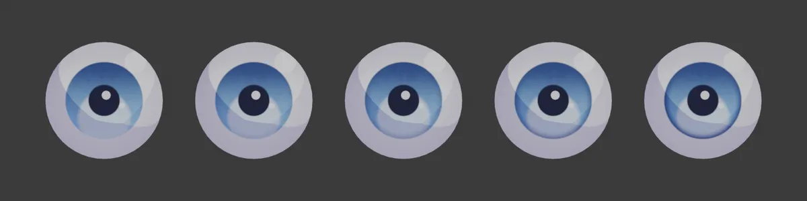
00.250.50.751

<strong>模様の濃さ</strong><code>Pattern Amount</code>既定 0.35比較 0 → 1

虹彩の放射状の模様の濃さ。
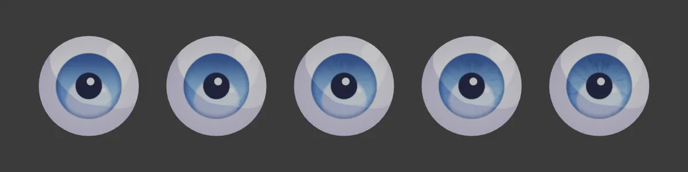
00.250.50.751

<strong>模様の細かさ</strong><code>Pattern Scale</code>既定 1比較 0.3 → 8

模様の細かさ（模様の濃さ 0.8 の場合）。
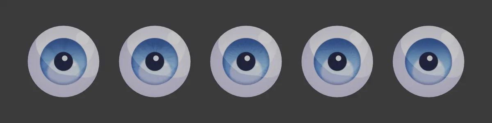
0.31248

### 黒目の輪郭線 Iris Outline

<strong>輪郭線の太さ</strong><code>Ink Width</code>既定 0.08比較 0 → 0.3

虹彩を囲むインクの線（オンの場合）。
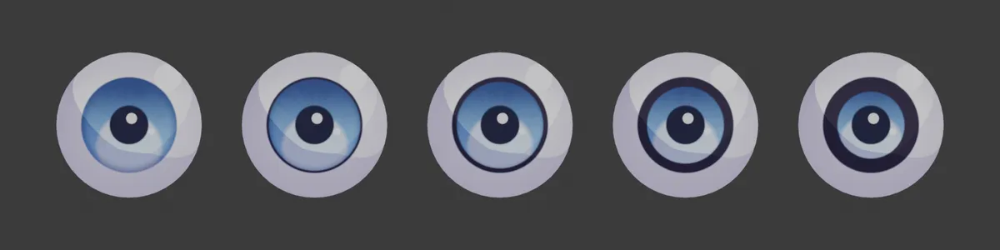
00.050.10.20.3

### 下の反射 Lower Glow

<strong>反射の強さ</strong><code>Glow Amount</code>既定 0.5比較 0 → 1

虹彩の下側の明るい反射。
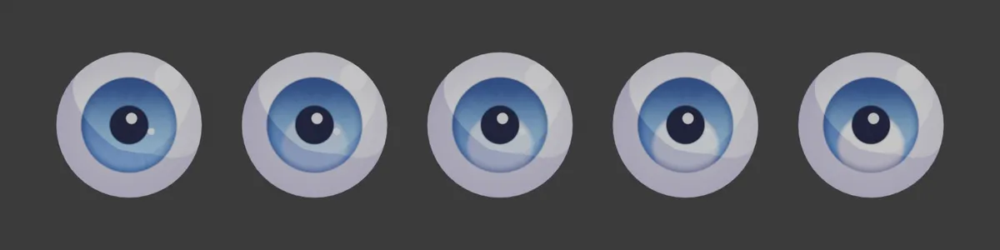
00.250.50.751

<strong>反射の位置（下へ）</strong><code>Glow Offset</code>既定 0.45比較 -1 → 1

反射の位置。マイナスで上に移ります。
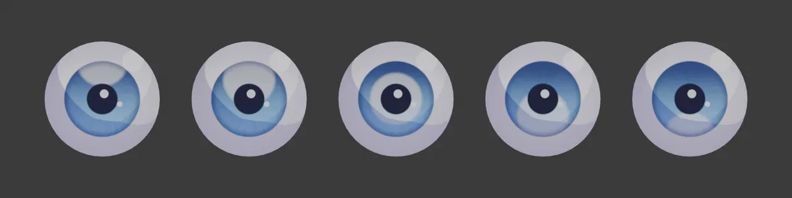
-1-0.500.451

### ライトの陰影 Light Shading

<strong>影のしきい値</strong><code>Shadow Threshold</code>既定 1比較 0 → 4

RGB ライトで目に入る影の量。上げると影が広がり、目が暗くなります。
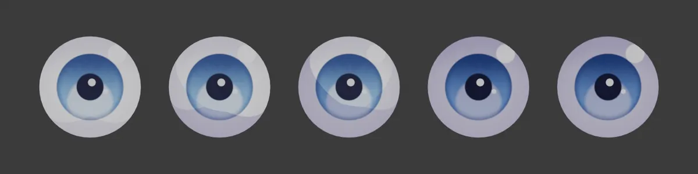
00.5124

### 白目 Sclera

<strong>陰りの濃さ</strong><code>Sclera Shade</code>既定 0.35比較 0 → 1

白目のふちの陰り。
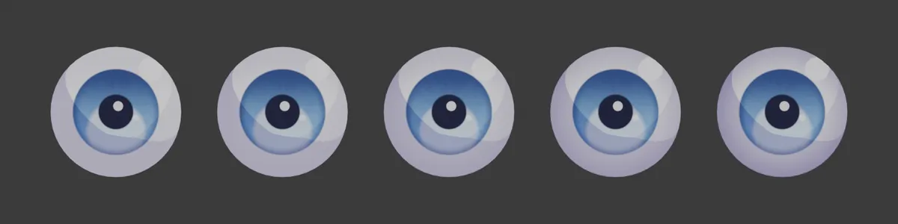
00.250.50.751

