# <i class="bi bi-lightning-charge-fill"></i> Manga Toon Effects NEW {data-toc-label="Manga Toon Effects"}

<figure class="ms-page-hero">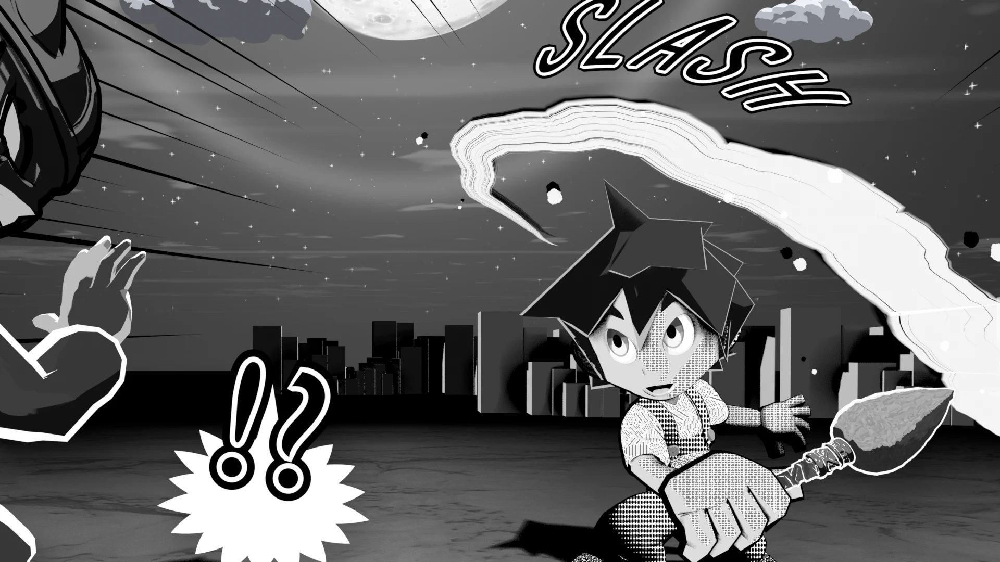</figure>

MTFX · Geometry Nodes › MTS FX …

There are 54 effects in total, and all of them are built with <strong>Geometry Nodes</strong>. Their values appear in the object's Modifier, and they are also listed in the "Effect" section of the Sidebar, with lock and Keyframe buttons. By how they are built, they fall into the four groups below.

<a href="#screen">1<b>Screen lines</b>Focus lines, speed lines, gloom lines (3 types)</a>
<a href="#manga">2<b>Manga line art</b>Effect lines, manga symbols, drawn sound effects (21 types)</a>
<a href="#vfx">3<b>Game-style VFX</b>Attacks, skills, environment, warnings (25 types)</a>
<a href="#ink">4<b>Ink &amp; brush</b>Brush strokes, splatter, drips, wash (5 types)</a>

!!! note ""
    The categories in the Sidebar (effect lines, manga symbols, attacks, elements...) are sorted to make effects easy to find. The groups on this page are sorted by how the effects are built. Each group's layer diagram uses one representative effect as the example.

## <i class="bi bi-bullseye"></i> Screen lines {#screen}

These are parented to the camera and drawn <strong>relative to the screen</strong>. They stay in the same place on screen when you move the camera, and the line width on screen does not change when you change the focal length.

Focus Lines

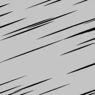Speed Lines

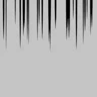Gloom Lines

??? info "Main settings (Focus Lines)"

    | Setting | English name | What it does |
    |---|---|---|
    | Line count | `Count` | Number of lines |
    | Line width | `Line Width` | Width of the lines (1 = screen height) |
    | Width variation | `Width Random` | How much the width differs from line to line |
    | Taper | `Taper` | Makes the inner end thinner |
    | Color | `Color` | Line color |
    | Blank radius | `Blank Radius` | Area in the center where no lines are drawn |
    | Length variation | `Length Random` | Variation of where each line's inner end stops |
    | Spacing variation | `Angle Random` | Variation of the spacing between lines |
    | Center X / Center Y | `Center X / Y` | Where the lines converge (0 to 1 on screen) |
    | Depth | `Depth` | Distance from the camera (front/back overlap) |
    | Seed | `Seed` | Changes the variation pattern |
    | Boil interval (frames) | `Boil Interval` | Redraws every N frames (0 = off) |

## <i class="bi bi-heart-fill"></i> Manga line art {#manga}

Effect lines, manga symbols and drawn sound effects are black-and-white line art (material MTS FX Ink). They are <strong>placed in 3D space</strong> and always face the camera. Line and edge widths are a ratio of the screen height, so they look the same width even when they are far from the camera.

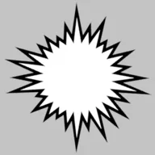Impact Burst

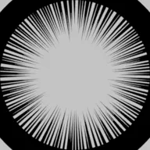Beta Flash

Notice Lines

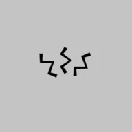Shock Lines

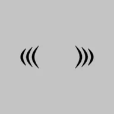Tremble Lines

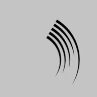Swoosh Lines

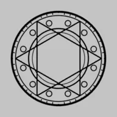Magic Circle

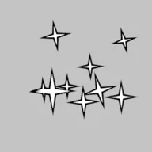Sparkles

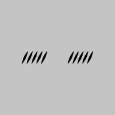Blush Lines

Anger Mark

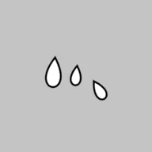Sweat Drops

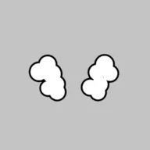Steam Puffs

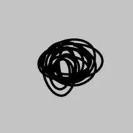Scribble

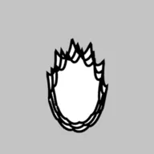Manga Aura

Sound Effect Text

!

?

!?

Music Notes

Heart

Zzz

!!! bubble "Only drawn sound effects are text objects"
    Drawn sound effects are added as a Blender text object and warped with Geometry Nodes (MTS FX Manga Text Warp). There is no face-camera setting; you set the direction with the **object's normal rotation**. See [Feature Guide › Drawn sound effects](../guide/bgfx.md#sfx-text) for how to use them.

??? info "Main settings (shared)"

    | Setting | English name | What it does |
    |---|---|---|
    | Line width | `Line Width` | Width of the lines (1 = screen height) |
    | Color | `Color` | Line color |
    | Fill color | `Fill Color` | Fill color (for manga symbols that have a fill) |
    | Edge width / Edge color | `Edge Width / Color` | The edge around the fill |
    | Face camera | `Face Camera` | Off = keeps the object's own orientation |
    | Size | `(Scale)` | Set by the object's scale |

## <i class="bi bi-stars"></i> Game-style VFX {#vfx}

These work like particle effects in Unity or Unreal Engine: each effect is built by stacking <strong>several layers</strong> (flash, sparks, ring, smoke...). A layer is either a group of camera-facing cards, or a mesh such as a ring, arc or pillar. Time is controlled by the "Effect Progress" slider (0 to 1), which goes: anticipation → onset → peak → afterglow → fade out. Add Keyframes to it to animate the effect.

Hit Spark

Sword Slash

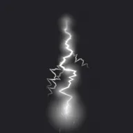Lightning Bolt

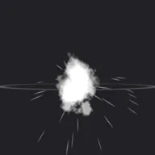Blast

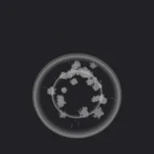Shockwave Ring

Flames

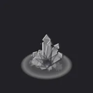Ice Crystals

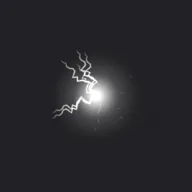Electric Orb

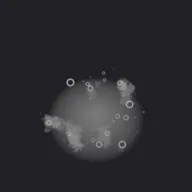Poison

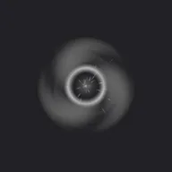Dark Vortex

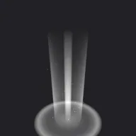Holy Light

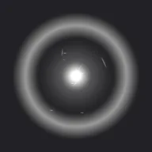Charge Up

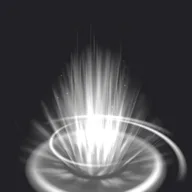Aura

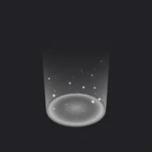Heal

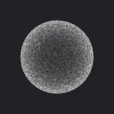Barrier

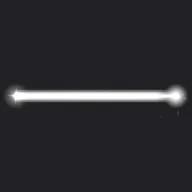Beam

Smoke Cloud

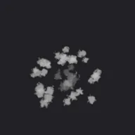Landing Dust

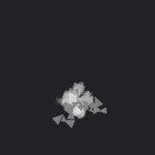Debris

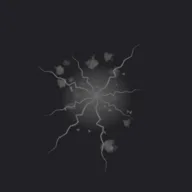Ground Crack

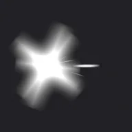Muzzle Flash

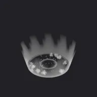Water Splash

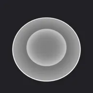Warning Circle

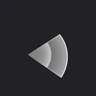Warning Fan

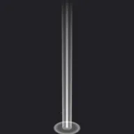Light Pillar

??? info "Main settings (shared)"

    | Setting | English name | What it does |
    |---|---|---|
    | Progress | `Effect Progress` | 0 = start, peak in the middle, 1 = gone |
    | Size | `Size` | Size of the whole effect |
    | Color / Secondary color | `Color / Secondary Color` | Color of the light and sparks / color of the smoke, debris and shadow parts |
    | Intensity | `Intensity` | Brightness of the glowing parts |
    | Additive glow | `Additive Glow` | 1 = adds light, 0 = normal semi-transparency |
    | Seed | `Seed` | Changes the variation pattern |
    | Contrast / Brightness | `Contrast / Brightness` | Strength of the color's black-and-white contrast, and its brightness |
    | Hardness | `Hardness` | Higher = crisper, more manga-like shapes |
    | Drop shadow | `Drop Shadow` | A dark shadow behind the effect so it stays visible on bright backgrounds |
    | Shadow color, opacity, offset, spread | `Shadow Color / Opacity / Offset / Spread` | Look of the drop shadow |
    | Outer glow | `Outer Glow` | On = glows all around without an offset |
    Continuous effects (fire, aura, barrier and so on) repeat several times as progress goes from 0 to 1.

## <i class="bi bi-brush-fill"></i> Ink &amp; brush {#ink}

Ink does not glow (normal semi-transparency, no additive blending). The default color is black, and ink does not fade out at the end, because it stays on the paper once drawn. The brush shape is made in the shader, with ragged edges, bristle streaks and dry-brush breaks (stronger toward the end of the stroke).

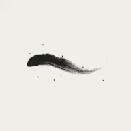Brush Stroke

Ink Splatter

Ink Drips

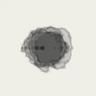Ink Wash

Brush Burst

??? info "Main settings (Brush Stroke)"

    | Setting | English name | What it does |
    |---|---|---|
    | Progress | `Effect Progress` | How far the brush has traveled (0 → 1) |
    | Ink color / Ink opacity | `Ink Color / Ink Opacity` | Color and density of the ink |
    | Face camera | `Face Camera` | Off = uses the object's orientation |
    | Stroke shape | `Stroke Shape` | 0 = S-curve, 1 = ensō (circle), 2 = straight line |
    | Length | `Length` | Length of the stroke |
    | Brush width | `Brush Width` | Width of the brush |
    | Taper in / Taper out | `Taper In / Out` | Length until the stroke reaches full width / length over which it thins out |
    | Dry brush | `Dry Brush` | Dry-brush breaks (stronger toward the end of the stroke) |
    | Wobble | `Wobble` | Hand shake |
    | Splatter | `Splatter` | Small ink drops flying off the brush |
    | Rotation | `Rotation` | Direction of the stroke |
    | Draw along a path | `Use Stroke Path` | Draws along an editable path (Bezier curve) |
