# <i class="bi bi-lightning-charge-fill"></i> Manga Toon Effects（エフェクト） NEW {data-toc-label="Manga Toon Effects（エフェクト）"}

<figure class="ms-page-hero">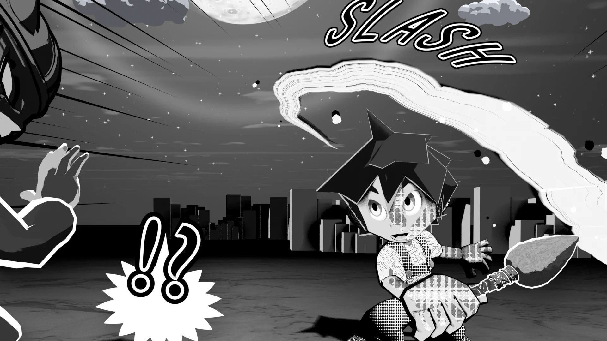</figure>

MTFX · Geometry Nodes › MTS FX …

エフェクトは全部で 54 種類あり、どれも<strong>ジオメトリノード</strong>で作られています。数値はオブジェクトのモディファイアに出て、サイドバーの「エフェクト」にもロックとキーフレームのボタン付きで並びます。作りで分けると、次の4つのまとまりになります。

<a href="#screen">1<b>画面に描く線</b>集中線・スピード線・タレ線（3 種）</a>
<a href="#manga">2<b>漫画の線画</b>効果線・漫符・描き文字（21 種）</a>
<a href="#vfx">3<b>ゲーム風 VFX</b>攻撃・スキル・環境・警告（25 種）</a>
<a href="#ink">4<b>墨・筆</b>筆跡・しぶき・たれ・にじみ（5 種）</a>

!!! note ""
    サイドバーの種類（効果線・漫符・攻撃・属性…）は「探しやすさ」の分け方、このページのまとまりは「作り」の分け方です。各まとまりの概要図は、代表の1つを例にしています。

## <i class="bi bi-bullseye"></i> 画面に描く線 Screen lines {#screen}

カメラの子になり、<strong>画面に対して</strong>描きます。カメラを動かしても画面の同じ位置に残り、焦点距離を変えても線の太さは画面上で変わりません。

集中線

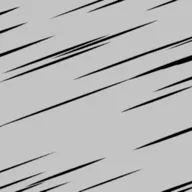スピード線

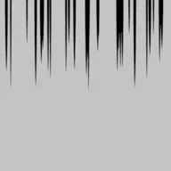タレ線

??? info "主な項目（集中線）"

    | 項目 | 英語名 | 内容 |
    |---|---|---|
    | 本数 | `Count` | 線の本数 |
    | 線の太さ | `Line Width` | 線の太さ（1 = 画面の高さ） |
    | 太さのばらつき | `Width Random` | 線ごとの太さの違い |
    | 入り抜き | `Taper` | 内側の端を細く |
    | 色 | `Color` | 線の色 |
    | 空白の半径 | `Blank Radius` | 中心の線を描かない範囲 |
    | 長さのばらつき | `Length Random` | 線の内側の端のばらつき |
    | 間隔のばらつき | `Angle Random` | 線の間隔のばらつき |
    | 中心 X ／ 中心 Y | `Center X / Y` | 線が集まる位置（画面の 0〜1） |
    | 奥行き | `Depth` | カメラからの距離（前後の重なり） |
    | シード | `Seed` | ばらつきの模様を変える |
    | ボイル間隔（フレーム） | `Boil Interval` | N フレームごとに描き直す（0 = オフ） |

## <i class="bi bi-heart-fill"></i> 漫画の線画 Manga line art {#manga}

効果線・漫符・描き文字は、白黒の線画（マテリアル MTS FX Ink）です。<strong>空間に置き</strong>、いつもカメラの方を向きます。線やフチの太さは画面の高さに対する割合なので、カメラから離れても同じ太さに見えます。

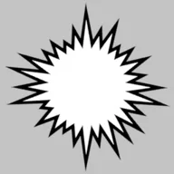ウニフラ

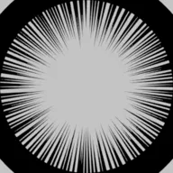ベタフラッシュ

気付き線

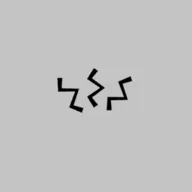衝撃線

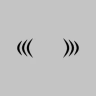震え線

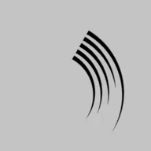動きの線

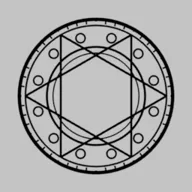魔法陣

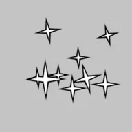キラキラ

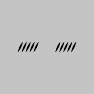照れ線

怒りマーク

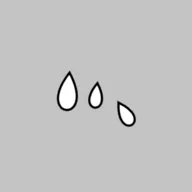汗

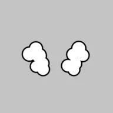湯気（プンスカ）

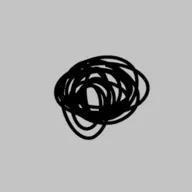モジャモジャ

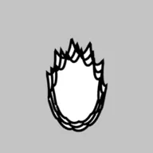オーラ（メラメラ）

描き文字

！

？

！？

音符

ハート

Zzz

!!! bubble "描き文字だけはテキストオブジェクト"
    描き文字は Blender のテキストオブジェクトとして入り、ジオメトリーノード（MTS FX Manga Text Warp）でワープを掛けます。カメラの方を向く設定はなく、向きは**ふつうのオブジェクトの回転**で決めます。使い方は [機能ガイド › 描き文字](../guide/bgfx.md#sfx-text) にあります。

??? info "主な項目（共通）"

    | 項目 | 英語名 | 内容 |
    |---|---|---|
    | 線の太さ | `Line Width` | 線の太さ（1 = 画面の高さ） |
    | 色 | `Color` | 線の色 |
    | 中の色 | `Fill Color` | 塗りの色（塗りのある漫符） |
    | フチの太さ ／ フチの色 | `Edge Width / Color` | 塗りのまわりのフチ |
    | カメラの方を向く | `Face Camera` | オフ = オブジェクトの向きのまま |
    | 大きさ | `（拡大縮小）` | オブジェクトの拡大縮小で決まる |

## <i class="bi bi-stars"></i> ゲーム風 VFX Game-style VFX {#vfx}

Unity や Unreal Engine のパーティクルと同じ考え方で、1つのエフェクトを<strong>いくつかの層</strong>（閃光・火花・リング・煙…）の重ね合わせで作ります。層はカメラを向く板の群れか、リング・弧・柱などのメッシュです。時間は「進み具合」スライダー（0〜1）で、予兆 → 発生 → ピーク → 余韻 → 消える、と進みます。キーフレームを打てばアニメーションになります。

ヒットスパーク

斬撃

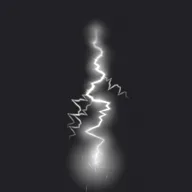稲妻

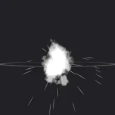爆発

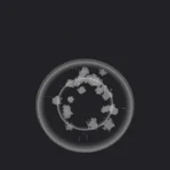衝撃波リング

炎

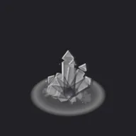氷の結晶

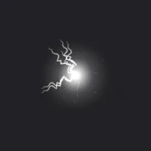電撃の玉

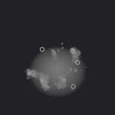毒

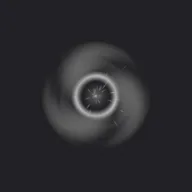闇の渦

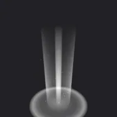聖なる光

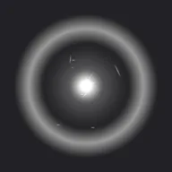チャージ

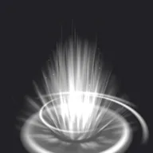オーラ

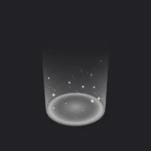回復

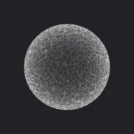バリア

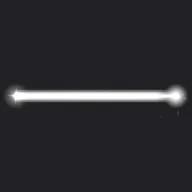ビーム

煙・土煙

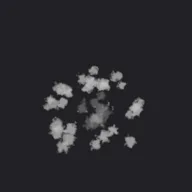着地の土煙

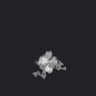破片

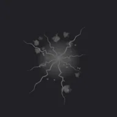地割れ

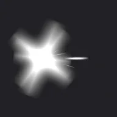マズルフラッシュ

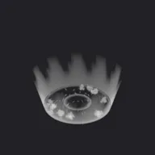水しぶき

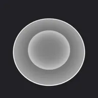範囲予告（円）

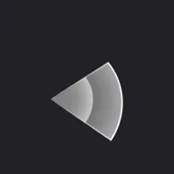範囲予告（扇）

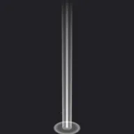光の柱

??? info "主な項目（共通）"

    | 項目 | 英語名 | 内容 |
    |---|---|---|
    | 進み具合 | `Effect Progress` | 0 = 始まり、真ん中でピーク、1 = 消える |
    | 大きさ | `Size` | エフェクト全体の大きさ |
    | 色 ／ 2番目の色 | `Color / Secondary Color` | 光・火花の色 ／ 煙・破片・影の部分の色 |
    | 明るさ | `Intensity` | 光る部分の明るさ |
    | 加算の光 | `Additive Glow` | 1 = 光を足す、0 = ふつうの半透明 |
    | シード | `Seed` | ばらつきの模様を変える |
    | コントラスト ／ 明るさ | `Contrast / Brightness` | 色の白黒の強さと明るさ |
    | 輪郭の硬さ | `Hardness` | 高いほど漫画のようなくっきりした形 |
    | ドロップシャドウ | `Drop Shadow` | 明るい背景でも見えるように、後ろに暗い影 |
    | 影の色・濃さ・ずれ・広がり | `Shadow Color / Opacity / Offset / Spread` | ドロップシャドウの見た目 |
    | 外側の光彩 | `Outer Glow` | オン = ずらさずに周りを光らせる |
    続くエフェクト（炎・オーラ・バリアなど）は、進み具合 0 → 1 で何回かくり返します。

## <i class="bi bi-brush-fill"></i> 墨・筆 Ink &amp; brush {#ink}

墨は光りません（加算なしのふつうの半透明）。色の初期値は黒で、描き終わっても紙に残るので消えません。筆の形はシェーダーで作り、ふちのがさつき・毛の筋・かすれ（筆の終わりほど強い）が出ます。

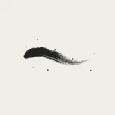筆跡

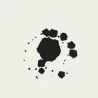墨しぶき

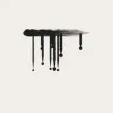墨のたれ

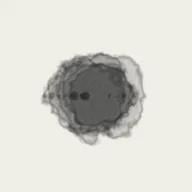墨のにじみ

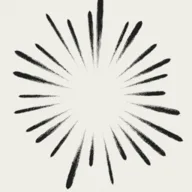筆の放射線

??? info "主な項目（筆跡）"

    | 項目 | 英語名 | 内容 |
    |---|---|---|
    | 進み具合 | `Effect Progress` | 筆が走る途中（0 → 1） |
    | 墨の色 ／ 墨の不透明度 | `Ink Color / Ink Opacity` | 墨の色と濃さ |
    | カメラの方を向く | `Face Camera` | オフ = オブジェクトの向き |
    | 筆跡の形 | `Stroke Shape` | 0 = S 字、1 = 円相、2 = 直線 |
    | 長さ | `Length` | ストロークの長さ |
    | 筆の太さ | `Brush Width` | 筆の太さ |
    | 入り ／ 抜き | `Taper In / Out` | 太くなるまでの長さ ／ 細く抜けていく長さ |
    | かすれ | `Dry Brush` | かすれ（筆の終わりほど強い） |
    | 手ぶれ | `Wobble` | 手の揺れ |
    | しぶき | `Splatter` | 筆から飛ぶ小さな墨の粒 |
    | 回転 | `Rotation` | ストロークの向き |
    | パスで描く | `Use Stroke Path` | 編集できるパス（ベジェカーブ）に沿って描く |
