# <i class="bi bi-grid-3x3"></i> Manga Toon Ground (Ground) NEW {data-toc-label="Manga Toon Ground (Ground)"}

<figure class="ms-page-hero">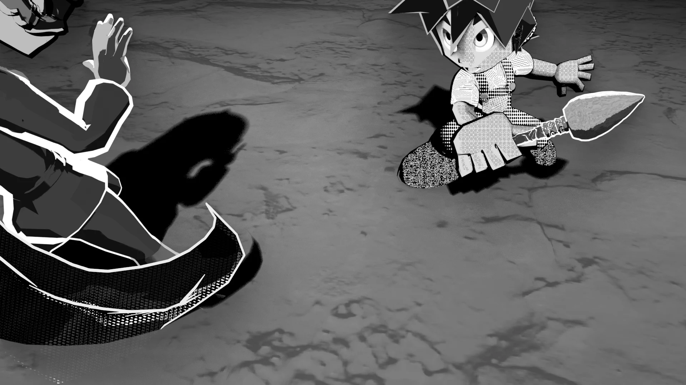</figure>

MTG · Material › Manga Toon Ground

A material made just for the ground under your characters. It draws the shadows of the key, fill and back lights, each switchable on or off per light, as a <strong>flat shadow color (screentone can be used too)</strong>. You can also make the ground transparent so only the shadow lies over the background, or fade out its edges so it blends into the background.

## <i class="bi bi-layers-fill"></i> Layer stack

The texture, bumps, shadows and AO are multiplied over the ground color.

## <i class="bi bi-diagram-2-fill"></i> Node tree

MTG Texture Image

Ground image<i>Tiled, projected from above</i>

MTG Normal Map

Bump image

MTG Fade Position → Fade Ramp

How the edges fade<i>Circular / along the edges</i>

Drivers (automatic)

Shadow light direction and strength

Manga Toon Ground

Shadows, bumps, AO, edge fade<i>Output is emission (flat fill)</i><i>Shadow Only = transparent × shadow color</i>

Material Output

Surface

<em>1</em><b>Find the shadows</b>White diffuse → Shader to RGB → R, G, B (key, fill, back). Divided by the unshadowed brightness so that lit = 1 and shadow = 0

<em>2</em><b>Set the edge</b>Shadow Softness plus the Shadow Blur width make the shadow crisp or soft

<em>3</em><b>Multiply</b>Ground color × texture × bump shade → bump highlights → shadows (per light) × AO

<em>4</em><b>Output</b>Flat fill with emission. Shadow Only and Fade Edges switch to transparent

!!! bubble "Only the shadow lights light the ground"
    The ground gets three "ground shadow lights" per light group, with the same direction, color and strength as the key, fill and back lights. Regular lights do not light the ground (they are excluded with Light Linking), so raising Shadow Blur (the shadow light angle) does not change the character's shadows.

## <i class="bi bi-sliders2"></i> Inputs

Each row of 5 images shows **the value changing from left to right**. The values are written under each image. The yellow cell is the setting's default. Images use Texture Strength 0 and no normal map; all settings other than the one being changed stay at their defaults.

??? info "Manga Toon Ground settings"

    | Panel | Setting | English Name | Default | Description |
    |---|---|---|---|---|
    | Ground | [Shadow Only](#mtg-shadow-only) | `Shadow Only` | Off | Hides the ground and leaves only the shadow over the background |
    | Ground | Ground Color | `Ground Color` | White | The ground color (a screentone material can also be plugged in) |
    | Texture | Ground Texture | `Ground Texture` | (automatic) | Filled in automatically from the image you choose |
    | Texture | [Texture Strength](#mtg-texture-strength) | `Texture Strength` | 1 | How strongly the texture shows on the ground |
    | Texture | Grayscale Texture | `Grayscale Texture` | Off | Uses the texture in black and white |
    | Texture | Ground Normal | `Ground Normal` | (automatic) | Filled in automatically from the texture and normal map |
    | Texture | Bump Shade Color | `Bump Shade Color` | Gray 0.45 | The color multiplied on the sides of bumps facing away from the light (also shows inside shadows) |
    | Texture | [Bump Shade Threshold](#mtg-bump-shade-threshold) | `Bump Shade Threshold` | 0.75 | The higher it is, the more even gentle bumps get shaded |
    | Texture | Bump Shade Softness | `Bump Shade Softness` | 0.3 | 0 = two steps like cel shading, 1 = smooth |
    | Texture | Bump Highlights | `Bump Highlights` | On | Brightens the sides of bumps facing the light (not shown inside that light's shadow) |
    | Texture | Bump Highlight Color | `Bump Highlight Color` | White | The color of the bump highlights |
    | Texture | [Bump Highlight Strength](#mtg-bump-highlight-strength) | `Bump Highlight Strength` | 0.6 | How strongly the highlights show |
    | Texture | Bump Highlight Threshold | `Bump Highlight Threshold` | 0.3 | The lower it is, the more highlights appear |
    | Shadow | [Key Light Shadows](#mtg-key-light-shadows) | `Key Light Shadows` | On | Draws the key light's shadow |
    | Shadow | Fill Light Shadows | `Fill Light Shadows` | Off | Draws the fill light's shadow |
    | Shadow | Back Light Shadows | `Back Light Shadows` | Off | Draws the back light's shadow |
    | Shadow | Ground Shadow Color | `Ground Shadow Color` | Gray 0.25 | The shadow color (a screentone material can also be plugged in) |
    | Shadow | [Ground Shadow Opacity](#mtg-ground-shadow-opacity) | `Ground Shadow Opacity` | 1 | How strongly the shadow shows (0 = no shadow) |
    | Shadow | [Shadow Blur](#mtg-shadow-blur) | `Shadow Blur` | 0 | How blurry the ground shadow is. The character's shadows do not change |
    | Shadow | Shadow Softness | `Shadow Softness` | 0.1 | How soft the shadow's edge is (0 = crisp) |
    | Ambient Occlusion | Ground AO | `Ground AO` | Off | Darkens the ground near objects and where they touch it. Shadows there get darker too |
    | Ambient Occlusion | Ground AO Color | `Ground AO Color` | Gray 0.3 | The color multiplied where light is blocked (screentone can be used too) |
    | Ambient Occlusion | [Ground AO Strength](#mtg-ground-ao-strength) | `Ground AO Strength` | 0.8 | How much AO darkens the ground |
    | Ambient Occlusion | [Ground AO Distance](#mtg-ground-ao-distance) | `Ground AO Distance` | 1 m | How far from objects the darkening reaches |
    | Ambient Occlusion | [Ground AO Contrast](#mtg-ground-ao-contrast) | `Ground AO Contrast` | 0 | 0 = smooth blur, 1 = crisp like a manga contact shadow |
    | Ambient Occlusion | Ground AO Tone Contrast | `Ground AO Tone Contrast` | 0 | + = stronger difference between dark and light areas, − = flatter |
    | Ambient Occlusion | Ground AO Brightness | `Ground AO Brightness` | 0 | + = lighter, − = darker |
    | Ambient Occlusion | AO Only in Shadows | `AO Only in Shadows` | Off | Shows AO only inside the shadow lights' shadows (clipping mask) |
    | Fade | Fade Edges | `Fade Edges` | Off | Fades out the ground far from its center so it blends into the background |
    | Fade | Fade Ramp | `Fade Ramp` | 1 | Filled in automatically from the fade Color Ramp |
    | Fade | Fade Shape | `Fade Shape` | 1 | 0 = circular from the center, 1 = along the ground's edges (MTG Fade Position) |
    | Fade | [Fade Radius](#mtg-fade-radius) | `Fade Radius` | 30 m | The radius of the circle where the ground fades out (MTG Fade Position) |
    | Fade | Edge Fade Width | `Edge Fade Width` | 5 m | How wide the fade is, measured from the ground's edges (MTG Fade Position) |
    | Lights (automatic) | Key / Fill / Back light direction and strength | `… Light Direction / Strength` | (automatic) | Filled in automatically by drivers from the ground shadow lights. Strength 0 = no shadow from that light |

### Ground

<strong>Shadow Only</strong><code>Shadow Only</code>Default OffCompared Off → On

Hides the ground and leaves only the shadow over the background. When on, the ground (texture) disappears and only the shadow is multiplied over the background. In the comparison the background is set to "Screentone": with it on, the ground disappears and only the shadow stays on the dot background.
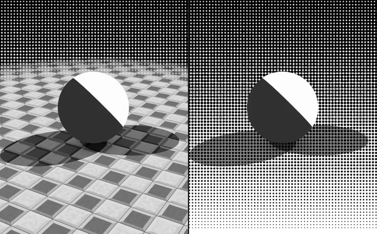
OffOn

### Texture

<strong>Texture Strength</strong><code>Texture Strength</code>Default 1Compared 0 → 1

How strongly the texture shows on the ground. Images use the sample concrete tile (no normal map).
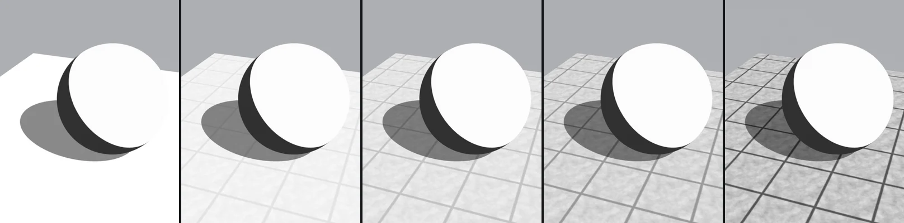
00.250.50.751

<strong>Bump Shade Threshold</strong><code>Bump Shade Threshold</code>Default 0.75Compared 0 → 1

The higher it is, the more even gentle bumps get shaded. Images use a normal map with highlights off.
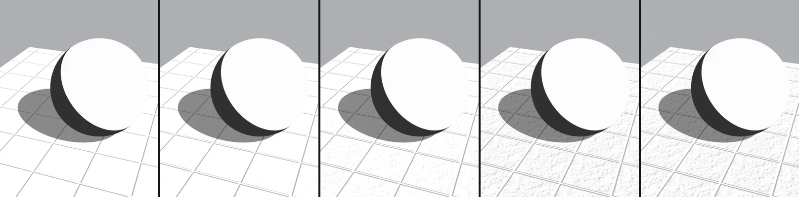
00.250.50.751

<strong>Bump Highlight Strength</strong><code>Bump Highlight Strength</code>Default 0.6Compared 0 → 1

How strongly the highlights show. Images use a normal map.
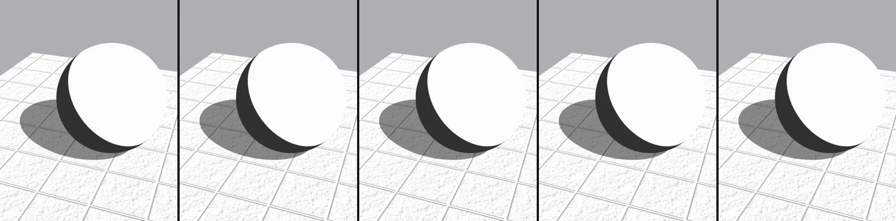
00.30.60.81

### Shadow

<strong>Shadows from</strong><code>Key / Fill / Back Light Shadows</code>Default Key onlyCompared Key → all 3

Turns the shadow of each of the key, fill and back lights on or off. Where shadows overlap, they get darker.
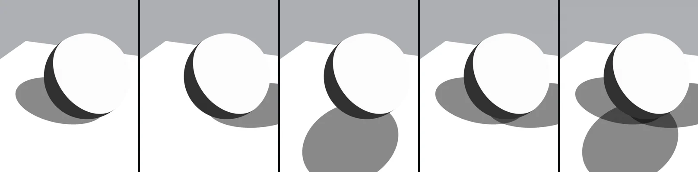
KeyFillBackKey + FillAll 3

<strong>Ground Shadow Opacity</strong><code>Ground Shadow Opacity</code>Default 1Compared 0 → 1

How strongly the shadow shows (0 = no shadow).
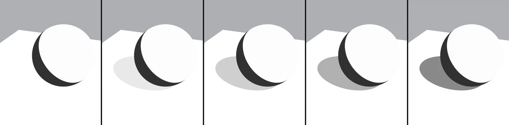
00.250.50.751

<strong>Shadow Blur</strong><code>Shadow Blur</code>Default 0Compared 0 → 1

How blurry the ground shadow is. The character's shadows do not change. Shadow Blur 1 = a shadow light angle of 20°.
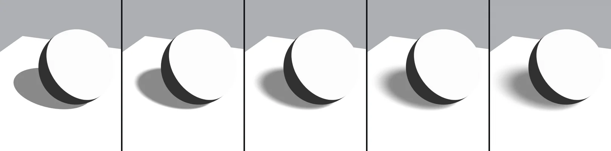
00.250.50.751

### Ambient Occlusion

<strong>Ground AO Strength</strong><code>Ground AO Strength</code>Default 0.8Compared 0 → 1

How much AO darkens the ground. Images use AO on with Ground AO Distance 2.5 m.
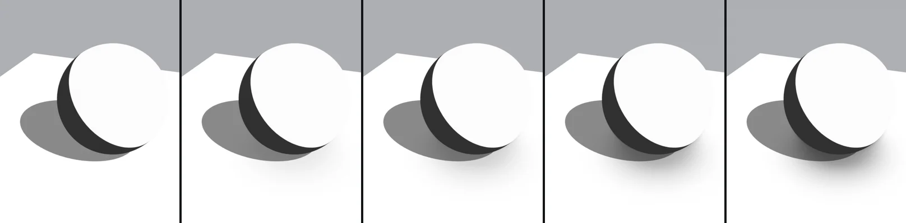
00.250.50.81

<strong>Ground AO Distance</strong><code>Ground AO Distance</code>Default 1 mCompared 0.25 → 4

How far from objects the darkening reaches. Images use AO on.
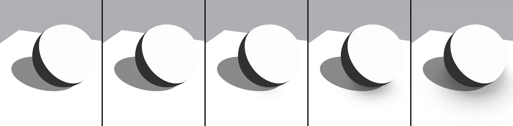
0.250.5124

<strong>Ground AO Contrast</strong><code>Ground AO Contrast</code>Default 0Compared 0 → 1

0 = smooth blur, 1 = crisp like a manga contact shadow. Images use AO on with Ground AO Distance 2.5 m.
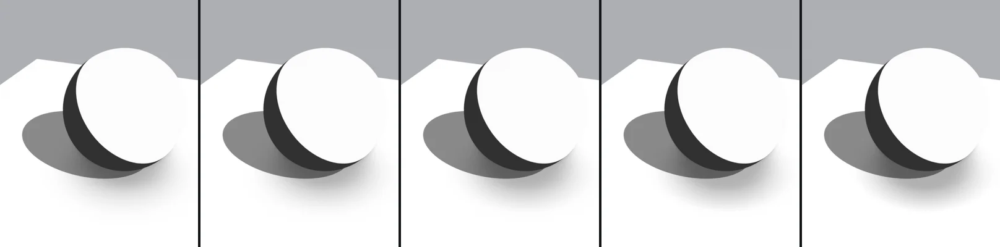
00.250.50.751

### Fade

<strong>Fade Radius</strong><code>Fade Radius</code>Default 30 mCompared 3 m → 30 m

The radius of the circle where the ground fades out (MTG Fade Position). Images use Fade Edges on with Fade Shape 0 (circular).
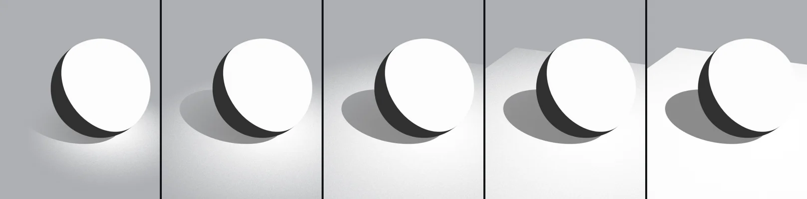
3 m5 m8 m12 m30 m

!!! note ""
    Shadow Softness barely changes anything while the shadow lights' shadows are crisp. Combined with Shadow Blur, it changes how the light and dark of a blurred shadow come out.
