# <i class="bi bi-grid-3x3"></i> Manga Toon Ground（地面） NEW {data-toc-label="Manga Toon Ground（地面）"}

<figure class="ms-page-hero">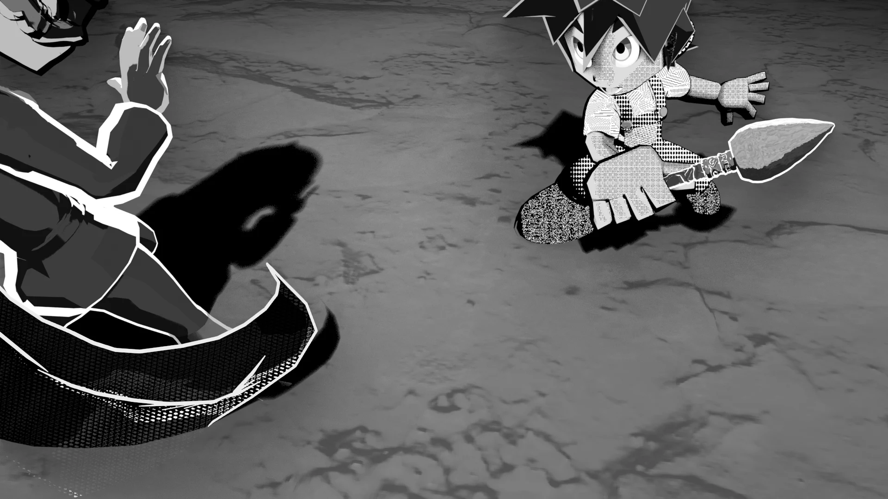</figure>

MTG · Material › Manga Toon Ground

キャラクターの下に敷く地面専用のマテリアルです。キー・フィル・バックのライトの影を、ライトごとにオン・オフして<strong>平らな影の色（トーンも入れられる）</strong>で描きます。地面を透明にして影だけを背景に重ねたり、端を消して背景になじませたりもできます。

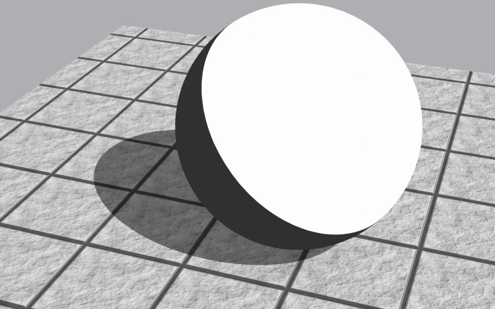

## <i class="bi bi-layers-fill"></i> 概要図 Layer stack

地面の色に、テクスチャ・凹凸・影・AO を掛け合わせて重ねます。

## <i class="bi bi-diagram-2-fill"></i> 構成 Node tree

MTG Texture Image

地面の画像<i>上から見て並べて貼る</i>

MTG Normal Map

凹凸の画像

MTG Fade Position → Fade Ramp

端の消し方<i>円形／辺に沿う</i>

ドライバー（自動）

影用ライトの向き・強さ

Manga Toon Ground

影・凹凸・AO・端の消し方<i>出力は発光（平らな塗り）</i><i>影だけ = 透明 × 影の色</i>

マテリアル出力

サーフェス

<em>1</em><b>影を見つける</b>白いディフューズ → シェーダーのRGB化 → R・G・B（キー・フィル・バック）。影の無いときの明るさで割り、日なた 1・影 0 にする

<em>2</em><b>境目を決める</b>影のふちのやわらかさ＋影のぼかしの幅で、くっきり／やわらかい影にする

<em>3</em><b>掛け合わせる</b>地面の色 × テクスチャ × 凹凸の陰 → 照り → 影（ライトごと）× AO

<em>4</em><b>出力</b>発光で平らに塗る。影だけ・端を消すは透明と切り替える

!!! bubble "地面を照らすのは影用ライトだけ"
    地面には、キー・フィル・バックと同じ向き・色・強さの「地面の影用ライト」がライトグループごとに3つ付きます。ふつうのライトは地面を照らさない（ライトリンキングで除外）ので、影のぼかし（影用ライトの角度）を上げてもキャラクターの影は変わりません。

## <i class="bi bi-sliders2"></i> パネルと数値 Inputs

5つの画像は、**左から右へ値を変えたもの**です。画像の下に値を書いています。黄色い欄がその項目の既定値です。テクスチャの濃さ 0・ノーマルマップなしの状態で、変えている項目以外は既定値のままです。

??? info "Manga Toon Ground の項目一覧"

    | パネル | 項目 | 英語名 | 既定値 | 内容 |
    |---|---|---|---|---|
    | 地面 | [影だけ](#mtg-shadow-only) | `Shadow Only` | オフ | 地面を見えなくして、影だけを背景の上に残します |
    | 地面 | 地面の色 | `Ground Color` | 白 | 地面の色（スクリーントーンのマテリアルも入れられます） |
    | テクスチャ | 地面のテクスチャ | `Ground Texture` | （自動） | 選んだ画像から自動で入ります |
    | テクスチャ | [テクスチャの濃さ](#mtg-texture-strength) | `Texture Strength` | 1 | テクスチャが地面に出る強さ |
    | テクスチャ | テクスチャを白黒に | `Grayscale Texture` | オフ | テクスチャを白黒で使います |
    | テクスチャ | 地面の凹凸 | `Ground Normal` | （自動） | テクスチャとノーマルマップから自動で入ります |
    | テクスチャ | 凹凸の陰の色 | `Bump Shade Color` | 灰 0.45 | 凹凸の光に背を向けた側に掛け合わせる色（影の中でも出ます） |
    | テクスチャ | [凹凸の陰の境目](#mtg-bump-shade-threshold) | `Bump Shade Threshold` | 0.75 | 高いほど、ゆるい凹凸にも陰が付く |
    | テクスチャ | 凹凸の陰・照りのやわらかさ | `Bump Shade Softness` | 0.3 | 0 = セル塗りのような 2 段、1 = なめらか |
    | テクスチャ | 凹凸の照り | `Bump Highlights` | オン | 凹凸の光に向いた側を明るくします（そのライトの影の中には出ません） |
    | テクスチャ | 照りの色 | `Bump Highlight Color` | 白 | 凹凸の照りの色 |
    | テクスチャ | [照りの強さ](#mtg-bump-highlight-strength) | `Bump Highlight Strength` | 0.6 | 照りの出る強さ |
    | テクスチャ | 照りの境目 | `Bump Highlight Threshold` | 0.3 | 低いほど照りが増える |
    | 影 | [キーライトの影](#mtg-key-light-shadows) | `Key Light Shadows` | オン | キーライトの影を描きます |
    | 影 | フィルライトの影 | `Fill Light Shadows` | オフ | フィルライトの影を描きます |
    | 影 | バックライトの影 | `Back Light Shadows` | オフ | バックライトの影を描きます |
    | 影 | 影の色 | `Ground Shadow Color` | 灰 0.25 | 影の色（スクリーントーンのマテリアルも入れられます） |
    | 影 | [影の濃さ](#mtg-ground-shadow-opacity) | `Ground Shadow Opacity` | 1 | 影の出る強さ（0 = 影なし） |
    | 影 | [影のぼかし](#mtg-shadow-blur) | `Shadow Blur` | 0 | 地面の影のぼけ具合。キャラクターの影は変わりません |
    | 影 | 影のふちのやわらかさ | `Shadow Softness` | 0.1 | 影のふちのやわらかさ（0 = くっきり） |
    | 接地の陰（AO） | 接地の陰（AO） | `Ground AO` | オフ | 物の近くや接地しているところの地面を暗くします。そこでは影も濃くなります |
    | 接地の陰（AO） | AO の色 | `Ground AO Color` | 灰 0.3 | 遮られたところに掛け合わせる色（トーンも入れられます） |
    | 接地の陰（AO） | [AO の濃さ](#mtg-ground-ao-strength) | `Ground AO Strength` | 0.8 | AO で地面が暗くなる強さ |
    | 接地の陰（AO） | [AO の届く距離](#mtg-ground-ao-distance) | `Ground AO Distance` | 1 m | 物からどのくらいの距離まで暗くなるか |
    | 接地の陰（AO） | [AO のくっきりさ](#mtg-ground-ao-contrast) | `Ground AO Contrast` | 0 | 0 = なめらかなぼかし、1 = 漫画の接地影のようにくっきり |
    | 接地の陰（AO） | AO のコントラスト | `Ground AO Tone Contrast` | 0 | ＋ = 濃い所と薄い所の差を強く、− = 平らに |
    | 接地の陰（AO） | AO の明るさ | `Ground AO Brightness` | 0 | ＋ = 薄く、− = 濃く |
    | 接地の陰（AO） | AO を影の中だけに | `AO Only in Shadows` | オフ | AO を影用ライトの影の範囲だけに出します（クリッピングマスク） |
    | 端を消す | 端を消す | `Fade Edges` | オフ | 地面の中心から遠い所を消して、背景になじませます |
    | 端を消す | 消え方（自動） | `Fade Ramp` | 1 | 消し方のカラーランプから自動で入ります |
    | 端を消す | 消し方の形 | `Fade Shape` | 1 | 0 = 中心から円形、1 = 地面の辺に沿って（MTG Fade Position） |
    | 端を消す | [円の半径](#mtg-fade-radius) | `Fade Radius` | 30 m | 地面が消えていく円の半径（MTG Fade Position） |
    | 端を消す | 辺から消す幅 | `Edge Fade Width` | 5 m | 地面の辺から、消えていく幅（MTG Fade Position） |
    | ライト（自動） | キー／フィル／バックライトの向き・強さ | `… Light Direction / Strength` | （自動） | 地面の影用ライトからドライバーで自動で入ります。強さ 0 = そのライトの影なし |

### 地面 Ground

<strong>影だけ</strong><code>Shadow Only</code>既定 オフ比較 オフ → オン

地面を見えなくして、影だけを背景の上に残します。オンにすると地面（テクスチャ）は消え、影だけが背景に掛け合わされます。比較画像は背景を「トーン模様」にしたもので、オンでは地面が消えて網点の背景の上に影だけが残ります。
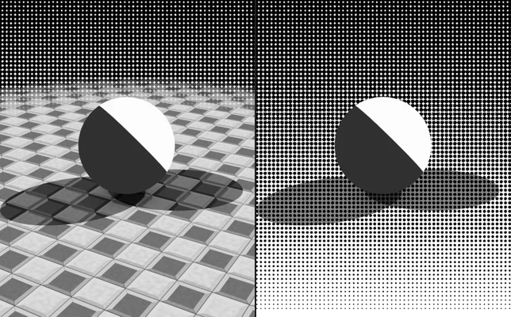
オフオン

### テクスチャ Texture

<strong>テクスチャの濃さ</strong><code>Texture Strength</code>既定 1比較 0 → 1

テクスチャが地面に出る強さ。画像はサンプルのコンクリートタイル（ノーマルマップなし）の場合。
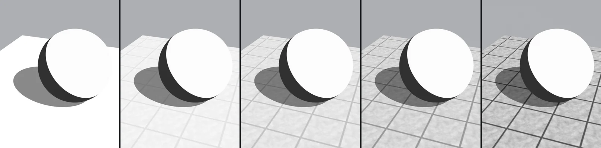
00.250.50.751

<strong>凹凸の陰の境目</strong><code>Bump Shade Threshold</code>既定 0.75比較 0 → 1

高いほど、ゆるい凹凸にも陰が付く。画像はノーマルマップあり・照りオフの場合。
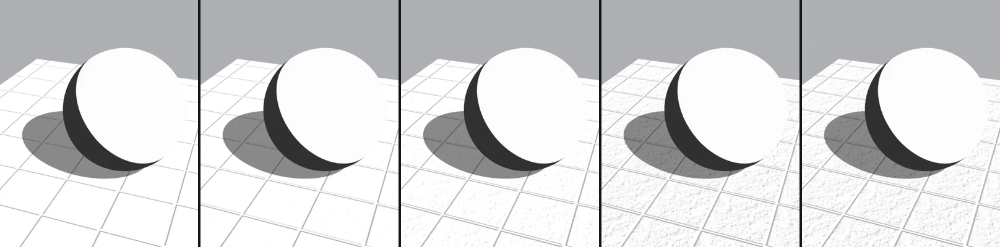
00.250.50.751

<strong>照りの強さ</strong><code>Bump Highlight Strength</code>既定 0.6比較 0 → 1

照りの出る強さ。画像はノーマルマップありの場合。
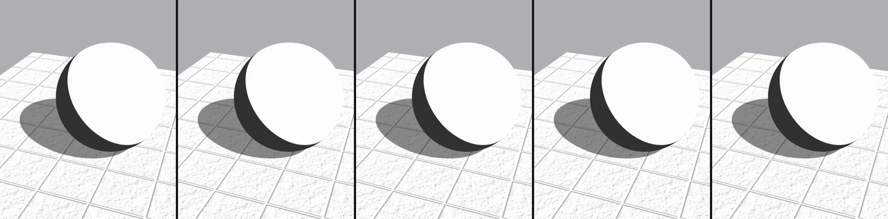
00.30.60.81

### 影 Shadow

<strong>影を落とすライト</strong><code>Key / Fill / Back Light Shadows</code>既定 キーのみ比較 キー → 3灯

キー・フィル・バックそれぞれの影のオン・オフ。重なった所ほど濃くなります。
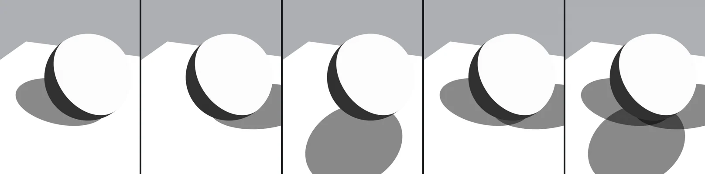
キーフィルバックキー＋フィル3灯

<strong>影の濃さ</strong><code>Ground Shadow Opacity</code>既定 1比較 0 → 1

影の出る強さ（0 = 影なし）。
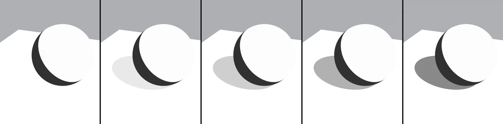
00.250.50.751

<strong>影のぼかし</strong><code>Shadow Blur</code>既定 0比較 0 → 1

地面の影のぼけ具合。キャラクターの影は変わりません。影のぼかし 1 = 影用ライトの角度 20°。
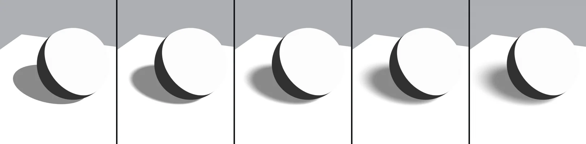
00.250.50.751

### 接地の陰（AO） Ambient Occlusion

<strong>AO の濃さ</strong><code>Ground AO Strength</code>既定 0.8比較 0 → 1

AO で地面が暗くなる強さ。画像は AO オン・届く距離 2.5 m の場合。
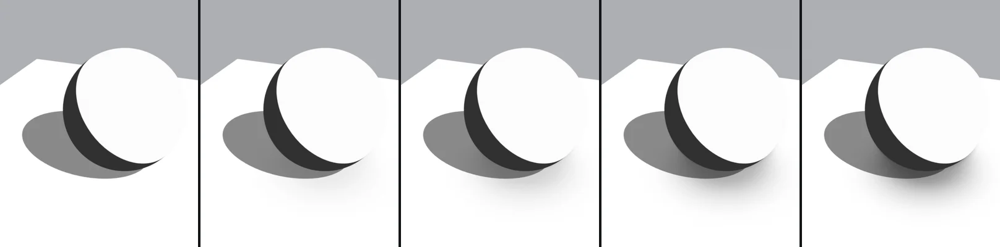
00.250.50.81

<strong>AO の届く距離</strong><code>Ground AO Distance</code>既定 1 m比較 0.25 → 4

物からどのくらいの距離まで暗くなるか。画像は AO オンの場合。
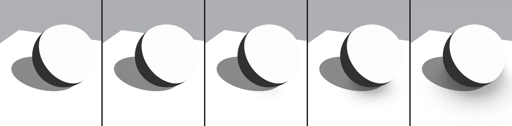
0.250.5124

<strong>AO のくっきりさ</strong><code>Ground AO Contrast</code>既定 0比較 0 → 1

0 = なめらかなぼかし、1 = 漫画の接地影のようにくっきり。画像は AO オン・届く距離 2.5 m の場合。
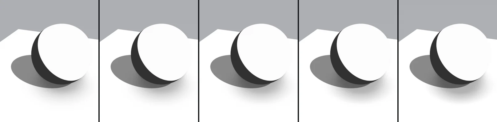
00.250.50.751

### 端を消す Fade

<strong>円の半径</strong><code>Fade Radius</code>既定 30 m比較 3 m → 30 m

地面が消えていく円の半径（MTG Fade Position）。画像は端を消すオン・消し方の形 0（円形）の場合。
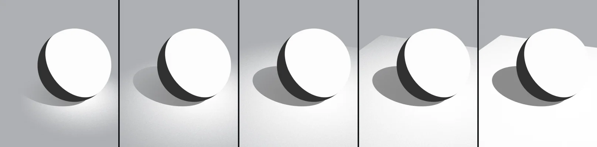
3 m5 m8 m12 m30 m

!!! note ""
    影のふちのやわらかさ（Shadow Softness）は、影用ライトの影がくっきりしているときはほとんど変わりません。影のぼかしと組み合わせると、ぼけた影の濃淡の出方が変わります。
