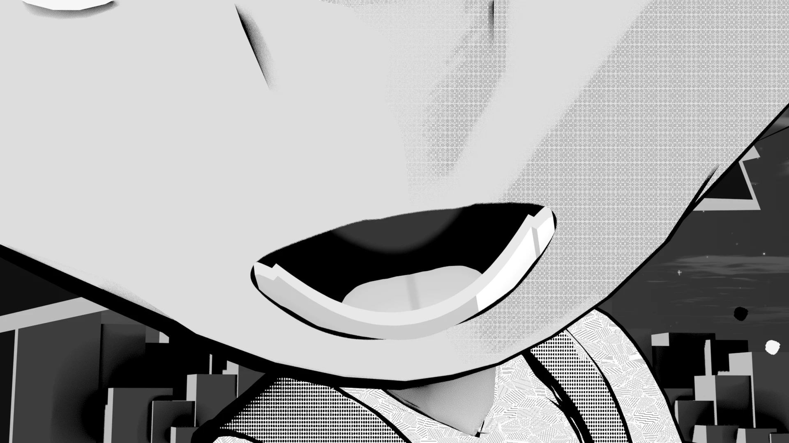
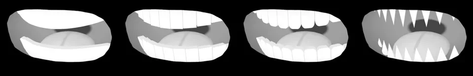
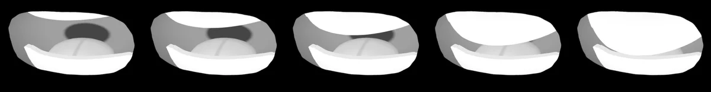
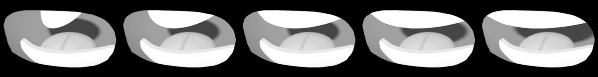
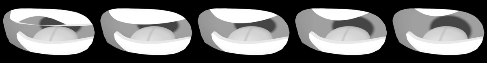
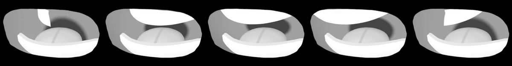
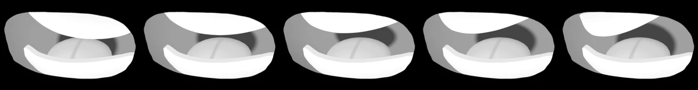
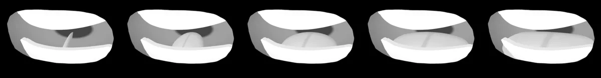
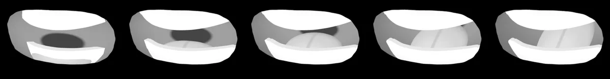
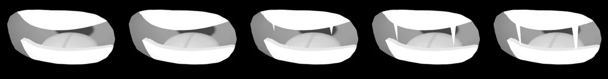

# <i class="bi bi-emoji-smile-fill"></i> Manga Toon Mouth NEW {data-toc-label="Manga Toon Mouth"}

<figure class="ms-page-hero"></figure>

MTM · Material › Manga Toon Mouth + Geometry Nodes › MTS Mouth Inner

The mouth is made of two parts: the <strong>mouth plane</strong> (a material) that sticks to the face surface, and the <strong>mouth interior geometry</strong> (Geometry Nodes) placed behind it. The teeth, tongue and depth change with the values on the mouth interior's Modifier.

## <i class="bi bi-layers-fill"></i> Layer stack

The mouth interior stacks layers at different depths and uses parallax to look 3D.

## <i class="bi bi-diagram-2-fill"></i> Node tree

Mouth plane

Subdivide → Shrinkwrap<i>Sticks to the face surface</i>

Mouth interior (_Inner)

GN: MTS Mouth Inner<i>Throat, tongue, upper and lower teeth, fangs</i>

Manga Toon Mouth [material name]

Coords → Rig → Shade → Output<i>The mouth shape is a mask; outside is transparent</i>

MTS Teeth / Tongue / Inside

Mouth interior materials

Render

Draws the mouth in front of the face

<em>Coords</em><b>Coordinates</b>Turns the plane's UVs into mouth coordinates

<em>Rig</em><b>Rig</b>Moves the upper lip, lower lip, teeth and tongue from the Link to Rig bones

<em>Shade</em><b>Shading</b>Mouth interior color, tongue and teeth shape and color, light shading

<em>Output</em><b>Output</b>Makes the area outside the mouth transparent and lets the face show through with a mask

## <i class="bi bi-sliders2"></i> Inputs

Each row of 5 spheres (eye, mouth, sky) shows **the value changing from left to right**. The values are written under each image. The yellow cell is the setting's default; all other settings stay at their defaults.

??? info "MTS Mouth Inner settings"

    | Panel | Setting | English Name | Default |
    |---|---|---|---|
    | Teeth | [Teeth Style](#mtm-teeth-teeth-style) | `Teeth Style` | 1 |
    | Upper Teeth | [Upper Teeth Height](#mtm-teeth-upper-teeth-length) | `Upper Teeth Length` | 0.3 |
    | Upper Teeth | [Upper Teeth Width](#mtm-teeth-upper-teeth-width) | `Upper Teeth Width` | 1 |
    | Upper Teeth | [Upper Teeth Rotation Forward / Back](#mtm-teeth-upper-teeth-rotation-x) | `Upper Teeth Rotation X` | 0° |
    | Upper Teeth | [Upper Teeth Rotation Left / Right](#mtm-teeth-upper-teeth-rotation-y) | `Upper Teeth Rotation Y` | 0° |
    | Upper Teeth | [Upper Teeth Rotation Front](#mtm-teeth-upper-teeth-rotation-z) | `Upper Teeth Rotation Z` | 0° |
    | Tongue | [Tongue Size](#mtm-tongue-tongue-size) | `Tongue Size` | 0.55 |
    | Inside | [Depth](#mtm-inside-depth) | `Depth` | 1.2 |
    | Fang | [Fang Size](#mtm-fang-fang-size) | `Fang Size` | 1.5 |

### Teeth

<strong>Teeth Style</strong><code>Teeth Style</code>Default 1Compared 0 → 3

0 = Solid, 1 = Square, 2 = Round, 3 = Jagged. In the Sidebar you pick one with the buttons.

0123

<strong>Upper Teeth Height</strong><code>Upper Teeth Length</code>Default 0.3Compared 0.1 → 0.6

Height of the upper teeth from root to tip. Lower Teeth Height works the same way for the lower teeth.

0.10.20.30.450.6

The next four comparisons use the same mouth as the Teeth Style comparison (Teeth Style 0, everything else at its default). The lower teeth have the same settings (Lower Teeth Width and Rotation).

<strong>Upper Teeth Width</strong><code>Upper Teeth Width</code>Default 1Compared 0.4 → 1.6

Width of the row of teeth (the full mouth width = 1). The number of teeth stays the same; the row shrinks or widens from its center.

0.40.711.31.6

<strong>Upper Teeth Rotation Forward / Back</strong><code>Upper Teeth Rotation X</code>Default 0°Compared −40° → 40°

Tilts the row of teeth forward or back, like buck teeth (upper) or an underbite (lower).

−40°−20°0°20°40°

<strong>Upper Teeth Rotation Left / Right</strong><code>Upper Teeth Rotation Y</code>Default 0°Compared −40° → 40°

Turns the row of teeth left or right: one side goes back, the other comes forward.

−40°−20°0°20°40°

<strong>Upper Teeth Rotation Front</strong><code>Upper Teeth Rotation Z</code>Default 0°Compared −20° → 20°

Rotates the row of teeth as seen from the front. Handy for lining the teeth up with a tilted mouth.

−20°−10°0°10°20°

### Tongue

<strong>Tongue Size</strong><code>Tongue Size</code>Default 0.55Compared 0 → 1.1

The size of the tongue.

00.30.550.81.1

### <i class="bi bi-emoji-smile-fill"></i> Inside

<strong>Depth</strong><code>Depth</code>Default 1.2Compared 0.4 → 2.6

How deep the mouth interior is. When shallow, the dark throat at the back looks closer.

0.40.81.21.82.6

### Fang

<strong>Fang Size</strong><code>Fang Size</code>Default 1.5Compared 0.5 → 3

The length of the fang (when Fang is on).

0.511.52.23

