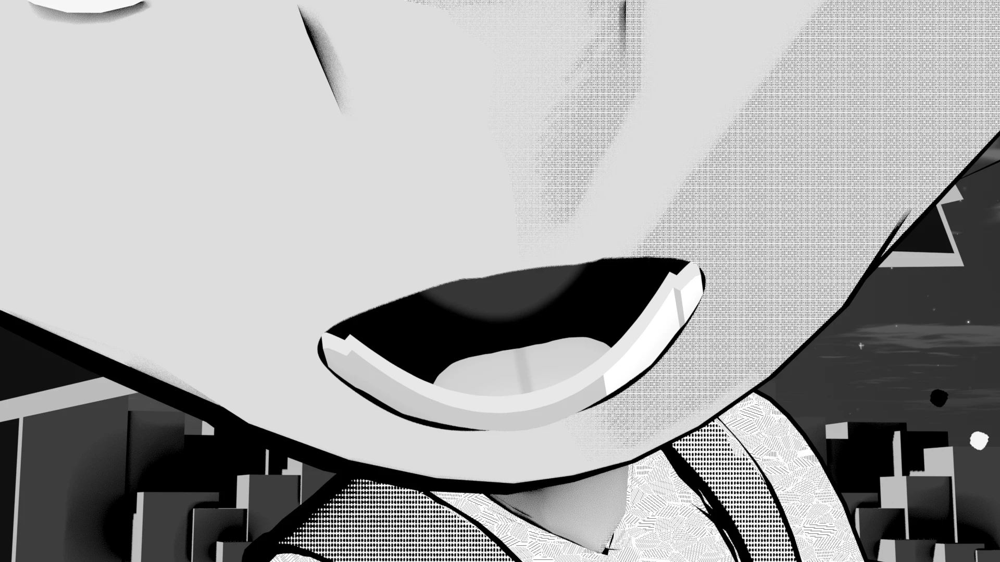
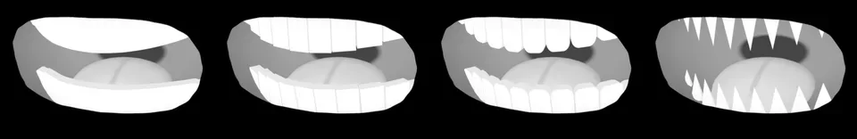
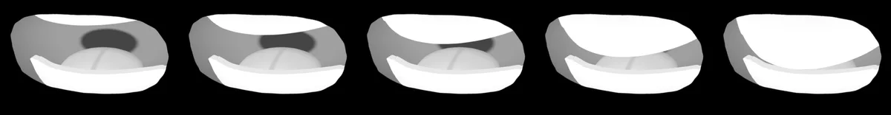
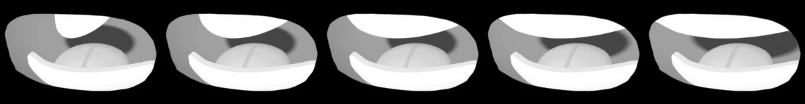
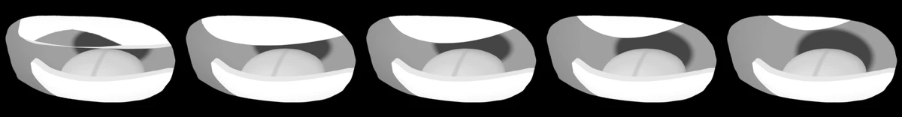
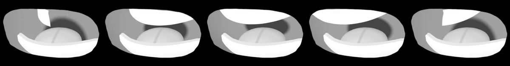
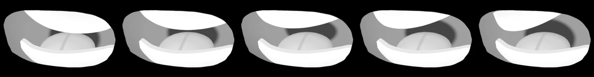
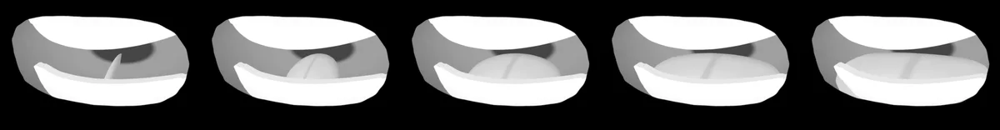
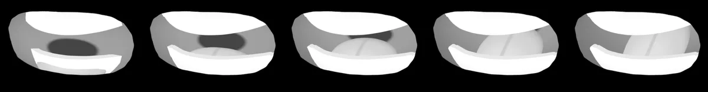
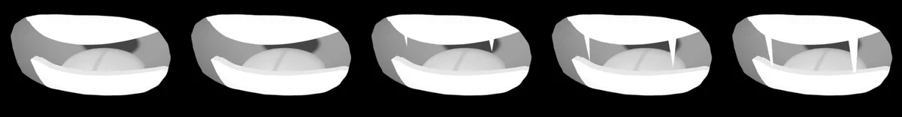

# <i class="bi bi-emoji-smile-fill"></i> Manga Toon Mouth NEW {data-toc-label="Manga Toon Mouth"}

<figure class="ms-page-hero"></figure>

MTM · Material › Manga Toon Mouth ＋ Geometry Nodes › MTS Mouth Inner

口は2つの部品でできています。顔の面にくっつく<strong>口の板ポリ</strong>（マテリアル）と、その奥に置く<strong>口の中のジオメトリ</strong>（ジオメトリノード）です。歯・舌・奥行きは口の中のモディファイアの値で変わります。

## <i class="bi bi-layers-fill"></i> 概要図 Layer stack

口の中は奥行きの違う層を重ねて、視差で立体に見せます。

## <i class="bi bi-diagram-2-fill"></i> 構成 Node tree

口の板ポリ

細分化 → シュリンクラップ<i>顔の面にくっつける</i>

口の中（_Inner）

GN: MTS Mouth Inner<i>喉・舌・上下の歯・八重歯</i>

Manga Toon Mouth [マテリアル名]

Coords → Rig → Shade → Output<i>口の形はマスク、外側は透過</i>

MTS Teeth / Tongue / Inside

口の中のマテリアル

レンダー

顔の前に口を描く

<em>Coords</em><b>座標</b>板ポリの UV を口の座標にする

<em>Rig</em><b>リグ</b>リグ連携のボーンから上唇・下唇・歯・舌を動かす

<em>Shade</em><b>塗り</b>口の中の色、舌・歯の形と色、ライトの陰影

<em>Output</em><b>出力</b>口の外を透過し、顔をマスクで透かす

## <i class="bi bi-sliders2"></i> パネルと数値 Inputs

5つの球（目・口・空）は、**左から右へ値を変えたもの**です。画像の下に値を書いています。黄色い欄がその項目の既定値で、ほかの項目は既定値のままです。

??? info "MTS Mouth Inner の項目一覧"

    | パネル | 項目 | 英語名 | 既定値 |
    |---|---|---|---|
    | 歯の形 | [歯のスタイル](#mtm-teeth-teeth-style) | `Teeth Style` | 1 |
    | 上の歯 | [上の歯の高さ](#mtm-teeth-upper-teeth-length) | `Upper Teeth Length` | 0.3 |
    | 上の歯 | [上の歯の幅](#mtm-teeth-upper-teeth-width) | `Upper Teeth Width` | 1 |
    | 上の歯 | [上の歯 回転 前後](#mtm-teeth-upper-teeth-rotation-x) | `Upper Teeth Rotation X` | 0° |
    | 上の歯 | [上の歯 回転 左右](#mtm-teeth-upper-teeth-rotation-y) | `Upper Teeth Rotation Y` | 0° |
    | 上の歯 | [上の歯 回転 正面](#mtm-teeth-upper-teeth-rotation-z) | `Upper Teeth Rotation Z` | 0° |
    | 舌 | [舌の大きさ](#mtm-tongue-tongue-size) | `Tongue Size` | 0.55 |
    | 口の中 | [奥行き](#mtm-inside-depth) | `Depth` | 1.2 |
    | 八重歯 | [八重歯の長さ](#mtm-fang-fang-size) | `Fang Size` | 1.5 |

### 歯の形 Teeth

<strong>歯のスタイル</strong><code>Teeth Style</code>既定 1比較 0 → 3

0 = 一枚板、1 = 四角、2 = 丸、3 = ギザ。サイドバーではボタンで選びます。

0123

<strong>上の歯の高さ</strong><code>Upper Teeth Length</code>既定 0.3比較 0.1 → 0.6

上の歯の、付け根から先までの高さ。下の歯は「下の歯の高さ」で同じように変えられます。

0.10.20.30.450.6

次の4つの比較は、歯のスタイルの比較と同じ口で撮っています（歯のスタイル 0・ほかは既定値）。下の歯にも同じ項目（下の歯の幅・回転）があります。

<strong>上の歯の幅</strong><code>Upper Teeth Width</code>既定 1比較 0.4 → 1.6

歯の列の横幅（口の幅いっぱい = 1）。歯の本数はそのままで、列の中心から横に縮めたり広げたりします。

0.40.711.31.6

<strong>上の歯 回転 前後</strong><code>Upper Teeth Rotation X</code>既定 0°比較 −40° → 40°

歯の列を前後に傾けます。上の歯では出っ歯、下の歯ではしゃくれのような向きになります。

−40°−20°0°20°40°

<strong>上の歯 回転 左右</strong><code>Upper Teeth Rotation Y</code>既定 0°比較 −40° → 40°

歯の列を左右に向けます。片側が奥へ、反対側が手前に来ます。

−40°−20°0°20°40°

<strong>上の歯 回転 正面</strong><code>Upper Teeth Rotation Z</code>既定 0°比較 −20° → 20°

正面から見て、歯の列を回します。口を傾けたときに歯をそろえるのにも使えます。

−20°−10°0°10°20°

### 舌 Tongue

<strong>舌の大きさ</strong><code>Tongue Size</code>既定 0.55比較 0 → 1.1

舌の大きさ。

00.30.550.81.1

### <i class="bi bi-emoji-smile-fill"></i> 口の中 Inside

<strong>奥行き</strong><code>Depth</code>既定 1.2比較 0.4 → 2.6

口の中の深さ。浅いと奥の喉の暗がりが近くに見えます。

0.40.81.21.82.6

### 八重歯 Fang

<strong>八重歯の長さ</strong><code>Fang Size</code>既定 1.5比較 0.5 → 3

八重歯の長さ（八重歯がオンの場合）。

0.511.52.23

