# <i class="bi bi-circle-half"></i> Manga Tone Shader

<figure class="ms-page-hero">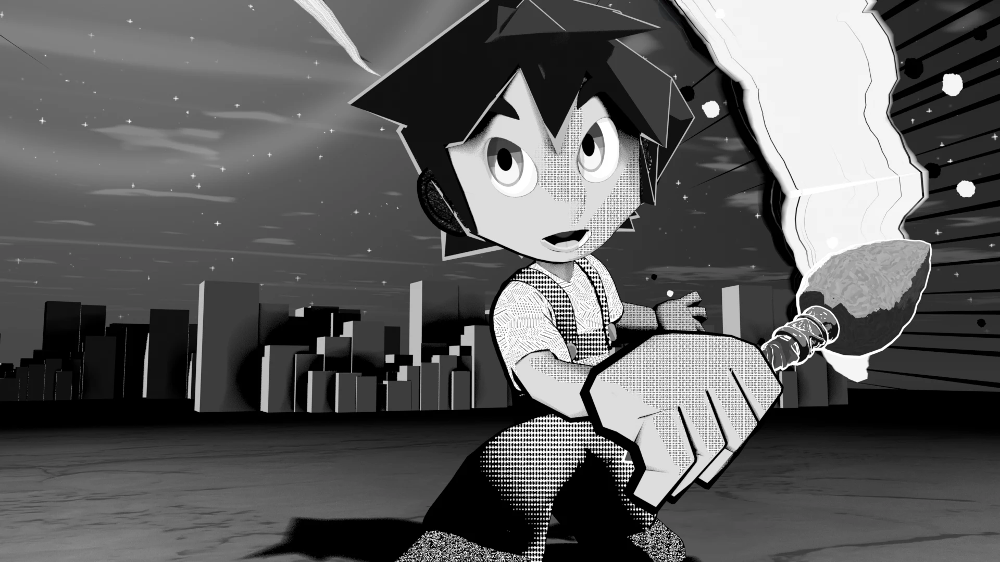</figure>

MTS · Material › Manga Tone Shader (Lite: …)

A shader that reads the <strong>color channels</strong> of the lights separately and paints a different tone for each: where the key (red), fill (green) and back (blue) lights hit. When you check a feature, the shader is automatically swapped for a lightweight group that contains only the features you use.

## <i class="bi bi-layers-fill"></i> Layer stack

The layers stack from the bottom up into one final shading. The label at the top right is how each layer is combined (blend mode).

## <i class="bi bi-diagram-2-fill"></i> Node tree

Image Texture

Matte tone<i>Normal → Vector Transform → Mapping</i>

Image Texture

AO mask<i>UV → Mapping</i>

Image Texture + Normal Map

Normal map

Image Texture

Transparent PNG (alpha)

Manga Tone Shader (Lite: …)

Base / Key / Fill / Back tones<i>Normals, shadows, highlights, matte, watercolor, transparency…</i><i>Lightweight version with only the checked features</i>

Material Output

Surface

<em>1</em><b>Read the lights</b>Diffuse → Shader to RGB → Separate Color pulls out how the red, green and blue lights hit, one by one

<em>2</em><b>Split into steps</b>Each of the three values is cut into steps (Map Range) for crisp light and dark. The offsets move the borders

<em>3</em><b>Layer the tones</b>Tones (colors or patterns) are layered in the order Base → Key → Fill → Back

<em>4</em><b>Add effects</b>Shadow, sub outline, AO, gloss, rim light and matte are layered on top

<em>5</em><b>Finish</b>Watercolor → color (variation and paper) → output

!!! note ""
    Light Linking decides which objects each light illuminates. If the character is not in a light group's "Lit Objects", it renders solid black.

## <i class="bi bi-sliders2"></i> Inputs

The five spheres (or eyes, mouths, skies) show **the value changing from left to right**. The values are written under the image. The yellow cell is the default value for that setting, and all other settings stay at their defaults.

??? info "All Manga Tone Shader settings"

    | Panel | Setting | UI name | Default |
    |---|---|---|---|
    | Base | Base Tone | `Base Tone` | Color |
    | Base | [Key Light Offset](#mts-base-key-light-offset) | `Key Light Offset` | 3 |
    | Base | [Fill Light Offset](#mts-base-fill-light-offset) | `Fill Light Offset` | 3 |
    | Base | [Back Light Offset](#mts-base-back-light-offset) | `Back Light Offset` | 1 |
    | Shadow | [Shadow Opacity](#mts-shadow-shadow-opacity) | `Shadow Opacity` | 1 |
    | Shadow | [Brightness](#mts-shadow-brightness) | `Brightness` | 0.5 |
    | Shadow | [Contrast](#mts-shadow-contrast) | `Contrast` | 1 |
    | Sub Outline | [Opacity](#mts-sub-outline-opacity) | `Opacity` | 0.5 |
    | Sub Outline | [Size](#mts-sub-outline-size) | `Size` | 0.5 |
    | Sub Outline | [Shadow Size](#mts-sub-outline-shadow-size) | `Shadow Size` | 0.2 |
    | AO | [Opacity](#mts-ao-opacity) | `Opacity` | 1 |
    | AO | [Intensity](#mts-ao-intensity) | `Intensity` | 1 |
    | Gloss | [Opacity](#mts-gloss-opacity) | `Opacity` | 0.5 |
    | Gloss | [Brightness](#mts-gloss-brightness) | `Brightness` | 0.5 |
    | Gloss | [Contrast](#mts-gloss-contrast) | `Contrast` | 1 |
    | Gloss | [Spread](#mts-gloss-spread) | `Spread` | 0.1 |
    | Gloss | [Offset X](#mts-gloss-offset-x) | `Offset X` | 0 |
    | Gloss | [Offset Z](#mts-gloss-offset-z) | `Offset Z` | 0 |
    | Anisotropy | [Opacity](#mts-anisotropy-opacity) | `Opacity` | 0.5 |
    | Rim Light | [Opacity](#mts-rim-light-opacity) | `Opacity` | 0.5 |
    | Rim Light | [Contrast](#mts-rim-light-contrast) | `Contrast` | 1 |
    | Rim Light | [Width](#mts-rim-light-width) | `Width` | 0.014 |
    | Rim Light | [Offset X](#mts-rim-light-offset-x) | `Offset X` | 0 |
    | Rim Light | [Offset Z](#mts-rim-light-offset-z) | `Offset Z` | 0 |
    | Matte | [Opacity](#mts-matte-opacity) | `Opacity` | 1 |
    | Matte | [Brightness](#mts-matte-brightness) | `Brightness` | 0.1 |
    | Matte | [Contrast A](#mts-matte-contrast-a) | `Contrast A` | 0.5 |
    | Matte | [Contrast B](#mts-matte-contrast-b) | `Contrast B` | 0.5 |
    | Brush Strokes | [Stroke Strength](#mts-brush-strokes-stroke-strength) | `Stroke Strength` | 0.3 |
    | Brush Strokes | [Stroke Scale](#mts-brush-strokes-stroke-scale) | `Stroke Scale` | 3 |
    | Brush Strokes | [Stroke Stretch](#mts-brush-strokes-stroke-stretch) | `Stroke Stretch` | 4 |
    | Brush Strokes | [Stroke Angle](#mts-brush-strokes-stroke-angle) | `Stroke Angle` | 35 |
    | Brush Strokes | [Stroke Edge](#mts-brush-strokes-stroke-edge) | `Stroke Edge` | 0.5 |
    | Color (Variation & Paper) | [Color Variation](#mts-paint-finish-color-variation) | `Color Variation` | 0.057 |
    | Color (Variation & Paper) | [Value Variation](#mts-paint-finish-value-variation) | `Value Variation` | 0 |
    | Color (Variation & Paper) | [Paper](#mts-paint-finish-paper) | `Paper` | 0.812 |
    | Watercolor | [Bleed](#mts-watercolor-bleed) | `Bleed` | 0.5 |
    | Watercolor | [Bleed Scale](#mts-watercolor-bleed-scale) | `Bleed Scale` | 12 |
    | Watercolor | [Edge Darkening](#mts-watercolor-edge-darkening) | `Edge Darkening` | 0.5 |
    | Watercolor | [Granulation](#mts-watercolor-granulation) | `Granulation` | 0.3 |
    | Watercolor | [Wash](#mts-watercolor-wash) | `Wash` | 0.15 |
    | Transparency | [Alpha Clip](#mts-transparency-alpha-clip) | `Alpha Clip` | 0.5 |

### Base

<strong>Base Tone</strong><code>Base Tone</code>ColorTone Material

The color or pattern of the area no light reaches (the underside of the sphere). Drop a material from the bundled tone assets (<a href="flat.md">Manga Tone Flat</a> / <a href="shaded.md">Manga Tone Shaded</a>) below the color field to use its pattern.

<b><a href="flat.md">Manga Tone Flat</a></b> (flat tones): The pattern fills the whole area as is.
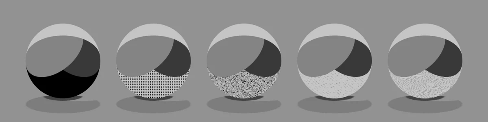
SolidDotsSandLinesCrosshatch A

<b><a href="shaded.md">Manga Tone Shaded</a></b> (shaded tones): The pattern density changes with how the light hits: lighter on the bright side, denser on the dark side.
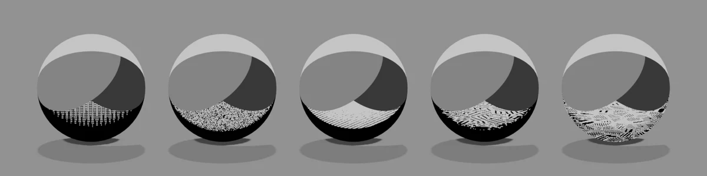
Dots (Shaded)Sand (Shaded)Lines (Shaded)Crosshatch A (Shaded)Pencil (Shaded)

<strong>Key Light Offset</strong><code>Key Light Offset</code>Default 3Compared 1 → 6.5

The border of the area the key light (red) hits. The higher the value, the smaller the key tone area and the larger the shadow side. The image uses a red key tone.
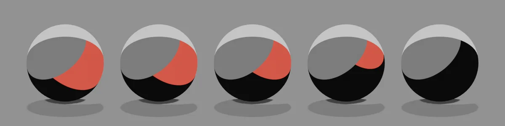
1234.56.5

<strong>Fill Light Offset</strong><code>Fill Light Offset</code>Default 3Compared 1 → 6.5

The border of the fill light (green) area. Raising it shrinks the midtone area and adds more dark area. The image uses a green fill tone.
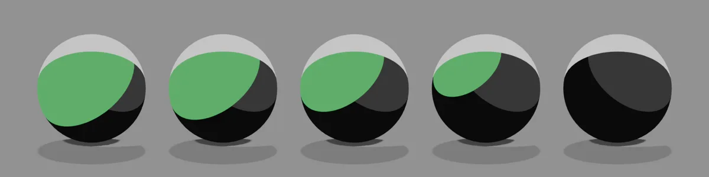
1234.56.5

<strong>Back Light Offset</strong><code>Back Light Offset</code>Default 1Compared 1 → 6.5

The width of the back light (blue) rim. The higher the value, the thinner the edge from behind; at 6.5 it almost disappears. The image uses a blue back tone.
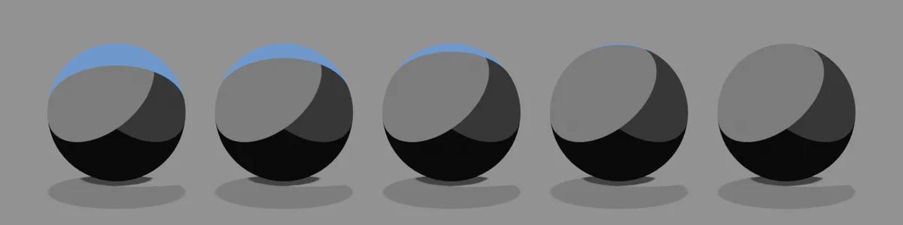
1234.56.5

### Shadow

<strong>Shadow Opacity</strong><code>Shadow Opacity</code>Default 1Compared 0 → 1

How dark the shadows cast by other objects are. 0 means no shadows.
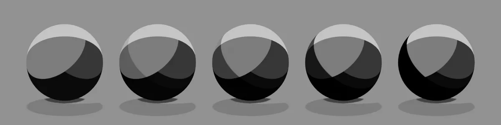
00.250.50.751

<strong>Brightness</strong><code>Brightness</code>Default 0.5Compared 0 → 1

The threshold that sets the shadow area. Raising it makes the shadows larger. With Contrast at 1 you see almost no change, so the image uses Contrast 0.3.
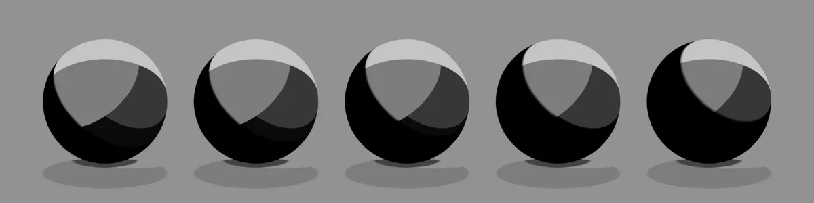
00.250.50.751

<strong>Contrast</strong><code>Contrast</code>Default 1Compared 0 → 1

How sharp the shadow border is. At 0 everything is in shadow; the higher the value, the clearer the border.
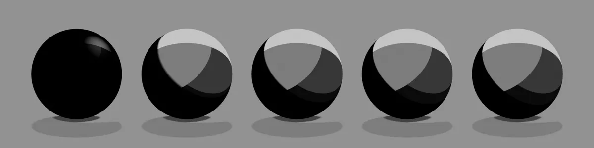
00.250.50.751

### Sub Outline

<strong>Opacity</strong><code>Opacity</code>Default 0.5Compared 0 → 1

How strong the colored line just inside the outline is (blue by default).
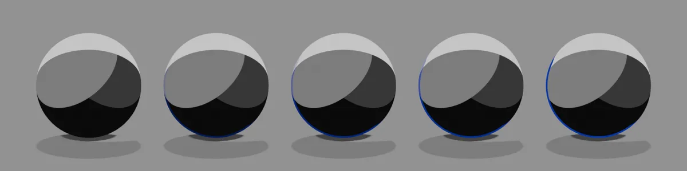
00.250.50.751

<strong>Size</strong><code>Size</code>Default 0.5Compared 0 → 1

The thickness of the sub outline.
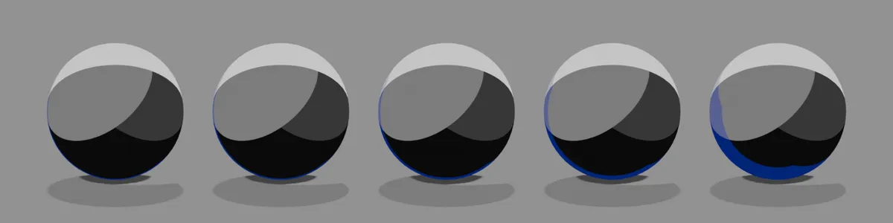
00.250.50.751

<strong>Shadow Size</strong><code>Shadow Size</code>Default 0.2Compared 0 → 1

How far it spreads into the shadow side. Raise it and the whole shadow area takes the sub outline color.
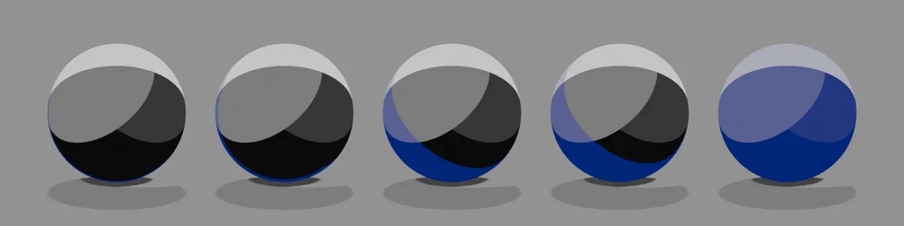
00.250.50.751

### AO

<strong>Opacity</strong><code>Opacity</code>Default 1Compared 0 → 1

How dark the shading is in hollows and recessed areas (around the eyes, inside the ears, under the chin). The image uses a model with many hollows and a light body color.
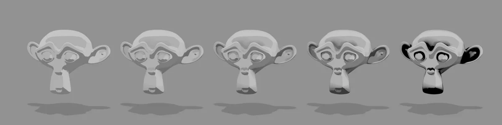
00.250.50.751

<strong>Intensity</strong><code>Intensity</code>Default 1Compared 0 → 1

How far the dark areas spread. The higher the value, the further they spread out from the hollows.
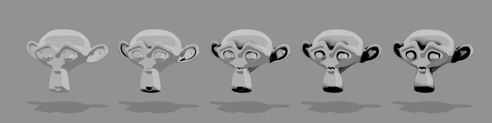
00.250.50.751

### Gloss

<strong>Opacity</strong><code>Opacity</code>Default 0.5Compared 0 → 1

How strong the highlights are.
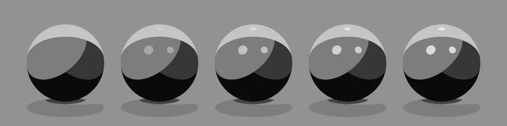
00.250.50.751

<strong>Brightness</strong><code>Brightness</code>Default 0.5Compared 0 → 1

How much area the highlights cover. At 1 the whole surface becomes bright.
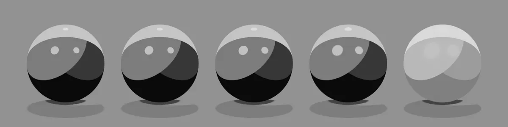
00.250.50.751

<strong>Contrast</strong><code>Contrast</code>Default 1Compared 0 → 1

How sharp the highlight edges are. Lower it and they blur and spread over the whole surface.
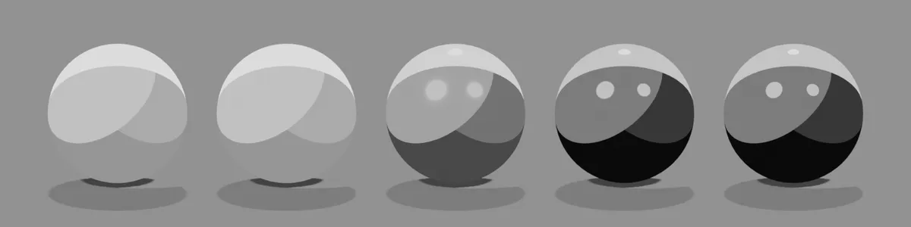
00.250.50.751

<strong>Spread</strong><code>Spread</code>Default 0.1Compared 0 → 0.8

The size of each individual highlight.
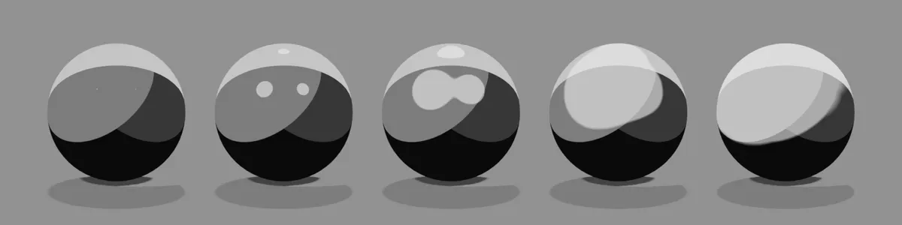
00.10.250.50.8

<strong>Offset X</strong><code>Offset X</code>Default 0Compared -1 → 1

Moves the highlights left or right.
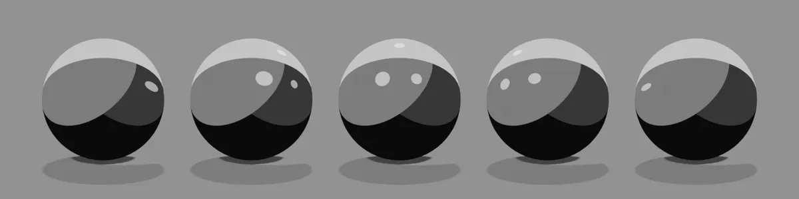
-1-0.500.51

<strong>Offset Z</strong><code>Offset Z</code>Default 0Compared -1 → 1

Moves the highlights up or down.
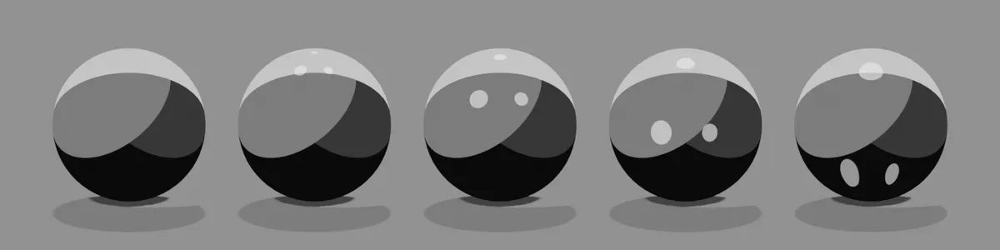
-1-0.500.51

### Anisotropy

<strong>Opacity</strong><code>Opacity</code>Default 0.5Compared 0 → 1

A streaky highlight, like the "angel ring" on hair. The band runs along the vertical UV direction and shines on the side the key light hits. The streak takes the tone color (the image uses a white tone).
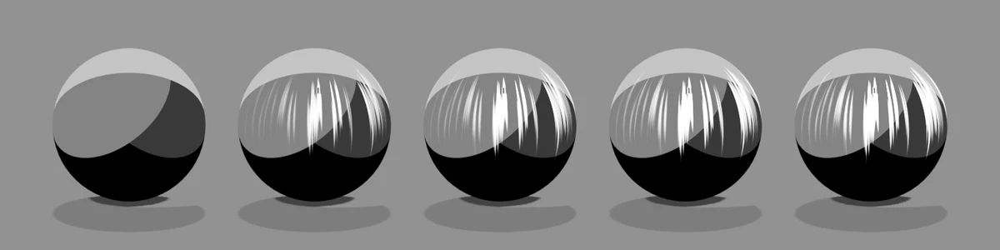
00.250.50.751

!!! bubble "Anisotropy expects a clean UV unwrap"
    The streak follows the vertical UV direction, so it assumes UVs laid out in a consistent direction. For hair, **start the shape from a UV Sphere primitive**: its UVs already run top to bottom, so the angel ring follows the head.
    Hair made by sculpting or remeshing, or left with an automatic unwrap (such as Smart UV Project), has UVs facing every which way, and the streak breaks up or runs at an angle.

    

<strong>Effect of the UV unwrap</strong>Same shape, same settings

Both are the same hair shape made from a UV Sphere, with the same anisotropy settings. Left: UVs split into small islands with Smart UV Project, each turned to a random angle. Right: the UV Sphere's own UVs.
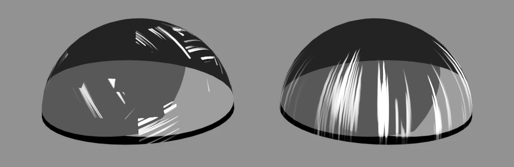
UVs split up and turned at randomUV Sphere as is (UVs run top to bottom)

### Rim Light

<strong>Opacity</strong><code>Opacity</code>Default 0.5Compared 0 → 1

How strong the bright edge along the silhouette is (with Width 0.8).
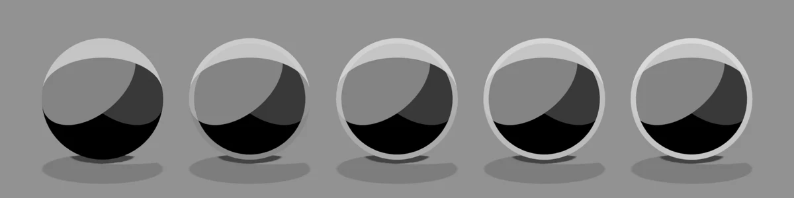
00.250.50.751

<strong>Contrast</strong><code>Contrast</code>Default 1Compared -1 → 1

The border of the edge. Negative values spread the edge over the whole inside.
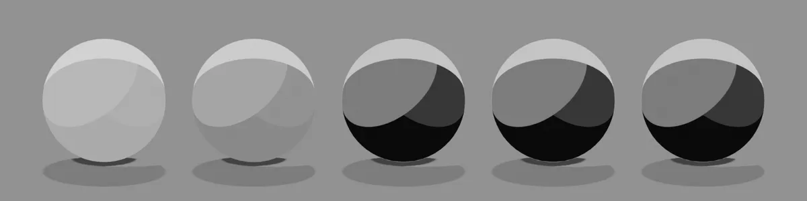
-1-0.500.51

<strong>Width</strong><code>Width</code>Default 0.014Compared 0 → 0.2

The thickness of the edge (with Opacity 1).
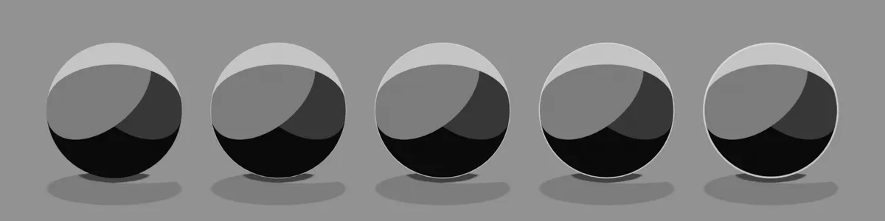
00.020.050.10.2

<strong>Offset X</strong><code>Offset X</code>Default 0Compared -1 → 1

Shifts the direction of the edge left or right. Negative values thicken the left edge, positive values the right edge (with Width 0.2 and Opacity 1).
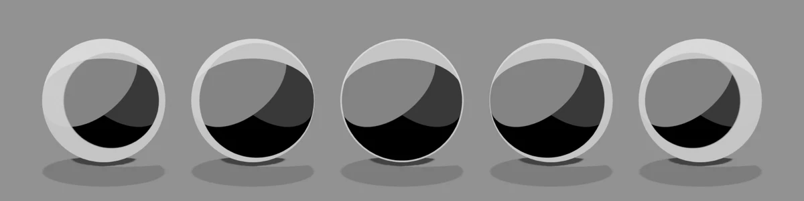
-1-0.500.51

<strong>Offset Z</strong><code>Offset Z</code>Default 0Compared -1 → 1

Shifts the direction of the edge up or down. Negative values thicken the bottom edge, and at -1 the whole sphere is covered. Positive values thin the bottom edge and move it toward the top (with Width 0.2 and Opacity 1).
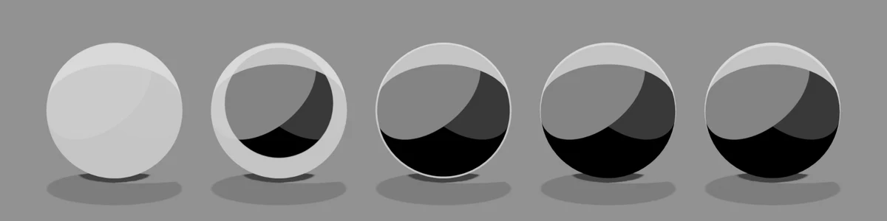
-1-0.500.51

### Matte

<strong>Opacity</strong><code>Opacity</code>Default 1Compared 0 → 1

How strong the matte tone (texture layer) is. The tone takes a matcap image mapped by the camera-space normals (the image uses a crystal-pattern matcap; the shader uses the image's brightness, so it comes out black and white).
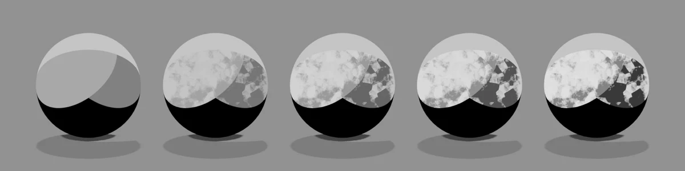
00.250.50.751

<strong>Brightness</strong><code>Brightness</code>Default 0.1Compared -0.1 → 0.2

The brightness of the matte layer. Ten times the value is added as brightness, so small changes make a big difference. Negative values darken it, positive values make it whiter.
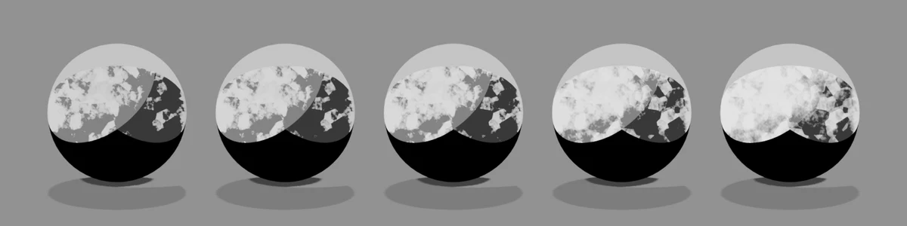
-0.1-0.0500.10.2

<strong>Contrast A</strong><code>Contrast A</code>Default 0.5Compared 0 → 1

The gamma (power) of the matcap image. The higher the value, the deeper the dark side and the stronger the shading.
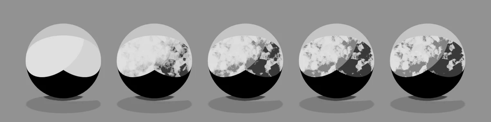
00.250.50.751

<strong>Contrast B</strong><code>Contrast B</code>Default 0.5Compared 0 → 1

The contrast of the matte layer. The higher the value, the clearer the difference between light and dark.
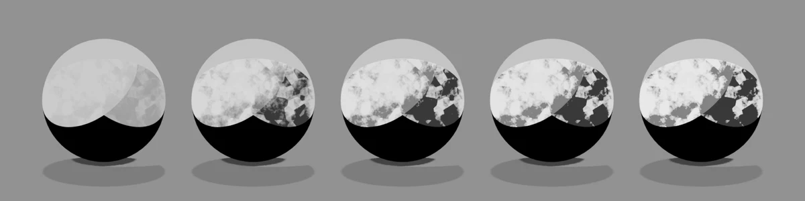
00.250.50.751

### Brush Strokes

<strong>Stroke Strength</strong><code>Stroke Strength</code>Default 0.3Compared 0 → 2

How strongly the light/dark border is broken up like brush marks.
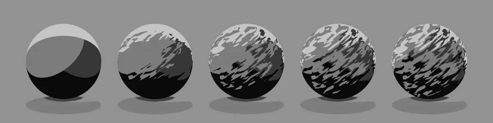
00.511.52

<strong>Stroke Scale</strong><code>Stroke Scale</code>Default 3Compared 1 → 8

The size of the brush marks. The higher the value, the finer the strokes.
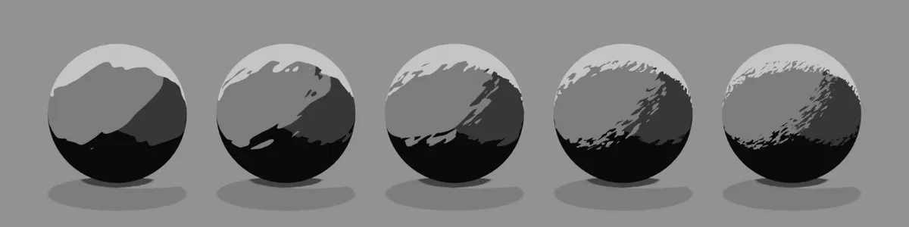
12358

<strong>Stroke Stretch</strong><code>Stroke Stretch</code>Default 4Compared 1 → 50

The aspect ratio of the brush marks. Raise it for long, thin strokes.
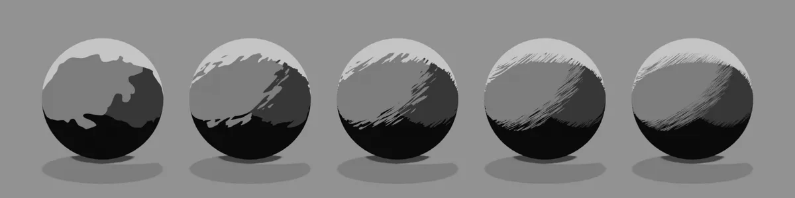
14102550

<strong>Stroke Angle</strong><code>Stroke Angle</code>Default 35Compared -90 → 90

The direction of the strokes (in degrees).
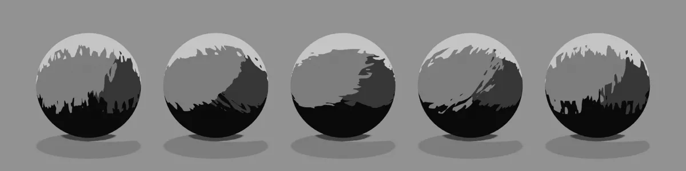
-90-4504590

<strong>Stroke Edge</strong><code>Stroke Edge</code>Default 0.5Compared 0 → 1

How hard the stroke edges are. At 1 the brush marks disappear and the original border comes back.
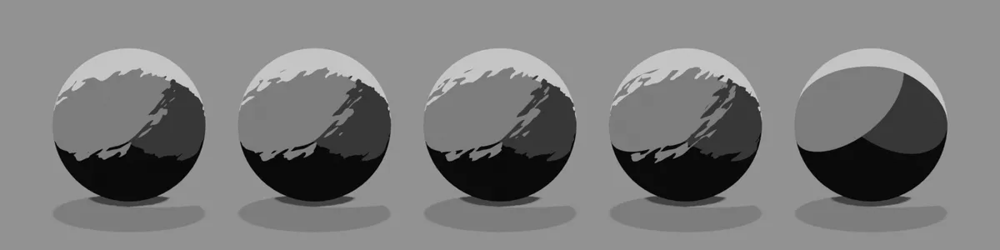
00.250.50.751

### Paint Finish

<strong>Color Variation</strong><code>Color Variation</code>Default 0.057Compared 0 → 1

Varies the color from patch to patch of paint. When the tone is black and white (grayscale), you will barely see any change.
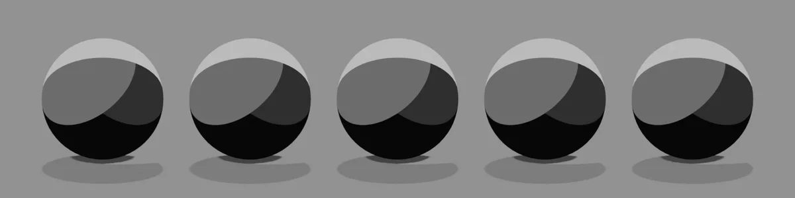
00.250.50.751

<strong>Value Variation</strong><code>Value Variation</code>Default 0Compared 0 → 1

Varies the brightness from patch to patch.
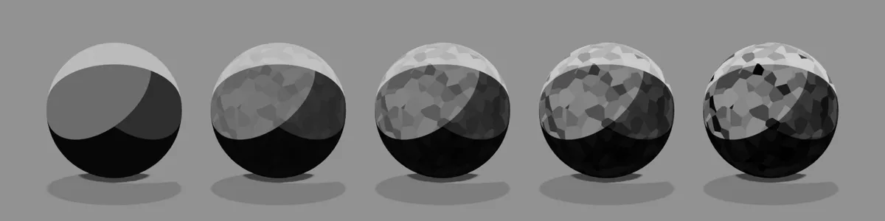
00.250.50.751

<strong>Paper</strong><code>Paper</code>Default 0.812Compared 0 → 1

How strong the paper grain (roughness) is. The image uses a light tone with Paper Scale 30 and Screen-Space Paper 0.
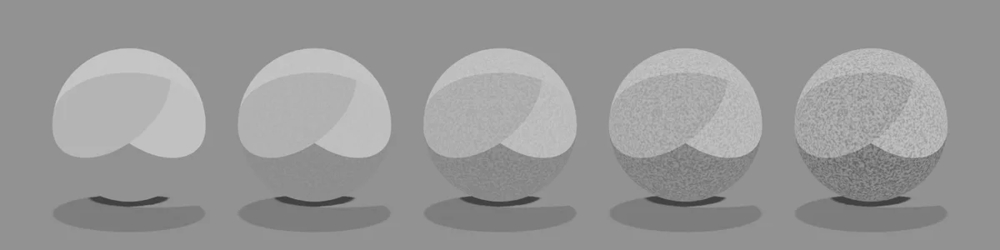
00.250.50.751

### Watercolor

<strong>Bleed</strong><code>Bleed</code>Default 0.5Compared 0 → 1

How much the light/dark border bleeds.
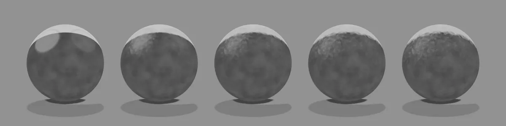
00.250.50.751

<strong>Bleed Scale</strong><code>Bleed Scale</code>Default 12Compared 2 → 80

The size of the bleed pattern. The higher the value, the finer it gets.
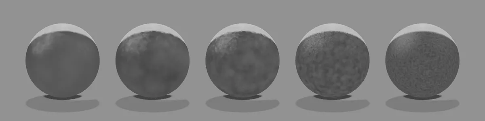
26123080

<strong>Edge Darkening</strong><code>Edge Darkening</code>Default 0.5Compared 0 → 1

How much paint pools at the edges and darkens them.
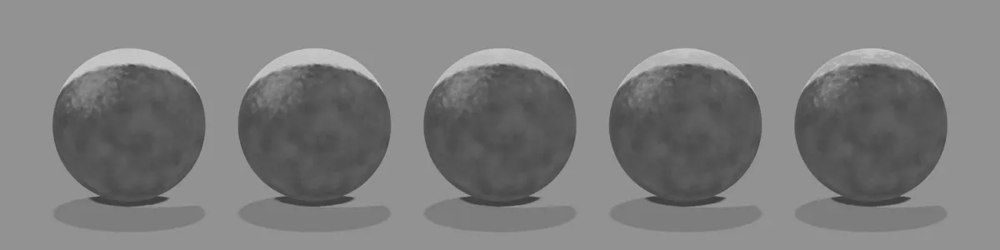
00.250.50.751

<strong>Granulation</strong><code>Granulation</code>Default 0.3Compared 0 → 1

The graininess of the pigment particles.
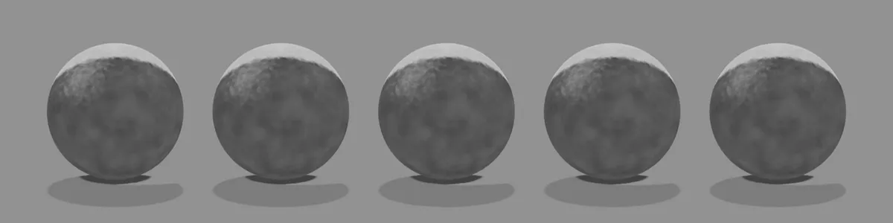
00.250.50.751

<strong>Wash</strong><code>Wash</code>Default 0.15Compared 0 → 1

Lightens everything, as if thinned with water.
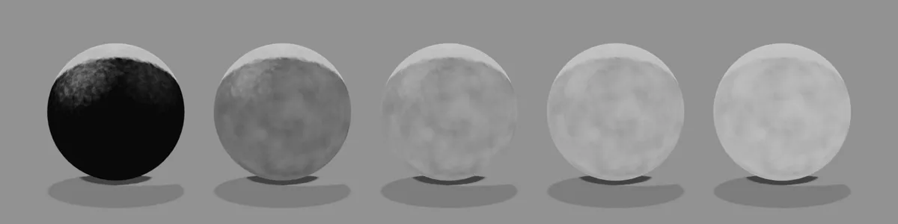
00.250.50.751

### Transparency

<strong>Alpha Clip</strong><code>Alpha Clip</code>Default 0.5Compared 0.1 → 0.9

Cuts out the parts where the PNG's alpha is below this value. The image shows a flat polygon with a star-shaped PNG whose alpha is strongest at the center. The higher the value, the more the thin parts are trimmed away and the smaller the shape gets.

0.10.30.50.70.9

