# <i class="bi bi-circle-half"></i> Manga Tone Shader

<figure class="ms-page-hero">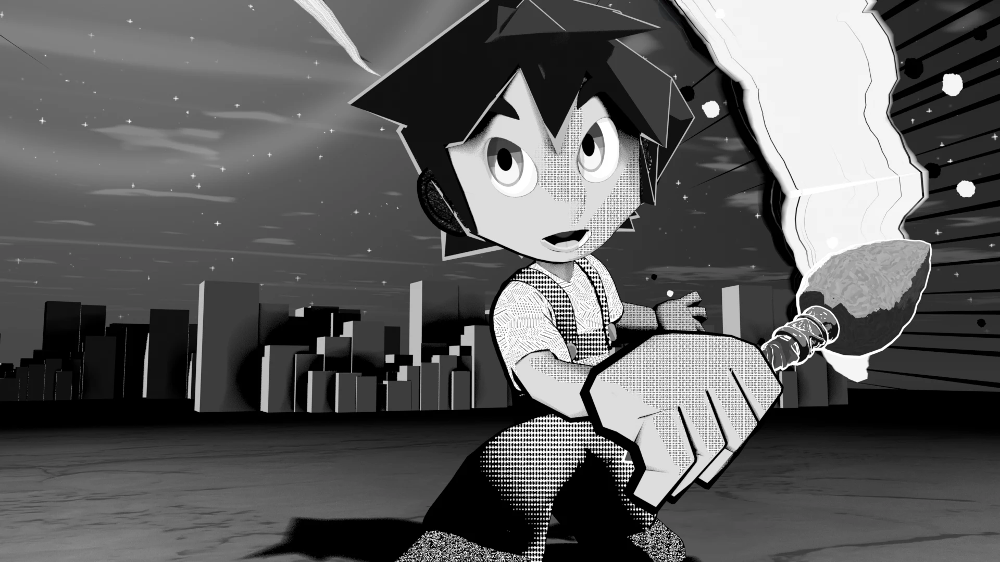</figure>

MTS · Material › Manga Tone Shader (Lite: …)

ライトの<strong>色の成分</strong>を読み分けて、キー（赤）・フィル（緑）・バック（青）の当たり方ごとに別のトーンを塗るシェーダーです。機能のチェックを入れると、その機能だけを含む軽量版のグループに自動で差し替わります。

## <i class="bi bi-layers-fill"></i> 概要図 Layer stack

下から順に重なって、1つの塗りになります。右上の札が重ね方（合成）です。

## <i class="bi bi-diagram-2-fill"></i> 構成 Node tree

画像テクスチャ

マットのトーン<i>法線 → ベクトル変換 → マッピング</i>

画像テクスチャ

AO のマスク<i>UV → マッピング</i>

画像テクスチャ ＋ ノーマルマップ

ノーマルマップ

画像テクスチャ

透過の PNG（アルファ）

Manga Tone Shader (Lite: …)

ベース／キー／フィル／バックのトーン<i>法線・影・ハイライト・マット・水彩・透過…</i><i>チェックした機能だけを含む軽量版</i>

マテリアル出力

サーフェス

<em>1</em><b>ライトを読む</b>Diffuse → Shader to RGB → Separate Color で、赤・緑・青の当たり方を別々に取り出す

<em>2</em><b>段に分ける</b>3つの値をそれぞれ段階的に区切り（Map Range）、くっきりした明暗にする。オフセットで境目が動く

<em>3</em><b>トーンを重ねる</b>ベース → キー → フィル → バックの順にトーン（色や模様）を重ねる

<em>4</em><b>効果を足す</b>影・サブ輪郭線・AO・光沢・リムライト・マットを重ねる

<em>5</em><b>仕上げ</b>水彩 → 色（色ゆらぎ・紙）→ 出力

!!! note ""
    ライトはライトリンキングで照らす対象を決めています。キャラクターがライトグループの「照らす対象」に入っていないと、真っ黒になります。

## <i class="bi bi-sliders2"></i> パネルと数値 Inputs

5つの球（目・口・空）は、**左から右へ値を変えたもの**です。画像の下に値を書いています。黄色い欄がその項目の既定値で、ほかの項目は既定値のままです。

??? info "Manga Tone Shader の項目一覧"

    | パネル | 項目 | 英語名 | 既定値 |
    |---|---|---|---|
    | 基本色 | ベーストーン | `Base Tone` | カラー |
    | 基本色 | [キーライト オフセット](#mts-base-key-light-offset) | `Key Light Offset` | 3 |
    | 基本色 | [フィルライト オフセット](#mts-base-fill-light-offset) | `Fill Light Offset` | 3 |
    | 基本色 | [バックライト オフセット](#mts-base-back-light-offset) | `Back Light Offset` | 1 |
    | 影 | [シャドウの不透明度](#mts-shadow-shadow-opacity) | `Shadow Opacity` | 1 |
    | 影 | [明るさ](#mts-shadow-brightness) | `Brightness` | 0.5 |
    | 影 | [コントラスト](#mts-shadow-contrast) | `Contrast` | 1 |
    | サブ輪郭線 | [不透明度](#mts-sub-outline-opacity) | `Opacity` | 0.5 |
    | サブ輪郭線 | [サイズ](#mts-sub-outline-size) | `Size` | 0.5 |
    | サブ輪郭線 | [シャドウサイズ](#mts-sub-outline-shadow-size) | `Shadow Size` | 0.2 |
    | AO | [不透明度](#mts-ao-opacity) | `Opacity` | 1 |
    | AO | [強度](#mts-ao-intensity) | `Intensity` | 1 |
    | 光沢 | [不透明度](#mts-gloss-opacity) | `Opacity` | 0.5 |
    | 光沢 | [明るさ](#mts-gloss-brightness) | `Brightness` | 0.5 |
    | 光沢 | [コントラスト](#mts-gloss-contrast) | `Contrast` | 1 |
    | 光沢 | [広がり具合](#mts-gloss-spread) | `Spread` | 0.1 |
    | 光沢 | [オフセットX](#mts-gloss-offset-x) | `Offset X` | 0 |
    | 光沢 | [オフセットZ](#mts-gloss-offset-z) | `Offset Z` | 0 |
    | 異方性 | [不透明度](#mts-anisotropy-opacity) | `Opacity` | 0.5 |
    | リムライト | [不透明度](#mts-rim-light-opacity) | `Opacity` | 0.5 |
    | リムライト | [コントラスト](#mts-rim-light-contrast) | `Contrast` | 1 |
    | リムライト | [幅](#mts-rim-light-width) | `Width` | 0.014 |
    | リムライト | [オフセットX](#mts-rim-light-offset-x) | `Offset X` | 0 |
    | リムライト | [オフセットZ](#mts-rim-light-offset-z) | `Offset Z` | 0 |
    | マット | [不透明度](#mts-matte-opacity) | `Opacity` | 1 |
    | マット | [明るさ](#mts-matte-brightness) | `Brightness` | 0.1 |
    | マット | [コントラストA](#mts-matte-contrast-a) | `Contrast A` | 0.5 |
    | マット | [コントラストB](#mts-matte-contrast-b) | `Contrast B` | 0.5 |
    | 筆のタッチ | [タッチの強さ](#mts-brush-strokes-stroke-strength) | `Stroke Strength` | 0.3 |
    | 筆のタッチ | [タッチの細かさ](#mts-brush-strokes-stroke-scale) | `Stroke Scale` | 3 |
    | 筆のタッチ | [タッチの伸び](#mts-brush-strokes-stroke-stretch) | `Stroke Stretch` | 4 |
    | 筆のタッチ | [タッチの角度](#mts-brush-strokes-stroke-angle) | `Stroke Angle` | 35 |
    | 筆のタッチ | [タッチの縁](#mts-brush-strokes-stroke-edge) | `Stroke Edge` | 0.5 |
    | 色（色ゆらぎ・紙） | [色ゆらぎ](#mts-paint-finish-color-variation) | `Color Variation` | 0.057 |
    | 色（色ゆらぎ・紙） | [明るさのゆらぎ](#mts-paint-finish-value-variation) | `Value Variation` | 0 |
    | 色（色ゆらぎ・紙） | [紙](#mts-paint-finish-paper) | `Paper` | 0.812 |
    | 水彩 | [にじみ](#mts-watercolor-bleed) | `Bleed` | 0.5 |
    | 水彩 | [にじみの細かさ](#mts-watercolor-bleed-scale) | `Bleed Scale` | 12 |
    | 水彩 | [縁のたまり](#mts-watercolor-edge-darkening) | `Edge Darkening` | 0.5 |
    | 水彩 | [粒状感](#mts-watercolor-granulation) | `Granulation` | 0.3 |
    | 水彩 | [淡さ](#mts-watercolor-wash) | `Wash` | 0.15 |
    | 透過 | [アルファクリップ](#mts-transparency-alpha-clip) | `Alpha Clip` | 0.5 |

### 基本色 Base

<strong>ベーストーン</strong><code>Base Tone</code>カラートーンのマテリアル

どのライトも当たらない部分（球の下側）の色、または模様。色の欄の下に付属のトーン素材（<a href="flat.md">Manga Tone Flat</a>／<a href="shaded.md">Manga Tone Shaded</a>）のマテリアルをドロップすると、その模様になります。

<b><a href="flat.md">Manga Tone Flat</a></b>（平らなトーン）：模様がそのまま一面に入ります。
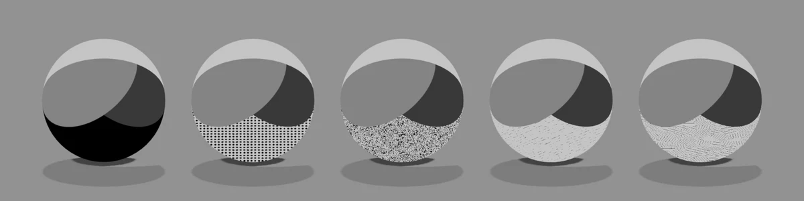
単色アミ砂目万線カケアミA

<b><a href="shaded.md">Manga Tone Shaded</a></b>（陰影付きのトーン）：ライトの当たり方で模様の濃さが変わり、明るい側ほど薄く、暗い側ほど濃くなります。
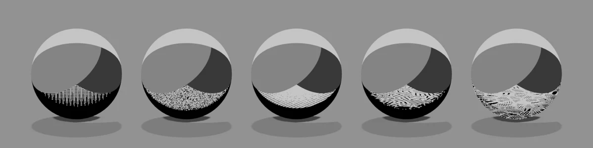
アミ（陰影）砂目（陰影）万線（陰影）カケアミA（陰影）鉛筆風（陰影）

<strong>キーライト オフセット</strong><code>Key Light Offset</code>既定 3比較 1 → 6.5

キーライト（赤）の当たる範囲の境目。値を上げるほどキーのトーンの面が狭くなり、影側が広がります。画像はキートーンを赤にした場合。
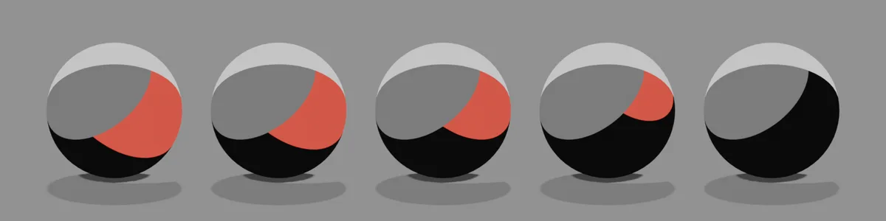
1234.56.5

<strong>フィルライト オフセット</strong><code>Fill Light Offset</code>既定 3比較 1 → 6.5

フィルライト（緑）の面の境目。上げると中間調の面が狭くなり、暗い部分が増えます。画像はフィルトーンを緑にした場合。
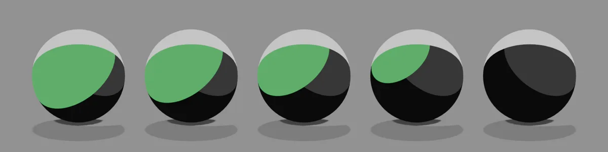
1234.56.5

<strong>バックライト オフセット</strong><code>Back Light Offset</code>既定 1比較 1 → 6.5

バックライト（青）のリムの幅。上げるほど後ろからの縁が細くなり、6.5 でほぼ消えます。画像はバックトーンを青にした場合。
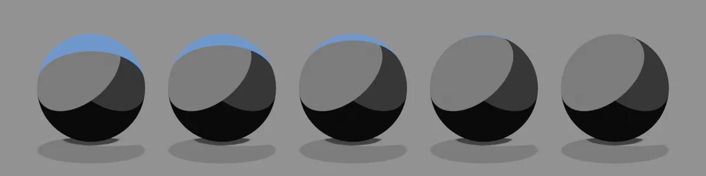
1234.56.5

### 影 Shadow

<strong>シャドウの不透明度</strong><code>Shadow Opacity</code>既定 1比較 0 → 1

ほかのオブジェクトから落ちる影の濃さ。0 で影なし。
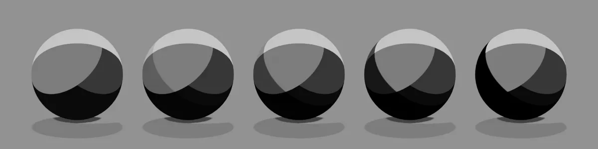
00.250.50.751

<strong>明るさ</strong><code>Brightness</code>既定 0.5比較 0 → 1

影の範囲を決めるしきい値。上げると影が広がります。コントラストが 1 だと変化がほとんど出ないため、画像はコントラスト 0.3 の場合。
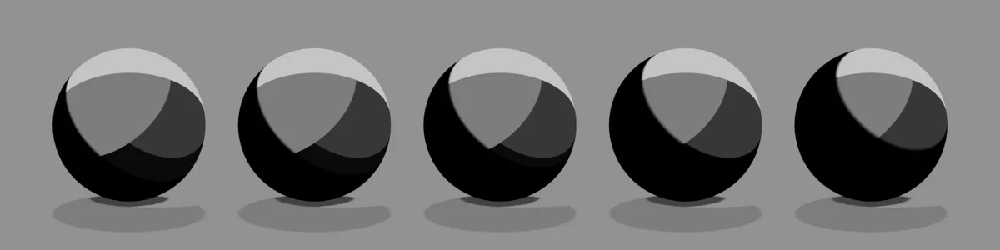
00.250.50.751

<strong>コントラスト</strong><code>Contrast</code>既定 1比較 0 → 1

影の境目のくっきり具合。0 で全体が影になり、上げるほど境目がはっきりします。
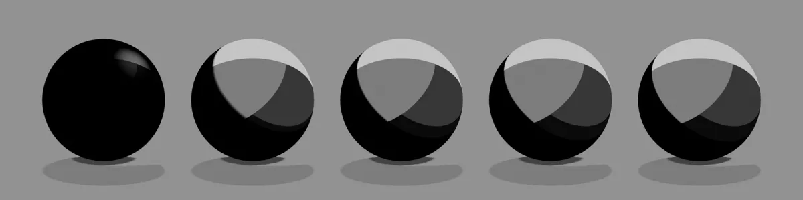
00.250.50.751

### サブ輪郭線 Sub Outline

<strong>不透明度</strong><code>Opacity</code>既定 0.5比較 0 → 1

輪郭の内側に入る色付きの線（既定は青）の濃さ。
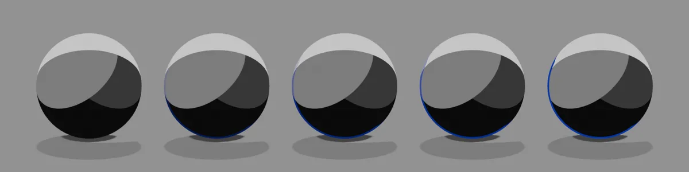
00.250.50.751

<strong>サイズ</strong><code>Size</code>既定 0.5比較 0 → 1

サブ輪郭線の太さ。
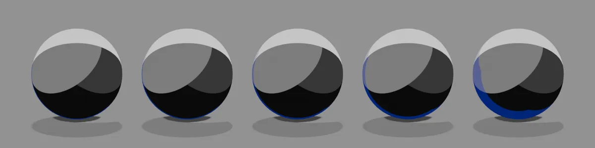
00.250.50.751

<strong>シャドウサイズ</strong><code>Shadow Size</code>既定 0.2比較 0 → 1

影側に広がる量。上げると影の面全体がサブ輪郭線の色になります。
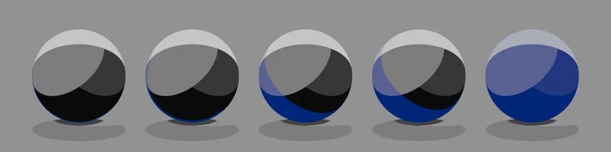
00.250.50.751

### AO AO

<strong>不透明度</strong><code>Opacity</code>既定 1比較 0 → 1

くぼみや奥まった部分（目のまわり・耳の内側・あごの下）に入る暗がりの濃さ。画像はくぼみの多いモデルで、本体が明るい色の場合。
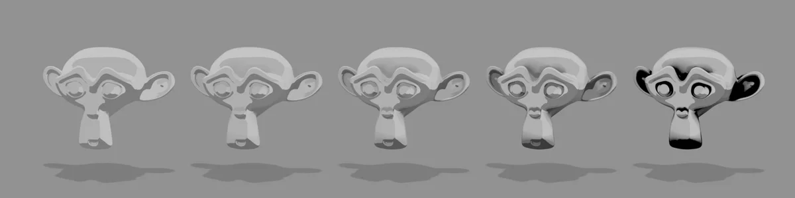
00.250.50.751

<strong>強度</strong><code>Intensity</code>既定 1比較 0 → 1

暗がりが広がる範囲。上げるほどくぼみから外側へ広がります。
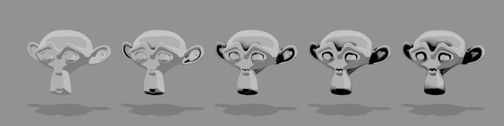
00.250.50.751

### 光沢 Gloss

<strong>不透明度</strong><code>Opacity</code>既定 0.5比較 0 → 1

ハイライトの濃さ。
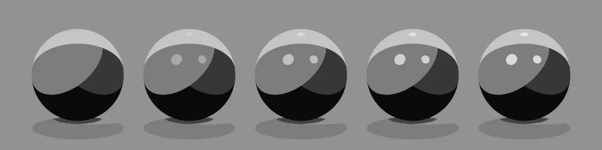
00.250.50.751

<strong>明るさ</strong><code>Brightness</code>既定 0.5比較 0 → 1

ハイライトの出る範囲。1 で面全体が明るくなります。
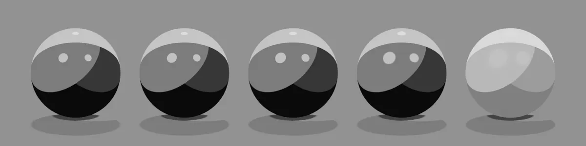
00.250.50.751

<strong>コントラスト</strong><code>Contrast</code>既定 1比較 0 → 1

ハイライトの縁のくっきり具合。下げるとぼやけて全体に広がります。
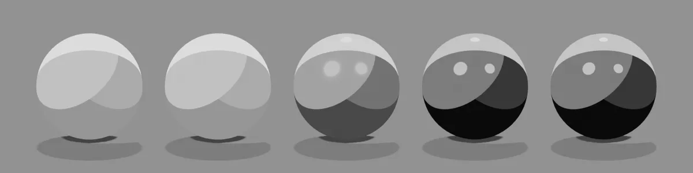
00.250.50.751

<strong>広がり具合</strong><code>Spread</code>既定 0.1比較 0 → 0.8

ハイライト1つ1つの大きさ。
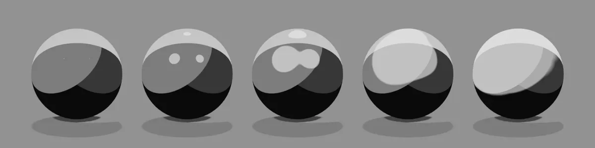
00.10.250.50.8

<strong>オフセットX</strong><code>Offset X</code>既定 0比較 -1 → 1

ハイライトの位置を左右にずらします。
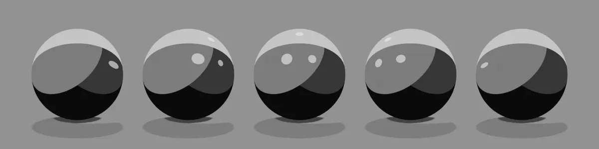
-1-0.500.51

<strong>オフセットZ</strong><code>Offset Z</code>既定 0比較 -1 → 1

ハイライトの位置を上下にずらします。
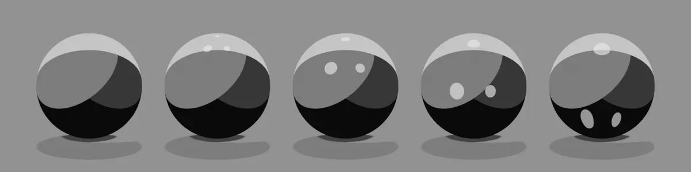
-1-0.500.51

### 異方性 Anisotropy

<strong>不透明度</strong><code>Opacity</code>既定 0.5比較 0 → 1

髪の天使の輪のような、筋状のハイライト。UV の縦方向に沿って帯が出て、キーライトの当たる側で光ります。筋の色はトーンの色です（トーンが白の場合）。
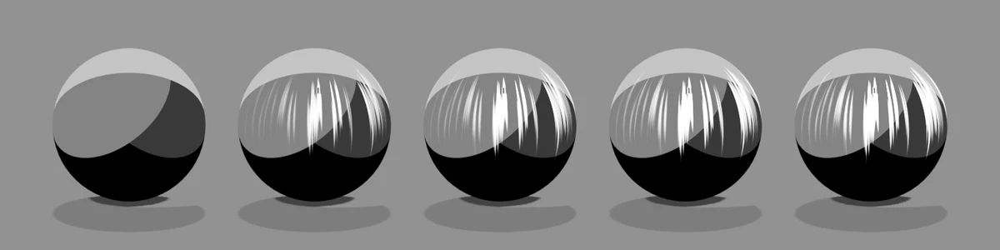
00.250.50.751

!!! bubble "異方性は UV 展開がきれいなメッシュ向け"
    筋の帯は UV 展開の縦方向に沿って出るため、UV 展開の向きが整っていることを前提にしています。髪に使うときは、**「UV球」のプリミティブから形を作る**のがおすすめです。UV球は最初から UV 展開の縦方向がそろっているので、頭の形に沿った天使の輪になります。
    スカルプトやリメッシュで作った髪、自動の UV 展開（スマート UV 投影など）のままの髪では、UV 展開の向きがばらばらになり、帯が途切れたり斜めに走ったりします。

    

<strong>UV 展開の違いによる比較</strong>同じ形・同じ設定

どちらも UV球から作った同じ形の髪に、同じ異方性の設定を入れています。左は UV 展開を細かく分けて、島ごとにばらばらの向きに回したもの（スマート UV 投影のあとに回転）、右は UV球の UV 展開をそのまま使ったものです。
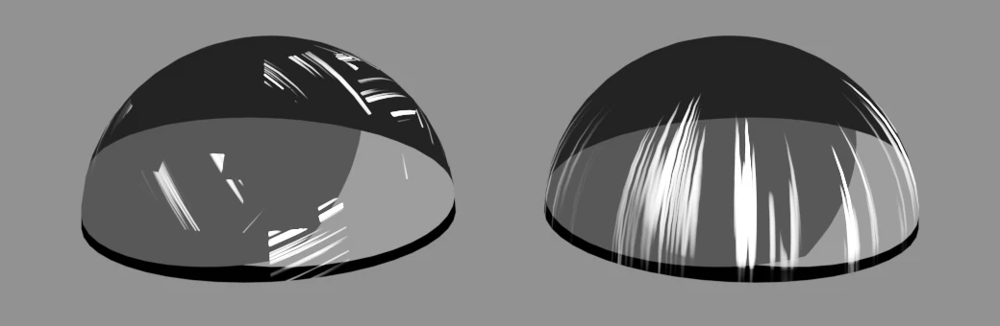
UV 展開を細かく分けて向きをばらばらにUV球のまま（UV 展開の縦がそろう）

### リムライト Rim Light

<strong>不透明度</strong><code>Opacity</code>既定 0.5比較 0 → 1

輪郭に沿った明るい縁の濃さ（幅 0.8 の場合）。
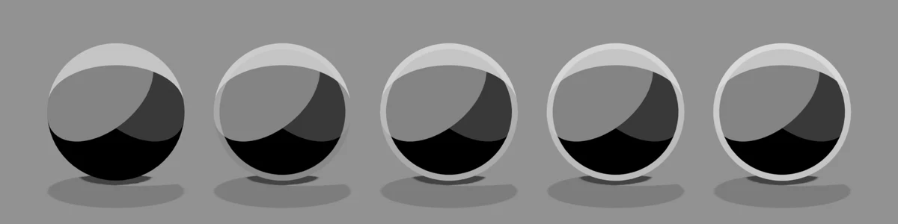
00.250.50.751

<strong>コントラスト</strong><code>Contrast</code>既定 1比較 -1 → 1

縁の境目。マイナスにすると縁が内側全体に広がります。
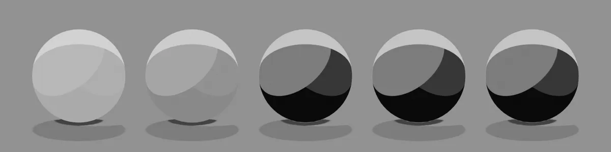
-1-0.500.51

<strong>幅</strong><code>Width</code>既定 0.014比較 0 → 0.2

縁の太さ（不透明度 1 の場合）。
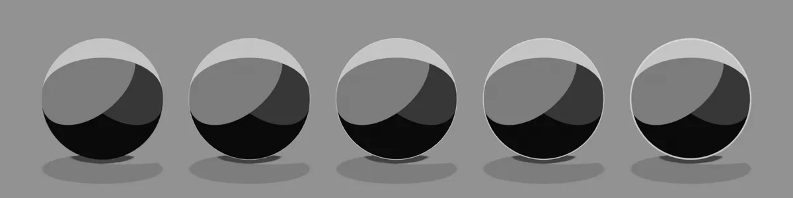
00.020.050.10.2

<strong>オフセットX</strong><code>Offset X</code>既定 0比較 -1 → 1

縁の出る向きを左右にずらします。マイナスで左側、プラスで右側の縁が太くなります（幅 0.2・不透明度 1 の場合）。
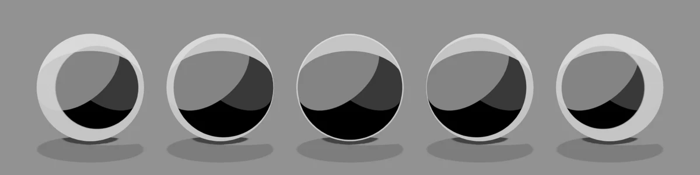
-1-0.500.51

<strong>オフセットZ</strong><code>Offset Z</code>既定 0比較 -1 → 1

縁の出る向きを上下にずらします。マイナスで下側の縁が太くなり、-1 では球全体が覆われます。プラスでは下側の縁が細くなり、上側に寄ります（幅 0.2・不透明度 1 の場合）。
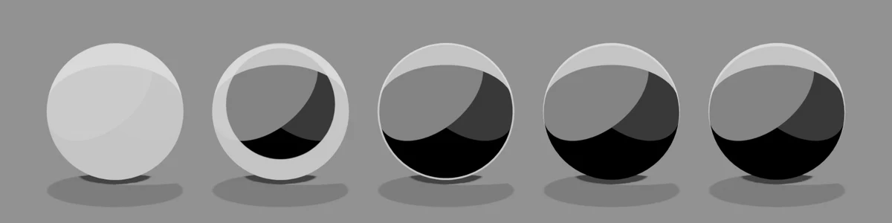
-1-0.500.51

### マット Matte

<strong>不透明度</strong><code>Opacity</code>既定 1比較 0 → 1

マットのトーン（質感の層）の濃さ。トーンには、カメラから見た法線で貼るマットキャップ画像をつなぎます（画像は結晶模様のマットキャップの場合。シェーダーは画像の明るさを使うので、色は白黒になります）。
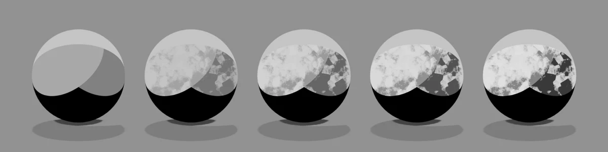
00.250.50.751

<strong>明るさ</strong><code>Brightness</code>既定 0.1比較 -0.1 → 0.2

マットの層の明るさ。値の 10 倍が明るさとして足されるので、少しの変化で大きく変わります。マイナスで暗く、プラスで白っぽくなります。
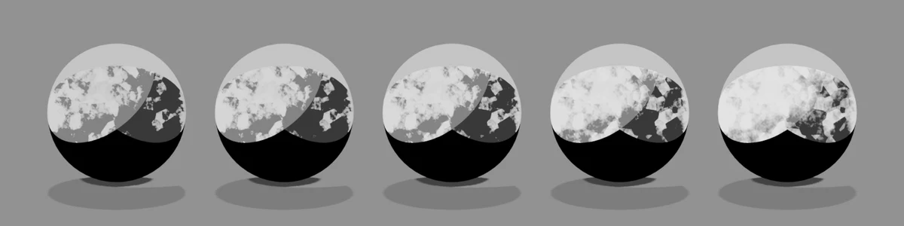
-0.1-0.0500.10.2

<strong>コントラストA</strong><code>Contrast A</code>既定 0.5比較 0 → 1

マットキャップ画像のガンマ（べき乗）。上げるほど暗い側が締まり、陰影が濃くなります。
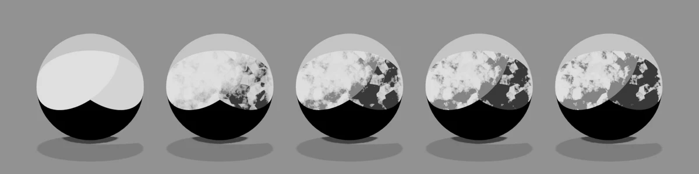
00.250.50.751

<strong>コントラストB</strong><code>Contrast B</code>既定 0.5比較 0 → 1

マットの層のコントラスト。上げるほど明暗の差がはっきりします。
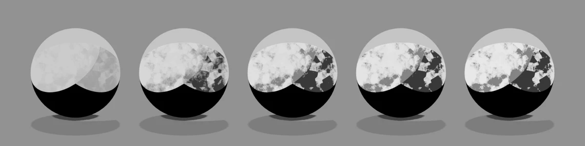
00.250.50.751

### 筆のタッチ Brush Strokes

<strong>タッチの強さ</strong><code>Stroke Strength</code>既定 0.3比較 0 → 2

明暗の境目を筆跡のように揺らす強さ。
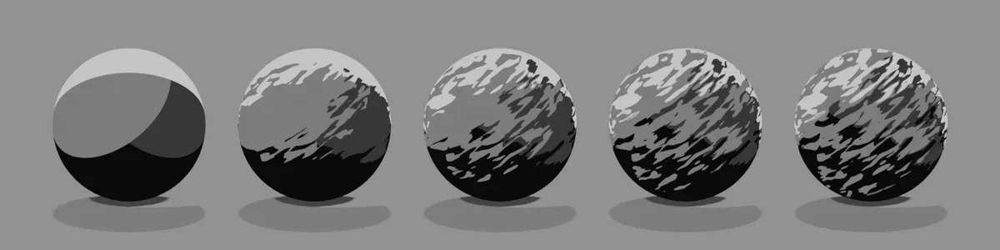
00.511.52

<strong>タッチの細かさ</strong><code>Stroke Scale</code>既定 3比較 1 → 8

筆跡の大きさ。上げるほど細かいタッチになります。
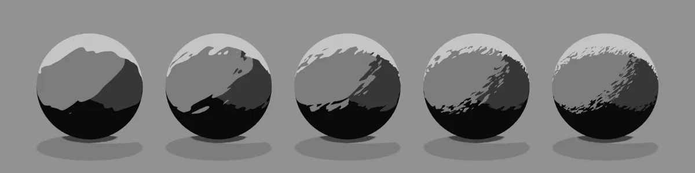
12358

<strong>タッチの伸び</strong><code>Stroke Stretch</code>既定 4比較 1 → 50

筆跡の縦横比。上げると細長いストロークになります。
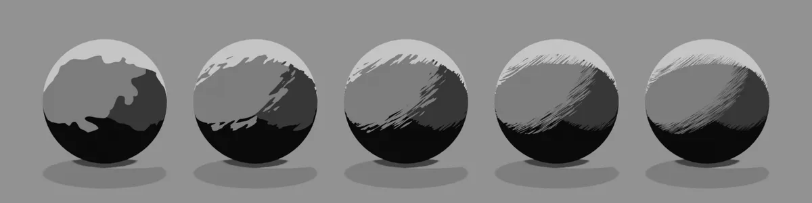
14102550

<strong>タッチの角度</strong><code>Stroke Angle</code>既定 35比較 -90 → 90

ストロークの向き（度）。
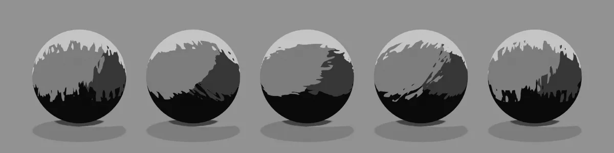
-90-4504590

<strong>タッチの縁</strong><code>Stroke Edge</code>既定 0.5比較 0 → 1

ストロークの縁の硬さ。1 で筆跡が消えて元の境目に戻ります。
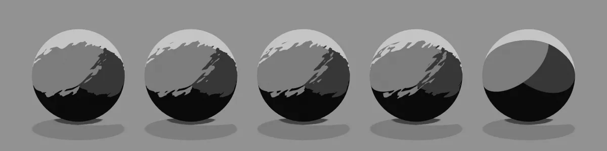
00.250.50.751

### 色（色ゆらぎ・紙） Paint Finish

<strong>色ゆらぎ</strong><code>Color Variation</code>既定 0.057比較 0 → 1

塗りの面ごとに色をばらつかせます。トーンが白黒（グレースケール）のときは、変化はほとんど見えません。
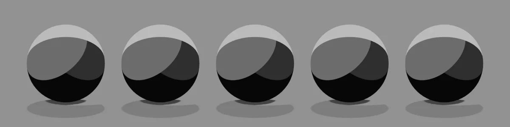
00.250.50.751

<strong>明るさのゆらぎ</strong><code>Value Variation</code>既定 0比較 0 → 1

面ごとに明るさをばらつかせます。
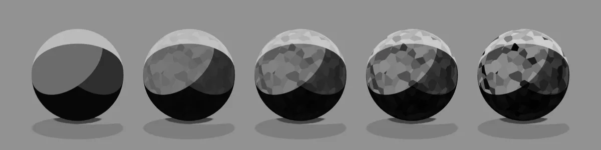
00.250.50.751

<strong>紙</strong><code>Paper</code>既定 0.812比較 0 → 1

紙の目（ざらつき）の強さ。画像は明るいトーンで「紙の細かさ 30・紙を画面に固定 0」の場合。
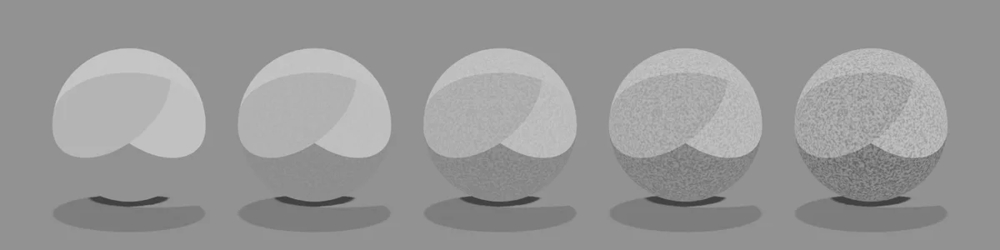
00.250.50.751

### 水彩 Watercolor

<strong>にじみ</strong><code>Bleed</code>既定 0.5比較 0 → 1

明暗の境目のにじみの量。
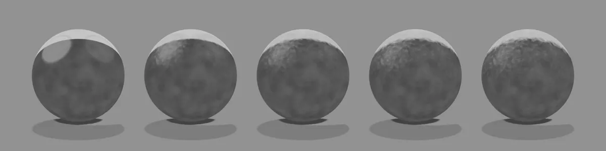
00.250.50.751

<strong>にじみの細かさ</strong><code>Bleed Scale</code>既定 12比較 2 → 80

にじみの模様の大きさ。上げるほど細かくなります。
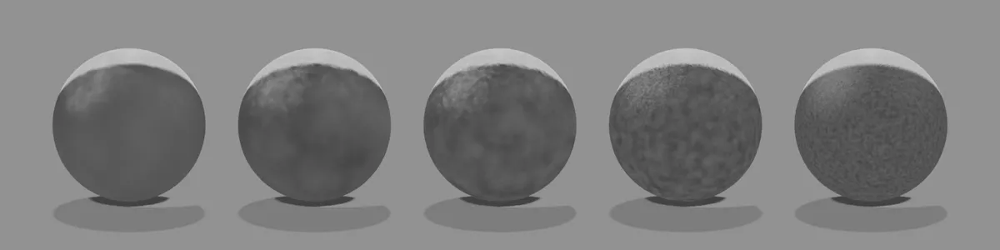
26123080

<strong>縁のたまり</strong><code>Edge Darkening</code>既定 0.5比較 0 → 1

絵の具が縁にたまって濃くなる量。
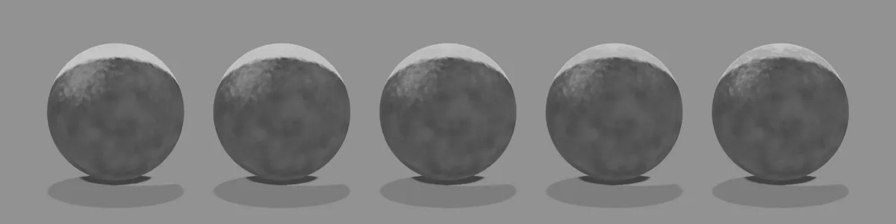
00.250.50.751

<strong>粒状感</strong><code>Granulation</code>既定 0.3比較 0 → 1

顔料の粒のざらつき。
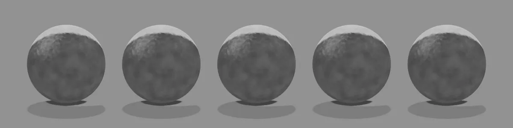
00.250.50.751

<strong>淡さ</strong><code>Wash</code>既定 0.15比較 0 → 1

全体を水で薄めたように明るくします。
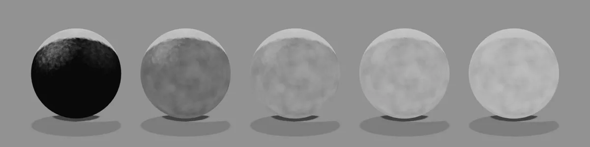
00.250.50.751

### 透過 Transparency

<strong>アルファクリップ</strong><code>Alpha Clip</code>既定 0.5比較 0.1 → 0.9

PNG のアルファがこの値より小さいところを切り抜きます。画像は、平面のポリゴンに中心ほどアルファが濃い星形の PNG を貼った場合。値を上げるほど、薄い部分から削れて形が小さくなります。
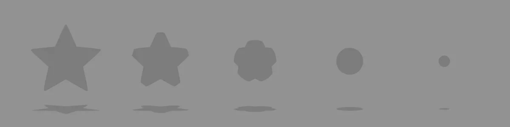
0.10.30.50.70.9

