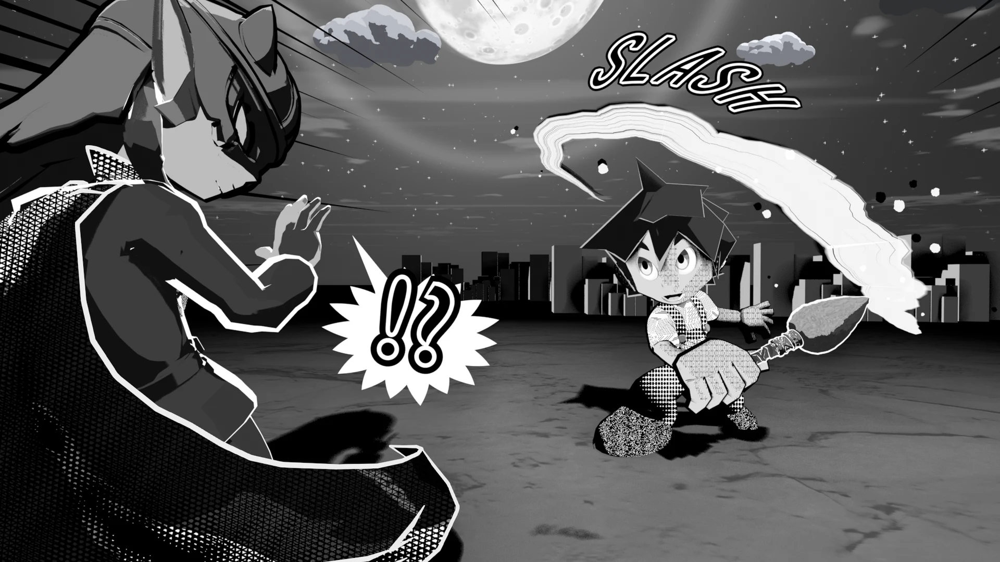
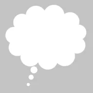

# <i class="bi bi-chat-fill"></i> Manga Toon Speech Bubbles NEW {data-toc-label="Manga Toon Speech Bubbles"}

<figure class="ms-page-hero"></figure>

MTSB (draft) · Geometry Nodes › MTS Balloon

A speech balloon is a single Geometry Nodes group, "MTS Balloon". It is parented to the camera and <strong>sticks to the screen</strong>. Position and size are based on the screen (lengths are in screen heights, positions are 0 to 1 on screen), so the balloon looks the same on screen even when you change the focal length. The balloon is only the "shape"; the dialogue text is meant to be added in a design app.

Speech (oval)

Shout (spiky)

Thought (cloud)

Narration (box)

## <i class="bi bi-layers-fill"></i> Layer stack

The four shapes (speech, shout, thought, narration) are just a choice in "Shape". All of them are made from the same stack of layers.

!!! bubble "Outlines come from the Outlines panel"
    The balloon geometry is fill only. Add the line with the Outlines panel, the same way as for any other object.

## <i class="bi bi-sliders2"></i> Inputs

| Panel | Setting | English name | What it does |
|---|---|---|---|
| — | Shape | `Shape` | 0 = speech, 1 = shout, 2 = thought, 3 = narration |
| — | Edge style | `Edge Style` | 0 = solid, 1 = dashed (whisper), 2 = wavy (trembling) |
| — | Tail shape | `Tail Shape` | 0 = straight, 1 = zigzag (electronic sound, phone) |
| Balloon | Center X / Center Y | `Center X / Y` | Center on the screen (0 = left/bottom, 1 = right/top) |
| Balloon | Width / Height | `Width / Height` | Size (1 = screen height) |
| Balloon | Rotation | `Rotation` | Tilt of the balloon |
| Balloon | Spike count / Spike depth | `Spikes / Spike Depth` | Spikes of the shout balloon |
| Balloon | Bump count / Bump roundness | `Bumps / Bump Depth` | Bumps of the thought balloon |
| Balloon | Corner roundness | `Corner Roundness` | Corners of the narration box |
| Balloon | Randomness | `Randomness` | Unevenness of the spikes and bumps |
| Balloon Tail | Show tail | `Show Tail` | A tail that points to the speaker |
| Balloon Tail | Tail tip X / Y | `Tail X / Y` | Position of the tail tip (0 to 1 on screen) |
| Balloon Tail | Tail width | `Tail Width` | Width at the base |
| Balloon Tail | Tail bend | `Tail Bend` | 0 = straight |
| Balloon Tail | Draw tail along a path | `Use Tail Path` | A tail that follows an editable path |
| Appearance | Fill color | `Fill Color` | White = normal, black = solid black balloon |
| Appearance | Depth | `Depth` | Distance from the camera. Make it small to put the balloon in front of everything |
| Animation | Seed / Boil interval | `Seed / Boil Interval` | Variation pattern / redraws every N frames |

See [Feature Guide › Speech balloons](../guide/bgfx.md) for how to use speech balloons.
