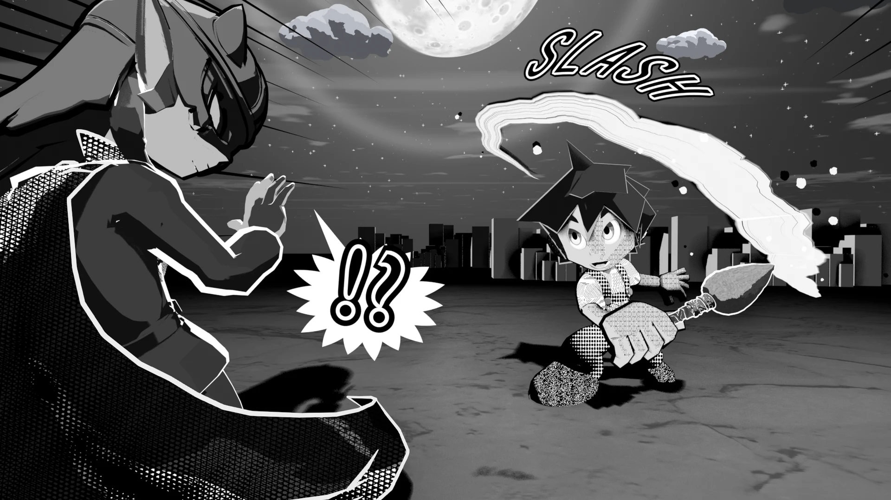

# <i class="bi bi-chat-fill"></i> Manga Toon Speech Bubbles（吹き出し） NEW {data-toc-label="Manga Toon Speech Bubbles（吹き出し）"}

<figure class="ms-page-hero"></figure>

MTSB（案） · Geometry Nodes › MTS Balloon

吹き出しは1つのジオメトリノード「MTS Balloon」で、カメラの子として<strong>画面に貼り付きます</strong>。位置と大きさは画面が基準（長さの単位は画面の高さ、位置は画面の 0〜1）なので、焦点距離を変えても画面上で同じに見えます。セリフの文字は、デザインアプリで入れる前提の「形」です。

通常（楕円）

叫び（トゲ）

思考（もこもこ）

ナレーション（四角）

## <i class="bi bi-layers-fill"></i> 概要図 Layer stack

4つの形（通常・叫び・思考・ナレーション）は「形」で選ぶだけの分類で、どれも同じ層の重なりでできています。

!!! bubble "輪郭線は「輪郭線」パネルで"
    吹き出しのジオメトリは塗りだけです。線は、ほかのオブジェクトと同じく輪郭線パネルで付けます。

## <i class="bi bi-sliders2"></i> パネルと数値 Inputs

| パネル | 項目 | 英語名 | 内容 |
|---|---|---|---|
| — | 形 | `Shape` | 0 = 通常、1 = 叫び、2 = 思考、3 = ナレーション |
| — | 線の種類 | `Edge Style` | 0 = 実線、1 = 点線（ささやき）、2 = 震え線 |
| — | しっぽの形 | `Tail Shape` | 0 = まっすぐ、1 = ギザギザ（電子音・電話） |
| 吹き出し | 中心 X ／ 中心 Y | `Center X / Y` | 画面上の中心（0 = 左・下、1 = 右・上） |
| 吹き出し | 幅 ／ 高さ | `Width / Height` | 大きさ（1 = 画面の高さ） |
| 吹き出し | 回転 | `Rotation` | 吹き出しの傾き |
| 吹き出し | トゲの数 ／ トゲの長さ | `Spikes / Spike Depth` | 叫びのトゲ |
| 吹き出し | もこもこの数 ／ もこもこの丸み | `Bumps / Bump Depth` | 思考のもこもこ |
| 吹き出し | 角の丸み | `Corner Roundness` | ナレーションの角 |
| 吹き出し | ばらつき | `Randomness` | トゲ・もこもこの不ぞろい |
| しっぽ | しっぽを表示 | `Show Tail` | 話し手を指すしっぽ |
| しっぽ | しっぽの先 X ／ Y | `Tail X / Y` | しっぽの先の位置（画面の 0〜1） |
| しっぽ | しっぽの太さ | `Tail Width` | 付け根の太さ |
| しっぽ | しっぽの曲がり | `Tail Bend` | 0 = まっすぐ |
| しっぽ | しっぽをパスで描く | `Use Tail Path` | 編集できるパスに沿ったしっぽ |
| 見た目 | 中の色 | `Fill Color` | 白 = ふつう、黒 = ベタの吹き出し |
| 見た目 | 奥行き | `Depth` | カメラからの距離。小さくして何よりも手前に |
| アニメーション | シード ／ ボイル間隔 | `Seed / Boil Interval` | ばらつきの模様 ／ N フレームごとに描き直す |

吹き出しの使い方は [機能ガイド › 吹き出し](../guide/bgfx.md) にあります。
