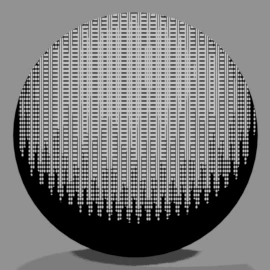
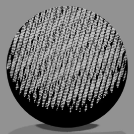
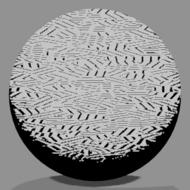
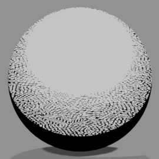
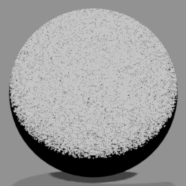
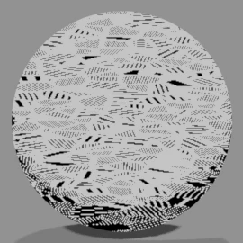
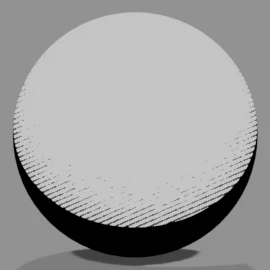
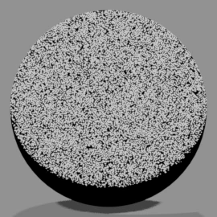
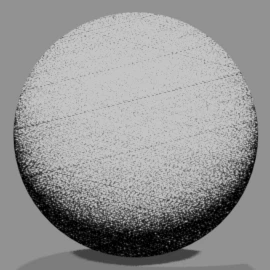

# <i class="bi bi-circle-half"></i> Manga Tone Shaded NEW {data-toc-label="Manga Tone Shaded"}

These are the **shaded tones (9 types)** among the bundled screentone assets. Drop one into a color field of the Manga Tone Shader and that area gets the pattern.

Manga Tone Shaded
The tone reads the lights itself: the pattern is lighter where it is bright and denser where it is dark. The light that matches the layer you put it in is connected automatically. The World has no shading, so you cannot use these for the background.

For tones that fill the whole area whatever the lights do, see [Manga Tone Flat](flat.md).

## <i class="bi bi-grid-fill"></i> Tones

Each one is the shaded version of the Flat tone with the same name. There is no shaded version of Faded Crosshatch.

<b>Dots (Shaded)</b>Screentone Dots

<b>4-Layer Crosshatch (Shaded)</b>Screentone 4-Layer Crosshatch

<b>Crosshatch A (Shaded)</b>Screentone Crosshatch A

<b>Crosshatch B (Shaded)</b>Screentone Crosshatch B

<b>Crosshatch C (Shaded)</b>Screentone Crosshatch C

<b>Pencil Layered Crosshatch (Shaded)</b>Screentone Pencil Layered Crosshatch

<b>Parallel Lines (Shaded)</b>Screentone Parallel Lines

<b>Sand (Shaded)</b>Screentone Sand

<b>Grain (Shaded)</b>Screentone Grain

The images show a sphere with the tone material applied as is.

## <i class="bi bi-hdd-stack-fill"></i> Asset Libraries

<ol class="ms-steps" markdown>
<li markdown>
**Place the folder**

Put the bundled "3D Manga Studios Assets EN" folder (the Japanese version is JP) anywhere you like. It contains the "Manga Tone Flat" and "Manga Tone Shaded" folders.
</li>
<li markdown>
**Add it as an asset library**

In Edit › Preferences › File Paths › Asset Libraries, click "+" and register each folder under the same name (it is handy to register both). This is the same as in the [installation](../getting-started/install.md) steps.
</li>
<li markdown>
**Open it in the Asset Browser**

Split an area, set its editor type to "Asset Browser", and choose "Manga Tone Flat" or "Manga Tone Shaded" in the library field.
</li>
</ol>

## <i class="bi bi-hand-index-fill"></i> Drag &amp; Drop

<ol class="ms-steps" markdown>
<li markdown>
**Open the layer you want to tone**

Select the object and, in Sidebar › Material › Manga Tone Shader, open the layer you want to fill with a tone (Base, Key, Fill or Back).
</li>
<li markdown>
**Drag and drop**

Drop a tone from the Asset Browser onto that layer's "Tone Material" field. You can also pick one from the right side of the field. Remove it to go back to the original color.
</li>
<li markdown>
**Adjust the pattern**

You can change the size, angle and so on of the tone with the inputs of the tone node ("Tone: ...") added in the Shader Editor. The values are carried over from the asset material's settings. Halftone dots are automatically kept round to match the render's aspect ratio.
</li>
</ol>

For a comparison of how tones look in the base tone, see [Manga Tone Shader › Base Tone](mts.md#mts-base-base-tone).

!!! shout "Using materials other than the bundled tones"
    You can drop in materials other than the bundled tones, but the Manga Tone Shader effects may not work correctly. If Blender freezes or the material shows up pink or purple, switch back to a bundled tone.

## <i class="bi bi-sliders2"></i> Inputs

### Pattern inputs

| Tone | Inputs (default) |
|---|---|
| Dots (Shaded) | Radius (0.5), Scale (5), Aspect Ratio (1), Angle (0), Randomness (0), Offset (0), Invert |
| 4-Layer Crosshatch (Shaded) | Scale (50), Width (0.122), Main Angle (76), Angle A–D (55, 100, 145, 190), Invert |
| Crosshatch A (Shaded) | Hatch Scale (2.167), Hatch Width (1), Hatch Angle (45), Pattern Scale (5.333), Pattern Width (2), Invert |
| Crosshatch B (Shaded) | Pattern Scale (5), Hatch Scale (80), Hatch Angle (30), Invert |
| Crosshatch C (Shaded) | Scale (10), Invert |
| Pencil Layered Crosshatch (Shaded) | Hatch Scale (10), Hatch Width (0.5), Hatch Angle (45), Pattern Scale (50), Pattern Width (10), Offset (0), Invert |
| Parallel Lines (Shaded) | Scale (5), Density (5), Fade Amount (0.5), Invert |
| Sand (Shaded) | Noise Brightness (0), Noise Contrast (2), Noise Scale (5), Invert |
| Grain (Shaded) | Size (10), Pattern (0), Pattern Brightness (0), Pattern Contrast (0), Cross Pattern, Invert |

### Shading inputs

| Input | What it does |
|---|---|
| Shader Tone | On: reads the lights and adds shading. Off: a flat pattern, the same as Flat |
| Bright / Contrast | Brightness and contrast of the shading: where the pattern starts to get denser, and how sharp the change is |
| Use Light Strength | Applies the light's strength (Light Strength) to the shading |
| Gloss / Roughness | Adds gloss and sets how far it spreads |
| Light Direction / Light Location / Point Light | Direction, position and type of the light it reads. Filled in automatically from the light that matches the layer |
