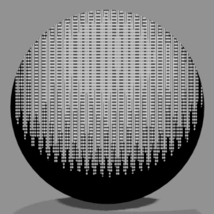
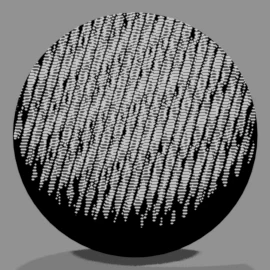
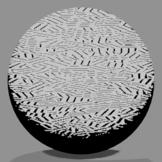
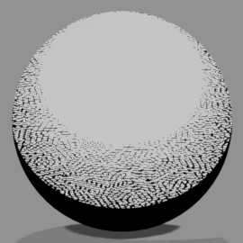
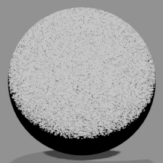
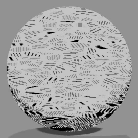
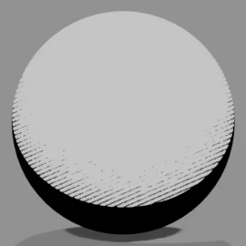
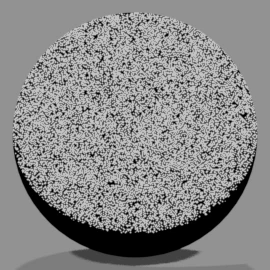
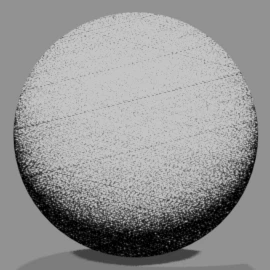

# <i class="bi bi-circle-half"></i> Manga Tone Shaded NEW {data-toc-label="Manga Tone Shaded"}

付属のスクリーントーン素材のうち、**陰影付きのトーン（9種）**です。Manga Tone Shader の色の欄にドロップすると、その面が模様になります。

Manga Tone Shaded
トーン自体がライトを読み、明るい所ほど模様が薄く、暗い所ほど濃くなります。入れた段に合ったライトが自動でつながります。ワールドでは陰影が出ないため、背景には使えません。

ライトに関係なく一面に入るトーンは [Manga Tone Flat](flat.md) です。

## <i class="bi bi-grid-fill"></i> 一覧 Tones

名前の末尾に「（陰影）」が付きます。かすれカケアミトーンの陰影付きはありません。

<b>アミトーン（陰影）</b>Screentone Dots

<b>4カケアミトーン（陰影）</b>Screentone 4-Layer Crosshatch

<b>カケアミトーンA（陰影）</b>Screentone Crosshatch A

<b>カケアミトーンB（陰影）</b>Screentone Crosshatch B

<b>カケアミトーンC（陰影）</b>Screentone Crosshatch C

<b>鉛筆風重ねカケアミトーン（陰影）</b>Screentone Pencil Layered Crosshatch

<b>万線トーン（陰影）</b>Screentone Parallel Lines

<b>砂目トーン（陰影）</b>Screentone Sand

<b>ノイズトーン（陰影）</b>Screentone Grain

画像は、球にトーンのマテリアルをそのまま付けた場合の見た目です。

## <i class="bi bi-hdd-stack-fill"></i> アセットブラウザに登録する Asset Libraries

<ol class="ms-steps" markdown>
<li markdown>
**フォルダを置く**

同梱の「3D Manga Studios Assets JP」（英語版は EN）を任意の場所に置きます。中に「Manga Tone Flat」「Manga Tone Shaded」のフォルダがあります。
</li>
<li markdown>
**アセットライブラリに追加する**

編集 › プリファレンス › ファイルパス › アセットライブラリの「＋」から、フォルダを同じ名前で登録します（2つとも登録しておくと便利です）（[インストール](../getting-started/install.md)の手順と同じです）。
</li>
<li markdown>
**アセットブラウザで開く**

エリアを分割してエディタの種類を「アセットブラウザ」にし、ライブラリの欄で「Manga Tone Flat」または「Manga Tone Shaded」を選びます。
</li>
</ol>

## <i class="bi bi-hand-index-fill"></i> Manga Tone Shader での使い方 Drag &amp; Drop

<ol class="ms-steps" markdown>
<li markdown>
**トーンを入れる段を開く**

オブジェクトを選び、サイドバー › マテリアル › Manga Tone Shader で、トーンにしたい段（ベース・キー・フィル・バック）を開きます。
</li>
<li markdown>
**ドラッグ＆ドロップする**

アセットブラウザのトーンを、その段の「トーンのマテリアル」の欄にドロップします。欄の右から選ぶこともできます。外すと元の色に戻ります。
</li>
<li markdown>
**模様を調整する**

入れたトーンの大きさ・角度などは、シェーダーエディターに追加されたトーンのノード（「Tone: 〜」）の入力で変えられます。値はアセットのマテリアルの設定を引き継ぎます。網点はレンダーの縦横比に合わせて自動で丸く保たれます。
</li>
</ol>

ベーストーンに入れたときの見た目の比較は [Manga Tone Shader › ベーストーン](mts.md#mts-base-base-tone) にあります。

!!! shout "専用のトーン以外を入れるとき"
    付属のトーン以外のマテリアルも入れられますが、Manga Tone Shader の効果が正しくかからないことがあります。Blender が固まったり、マテリアルがピンク・紫で表示されたりする場合は、付属のトーンに戻してください。

## <i class="bi bi-sliders2"></i> 調整できる項目 Inputs

### 模様の項目

| トーン | 項目（既定値） |
|---|---|
| アミトーン（陰影） | Radius（0.5）、Scale（5）、縦横比（1）、Angle（0）、Randomness（0）、Offset（0）、Invert |
| 4カケアミトーン（陰影） | Scale（50）、Width（0.122）、メイン角度（76）、角度 A〜D（55・100・145・190）、Invert |
| カケアミトーンA（陰影） | 斜線のスケール（2.167）、斜線の幅（1）、斜線の角度（45）、パターンのスケール（5.333）、パターンの幅（2）、Invert |
| カケアミトーンB（陰影） | パターンスケール（5）、斜線のスケール（80）、斜線の角度（30）、Invert |
| カケアミトーンC（陰影） | Scale（10）、Invert |
| 鉛筆風重ねカケアミトーン（陰影） | 斜線のスケール（10）、斜線の幅（0.5）、斜線の角度（45）、パターンのスケール（50）、パターンの幅（10）、Offset（0）、Invert |
| 万線トーン（陰影） | Scale（5）、Density（5）、かすれ具合（0.5）、Invert |
| 砂目トーン（陰影） | ノイズの明度（0）、ノイズのコントラスト（2）、ノイズのスケール（5）、Invert |
| ノイズトーン（陰影） | Size（10）、Pattern（0）、パターンの明度（0）、パターンのコントラスト（0）、クロスパターン化、Invert |

### 陰影の項目

| 項目 | 内容 |
|---|---|
| シェーダートーン | オンでライトを読んで陰影を付ける。オフにすると Flat と同じ平らな模様 |
| Bright / Contrast | 陰影の明るさとコントラスト。模様が濃くなり始める位置と、変化のくっきり具合 |
| ライトの強さに合わせる | ライトの強さ（Light Strength）を陰影に反映する |
| Gloss / Roughness | 光沢を足し、その広がりを決める |
| Light Direction / Light Location / Point Light | 読むライトの向き・位置・種類。入れた段に合ったライトから自動で入る |
